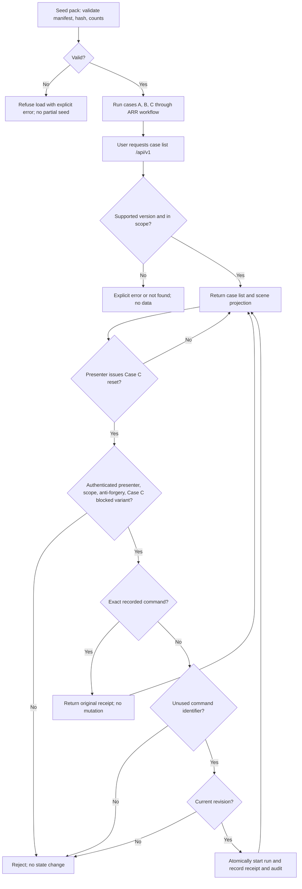

# Aircraft Synthetic Case Pack and Scene Projection API

> **aircraft-case-pack** | Status: Draft | Version: 0.3.0 | Last Updated: 2026-10-14

## Executive Summary

This PRD defines a versioned pack of three synthetic aircraft cases for the Aircraft Return Readiness Demonstrator, the server contracts that expose the pack, and one presenter-only scenario reset command. The pack supplements the single-aircraft core journey of the companion [Aircraft Return Readiness PRD](aircraft-return-readiness.md) (ARR, v0.7.0). ARR remains authoritative for case workflow, roles, permissions, audit, and capability labels.

The pack holds a narrow-body case (Case A, complete missing-evidence request and response journey), a regional case (Case B, ambiguous component identity), and a wide-body case (Case C, complete baseline with one blocked-document variant). The server exposes a read-only, versioned case list and a read-only, versioned scene projection for each case. Demo users receive case scope across all three cases. A presenter can reset the Case C blocked variant through a server-authorized, anti-forgery-protected, audited command.

The pack and its contracts are consumed by the presentation layer in [Aircraft Hangar 3D PRD](aircraft-hangar-3d.md) (HG), and are equally usable by the regular dashboard. This PRD contains no rendering requirements. Its merge is deliberately staged until the ARR prerequisites named in MVP and Release Framing are delivered on the default branch. Acceptance criteria describe future verification and do not claim that fixtures, APIs, or the reset command exist.

## Product Context

The companion demonstrator covers one aircraft. A presenter who wants to compare scenarios side by side has to reload fixtures. A three-case pack lets an audience see different records situations (a missing record, an ambiguous identity, a complete baseline with a blocked document) in one session.

The three aircraft are not a fleet. They do not represent a statistical or operational sample, and no status in the pack establishes readiness, airworthiness, financial approval, legal approval, contractual acceptance, or aircraft release. The frozen 40-case evaluation suite (ARR:DD-033) is a separate fixture and is never exposed in the case pack.

## Users and Personas

| Persona | Primary job | Pain point addressed | Success outcome |
|---|---|---|---|
| Presenter / demo operator | Choose a case, show its path, and restore the Case C blocked variant before the next audience. | Re-seeding the whole demo to repeat one scenario is slow and risks wiping unrelated state. | Resets only the Case C blocked variant, with the reset recorded in the audit history. |
| Technical reviewer (simulated) | Inspect evidence for an assigned case. | Evidence for several aircraft must not leak across case scope. | Sees only the cases in scope, with the same status as the regular dashboard. |
| Executive observer | Compare the three scenarios. | A single indicator hides why cases differ. | Sees the status, owner, and next action of each case. |
| Frontend implementer (consumer) | Build views from stable contracts. | Unversioned or ad hoc responses break clients silently. | Receives a versioned contract that fails explicitly when the version is unsupported. |

All aircraft, records, actors, and decisions are synthetic or simulated.

## Design Decisions

| ID | Decision |
|---|---|
| DD-001 | The case pack is fixture data owned by the server. It is loaded by the existing ASP.NET Core application and never by the client. The pack adds no second workflow owner; cases run through the ARR workflow. |
| DD-002 | The pack holds exactly three cases: Case A, Case B, Case C. Each has one aircraft, one engine, two modeled components, and 8–12 synthetic evidence documents. The pack therefore holds 24–36 documents. |
| DD-003 | The pack is a supplement to the ARR core journey. The ARR scope lines for one aircraft and 8–12 documents apply to the core journey; the pack is governed by this PRD (ARR v0.7.0 addendum). |
| DD-004 | The pack manifest carries a `schemaVersion`, a `packVersion`, a `scenarioDate` (UTC date, fixed, never the system clock, as in ARR:DD-018), and a SHA-256 content hash. Any content change requires a new `packVersion`. The manifest specifies the hashed fields and files, excludes the hash field itself, and documents deterministic serialization. The merge of the fixture pull request, reviewed by the product owner, is the case-pack freeze (as in ARR:DD-033); it does not await HG geometry approval. |
| DD-005 | Read contracts are versioned in the request path (`/api/v1/...`) and in the response body (`contractVersion`). An unsupported version returns an explicit error and no case data. |
| DD-006 | The scene projection is a read-only server projection. It lists, per case, one aircraft object, one engine object, and two component objects, together with the authorized history, evidence witnesses, revision and action permissions defined under Read and command contracts. It is derived from one ARR case revision and carries no business state of its own. |
| DD-007 | Demo users, roles, and case scopes come from the versioned sign-in fixture defined by ARR:DD-014. The pack extends that fixture with scope entries for the three cases. No client-supplied identifier grants access. |
| DD-008 | The scenario reset command applies only to the Case C blocked variant. It starts a new run of that variant and never rewrites history (ARR:DD-027). It is separate from the ARR run-level reset (ARR:FR-010) and does not replace it. |
| DD-009 | Diagnostics use the existing server diagnostics policy (ARR:DD-029). This PRD adds no client telemetry endpoint. |
| DD-010 | Status vocabulary: a case status is the ARR assessment, review, request, and acceptance state shown by ARR:FR-008. The projection reuses those states and adds none. |
| DD-011 | IDs are local to each PRD: `FR-001`, `AC-001`, `NFR-001`, `CON-001`, `DD-001`, and `GOAL-001`. Cross-document references use `ARR:FR-001`, `CP:FR-001`, or `HG:FR-001`, with the corresponding PRD path. Version 0.2.0 removes the draft `CP-` prefixes before any implementation stories exist. |
| DD-012 | The current pipeline creates dependencies only within one PRD plan. The product owner enforces ARR then CP then HG by staging PRD merges, not by relying on prose to create cross-plan issue dependencies. A named person reviews each PRD pull request; no pipeline change is part of this feature. |
| DD-013 | The Aircraft Case Pack integrates against ARR v0.9.2, the contract represented by the companion ARR PRD and default-branch implementation; this replaces the CP PRD's ARR v0.7.0 references. |
| DD-014 | CP API limits: each user may make at most 30 case-list requests per minute, 30 scene requests per minute, and 3 reset requests per minute; commandId accepts 1-64 ASCII letters, digits, hyphens, or underscores. A request above a limit returns 429 without mutation. |
| DD-015 | The executive observer uses a dedicated read-only ARR role scoped to Case A, Case B, and Case C; this decision supersedes the no-new-roles scope boundary only for that role. |
| DD-016 | Complete older-run/current-run history and exact historical evidence remain available through an authenticated ARR read contract that supports case, run, and basis selection; CP adds no separate history endpoint, and implementation waits until the ARR route is present and documented on the default branch. |

## Product Goals

| ID | Goal | Evidence of attainment | Priority |
|---|---|---|---|
| GOAL-001 | Provide three versioned, internally consistent synthetic cases that run through the ARR workflow and are readable through versioned, scope-checked, read-only APIs. | Fixture validation, workflow scenario tests, API contract tests, and negative scope tests all pass. | MUST |
| GOAL-002 | Let a presenter restore the Case C blocked variant safely and traceably without affecting other cases or roles. | Reset command tests including negative cases pass; audit records exist for each accepted reset. | MUST |

Measured at each release-candidate revision. Baseline: no case pack, no case-list API, no scene projection, and no scenario reset exist. Target: all CP acceptance criteria marked Automated pass, and the manual items in the release checklist are recorded.

## Functional Requirements

Unqualified IDs belong to this PRD. Companion IDs are cited as `ARR:` plus the ARR identifier. "Capability labels" means the label table in the ARR Scope Boundaries section.

| ID | Requirement | Actor / trigger | Companion dependencies | Acceptance criteria | Product goals |
|---|---|---|---|---|---|
| FR-001 | Load the case pack from a versioned manifest with a content hash. Refuse to load a pack whose hash, `schemaVersion`, or counts do not match, and report the reason without seeding partial data. | Application seeds fixtures. | ARR:DD-018 (fixed scenario date), ARR:DD-033 (version/hash freeze pattern). | AC-001, AC-002, AC-021 | GOAL-001 |
| FR-002 | Define Case A, Case B, and Case C with the aircraft, engine, two components, 8–12 documents each, fictional registrations and serials, and expected outcomes listed under Synthetic case pack. | Application seeds fixtures. | ARR:FR-001 (evidence basis), ARR:DD-026 (document format). | AC-003 | GOAL-001 |
| FR-003 | Run Case A through the ARR workflow so that it produces one mock request, one linked response, a new basis, and a reassessment that keeps prior history. | Case A is processed and a review/response is recorded. | ARR:FR-002, ARR:FR-003, ARR:FR-005, ARR:DD-021 (request template), ARR:AC-002, ARR:AC-017. | AC-004 | GOAL-001 |
| FR-004 | Run Case B through the ARR workflow so that the ambiguous identity routes to internal review with no external request. | Case B is processed. | ARR:FR-002, ARR:FR-003, ARR:FR-004, ARR:AC-003. | AC-005 | GOAL-001 |
| FR-005 | Run Case C through the ARR workflow so that complete evidence creates no request and no automatic acceptance, and the blocked-document variant stays blocked and retryable. | Case C is processed. | ARR:FR-001, ARR:FR-002, ARR:FR-003, ARR:AC-001, ARR:AC-004. | AC-006 | GOAL-001 |
| FR-006 | Serve a read-only, versioned case list that returns only the cases in the signed-in user's scope, with the fields and errors defined under Read and command contracts. | Authenticated user requests the case list. | ARR:DD-014 (sign-in and scope), ARR:FR-008, ARR:FR-013, ARR:NFR-001, ARR:NFR-008. | AC-007, AC-008, AC-020, AC-025 | GOAL-001 |
| FR-007 | Serve a read-only, versioned scene projection per case containing the four modeled objects, current revision, permitted actions, bounded ordered history and versioned document/witness references defined under Read and command contracts, filtered for the signed-in role. | Authenticated user requests a case projection. | ARR:FR-008, ARR:FR-013 (capability labels), ARR:NFR-008. | AC-009, AC-010, AC-011, AC-020, AC-024, AC-026, AC-027, AC-028 | GOAL-001 |
| FR-008 | Grant seeded demo users case scope across all three cases according to their role, and reject any case identifier outside the user's scope. | Authenticated user requests a case or projection. | ARR:DD-014, ARR:NFR-001, ARR:AC-009. | AC-012, AC-013 | GOAL-001 |
| FR-009 | Accept a scenario reset command for the Case C blocked variant only from a signed-in presenter in scope, with a valid anti-forgery token and the current case revision, and write one audit record per accepted reset. Exact replays return their original receipt; conflicting command identifiers fail without mutation. | Presenter issues the reset command. | ARR:DD-014, ARR:DD-023, ARR:DD-027 (append-only audit), ARR:DD-028 (anti-forgery), ARR:FR-010, ARR:NFR-008, ARR:AC-005. | AC-014, AC-015, AC-016, AC-023 | GOAL-002 |
| FR-010 | Record pack provenance: every document and case carries a synthetic marker and generator reference, the manifest names the product-owner review, and the 40-case evaluation suite is never part of the pack. | Application seeds fixtures; product owner reviews the fixture pull request. | ARR:CON-001, ARR:DD-033. | AC-008, AC-017, AC-018, AC-019 | GOAL-001 |
| FR-011 | Emit pack-load, case-list, projection and reset outcomes through the existing server diagnostics filter, without document content or authentication secrets. | A load, read or reset completes or fails. | ARR:DD-029, ARR:NFR-002, ARR:NFR-004. | AC-022 | GOAL-001 |

## Scope Boundaries

### In scope

- A three-case synthetic fixture pack with manifest, version, hash, and provenance.
- Seed data for the demo user scope entries covering the three cases.
- A versioned read-only case-list API and a versioned read-only scene projection API.
- A presenter-only scenario reset command for the Case C blocked variant, with an audit record.
- Workflow scenario tests that run each case through the ARR workflow.

### Out of scope

- Any rendering, 3D scene, camera, or client behavior (see HG).
- New workflow states, new roles, new capability labels, or a new authorization model.
- Fleet management, importing real fleets, or presenting the three cases as a representative sample.
- A client telemetry endpoint of any kind.
- Reset of Case A or Case B, or any reset that rewrites history.
- The frozen 40-case evaluation suite, which stays a separate fixture (ARR:DD-033).
- Real customer, airline, aircraft, maintenance, or personal data; real partner communications.

### Synthetic case pack

Each case has one engine and two modeled components. The pack therefore has 12 modeled objects in total (per case: one aircraft, one engine, two components). The `scenarioDate` is a fixed UTC date written in the manifest; the fixture story sets it equal to the ARR fixture as-of date, and the product owner confirms it in the fixture pull request.

| Case | Aircraft category | Main path | Required observable outcome |
|---|---|---|---|
| Case A | Narrow-body passenger aircraft | Clear missing-history finding, one eligible mock request, linked mock response, new evidence basis, reassessment. | The history shows the former basis and the current basis; exactly one request exists. |
| Case B | Regional passenger aircraft | Ambiguous engine or component identity. | The evidence conflict, the internal review owner, and zero external requests for the ambiguous finding. |
| Case C | Wide-body passenger aircraft | Complete baseline plus one document variant that is blocked (unprocessed). | The baseline creates no request and no automatic acceptance; the blocked variant stays blocked and retryable until the presenter resets or retries it. |

Registrations and serial numbers are fictional and carry no manufacturer marks.

### Read and command contracts

The first contract is version `1`. Authenticated `GET /api/v1/cases` returns the case list; `GET /api/v1/cases/{caseId}/scene` returns one scene projection. `POST /api/v1/cases/{caseId}/reset-blocked-variant` is the only new mutation. Unsupported `/api/v{version}/` reads return 400 with code `unsupported_contract_version`; unauthenticated reads return 401 and never include case data. Successful reads and error envelopes carry integer `contractVersion: 1`.

| Type / field | Type and meaning |
|---|---|
| Case-list envelope | `contractVersion: integer`, `packVersion: string`, `cases: CaseSummary[]`. It contains only role-visible, in-scope case summaries. |
| CaseSummary | `caseId: string`, `name: string`, `aircraftCategory: narrow-body / regional / wide-body`, `caseRevision: nonnegative integer`, `currentRunId: string`, `status: CaseStates`, `owner: string or null`, `nextAction: ActionSummary or null`, `activityId: string or null`, `capabilityLabel: CapabilityLabel`, `synthetic: true`. |
| CaseStates | Six named fields: `assessment`, `review`, `request`, `finance`, `legal`, `acceptance`. Each value is an existing ARR state token or null when not applicable. No overall approval score or new workflow state is derived. |
| CapabilityLabel | One of `AI agent`, `Rules-based`, `Simulated`, `Design-only`, `Unknown`. It labels the named activity, not the aircraft's approval; absent or unrecognized activity labels yield `Unknown`. ARR's unresolved-label rules still apply: no substitute count, action or owner is derived. |
| ActionSummary | `actionId: string`, `text: string`; an existing ARR action identifier or `resetBlockedVariant`. These are descriptions, not authority to execute. |
| Scene envelope | `contractVersion: integer`, `packVersion: string`, `scenarioDate: YYYY-MM-DD UTC date`, `case: CaseSummary`, `allowedActions: string[]`, `canResetBlockedVariant: boolean`, `objects: SceneObject[]`, `history: JourneyEvent[]`, `olderHistoryAvailable: boolean`, `documentRefs: EvidenceReference[]`, `evidence: EvidenceWitness[]`. Every field is projected from the same `caseRevision`. |
| SceneObject | `objectId: string`, `kind: aircraft / engine / component`, `caseId: string`, `displayName: string`, `status: CaseStates`, `owner: string or null`, `nextAction: ActionSummary or null`, `activityId: string or null`, `capabilityLabel: CapabilityLabel`, `evidenceIds: string[]`. Each `evidenceIds` entry references `EvidenceReference.evidenceRefId`, never a bare document ID or witness ID. Object IDs are unique within the pack, never scene-generated case identifiers. |
| EvidenceReference | `evidenceRefId: string`, `documentId: string`, `documentVersion: integer`, `basisId: string`, `basisVersion: integer`, `displayLabel: string`, `processingState: existing ARR document-processing token`, `retryable: boolean`, `usableAsEvidence: boolean`. The reference ID identifies this exact document-version/basis tuple within the case. A failed, partial or unprocessed document has `usableAsEvidence: false` and no page witness. |
| JourneyEvent | `eventId: string`, `runId: string`, `sequence: positive integer`, `eventType: existing ARR event token`, `basisId: string or null`, `basisVersion: integer or null`, `actorRole: string`, `summary: string`, `capabilityLabel: CapabilityLabel`, `witnessIds: string[]`. Events are in server-recorded sequence order; retained prior-run history is distinguished by `runId`. |
| EvidenceWitness | `witnessId: string`, `evidenceRefId: string`, `documentId: string`, `documentVersion: integer`, `page: positive integer`, `basisId: string`, `basisVersion: integer`, `displayLabel: string`. It resolves to a usable EvidenceReference with the same document-version/basis tuple and an existing page in that case; a blocked document is not a witness. |
| Reset request | `commandId: nonempty string`, `expectedRevision: nonnegative integer`, `variant: "blocked"`. The session and anti-forgery header identify the caller; actor, time and reason are never accepted from the body. |
| Reset receipt | `contractVersion: 1`, `commandId: string`, `caseId: string`, `priorRevision: integer`, `newRevision: integer`, `newRunId: string`, `auditEventId: string`. The server uses reason code `presenter_reset_blocked_variant`. |
| Error envelope | `contractVersion: 1`, `error: {code: string, message: string}`. No case data or receipt occurs in an authorization or command-conflict error. |

History, document references, witnesses, owners and actions use the ARR server-side role filter. `canResetBlockedVariant` is true only for an in-scope presenter on Case C, and is consistent with `allowedActions`; it is false for every other role or case. Object mappings, histories and references never cross case boundaries. An object's references select exact document versions on the current basis; historic witnesses retain their own original basis/version and are not rebound to the newest document. `documentRefs` includes every object-mapped reference and every reference needed by the returned witnesses.

`history` contains at most the latest 20 authorized events of `currentRunId`, returned in ascending server sequence. `olderHistoryAvailable` is true when authorized prior-run events or earlier current-run events are outside this window. The response includes all witnesses for the returned events; it never silently drops citations to fit the byte limit. If serialization still exceeds 65,536 bytes, it returns 422 `scene_payload_limit` without a partial success envelope. The current case stays usable in the regular UI.

The existing ARR case-history controls and their authenticated read endpoints provide complete older-run/current-run history and exact historical evidence; no second CP history endpoint is added. Their actual routes and support for case/run/basis selection must be recorded in the CP contract documentation and verified at the ARR delivery gate before this PRD is merged. Older history is retained, never deleted to meet the scene budget. A window omission is not proof that an event never occurred.

The scene envelope supplies the hangar's history and citation metadata. Document content and existing review/request/response commands continue to use the ARR endpoints exposed by the dashboard. The CP implementation records their actual routes and request shapes from the default branch in its contract documentation; it adds no duplicate workflow endpoint.

Reset validation order is authentication, role, case scope, anti-forgery, supported case/variant, then replay lookup. An identical stored command for that actor and case returns its original receipt even though its `expectedRevision` is now stale. Reusing the identifier with different actor or payload returns 409 with code `command_id_conflict` and no prior receipt. For a new command, a stale revision returns 409 with code `stale_revision`. Case A or B returns 422; unsupported variants return 422. Every replay still requires the caller's current authorization. An accepted command atomically records the new run, revision, receipt and audit event; a failure records none of them.

Failed pack loading preserves every previously stored case, document version and audit record. Validation happens before publishing the pack; a failure during publication rolls back the new pack's writes and exposes no partial pack. Loading the same version and hash again is a no-op. A stored version with different content is refused; partial-load failure tests include a pre-existing pack and unrelated case data.

## Security Notes

- Trust boundary: the browser is untrusted (ARR Security Notes). The case list, projection, and reset command validate identity, role, case scope, and revision on the server. Case, aircraft, component, and work-item identifiers supplied by the client never grant access; an out-of-scope or unknown identifier returns the same response as a nonexistent one and reveals nothing.
- Data handled: synthetic fixtures only. No credentials, personal data, or real records enter the pack. The manifest hash detects accidental fixture drift; it is not a secret and gives no authenticity guarantee beyond the repository's review gate.
- The reset command requires the session cookie, anti-forgery token (ARR:DD-028), presenter role and case scope before replay lookup. New commands also require the current revision; an authorized exact replay returns its receipt despite the original revision now being stale. Other roles, invalid tokens, out-of-scope/unsupported cases, new commands at stale revisions and conflicting identifiers fail without mutation.
- Audit: each accepted reset writes one append-only audit record (ARR:DD-027) with actor, case, prior revision, new revision, time, and the fixed reason code. Diagnostics stay separate from audit (ARR:NFR-004) and never hold document text, cookies, or tokens (ARR:DD-029).
- The projection and case-list endpoints accept GET only. Unsupported contract versions return an explicit error and no case data.
- Capability labels come from the server. A missing or unrecognized label is returned as `Unknown`, never inferred (ARR Capability labels).

## Non-Functional Requirements

### Performance and Capacity

**NFR-001 — Performance and Capacity.** In an in-process ASP.NET integration host with temporary stores and the three-case fixture, each read endpoint responds in 1 second or less at the 95th percentile over 100 sequential measured requests following one warm-up request. Sign-in and seeding occur before measurement; no live model or cloud service is called. P95 is the 95th sorted sample, measured with a monotonic clock. Each scene response is at most 65,536 UTF-8 bytes before compression. Verification: AC-020, Automated.

### Reliability and Resilience

**NFR-002 — Reliability and Resilience.** Failed loading preserves pre-existing database and blob data and leaves no published partial pack. An authorized exact reset replay returns the original receipt, including after its first acceptance changed the revision; it creates no second run, revision or audit record. Verification: AC-001, AC-002, AC-016, AC-021, AC-023, Automated.

### Security

**NFR-003 — Security.** Every read and command enforces authentication, role and case scope; commands also require anti-forgery and current-revision validation, with exact replay handled as specified above (ARR:NFR-001, ARR:NFR-008). Reads return the current server revision without requiring a client revision. An unauthorized or out-of-scope request reveals no protected data and changes no state. Verification: AC-008, AC-013, AC-015, AC-023, Automated.

### Privacy

**NFR-004 — Privacy.** Fixtures and examples hold synthetic data only. Logs and diagnostics record identifiers, contract version, outcome and duration, and never document text, cookies, passcodes or tokens (ARR:DD-029, ARR:NFR-002). Verification: AC-017, AC-022, Automated; content review is AC-019.

### Scalability and Elasticity

No fleet-scale or dynamic fleet import is required. The pack supports exactly three cases and 12 modeled objects.

### Maintainability and Operability

**NFR-005 — Maintainability and Operability.** Manifest and response schemas are documented in `docs/`. Fixture or mapping changes require a new `packVersion` and hash; breaking response-schema changes require a new path and `contractVersion`. A case-state revision is not a contract-version change. Version changes carry a migration note. Verification: AC-018, AC-026, Automated validators; migration note verified by review.

### Observability

**NFR-006 — Observability.** Pack-load, case-list, projection and reset outcomes, including validation/version failure and replay, use the ARR diagnostics policy (ARR:DD-029). Allowed fields are `caseId`, `commandId`, `packVersion`, `contractVersion`, `outcome`, `durationMs`, and `eventType`; absent identifiers are omitted. No new client-to-server telemetry path exists. Verification: AC-022, Automated.

### Usability and Accessibility

Not applicable to this PRD; there is no user interface requirement. Interface accessibility is specified in HG.

### Compatibility and Interoperability

**NFR-007 — Compatibility and Interoperability.** Contracts use `/api/v1/` paths and integer `contractVersion: 1` in successful and error responses. Unsupported requested versions fail explicitly (ARR:NFR-008). Verification: AC-011, AC-025, AC-026, Automated.

### Portability

No requirement beyond the existing application deployment (ARR:NFR-010). The pack ships inside the existing application image; it needs no new host.

## Constraints

| ID | Constraint | Category | Imposing source, authority, affected boundary, and impact |
|---|---|---|---|
| CON-001 | Use synthetic aircraft, evidence, users, and workflow events only. | Organizational | ARR:CON-001; product owner; constrains every fixture. |
| CON-002 | The ARR server remains the authority for lifecycle, permissions, decisions, and capability labels. | Technical | ARR:CON-003, ARR:DD-013; engineering owner; the pack and APIs add no second workflow owner. |
| CON-003 | The pack, APIs, and reset command ship in the existing ASP.NET Core application. | Technical | ARR:DD-006; engineering owner. |
| CON-004 | The frozen 40-case suite stays separate from the pack. | Operational | ARR:DD-033; product owner; evaluation integrity cannot be relaxed without amending ARR's freeze boundary. |
| CON-005 | Demo user scopes come from the ARR:DD-014 sign-in fixture; no new identity mechanism. | Technical | ARR:DD-014, ARR:DD-023; product owner; authentication changes require an ARR amendment, not a CP implementation choice. |
| CON-006 | Merge this PRD only after the named ARR prerequisites exist on the default branch. | Organizational | User decision on 2026-10-14; product owner; staged delivery prevents premature dispatch and is not relaxed within this plan. |

## Process Models

## Acceptance Criteria

Verification values: **Automated** means a vitest, xUnit, or CI check that fails when the behavior is missing. **Manual** means a human check collected in the Release checklist and not story acceptance.

| ID | Given / When / Then acceptance intent | Covers | Verification | Status |
|---|---|---|---|---|
| AC-001 | Given the manifest, when the pack loads, then exactly three cases are seeded with `schemaVersion`, `packVersion`, `scenarioDate`, and a SHA-256 hash that matches the content; a manifest whose content differs from its hash is refused with an explicit error and seeds nothing. | FR-001 | Automated (xUnit) | Not Started |
| AC-002 | Given an unsupported `schemaVersion` or case count other than three, when the pack loads, then an explicit error names the invalid field, no new pack is published, and all pre-existing case and blob data remains unchanged. | FR-001 | Automated (xUnit) | Not Started |
| AC-003 | Given the fixture, when it is validated, then each case has one aircraft, one engine, two components, and 8–12 documents, with a total of 24–36; a case with 7 or 13 documents, a component without an evidence mapping, or a registration not marked fictional fails validation. | FR-002 | Automated (xUnit) | Not Started |
| AC-004 | Given Case A processed through the ARR workflow, when the response is linked, then exactly one request with the ARR:DD-021 template exists, a new basis and reassessment exist, and prior basis history is retained; replaying the same events creates no second request. | FR-003 | Automated (xUnit) | Not Started |
| AC-005 | Given Case B processed, when policy evaluates the ambiguous finding, then an internal review item exists and the request count for that finding is zero; a test that injects a request for it fails. | FR-004 | Automated (xUnit) | Not Started |
| AC-006 | Given Case C processed, when the baseline completes, then no request and no acceptance exists; when the blocked variant is loaded, then the blocked document is visible as blocked and retryable, and it is never counted as evidence or as proven absence. | FR-005 | Automated (xUnit) | Not Started |
| AC-007 | Given an authenticated user scoped to all three cases, when the case list is requested, then all CaseSummary fields match current ARR projections and `contractVersion` is 1; a user scoped to Case A only receives one entry and no out-of-scope identifier. | FR-006 | Automated (xUnit) | Not Started |
| AC-008 | Given the case list endpoint, when a non-GET request, an unauthenticated request, or a request for the 40-case suite is made, then the response is 405, 401, or an absent case respectively, and no state changes. | FR-006, FR-010 | Automated (xUnit) | Not Started |
| AC-009 | Given a case in scope, when its scene projection is requested, then the scene envelope has all fields defined under Read and command contracts, one aircraft, one engine and two components, role-filtered history and witnesses, and a single current revision; a cross-case object or witness is rejected rather than emitted. | FR-007 | Automated (xUnit) | Not Started |
| AC-010 | Given a projection object whose capability label is missing or unrecognized, when the projection is built, then the label is `Unknown`; a mapping to an evidence document outside the case fails fixture validation. | FR-007 | Automated (xUnit) | Not Started |
| AC-011 | Given a request for an unsupported contract version or a non-GET method, when the projection endpoint handles it, then the response is an explicit error (400 with code `unsupported_contract_version`, or 405) with no case data and no state change. | FR-007 | Automated (xUnit) | Not Started |
| AC-012 | Given the seeded demo users, when scope is loaded, then presenter, technical reviewer, and executive observer each have scope for all three cases, and a scope entry that names a nonexistent case fails fixture validation. | FR-008 | Automated (xUnit) | Not Started |
| AC-013 | Given a case, aircraft, component, or work-item identifier supplied by the client, when it is outside the user's scope or does not exist, then the response is the same 404 for both, no protected data is returned, and no mutation occurs. | FR-008 | Automated (xUnit) | Not Started |
| AC-014 | Given the presenter, in scope for Case C, with a valid anti-forgery token and the current revision, when the reset command is issued, then a new Case C blocked-variant run starts, other cases are unchanged, prior history is retained, and exactly one audit record (actor, case, prior revision, new revision, time, reason code) is written. | FR-009 | Automated (xUnit) | Not Started |
| AC-015 | Given a technical reviewer, finance reviewer, legal reviewer, executive observer, or a presenter outside Case C scope, when the reset command is issued, then the response is 403 or 404 respectively, state is unchanged, and no audit record for a reset is written; a missing or invalid anti-forgery token returns 400 with no change. | FR-009 | Automated (xUnit) | Not Started |
| AC-016 | Given a previously accepted reset, when its authorized exact request is replayed with the original now-stale revision, then the original receipt is returned and run, revision and audit count remain unchanged; a new command at that stale revision returns 409, and a Case A or B reset returns 422, both without mutation. | FR-009 | Automated (xUnit) | Not Started |
| AC-017 | Given the manifest, when provenance is validated, then every case and document carries a synthetic marker and generator reference and the manifest names the product-owner review reference; a document without a marker fails validation. | FR-010 | Automated (xUnit) | Not Started |
| AC-018 | Given current and previous fixture manifests and their file contents, when the version validator compares them, then a changed file requires a new `packVersion` and matching hash, and no evaluation-suite case identifier occurs in the pack; unchanged-version content, mismatched hashes and suite identifiers fail explicitly. | FR-010 | Automated (xUnit; comparator takes supplied manifests and contents, not Git or a child process) | Not Started |
| AC-019 | Given the fixture pull request, when the product owner reviews content and expected outcomes before freeze, then the review reference is recorded in the manifest; a pull request without it is not merged by the product owner. | FR-010 | Manual | Not Started |
| AC-020 | Given the integration host and measurement procedure in NFR-001, when the case list and each case projection are measured, then P95 is at most 1 second and each projection is at most 65,536 UTF-8 bytes; an oversized projection fails the size check and a measured threshold violation fails the timing check. | FR-006, FR-007 | Automated (xUnit) | Not Started |
| AC-021 | Given an existing pack and unrelated case data, when an injected publication failure occurs after a new document or case write, then no new pack is visible and the stored case/document versions equal the pre-load snapshot; retrying the valid load succeeds once and repeated seeding is a no-op. | FR-001 | Automated (xUnit; injected stores and temporary files, no live cloud service) | Not Started |
| AC-022 | Given successful and failed loads, reads and resets, including replay, when diagnostics are captured, then outcome and monotonic duration are recorded using only the NFR-006 fields; attempted `documentText`, `cookie`, `passcode`, `token` and `prompt` properties are removed by the ARR logging filter. | FR-011 | Automated (xUnit; captured diagnostics sink) | Not Started |
| AC-023 | Given an accepted command identifier, when a different actor or payload reuses it, then 409 `command_id_conflict` returns no receipt and makes no mutation; revoked scope or role rejects even an exact replay, and an injected commit failure stores neither the new run nor its receipt/audit event. | FR-009 | Automated (xUnit) | Not Started |
| AC-024 | Given Case C and the current projection, when reset permission is projected, then only the in-scope presenter has `canResetBlockedVariant: true` and `resetBlockedVariant` in `allowedActions`; other cases/roles have false and no reset action, and missing capability labels create no inferred action. | FR-007 | Automated (xUnit) | Not Started |
| AC-025 | Given authenticated case-list requests, when version 1 is requested, then successful and error envelopes identify contract version 1; version 2 returns 400 `unsupported_contract_version` without case data, and an unauthenticated request returns 401 without case data. | FR-006 | Automated (xUnit) | Not Started |
| AC-026 | Given the scene response schema, when fixtures and responses are validated, then every required field has the declared type, and `history` preserves server sequence, run and basis witnesses; a missing revision, mistyped permission, duplicate object identifier or unresolved witness fails validation. | FR-007 | Automated (xUnit) | Not Started |
| AC-027 | Given 100 retained prior runs and more than 20 events in the current run, when the scene is requested, then only the latest 20 authorized current-run events are returned in order with `olderHistoryAvailable: true`, required witnesses and a response within the byte budget; earlier runs/events remain reachable through the scoped ARR history controls, and excess payload returns 422 without silent citation loss or deleted history. | FR-007 | Automated (xUnit) | Not Started |
| AC-028 | Given two versions of one document on different bases and a blocked document, when references are projected, then object mappings resolve the current-basis tuple while historical witnesses retain the older tuple; blocked references expose processing/retry state without witnesses, and unresolved, cross-case or tuple-mismatched references fail validation. | FR-007 | Automated (xUnit) | Not Started |

## Traceability Matrix

### FR-to-AC Coverage

| FR | Acceptance criteria |
|---|---|
| FR-001 | AC-001, AC-002, AC-021 |
| FR-002 | AC-003 |
| FR-003 | AC-004 |
| FR-004 | AC-005 |
| FR-005 | AC-006 |
| FR-006 | AC-007, AC-008, AC-020, AC-025 |
| FR-007 | AC-009, AC-010, AC-011, AC-020, AC-024, AC-026, AC-027, AC-028 |
| FR-008 | AC-012, AC-013 |
| FR-009 | AC-014, AC-015, AC-016, AC-023 |
| FR-010 | AC-008, AC-017, AC-018, AC-019 |
| FR-011 | AC-022 |

Coverage: 11/11 FRs have one or more AC links (100%; target 80%).

### FR-to-GOAL Alignment

| FR | Product goals |
|---|---|
| FR-001 | GOAL-001 |
| FR-002 | GOAL-001 |
| FR-003 | GOAL-001 |
| FR-004 | GOAL-001 |
| FR-005 | GOAL-001 |
| FR-006 | GOAL-001 |
| FR-007 | GOAL-001 |
| FR-008 | GOAL-001 |
| FR-009 | GOAL-002 |
| FR-010 | GOAL-001 |
| FR-011 | GOAL-001 |

Coverage: 11/11 FRs have one or more GOAL links (100%; target 100%).

### NFR verification links

| NFR | Acceptance criteria |
|---|---|
| NFR-001 | AC-020, AC-027 |
| NFR-002 | AC-001, AC-002, AC-016, AC-021, AC-023 |
| NFR-003 | AC-008, AC-013, AC-015, AC-023, AC-024 |
| NFR-004 | AC-017, AC-019, AC-022 |
| NFR-005 | AC-018, AC-026, AC-028; migration note verified by review |
| NFR-006 | AC-022 |
| NFR-007 | AC-011, AC-025, AC-026, AC-027, AC-028 |

## MVP and Release Framing

The release contains FR-001 through FR-011. **Do not merge this PRD while its ARR prerequisites are undelivered.** Before approval, the product owner verifies default-branch code and passing behavior tests for ARR:FR-001, ARR:FR-002, ARR:FR-003, ARR:FR-004, ARR:FR-005, ARR:FR-008, ARR:FR-010 and ARR:FR-013; ARR:DD-014/ARR:DD-023 sign-in and scopes; ARR:DD-027 persistence/audit; and ARR:DD-028/ARR:DD-029 request protection and filtered diagnostics. A closed issue alone is not delivery evidence. The ARR v0.7.0 amendment is merged first; this CP PRD is merged only after that prerequisite behavior is present.

Merging CP starts its automatic planning. All newly generated `Depends on #N` lines are within the CP plan; ARR is already delivered and is not recreated. Merge HG only after the entire CP pack, APIs, reset and diagnostics behavior is delivered, tested and fixture-approved on the default branch. Draft CP and HG may be reviewed together, but are not merged together. The PR descriptions identify the staged gate and that the ARR addendum adds no CP/HG implementation stories to the ARR plan.

Story-split hints, in dependency order (each is intended to stay under 500 changed lines):

1. Manifest/schema/hash and provenance validators, using test-only miniature inputs; add no partially published production pack (FR-001, FR-010).
2. Case A fixture and workflow scenario test (FR-002, FR-003).
3. Case B fixture and scenario test (FR-002, FR-004).
4. Case C fixture, blocked variant and scenario test (FR-002, FR-005).
5. Atomic pack publication, rollback and repeat-seed handling; depends on all three case fixtures (FR-001).
6. Demo user scope entries and validator (FR-008).
7. Case list API, including version/method/auth errors and response schema (FR-006).
8. Projection builder/schema with role-filtered history, witnesses, revisions and permissions, tested without exposing a new endpoint (FR-007).
9. Scene projection endpoint with scope/version/method checks and payload measurement (FR-007).
10. Atomic reset/replay application operation and receipt store, tested without exposing a new HTTP command (FR-009).
11. Reset endpoint: authorization, anti-forgery, revision/replay/conflict handling and audit are required in its first exposed implementation (FR-009).
12. Server diagnostics/filter tests and fixture-version comparator (FR-011, FR-010).

Fixture data lives under `backend/AirlineDemo.Api/Fixtures/`; behavior tests live under `backend/AirlineDemo.Api.Tests/`. Contract documentation lives under `docs/`. Every implementation story names the exact files and a test that fails against the pre-change default branch. Validator and application-operation stories create testable logic before endpoint stories; no endpoint is temporarily shipped without its required checks. Split further when code plus tests approaches 500 changed lines. Tests use temporary stores and injected providers, never live models, Azure provisioning or unit-test child processes.

The existing pipeline test profile runs xUnit and Vitest; validators are exercised there, not in an unnamed CI job. This PRD requires no `.github/` or other CI-file changes. Documentation/content inspection criteria use `Verified by review.` and are not presented as unit-test proof of a human approval.

### Release checklist (manual verification)

These items are recorded by the product owner at each release candidate. They are not story acceptance.

| ID | Check | Covers |
|---|---|---|
| RC-001 | Product owner reviews fixture content and expected outcomes before freeze (AC-019). Evidence: the pull request review. | FR-010 |

## Success Metrics

| Goal | Indicator | Baseline | Target | Measurement window | Evidence |
|---|---|---|---|---|---|
| GOAL-001 | Automated criteria other than reset command criteria (AC-014, AC-015, AC-016, AC-023); cases reaching their expected outcomes. | No pack behavior is accepted yet. | All 23 applicable automated criteria pass; 3 of 3 cases reach their expected outcomes on 2 consecutive runs at the same revision; RC-001 is recorded. | Each release-candidate revision. | Test results, pack version/hash, review record. |
| GOAL-002 | Reset command criteria (AC-014, AC-015, AC-016, AC-023); audit records for accepted resets. | No reset behavior is accepted yet. | 4 of 4 pass; one audit record per accepted reset and none added for replay or rejection. | Each release-candidate revision. | Test results, audit query. |

## Risks and Assumptions

### Key Assumptions

| ID | Assumption | Evidence status | Impact if false | Mitigation | Source |
|---|---|---|---|---|---|
| AS-001 | Three cases give enough variety to show the three records situations. | Untested | The audience sees too little or infers a fleet. | Rehearse with representative observers; keep the "not a fleet" statement in every consumer. | Product hypothesis |
| AS-002 | ARR provides the investigation, case, request, response and reassessment behavior needed by the pack. | Prerequisite delivery must be verified | CP cannot be safely dispatched. | Default-branch evidence is required before merging this PRD. | ARR MVP |
| AS-003 | The ARR sign-in fixture provides the named demo roles and case scopes. | Prerequisite delivery must be verified | Scope integration needs rework. | Verify existing roles before merge; AC-012 checks added scope entries. | ARR:DD-014 |

### Research Finding Dispositions

| Finding | Disposition |
|---|---|
| Scope conflict and missing dependencies | Core scope is amended separately; staged merges require delivered ARR behavior before CP planning. |
| Identifier/parser incompatibility | Canonical local IDs and parser-compatible NFR headings replace the 0.1.0 draft prefixes. |
| Missing contract fields and conflicting reset/load criteria | Read and command contracts define permissions, history, witnesses, replay precedence and preservation of existing data. |
| Missing verification and unsafe story boundaries | NFR-to-AC links, runnable validator tests and complete first-exposed endpoint protections are specified. |

### Risk Register

| Risk | Probability | Impact | Mitigation |
|---|---|---|---|
| Fixture cases drift from workflow rules. | Medium | High | Version and hash fixtures; scenario tests run each case through the ARR workflow (AC-004 to AC-006). |
| The reset command is abused to hide history. | Low | High | Presenter-only, audited, history retained, Case C only (AC-014 to AC-016). |
| Cross-case data exposure through identifiers. | Low | High | Scope check on every read; identical 404 (AC-013). |
| A consumer reads an unknown contract version as a valid one. | Medium | Medium | Explicit version error (AC-011) and HG:AC-009. |
| The pack is mistaken for a fleet or an approval. | Medium | High | Synthetic labels, "not a fleet" statement, ARR capability labels. |

## Glossary

| Term | Definition |
|---|---|
| Case pack | The versioned fixture holding the three synthetic aircraft cases, documents, expected outcomes, and provenance. |
| Scene projection | A read-only, versioned server projection of one case as an aircraft, an engine, and two component objects with status, owner, next action, capability label, and evidence mapping. |
| Scenario reset | The presenter-only command that starts a new run of the Case C blocked variant. |
| Contract version | The `contractVersion` value in every case-list and projection response. |
| ARR | The companion Aircraft Return Readiness PRD. |

## Sign-Off

### Approval Checklist

* Product Sponsor: Not assigned.
* Product Owner: Not assigned.
* Technical Lead: Not assigned.
* Quality Lead: Not assigned.
* Legal/Compliance: Not assigned; synthetic data only, subject to normal review.

Approval date: Not approved.

### Waivers

None requested.

### Handoff Readiness

Draft only. No implementation story is approved until the named person approves this PRD pull request, the ARR v0.7.0 amendment is merged, and the default-branch prerequisite delivery gate in MVP and Release Framing is satisfied. A later HG merge is a separate human gate after CP delivery and fixture review. This document records requirements, not a claim that either prerequisite gate has passed.

## Disclaimer

This document defines draft requirements for a fictional, synthetic demonstrator. It is not business sign-off, security approval, authorization to provision or spend, publication approval, implementation or runtime evidence, certification evidence, or production-readiness approval. No real-world airworthiness, legal, regulatory, operational, or commercial conclusion may be inferred from the synthetic scenario or future demo results.

## Document Metadata

* Template Version: 1.0.0.
* Canonical Template: `docs/templates/prd-template.md`.
* Companion PRDs: [Aircraft Return Readiness](aircraft-return-readiness.md) (ARR, v0.7.0); [Aircraft Hangar 3D](aircraft-hangar-3d.md) (HG, consumer).
* Derived from the untracked draft `aircraft-hangar-demo-mode` v0.1.0, which this PRD and HG replace.
* License: CC-BY 4.0 (Microsoft HVE-Core).
* Attribution: Microsoft HVE-Core Team.
