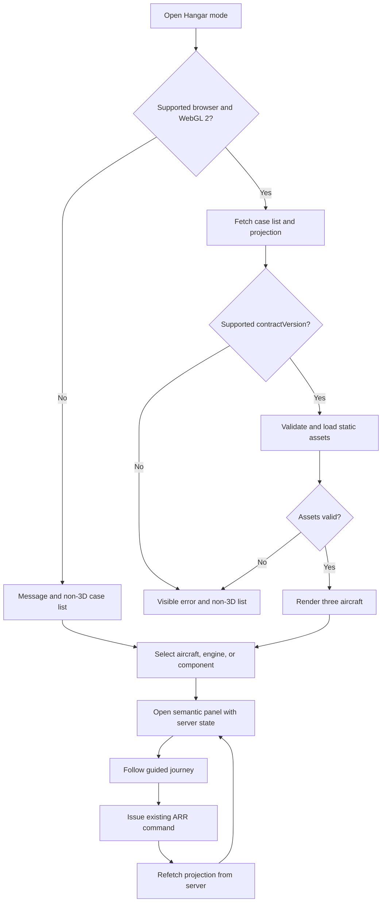

# Aircraft Hangar 3D Presentation Layer

> **aircraft-hangar-3d** | Status: Draft | Version: 0.2.1 | Last Updated: 2026-10-14

## Executive Summary

This PRD defines a browser-based 3D hangar presentation layer for the Aircraft Return Readiness Demonstrator. A presenter or reviewer sees the three synthetic aircraft cases of the [Aircraft Case Pack PRD](aircraft-case-pack.md) (CP) in a stylized hangar, selects an aircraft, engine, or component, and opens the matching evidence and work in conventional panels. A guided journey explains each real workflow transition in context.

The layer is a presentation surface over the server-owned case data and commands of the companion [Aircraft Return Readiness PRD](aircraft-return-readiness.md) (ARR, v0.7.0) and the read-only contracts defined in CP. It does not simulate aircraft operation, determine airworthiness, or grant authority. A non-3D equivalent, reduced-motion behavior, and keyboard access are part of the requirements. The renderer candidate is Three.js with React Three Fiber in the existing React client.

Dependency order is enforced by staged PRD merges: ARR prerequisites are delivered first, then CP is merged and delivered, then HG is merged. Draft documents can be reviewed together but are not merged together. This is a draft proposal. Acceptance criteria describe future verification and do not claim that any scene, asset, or demo exists.

## Product Context

The regular dashboard (ARR:FR-013) serves the work well, but it gives a presenter little help in showing several cases at once and how a finding on an aircraft or component leads to a review. The hangar offers a spatial overview and a memorable way into a case. Aircraft are selectable case entry points, not fleet objects. The three aircraft are not a representative fleet, and their statuses do not establish readiness, airworthiness, financial approval, legal approval, contractual acceptance, or aircraft release.

The value hypothesis (AS-001) that a spatial overview aids comprehension is untested; the non-3D equivalent keeps the demo usable if it is false.

The frontend today is a health-check stub. Almost everything the hangar relies on (dashboard, case, and evidence panels) is built by ARR stories first.

## Users and Personas

| Persona | Primary job | Pain point addressed | Success outcome |
|---|---|---|---|
| Presenter / demo operator | Give a guided overview, enter a case, show why the next step is required. | A dashboard is slow for explaining relationships between cases. | Moves from overview to a source-backed finding without losing the audience. |
| Technical reviewer (simulated) | Inspect an assigned evidence issue and record a current-basis decision. | Visual status must not hide source evidence or imply a model accepted evidence. | Opens the real evidence review from an aircraft or component. |
| Executive observer | Compare the three scenarios. | A single indicator conceals uncertainty. | Understands why cases differ and what moves each forward. |
| Keyboard or assistive-technology user | Complete the same tasks without a pointer or without 3D. | A 3D scene is not operable without a mouse. | Completes the journey with the keyboard or the non-3D list. |

## Design Decisions

| ID | Decision |
|---|---|
| DD-001 | The hangar is a presentation mode in the existing React client (ARR:DD-013). CP provides scene state, permissions, a bounded current-run history window and exact document/witness references. Full retained history, document content and review/request/response actions use delivered ARR endpoints and controls. The only new command is CP's reset; no duplicate workflow or history endpoint is added. |
| DD-002 | Renderer candidate: Three.js with `@react-three/fiber`. `@react-three/fiber` 9.8.1 is pinned because its peer range accepts React `>=19 <19.4` and `three >=0.156`, and the repository pins React 19.3.0 (verified 2026-10-14). The story that adds `three` pins one exact version inside that range and records it with the reason. No other 3D helper package is added unless its story names it with a reason. |
| DD-003 | Aircraft and component geometry is illustrative: generic fictional silhouettes with no manufacturer marks and no claim of engineering accuracy. |
| DD-004 | The scene shows the status, owner, next action, and capability label from the server projection. Color, position, animation, and client state never create or upgrade a status or enable a command. |
| DD-005 | Detailed evidence, status, decisions, and next actions appear in semantic HTML panels and the regular case UI. No meaning is carried by color alone. |
| DD-006 | Navigation is point-and-select, bounded orbit, preset camera positions and keyboard as specified under Camera controls. There is no free-roam or first-person movement. |
| DD-007 | No points, scores, rewards, or game mechanics. |
| DD-008 | Reduced motion is on when the browser reports `prefers-reduced-motion: reduce`, and the user can override it in either direction with an in-app control for the browser session. |
| DD-009 | Diagnostics use the existing server diagnostics policy (ARR:DD-029). The client sends no telemetry. Render time, capability result, and fallback reason appear only in a local, in-app diagnostics panel for the presenter and are never transmitted. |
| DD-010 | Scene assets are static, same-origin GLB version 2 files with embedded buffers and PNG/JPEG textures. The glTF extension allowlist is empty in the first release. External buffers/textures, Draco, KTX2, Basis, WebAssembly and parser plugins are not used. |
| DD-011 | The demo laptop and browser baseline is defined in this PRD under Demo baseline and applies to every manual check. |
| DD-012 | Vitest runs in jsdom, which has no WebGL. Automated tests cover view models, controllers, validators, and panels with the canvas component replaced by a stub. Rendering on real WebGL is verified only in the Release checklist. |
| DD-013 | IDs are document-local canonical IDs, qualified as `CP:FR-007` or `ARR:FR-013` for cross-document references. Version 0.2.0 replaces the draft `HG-` prefixes before any implementation stories exist. |
| DD-014 | The product owner accepted the minimum demo baseline and size budgets on 2026-10-14. They are acceptance targets, not measured performance results. Actual hardware, operating system, GPU and browser versions are recorded in each release check. |
| DD-015 | The user-approved scene asset allowlist is project-authored models/textures with a recorded rights declaration, plus assets with a verified `CC0-1.0` grant. Attribution-required or unknown rights are not permitted in this release. This is separate from software package licences. |
| DD-016 | The HG merge gate requires the complete CP behavior and fixture approval on the default branch, plus the named ARR endpoints used by the dashboard. Cross-PRD dependency prose is not treated as an automatically enforced issue dependency. |

## Product Goals

| ID | Goal | Evidence of attainment | Priority |
|---|---|---|---|
| GOAL-001 | Enable a presenter to guide an audience from a three-aircraft overview to a source-backed case decision and its resulting workflow state, with an equivalent non-3D path. | Automated acceptance criteria pass; the Release checklist records a rehearsal of at most five minutes, assistive-technology smoke checks, and timing on the demo baseline. | MUST |

Baseline: no hangar exists. Target: all Automated HG acceptance criteria pass at each release-candidate revision, and every Release checklist item is recorded. The five-minute figure is a demo pacing target, not a workflow SLA.

### Demo baseline and measurement procedure

The user-confirmed minimum baseline is a laptop with 4 logical CPU cores, 8 GB memory, an integrated GPU providing WebGL 2, and a 1920x1080 display. Supported 3D browsers are the current and previous stable major versions of both Chrome and Edge at the release-candidate date. Pin and record those four tested versions in the release evidence; they do not drift during one assessment. The operating system and actual CPU/GPU models are recorded. Other browsers get the non-3D equivalent; browser eligibility is detected separately from WebGL capability.

Measure the production build served by the local application on that device, with seeded cases, a signed-in session and no live model call. For each supported browser version, perform five Hangar openings with the browser asset cache cleared before each. Time from entry activation until the first rendered aircraft can be selected and its semantic controls are ready; every successful opening must take at most 8 seconds. A fallback/error is recorded as a failed 3D sample, never as a fast successful render.

After assets load, measure 100 aircraft/engine/component activations, distributed over all 12 objects, from input activation to the corresponding semantic panel's next painted state. Sort the samples; the 95th is P95 and must be at most 500 ms. Record sample durations, cold/warm cache state, browser/device details and failures. The five-minute rehearsal timer includes navigation and the real synthetic workflow commands; it does not substitute for these latency checks.

## Functional Requirements

Unqualified IDs belong to this PRD. Companion IDs are cited as `ARR:` or `CP:` plus the identifier. ARR and CP commands exist before the HG PRD merge; HG stories reuse them rather than generating unsupported cross-plan dependencies.

| ID | Requirement | Actor / trigger | Dependencies | Acceptance criteria | Product goals |
|---|---|---|---|---|---|
| FR-001 | Offer a Hangar mode entry that checks supported-browser eligibility and WebGL 2 support and, when either check fails, shows an actionable message and the non-3D case list rather than a blank screen. | Signed-in user opens Hangar mode. | ARR:DD-014, ARR:FR-013, CP:FR-006. | AC-001, AC-020, AC-029 | GOAL-001 |
| FR-002 | Render the in-scope cases from the case list as selectable aircraft with text name, category, six-axis status and activity capability label, using one scene-object mapping per projected identifier. | Scene loads. | CP:FR-006, CP:FR-007, CP:FR-008, ARR:FR-008. | AC-002, AC-021, AC-028 | GOAL-001 |
| FR-003 | On selection of an aircraft, engine, or component, open a panel with the projected status, owner, next action, and mapped evidence. | User selects a scene object. | CP:FR-007, ARR:FR-008, ARR:FR-013. | AC-003, AC-004 | GOAL-001 |
| FR-004 | Provide the bounded orbit, presets and keyboard controls specified under Camera controls, without free-roam movement or trapping input intended for semantic controls. | User navigates the scene. | FR-002. | AC-005, AC-030 | GOAL-001 |
| FR-005 | Present each journey from recorded CP/ARR events and witnesses: Case A finding/review/request/response/new basis/reassessment; Case B internal review without a request; Case C baseline or blocked variant. When CP reports older history, offer the delivered ARR history controls for older runs/events; absence from the window is not absence from the case. Future unrecorded steps stay disabled. | Presenter starts or selects a journey step. | CP:FR-003, CP:FR-004, CP:FR-005, CP:FR-007, ARR:FR-002, ARR:FR-003, ARR:FR-004, ARR:FR-005, ARR:FR-008, ARR:FR-010. | AC-006, AC-007, AC-022, AC-032 | GOAL-001 |
| FR-006 | Refetch scene state after any ARR or CP command issued by this client, on re-entry and on window focus; reject unsupported contracts and mark failed refreshes stale, disabling commands until refreshed. | Command result, re-entry or window focus. | CP:FR-007, CP:NFR-007, ARR:NFR-008. | AC-008, AC-009, AC-031 | GOAL-001 |
| FR-007 | Keep case state intact and avoid duplicate commands when the scene fails to render, an asset fails to load, or the user re-enters the scene. | Render error, asset error, or re-entry. | ARR:NFR-003, ARR:FR-010. | AC-010 | GOAL-001 |
| FR-008 | Provide a non-3D equivalent that lets a user complete every selection, evidence, status, next-step and journey task, including access to full ARR retained history. | User chooses regular mode or 3D is unavailable. | CP:FR-006, CP:FR-007, ARR:FR-013. | AC-011, AC-032 | GOAL-001 |
| FR-009 | Apply reduced motion from `prefers-reduced-motion` and an in-app override. | Browser preference or user toggle. | None beyond FR-004. | AC-012 | GOAL-001 |
| FR-010 | Give every object, status, journey step, and permitted action in the scene a keyboard-operable semantic equivalent with a text label, with visible focus and status not conveyed by color alone. | Keyboard or assistive-technology use. | ARR:NFR-009 (bounded checks). | AC-013, AC-014, AC-023, AC-030 | GOAL-001 |
| FR-011 | Serve the scene as lazy-loaded static same-origin assets within NFR-001's byte budgets, make no runtime third-party request, and extend the content security policy only by the exact directives in the Security Notes. | Application build and request. | ARR:DD-028 (CSP baseline), ARR:DD-017. | AC-015, AC-016, AC-025, AC-027 | GOAL-001 |
| FR-012 | Record provenance and rights for every model/texture according to DD-015, and validate each GLB's structural envelope and JSON metadata before handing it to the renderer loader. | Build and asset load. | ARR:DD-026 (untrusted input stance), DD-010, DD-015. | AC-017, AC-018 | GOAL-001 |
| FR-013 | Pin `three` and `@react-three/fiber` to exact versions with a committed lockfile and include them in the existing dependency audit. | Dependency change. | ARR:DD-017. | AC-019 | GOAL-001 |
| FR-014 | Show a Case C reset control only when the server projection grants it; send `commandId`, `expectedRevision`, `variant: "blocked"` and the anti-forgery token, and refetch after acceptance. Reuse the same command identifier for retry of an uncertain result, not for a deliberate new reset. | Presenter selects or retries reset. | CP:FR-007, CP:FR-009, ARR:DD-028. | AC-024 | GOAL-001 |
| FR-015 | Show the presenter a local diagnostics panel containing scene-load duration, graphics capability and explicit fallback reason, without transmitting diagnostics or granting workflow authority. | Presenter opens local diagnostics. | ARR:DD-029, DD-009. | AC-026 | GOAL-001 |

## Scope Boundaries

### In scope

- A stylized 3D hangar in the existing single-page client showing the three case-pack aircraft.
- Selection of aircraft, engine, and components, opening semantic panels.
- Bounded orbit, preset cameras, keyboard control, reduced motion, and an in-app motion override.
- Guided journeys for Cases A, B, and C, built from server data.
- A non-3D equivalent, a local diagnostics panel, and the presenter reset control.
- Static scene assets with provenance and licence records.

### Out of scope

- Fixtures, case-list and projection APIs, scope, and reset command (see CP).
- Real customer, airline, aircraft, maintenance, or personal data; real partner communications.
- Aircraft physics, flight simulation, engineering-accurate geometry, multiplayer, free-roam movement, scoring, or progression.
- Fleet management or a separate game-engine runtime.
- A client telemetry endpoint.
- Licensed manufacturer liveries or photorealistic models.

### Camera controls

For the active target, let `R` be the positive radius of its bounding sphere. The overview targets the hangar centre; an aircraft preset targets that aircraft's centre. Orbit radius is clamped to `[1.2R, 6R]`; polar angle from the vertical axis is clamped to `[15, 85]` degrees; azimuth wraps modulo 360. An overview preset sets radius `3R` and polar angle 45 degrees; an aircraft preset sets radius `2R` and polar angle 35 degrees. A missing, non-finite or nonpositive radius rejects the preset visibly and retains the last valid camera state.

Only a focused, labelled camera-control region handles keys: Left/Right change azimuth by 10 degrees, Up/Down change polar angle by 5 degrees, `+` divides radius by 1.1 and `-` multiplies it by 1.1, with the same clamps as pointer orbit. Tab moves to ordinary semantic controls and is never captured. Inputs, buttons and evidence panels outside that region receive their normal keyboard behavior. WASD and pointer-lock do not move the camera. Nonessential camera transitions have zero duration when reduced motion is active.

### Asset and contract validation

The release contains three GLB model files, one for each aircraft category, with labelled engine and two component nodes; all textures and buffers are embedded. Each model must match the authored scene manifest. Mesh/node identifiers map to CP `objectId`, never to a guessed case identifier. A shared, renderer-independent scene descriptor supplies both the canvas component and semantic controls; its real mappings and activation handler are exercised by Vitest without WebGL.

GLB validation checks the version-2 header, declared byte length, aligned chunk bounds, a single first JSON chunk and an embedded binary chunk before a renderer loader sees the bytes. JSON is parsed only after enforcing its byte limit. `extensionsUsed` and `extensionsRequired` must be absent or empty. Buffer/image URI fields are absent: all data is embedded, with images identified by buffer view and PNG/JPEG MIME type. Buffer-view and accessor ranges must remain inside the declared buffer; malformed or out-of-range references fail visibly. Unknown nodes cannot dispatch a case action. These checks do not claim to prove geometry accuracy; the visual check remains manual.

The client accepts only CP contract version 1 and validates the typed scene envelope defined in CP, including revision, boolean permission, history, witnesses and object identifiers. A bad field or cross-case mapping is an error, not a success-shaped empty scene. Existing ARR controls supply document content and submit workflow decisions using their already implemented endpoints.

## Security Notes

- Trust boundary: the browser is untrusted. The scene renders server projections and submits existing commands; it cannot set status, label, owner, role, scope, or evidence acceptance. Client-supplied identifiers (scene object IDs, case IDs) never grant access; the server checks scope on every call (CP:FR-008).
- Content security policy (ARR:DD-028 baseline): preserve the baseline directives, change `img-src` to `'self' data: blob:` for embedded-image textures, and add explicit `worker-src 'self'`. These are the exact additions; no worker is required by the asset format. `unsafe-eval`, `unsafe-inline`, `wasm-unsafe-eval`, wildcards and external hosts are forbidden, and `script-src` remains `'self'`. The ARR v0.7.0 addendum makes this PRD the source of the additions only once its staged pull request is approved and merged; this draft is not security approval.
- Untrusted assets: the structural validator above runs before the renderer loader. Each GLB is at most 5 MiB (5,242,880 bytes), all scene assets total at most 15 MiB (15,728,640 bytes), and its JSON chunk is at most 1 MiB (1,048,576 bytes). The glTF extension allowlist is empty; external and data URIs in models are rejected, not fetched. A failing asset shows a visible error and offers the non-3D equivalent. Asset text is rendered as text, never as HTML.
- Asset rights: provenance records include relative asset path, source, author, `rightsBasis` (`Project-authored` or `CC0-1.0`), SHA-256 checksum and a synthetic marker. Project-authored records include a rights declaration; CC0 records include the original grant URL and its human verification reference. Unit tests verify structure and checksum, not the legal authenticity of a grant. The product owner reviews rights before HG release.
- Supply chain: `three` and `@react-three/fiber` are pinned to exact versions with a committed lockfile and are covered by ARR:DD-017's audit and SBOM. A high or critical finding blocks the release candidate unless an exception with reason and expiry is recorded in `docs/` (ARR:DD-017).
- Runtime network: no third-party fetch at presentation time (fonts, textures, models, CDNs). The CSP and a build check both enforce this.
- Diagnostics: no new client telemetry endpoint exists, so no client-to-server abuse surface is added. Server logging follows ARR:DD-029 and excludes document text, cookies, and tokens.
- The reset control is only a client of the CP reset command; authorization stays on the server. A display label or color is never authorization or proof of approval.
- Data handled: synthetic only. No credentials, personal data, or tracking in assets.

## Non-Functional Requirements

### Performance and Capacity

**NFR-001 — Performance and Capacity.** The accepted baseline meets the startup and P95 selection thresholds under Demo baseline and measurement procedure. Hangar-only code/assets are not requested before entry. The total gzip size of all JavaScript chunks introduced solely by opening Hangar is at most 1.5 MiB (1,572,864 bytes), not just the largest chunk; all model/texture assets total at most 15 MiB. Verification: AC-025 and AC-027, Automated validators; production-build integration verified by review; timing is AC-020, Manual.

### Reliability and Resilience

**NFR-002 — Reliability and Resilience.** Render/asset/refresh failure does not mutate case state or block the regular UI. An uncertain reset is not automatically issued as a new command. Verification: AC-010, AC-024, AC-031, Automated.

### Security

**NFR-003 — Security.** All reads retain server authentication/role/scope checks; commands retain anti-forgery and current-revision/replay checks (ARR:NFR-001, CP:NFR-003). Verification: AC-016, AC-018, AC-024 and CP server tests, Automated.

### Privacy

**NFR-004 — Privacy.** Assets/labels contain synthetic data only and diagnostics are not transmitted. Verification: AC-015, AC-017, AC-026, Automated structure/transport checks; rights/content review is RC-007.

### Scalability and Elasticity

The scene supports the three case-pack cases and their 12 modeled objects. No fleet-scale requirement applies.

### Maintainability and Operability

**NFR-005 — Maintainability and Operability.** The scene manifest names its supported CP `contractVersion` and `packVersion`. A fixture mapping change updates the manifest's pack version; a case-state revision does not change the contract version. Unsupported versions and invalid mappings fail visibly. Verification: AC-009, AC-028, Automated.

### Observability

**NFR-006 — Observability.** Local diagnostics show `sceneLoadDurationMs`, `webgl2Available`, `browserSupported` and `fallbackReason` (null on success; `unsupported_browser`, `webgl_unavailable`, `asset_invalid`, `asset_load_failed`, `render_failed`, `contract_invalid` or `refresh_failed` otherwise). Server request logging follows ARR:DD-029. No client telemetry is sent. Verification: AC-026, Automated.

### Usability and Accessibility

**NFR-007 — Usability and Accessibility.** Keyboard, focus, labels, six-axis text status and reduced motion meet FR-009 and FR-010. Automated DOM/controller checks do not prove painted focus, contrast or screen-reader behavior. Formal conformance is not claimed (ARR:DD-020). Verification: AC-012, AC-013, AC-030, Automated; AC-014, AC-023 and RC-003, Manual.

### Compatibility and Interoperability

**NFR-008 — Compatibility and Interoperability.** The 3D mode runs on the accepted browser/device baseline; other browsers receive the non-3D equivalent. The client consumes typed CP version-1 envelopes. Verification: AC-001, AC-009, AC-029, Automated; AC-020 and RC-006, Manual.

### Portability

**NFR-009 — Portability.** The scene ships as static client assets in the existing application image. No separate host/runtime or third-party fetch is required. Verification: AC-015, Automated request-policy checks; production-build same-origin load is RC-006, Manual.

## Constraints

| ID | Constraint | Category | Imposing source, authority, affected boundary, and impact |
|---|---|---|---|
| CON-001 | Synthetic content only. | Organizational | ARR:CON-001; product owner; constrains assets and labels. |
| CON-002 | The server stays authoritative for lifecycle, permissions, decisions, and capability labels. | Technical | ARR:CON-003, CP:CON-002; engineering owner. |
| CON-003 | Integrate into the existing React/Vite client and serve assets from the same origin. | Technical | ARR:DD-013, ARR:DD-028; engineering owner. |
| CON-004 | Every visualized activity keeps the server capability label (AI agent, Rules-based, Simulated, Design-only, or Unknown). | Operational | ARR Capability labels; product owner; the authority/safety boundary is changed only by an ARR amendment. |
| CON-005 | Merge this PRD only after ARR prerequisites and the complete CP behavior and approved fixture exist on the default branch. | Organizational | User decision on 2026-10-14; product owner; staged merges prevent unsupported dispatch and are not relaxed in this plan. |

## Process Models

## Acceptance Criteria

**Automated** means a vitest, xUnit, or CI check that fails when the behavior is missing; the canvas is replaced by a stub in jsdom (DD-012). **Manual** items are collected in the Release checklist and are not story acceptance.

| ID | Given / When / Then acceptance intent | Covers | Verification | Status |
|---|---|---|---|---|
| AC-001 | Given a supported browser whose WebGL 2 probe returns null, when Hangar opens, then an actionable message and the non-3D list appear and no scene canvas is mounted; a working probe on a supported browser mounts the scene. | FR-001 | Automated (vitest; injected graphics probe) | Not Started |
| AC-002 | Given a case list with three entries, when the scene view model builds, then three aircraft entries exist with name, category, status text, and capability label; a user with scope for one case receives one entry, and no unlisted case appears. | FR-002 | Automated (vitest) | Not Started |
| AC-003 | Given a scene object identifier present in the projection, when it is activated, then the panel shows the projected status, owner, next action, and label; an identifier not in the projection opens no panel and sends no request. | FR-003 | Automated (vitest) | Not Started |
| AC-004 | Given a component whose `evidenceIds` resolve through CP `documentRefs`, when selected, then the panel lists those exact document-version/basis tuples and opens their ARR content controls; blocked references show processing/retry status without page witnesses, missing mapping is labelled, and unresolved/cross-case references fail visibly rather than selecting the latest version. | FR-003 | Automated (vitest) | Not Started |
| AC-005 | Given a finite positive target radius, when pointer, preset and keyboard controller inputs run, then radius stays in [1.2R, 6R] and polar angle in [15, 85] degrees, with the specified preset/step values; WASD, pointer-lock and an invalid target radius cannot move the camera, and invalid radius is reported visibly. | FR-004 | Automated (vitest) | Not Started |
| AC-006 | Given Case A scene history, when the journey builds, then recorded finding/review/request/response/basis/reassessment events retain server sequence, run, basis and actor labels; evidence events link their returned page witnesses and other steps link the source event, while absent future events cannot be presented as completed or advanced to. | FR-005 | Automated (vitest) | Not Started |
| AC-007 | Given Case B or Case C, when the journey runs, then Case B shows internal review with no request step and Case C shows no acceptance step, with the blocked variant labeled blocked and retryable; a test that adds a request step to Case B fails. | FR-005 | Automated (vitest) | Not Started |
| AC-008 | Given an ARR or CP command result, re-entry or window focus, when refresh succeeds, then status, owner, next action, label, revision and permissions equal the new scene envelope; an injected client-store change is replaced and unresolved labels never create inferred actions. | FR-006 | Automated (vitest) | Not Started |
| AC-009 | Given a projection whose `contractVersion` is unsupported, when it loads, then a visible error and a link to the non-3D list appear, no scene is built, and the data is never mapped to another case. | FR-006 | Automated (vitest) | Not Started |
| AC-010 | Given a thrown render error or failed asset load, when the error boundary runs, then the fallback panel appears, case state equals the server state, and zero mutation requests are sent; re-entering the scene sends no command a second time for the same command identifier. | FR-007 | Automated (vitest) | Not Started |
| AC-011 | Given 3D disabled, when a user performs select case, view status, view evidence, follow the journey, and open the review action, then each task is available; a task present in 3D and missing in the list fails the test. | FR-008 | Automated (vitest) | Not Started |
| AC-012 | Given `prefers-reduced-motion: reduce`, when the camera moves, then transition duration is zero; the in-app toggle overrides in both directions for the browser session; with reduce on and no override, no animation duration above zero is scheduled. | FR-009 | Automated (vitest) | Not Started |
| AC-013 | Given the semantic layer, when queried by role/name and activated by keyboard, then each scene object, journey step and permitted action has a labelled control and statuses have text; an unlabelled or pointer-only control fails, and focus styles are present without suppressing the outline. Painted focus/contrast and announcements are checked manually. | FR-010 | Automated (vitest) | Not Started |
| AC-014 | Given a screen reader and keyboard only, when a tester completes the guided journey and a decision, then all content and recorded decisions are announced and no keyboard trap exists. | FR-010 | Manual | Not Started |
| AC-015 | Given the hangar's resource request policy and asset manifest, when tested with same-origin and external font/model/texture URLs, then only same-origin resources are requested; external and model-embedded URIs fail explicitly and captured transport calls include no client diagnostics. Production network behavior is verified by review in RC-006. | FR-011 | Automated (vitest; injected transport) | Not Started |
| AC-016 | Given the application response headers, when the CSP is tested, then it equals the ARR:DD-028 policy plus only `img-src blob:` and `worker-src 'self'` as allowed by the Security Notes; `unsafe-eval`, `unsafe-inline`, `wasm-unsafe-eval`, a wildcard, or an external host fails the test. | FR-011 | Automated (xUnit) | Not Started |
| AC-017 | Given asset bytes and provenance records, when the validator runs, then every record names source, author, approved rights basis, checksum and synthetic marker, with a rights declaration or CC0 grant/review reference as appropriate; missing records, bad checksums or unapproved rights fail. Legal authenticity remains RC-007. | FR-012 | Automated (vitest) | Not Started |
| AC-018 | Given a version-2 embedded GLB, when validation runs before the renderer loader, then the declared length/chunks/JSON/buffer ranges and size limits pass; wrong magic/version, oversize, truncation, malformed JSON, any URI, any extension or an out-of-bounds accessor fails visibly with fallback and no loader call. | FR-012 | Automated (vitest; tiny valid and malformed binary fixtures) | Not Started |
| AC-019 | Given dependency and lockfile manifests, when the pin validator runs, then `three` and `@react-three/fiber` have identical exact resolved versions with no range prefixes; missing pins, version mismatch, `^` or `~` fail. `npm ci`, production build and audit are verified by review of the existing pipeline/build evidence, not invoked by a unit test. | FR-013 | Automated (vitest; manifest inputs) | Not Started |
| AC-020 | Given the confirmed baseline and measurement procedure, when five cold openings and 100 warmed selections per supported browser version are measured, then every opening is at most 8 seconds and selection P95 is at most 500 ms; fallback, asset failure and threshold violations are recorded as failed checks, not successful fast samples. | FR-001 | Manual | Not Started |
| AC-021 | Given the three silhouettes and labels, when the product owner and a representative observer review them, then categories and components are distinguishable; failure blocks HG asset approval/release, never the already completed CP fixture freeze. | FR-002 | Manual | Not Started |
| AC-022 | Given the release candidate, when a presenter rehearses the guided journey, then it completes in 5 minutes or less and identifies synthetic data, simulated decisions, and the limits of the readiness display. | FR-005 | Manual | Not Started |
| AC-023 | Given reduced motion enabled in the operating system on the demo baseline, when the scene is navigated, then no nonessential camera movement is visible. | FR-010 | Manual | Not Started |
| AC-024 | Given a valid scene envelope granting reset, when the presenter confirms reset, then the client sends the CP request fields and anti-forgery header and refetches on acceptance; false/missing permission gives no control, errors (400, 403, 404, 409, 422) show no optimistic state change, and retry of an uncertain result retains the same identifier/payload rather than creating a second reset. | FR-014 | Automated (vitest) | Not Started |
| AC-025 | Given build-output byte sizes and dependency chunk mappings, when the budget validator runs, then total Hangar-only gzip JavaScript is at most 1,572,864 bytes and assets total at most 15,728,640 bytes; one-byte excess fails, including when several individually small chunks exceed the combined limit. | FR-011 | Automated (vitest; supplied artifact metadata, no build child process) | Not Started |
| AC-026 | Given an injected monotonic clock and capability/render outcomes, when the local presenter panel is opened, then it shows the NFR-006 fields and exact fallback codes; non-presenters have no presenter panel and no outcome sends a diagnostics request. | FR-015 | Automated (vitest) | Not Started |
| AC-027 | Given regular mode, when the entry controller runs, then the Hangar module and model files are not imported/requested until Hangar is selected; selecting it calls the lazy loader, while fallback-only mode never loads models. | FR-011 | Automated (vitest; injected loader) | Not Started |
| AC-028 | Given the actual scene manifest and descriptor builder used by the canvas, when each of the 12 model-node mappings is activated, then it resolves to the matching CP object and invokes the shared selection handler; duplicate, absent, cross-case or wrong-pack mappings fail visibly, and removing the renderer's descriptor/handler wiring fails the test. | FR-002 | Automated (vitest; descriptor and canvas-adapter wiring, no WebGL context) | Not Started |
| AC-029 | Given an unsupported browser or version, when Hangar opens even with WebGL 2 available, then the non-3D equivalent appears and no scene mounts; every recorded supported major version passes eligibility. | FR-001 | Automated (vitest; supplied browser/version input) | Not Started |
| AC-030 | Given focus in the camera region, when arrow and zoom keys are pressed, then the specified controller deltas apply; Tab is not captured, and keys focused in a text field/evidence control outside the region do not move the camera. | FR-004, FR-010 | Automated (vitest) | Not Started |
| AC-031 | Given a failed refetch or an envelope with missing revision/permission/history or bad witness IDs, when refresh completes, then the UI shows a stale/error state and disables commands while preserving the last labelled server snapshot; no invalid response replaces it as current or starts a command, and a later valid refetch restores current state. | FR-006 | Automated (vitest) | Not Started |
| AC-032 | Given `olderHistoryAvailable: true` after many runs, when the journey or non-3D list is used, then a labelled keyboard-operable control opens the case's delivered ARR history view for older runs/events and exact historical evidence; a window omission never becomes an assertion that the event did not occur, and an out-of-scope history rejection reveals no content. | FR-005, FR-008 | Automated (vitest; existing history-control adapter with injected read responses) | Not Started |

## Traceability Matrix

### FR-to-AC Coverage

| FR | Acceptance criteria |
|---|---|
| FR-001 | AC-001, AC-020, AC-029 |
| FR-002 | AC-002, AC-021, AC-028 |
| FR-003 | AC-003, AC-004 |
| FR-004 | AC-005, AC-030 |
| FR-005 | AC-006, AC-007, AC-022, AC-032 |
| FR-006 | AC-008, AC-009, AC-031 |
| FR-007 | AC-010 |
| FR-008 | AC-011, AC-032 |
| FR-009 | AC-012 |
| FR-010 | AC-013, AC-014, AC-023, AC-030 |
| FR-011 | AC-015, AC-016, AC-025, AC-027 |
| FR-012 | AC-017, AC-018 |
| FR-013 | AC-019 |
| FR-014 | AC-024 |
| FR-015 | AC-026 |

Coverage: 15/15 FRs have one or more AC links (100%; target 80%).

### FR-to-GOAL Alignment

| FR | Product goals |
|---|---|
| FR-001 | GOAL-001 |
| FR-002 | GOAL-001 |
| FR-003 | GOAL-001 |
| FR-004 | GOAL-001 |
| FR-005 | GOAL-001 |
| FR-006 | GOAL-001 |
| FR-007 | GOAL-001 |
| FR-008 | GOAL-001 |
| FR-009 | GOAL-001 |
| FR-010 | GOAL-001 |
| FR-011 | GOAL-001 |
| FR-012 | GOAL-001 |
| FR-013 | GOAL-001 |
| FR-014 | GOAL-001 |
| FR-015 | GOAL-001 |

Coverage: 15/15 FRs have one or more GOAL links (100%; target 100%).

### NFR verification links

| NFR | Acceptance criteria |
|---|---|
| NFR-001 | AC-020, AC-025, AC-027; build wiring verified by review |
| NFR-002 | AC-010, AC-024, AC-031, AC-032 |
| NFR-003 | AC-016, AC-018, AC-024 and CP server tests |
| NFR-004 | AC-015, AC-017, AC-026 and RC-007 |
| NFR-005 | AC-009, AC-028 |
| NFR-006 | AC-026 |
| NFR-007 | AC-012, AC-013, AC-014, AC-023, AC-030 |
| NFR-008 | AC-001, AC-009, AC-020, AC-029 and RC-006 |
| NFR-009 | AC-015 and RC-006 |

## MVP and Release Framing

The release contains FR-001 through FR-015. **Do not merge this PRD until CP is fully delivered and its case fixture is approved on the default branch.** The product owner checks code, contract documentation and behavior tests for CP:FR-001 through CP:FR-011, including real revision/permission/history/witness fields and the complete reset command. Verify the ARR dashboard and document/review/request/response endpoints required by FR-003 and FR-005. Closed issues alone do not prove delivery.

ARR's amendment is merged first; CP's PRD is merged only after its ARR prerequisites are delivered; HG's PRD is merged only after CP delivery. A named person approves each PRD pull request. HG planning then creates dependencies only within the HG plan; it does not recreate ARR or CP work. Draft review can happen now without enabling automatic planning by merging this document early.

Story-split hints, in dependency order (each must stay well under 500 changed lines including tests):

1. Add exact `three` and `@react-three/fiber` 9.8.1 pins to `frontend/package.json`/lockfile and a tested pin validator (FR-013). Record the chosen `three` version and reason; do not add unnamed helper packages.
2. CSP additions, tested against the existing server headers; no `.github/` changes (FR-011).
3. GLB structural validator with tiny valid/malformed byte fixtures (FR-012).
4. Asset provenance and aggregate-size validators with supplied file/metadata inputs (FR-012, FR-011).
5. Supported-browser/capability check, lazy entry and non-3D case list (FR-001, FR-008, FR-011).
6. Typed scene-envelope validation, descriptor mapping and refresh/stale-state handling (FR-002, FR-006).
7. Selection/evidence panels using existing ARR controls (FR-003).
8. Camera controller, followed by reduced motion/override as a second story (FR-004, FR-009).
9. Semantic layer and keyboard access (FR-010).
10. Render/asset error boundary and no duplicate command behavior (FR-007).
11. Guided journey for Case A, then Cases B/C as a second story (FR-005).
12. Presenter reset control using the complete CP command (FR-014).
13. Local presenter diagnostics with injected clock and transport assertions (FR-015).
14. Real model/texture assets, scene manifest and canvas adapter, split by aircraft category if required (FR-002). Each story adds an automated mapping/activation/wiring test against the actual descriptors used by its renderer; manual silhouette/WebGL approval is additional, not its only acceptance.
15. Aggregate gzip-budget checker and its invocation from `frontend/package.json`'s existing build command (FR-011, NFR-001). The checker has a plain exported validator tested with supplied artifact metadata; only the build invocation reads build output. Do not run npm or a browser inside Vitest.

Production source/asset paths are under `frontend/src/hangar/` and `frontend/src/assets/hangar/`; tests are under `frontend/tests/`. Provenance can live beside assets; release evidence lives under `docs/`. Do not plan `frontend/public/` or a top-level `scripts/` directory, which are outside the current implementer write scope. Every story names its exact files and behavior test; that test must fail against the pre-change default branch. Existing-behavior assertions belong in a separate tests-only story.

Validators and controllers run in the existing Vitest/xUnit test commands; the budget checker is wired into the existing frontend build command run by the pipeline. Installation, audit, real rendering and build-invocation inspection use `Verified by review.` with retained actual results, not a claim that unit tests ran those external tools. No unnamed CI job is a dependency. A GitHub Actions invocation, if added later, requires its own tested workflow story and human merge; no workflow change is required by this HG plan.

### Release checklist (manual verification)

Recorded by the product owner at each release candidate on the demo baseline. These are not story acceptance.

| ID | Check | Covers |
|---|---|---|
| RC-001 | Demo laptop timing: hangar selectable within 8 seconds; selection within 500 ms at the 95th percentile (AC-020). | FR-001 |
| RC-002 | Five-minute rehearsal of the guided journey (AC-022). | FR-005 |
| RC-003 | Screen-reader and keyboard-only journey, visible painted focus, readable text/control contrast and update announcements (AC-014); record actual assistive technology/browser versions. | FR-010 |
| RC-004 | Visual silhouette review of the three aircraft and components (AC-021). | FR-002 |
| RC-005 | Operating-system reduced-motion check (AC-023). | FR-010 |
| RC-006 | Production WebGL render of all three cases under the exact CSP, local assets and same-origin network requests, with browser/device record; inspect dependency install/build/audit results and the budget check's build invocation. | FR-002, FR-011, FR-013 |
| RC-007 | Product owner verifies original-asset rights declarations or CC0 grant sources and synthetic content; unknown or attribution-required rights block HG asset approval/release, not CP fixture freeze. | FR-012 |

## Success Metrics

| Goal | Indicator | Baseline | Target | Measurement window | Evidence |
|---|---|---|---|---|---|
| GOAL-001 | Automated HG criteria (27 of 32: all except AC-014, AC-020, AC-021, AC-022, AC-023); release checks (7). | No hangar behavior or release evidence is accepted yet. | 27 of 27 automated criteria pass; 7 of 7 release checks pass with actual evidence; no scene/server mismatch; rehearsal at most 5 minutes. | Each release-candidate revision and recorded rehearsal. | Test results and review/checklist evidence with browser/device details. |

## Risks and Assumptions

### Key Assumptions

| ID | Assumption | Evidence status | Impact if false | Mitigation | Source |
|---|---|---|---|---|---|
| AS-001 | A spatial overview aids audience comprehension of cases and workflow. | Untested | Added complexity without benefit. | Rehearse with observers; the non-3D equivalent stays complete. | Product hypothesis |
| AS-002 | The actual presentation device satisfies the user-confirmed minimum baseline. | Baseline accepted; actual device measurements pending | Release checks on another device do not establish presentation performance. | Record actual device and pinned browser versions in RC-001 and RC-006. | User decision, 2026-10-14 |
| AS-003 | Generic silhouettes can meet the accepted 1.5 MiB gzip/15 MiB asset/5 MiB per-model limits. | Targets accepted; runtime/build results pending | Assets need simplification to meet the targets. | Size validator and RC-001; changing a target requires a PRD amendment. | User decision, 2026-10-14 |
| AS-004 | `@react-three/fiber` 9.8.1 works with React 19.3.0 and the chosen `three` version. | Supported by the package peer range (verified 2026-10-14); integration unbuilt. | Version pin changes. | Dependency story installs and builds first. | npm registry |
| AS-005 | Generic fictional geometry communicates aircraft and components. | Untested | Weak visual clarity. | AC-021 before HG asset approval/release, after CP fixture freeze. | Product hypothesis |

### Research Finding Dispositions

| Finding | Disposition |
|---|---|
| Identifier/parser incompatibility and unsupported external dependencies | Canonical local IDs, parser-compatible NFR headings and staged PRD merges. |
| Missing server contract fields | CP supplies typed revision, permission, ordered history and witness metadata; ARR endpoints remain the source of document content and workflow commands. |
| Manual-only mesh story and circular fixture freeze | Real descriptor/adapter wiring has automated behavior tests; silhouette approval gates HG assets/release only. |
| Missing performance/diagnostic acceptance and undefined values | Explicit ACs, accepted byte budgets, measurement procedure, camera controls and asset rights/extensions policy. |
| Build/CI proof limitations | Validators run under existing test commands; production build/tool/render evidence is verified by review with no unnamed job or unit-test child process. |

### Risk Register

| Risk | Probability | Impact | Mitigation |
|---|---|---|---|
| 3D navigation distracts from evidence and decisions. | Medium | High | Bounded navigation, guided steps, semantic panels. |
| Visual status is mistaken for airworthiness or approval. | Medium | High | Text status, synthetic labels, authority statements. |
| Graphics support varies across devices. | Medium | Medium | Capability check, defined baseline, non-3D equivalent. |
| A malformed asset or dependency flaw is exploited. | Low | High | Asset validator, exact pins, audit, restrictive CSP. |
| Asset licensing is unclear. | Low | Medium | Provenance and licence check (AC-017). |
| jsdom cannot test real rendering. | High | Medium | Logic tests plus manual WebGL check (RC-006). |

## Glossary

| Term | Definition |
|---|---|
| Hangar mode | The 3D scene used to explore the three synthetic aircraft cases and navigate into case work. |
| Scene projection | The CP read-only, versioned server projection rendered as aircraft, engine, component, status, owner, and work indicators. |
| Guided journey | An ordered explanation of a case built from server history and projection. |
| Non-3D equivalent | The semantic list and panel interface that completes every hangar task without WebGL. |
| Demo baseline | The laptop and browser configuration defined in this PRD for manual checks. |
| CP / ARR | The Aircraft Case Pack PRD and the Aircraft Return Readiness PRD. |

## Sign-Off

### Approval Checklist

* Product Sponsor: Not assigned.
* Product Owner: Not assigned.
* Technical Lead: Not assigned.
* Quality Lead: Not assigned.
* Legal/Compliance: Not assigned; synthetic data only, subject to normal review.

Approval date: Not approved.

### Waivers

None requested.

### Handoff Readiness

Draft only. Merge this PRD only after a named person approves its pull request and verifies delivered CP behavior/fixture approval and ARR endpoint prerequisites on the default branch. ARR, CP and HG merges are staged separately. Generated HG stories cite this PRD path and local IDs, with real `Depends on #N` lines only for stories within their HG plan. Accepted design targets are not implementation or release evidence.

## Disclaimer

This document defines draft requirements for a fictional, synthetic demonstrator. It is not business sign-off, security approval, authorization to provision or spend, publication approval, implementation or runtime evidence, certification evidence, or production-readiness approval. No real-world airworthiness, legal, regulatory, operational, or commercial conclusion may be inferred from the synthetic scenario or future demo results.

## Document Metadata

* Template Version: 1.0.0.
* Canonical Template: `docs/templates/prd-template.md`.
* Companion PRDs: [Aircraft Return Readiness](aircraft-return-readiness.md) (ARR, v0.7.0); [Aircraft Case Pack](aircraft-case-pack.md) (CP, dependency).
* Derived from the untracked draft `aircraft-hangar-demo-mode` v0.1.0, which this PRD and CP replace.
* License: CC-BY 4.0 (Microsoft HVE-Core).
* Attribution: Microsoft HVE-Core Team.
