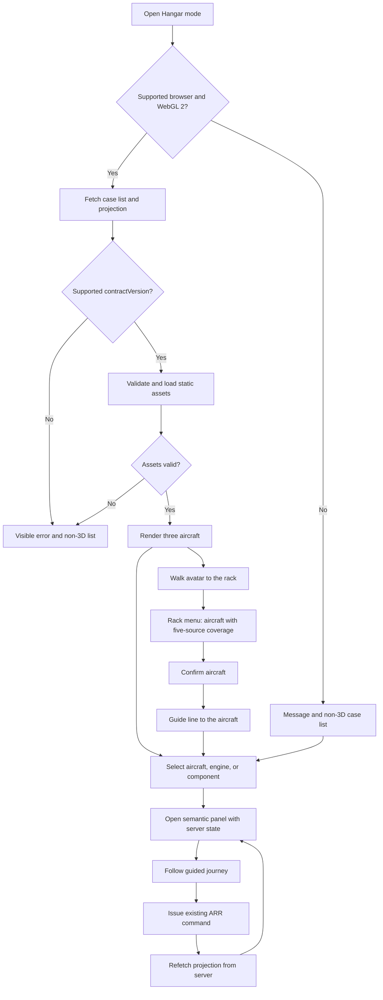

# Aircraft Hangar 3D Presentation Layer

> **aircraft-hangar-3d** | Status: Approved | Version: 0.4.1 | Last Updated: 2026-10-23

## Executive Summary

This PRD defines a browser-based 3D hangar presentation layer for the Aircraft Return Readiness Demonstrator. A presenter or reviewer sees the three synthetic aircraft cases of the [Aircraft Case Pack PRD](aircraft-case-pack.md) (CP) in a stylized hangar, selects an aircraft, engine, or component, and opens the matching evidence and work in conventional panels. A guided journey explains each real workflow transition in context.

The layer is a presentation surface over the server-owned case data and commands of the companion [Aircraft Return Readiness PRD](aircraft-return-readiness.md) (ARR, v0.7.0) and the read-only contracts defined in CP. It does not simulate aircraft operation, determine airworthiness, or grant authority. A non-3D equivalent, reduced-motion behavior, and keyboard access are part of the requirements. The renderer candidate is Three.js with React Three Fiber in the existing React client.

Version 0.3.0 adds a Data Room: a 3D server rack with one unit for each of the five synthetic source systems of the [Synthetic Source-System Stubs PRD](aircraft-source-systems.md) (SS), and a small presenter avatar that the user walks across the hangar floor with the arrow keys. Standing in front of the rack opens a game-style menu of the aircraft in scope, each with its five-source coverage; confirming one with Enter draws a guide line from the avatar to that aircraft. The rack, avatar, menu and line are presentation controls over the SS source summary and grant no authority.

Version 0.4.0 makes the scene real. Research on the default branch (`6029b5c`) found that Hangar mode draws one grey box, the five GLB files hold named nodes and no geometry, the scene data endpoints are never read, and the delivered panels, journey, reset, rack menu, guide line and follow camera are not reachable from the application. The amendment builds the geometry in code (DD-029), makes the scene graph testable without WebGL (DD-030), fixes the visual language, labels, picking, camera pose and render settings (DD-031 to DD-036, Scene rendering), and requires the delivered modules to be composed through the application (FR-027).

Dependency order is enforced by staged PRD merges: ARR prerequisites are delivered first, then CP is merged and delivered, then HG is merged. Draft documents can be reviewed together but are not merged together. This is a draft proposal. Acceptance criteria describe future verification and do not claim that any scene, asset, or demo exists.

## Research Readiness

Research status: `Required` (version 0.4.0)

Rationale (version 0.4.0): the amendment depends on the behaviour of the pinned `three` and `@react-three/fiber` packages (texture loading under the content security policy, camera configuration, render loop, context loss, scene graphs without WebGL) and on the delivered state of the default branch. Bounded research answered each question from the pinned package sources, a Node probe and the default branch; every material finding is dispositioned under Research Finding Dispositions.

Research artifact: [docs/research/2026-10-23/hangar-scene-rendering-research.md](../research/2026-10-23/hangar-scene-rendering-research.md).

Rationale (version 0.3.1, kept for history): Hangar mode is a presentation layer over contracts that are already delivered and tested on the default branch (the CP case list and scene projection, the ARR case resources and the SS source summary). Its third-party code is pinned and audited by a merged story (#506), and asset bytes are structurally validated before loading (#508). Asset rights are limited to `Project-authored` declarations or verified `CC0-1.0` grants (DD-015), so no licence research is needed. The remaining uncertainties are product hypotheses (AS-005, AS-006) checked by manual release items, not external facts that could change scope, security or story order.

Planning blockers: None.

## Product Context

The regular dashboard (ARR:FR-013) serves the work well, but it gives a presenter little help in showing several cases at once and how a finding on an aircraft or component leads to a review. The hangar offers a spatial overview and a memorable way into a case. Aircraft are selectable case entry points, not fleet objects. The three aircraft are not a representative fleet, and their statuses do not establish readiness, airworthiness, financial approval, legal approval, contractual acceptance, or aircraft release.

The value hypothesis (AS-001) that a spatial overview aids comprehension is untested; the non-3D equivalent keeps the demo usable if it is false. The Data Room makes the five source systems that feed every case's dossier visible in the same space as the aircraft, so a presenter can show where the evidence comes from before going to an aircraft; the hypothesis that this aids discovery (AS-006) is also untested.

The frontend today is a health-check stub. Almost everything the hangar relies on (dashboard, case, and evidence panels) is built by ARR stories first.

## Users and Personas

| Persona | Primary job | Pain point addressed | Success outcome |
|---|---|---|---|
| Presenter / demo operator | Give a guided overview, enter a case, show why the next step is required. | A dashboard is slow for explaining relationships between cases. | Moves from overview to a source-backed finding without losing the audience. |
| Technical reviewer (simulated) | Inspect an assigned evidence issue and record a current-basis decision. | Visual status must not hide source evidence or imply a model accepted evidence. | Opens the real evidence review from an aircraft or component. |
| Executive observer | Compare the three scenarios. | A single indicator conceals uncertainty. | Understands why cases differ and what moves each forward. |
| Keyboard or assistive-technology user | Complete the same tasks without a pointer or without 3D. | A 3D scene is not operable without a mouse. | Completes the journey with the keyboard or the non-3D list. |

## Design Decisions

| ID | Decision |
|---|---|
| DD-001 | The hangar is a presentation mode in the existing React client (ARR:DD-013). CP provides scene state, permissions, a bounded current-run history window and exact document/witness references. Full retained history, document content and review/request/response actions use delivered ARR endpoints and controls. The only new command is CP's reset; no duplicate workflow or history endpoint is added. |
| DD-002 | Renderer candidate: Three.js with `@react-three/fiber`. `@react-three/fiber` 9.8.1 is pinned because its peer range accepts React `>=19 <19.4` and `three >=0.156`, and the repository pins React 19.3.0 (verified 2026-10-14). The story that adds `three` pins one exact version inside that range and records it with the reason. No other 3D helper package is added unless its story names it with a reason. |
| DD-003 | Aircraft and component geometry is illustrative: generic fictional silhouettes with no manufacturer marks and no claim of engineering accuracy. |
| DD-004 | The scene shows the status, owner, next action, and capability label from the server projection. Color, position, animation, and client state never create or upgrade a status or enable a command. |
| DD-005 | Detailed evidence, status, decisions, and next actions appear in semantic HTML panels and the regular case UI. No meaning is carried by color alone. |
| DD-006 | Navigation is point-and-select, bounded orbit, preset camera positions and keyboard as specified under Camera controls. The camera has no free-roam or first-person movement; in follow mode (DD-022) it orbits the avatar, within the same clamps as any orbit. The only movement through the space is the Data Room walk (DD-017): a presenter avatar confined to the hangar's walkable floor, specified under Data Room walk. |
| DD-007 | No points, scores, rewards, timers, progression, or game mechanics. The avatar, the rack menu and the guide line are presentation controls with a game-like look only: they decide no status, enable no command, and carry no objective that can be won or lost. |
| DD-008 | Reduced motion is on when the browser reports `prefers-reduced-motion: reduce`, and the user can override it in either direction with an in-app control for the browser session. |
| DD-009 | Diagnostics use the existing server diagnostics policy (ARR:DD-029). The client sends no telemetry. Render time, capability result, and fallback reason appear only in a local, in-app diagnostics panel for the presenter and are never transmitted. |
| DD-010 | Scene assets are static, same-origin GLB version 2 files with embedded buffers and PNG/JPEG textures. The glTF extension allowlist is empty in the first release. External buffers/textures, Draco, KTX2, Basis, WebAssembly and parser plugins are not used. Version 0.4.0: the first release ships no GLB file and no texture (DD-029); this decision and the GLB validator apply to any GLB a later amendment adds. |
| DD-011 | The demo laptop and browser baseline is defined in this PRD under Demo baseline and applies to every manual check. |
| DD-012 | Vitest runs in jsdom, which has no WebGL. Automated tests cover view models, controllers, validators, and panels with the canvas component replaced by a stub. Rendering on real WebGL is verified only in the Release checklist. Version 0.4.0: the scene graph itself (meshes, names, dimensions, materials, picking and camera pose) is built by a renderer-independent builder and tested in Vitest without WebGL (DD-030); only painted pixels remain manual. |
| DD-013 | IDs are document-local canonical IDs, qualified as `CP:FR-007` or `ARR:FR-013` for cross-document references. Version 0.2.0 replaces the draft `HG-` prefixes before any implementation stories exist. |
| DD-014 | The product owner accepted the minimum demo baseline and size budgets on 2026-10-14. They are acceptance targets, not measured performance results. Actual hardware, operating system, GPU and browser versions are recorded in each release check. |
| DD-015 | The user-approved scene asset allowlist is project-authored models/textures with a recorded rights declaration, plus assets with a verified `CC0-1.0` grant. Attribution-required or unknown rights are not permitted in this release. This is separate from software package licences. |
| DD-016 | The HG merge gate requires the complete CP behavior and fixture approval on the default branch, plus the named ARR endpoints used by the dashboard. Cross-PRD dependency prose is not treated as an automatically enforced issue dependency. Version 0.3.0 adds the delivered SS source summary (SS:FR-009) to that gate. |
| DD-017 | The Data Room is part of Hangar mode: a server rack with exactly five units labelled with the SS source identifiers `technical`, `maintenance`, `finance`, `records` and `contracts`, a walkable presenter avatar, an interaction zone in front of the rack, a menu and a guide line. All are authored in the scene manifest; none is created from server data except the menu entries. |
| DD-018 | The rack menu reads only the delivered SS source summary, `GET /api/v1/cases/{caseId}/sources` (SS:FR-009), once for each in-scope case from the CP case list. It shows each source's mode and coverage flag as text, and no record payload. It adds no endpoint and no command. Role and case scope are enforced by the server (SS:DD-023); a case that is out of scope never appears, and a client-supplied identifier grants nothing. Personal-data exclusion is the server's (SS:DD-022); the client additionally renders only the typed summary fields. |
| DD-019 | The menu opens when the avatar enters the interaction zone, and also from a labelled "Open data rack" control for users who do not walk. Opening moves focus into the menu; closing restores focus to where it was. Closing with Escape does not reopen the menu until the avatar has left the zone and entered it again, or the control is activated. |
| DD-020 | The guide line is informational. It is computed in the client from the scene manifest's walkable floor and footprints, carries no status, colour meaning or authority, and is never transmitted. Avatar position, menu state and route are client state and are not sent to the server or to diagnostics. |
| DD-021 | The avatar is a generic fictional low-detail figure wearing a yellow safety hard hat, with no real person's likeness and no brand or company marks on the hat or clothing, and is an asset under DD-015 (code-built under DD-029 from version 0.4.0). The hat is appearance only: its colour carries no meaning, never changes, and is not a status, role or permission (DD-004, DD-005). The hat is distinguished by its shape as well as its colour, so the avatar stays easy to find against the floor and aircraft for users who cannot rely on colour. |
| DD-022 | The camera follows the avatar by default in the Data Room. Follow mode is an orbit whose target is the avatar's position, specified under Follow camera; it is a third-person view, never first-person, and it can be switched off with a labelled control. Choosing an overview or aircraft preset turns it off. |
| DD-023 | State-changing requests from Hangar mode use the existing signed-in session and the existing `X-CSRF-Token` header; Hangar adds no new authentication or anti-forgery mechanism. |
| DD-024 | The Case C blocked-variant reset sends the CP reset body exactly: `{ contractVersion: 1, commandId, expectedRevision, variant: "blocked" }`. |
| DD-025 | An unsupported browser, missing WebGL 2, an unsupported contract version, a malformed or oversized asset, and a failed refresh each show the visible non-3D fallback; none of them leaves a blank or partial scene. |
| DD-026 | A failed source-summary request or an unsupported source-summary contract version shows only `source summary unavailable` for that case, with no inferred or cached coverage. |
| DD-027 | Asset rights are accepted only from an approved `Project-authored` declaration or a verified `CC0-1.0` grant, and every asset carries a synthetic marker (DD-015). |
| DD-028 | The three aircraft categories, the rack, the avatar, its hard hat and the guide line are illustrative synthetic presentation assets; none depicts a real aircraft type, operator, person or brand. |
| DD-029 | Version 0.4.0. The floor, the three aircraft with their engines and components, the parts stands, the rack, the avatar with its hard hat, the ground shadows, the guide line and the selection ring are built in code in `frontend/src/hangar/` from three.js built-in geometries (`BoxGeometry`, `CapsuleGeometry`, `CylinderGeometry`, `SphereGeometry`, `TorusGeometry`, `CircleGeometry`, `PlaneGeometry`, `TubeGeometry`) with `MeshStandardMaterial` or `MeshBasicMaterial` and no texture map. No GLB, texture or image is loaded, so the content security policy needs no change (research G-4). The node-only GLB files on the default branch are retired. The synthetic declarations of DD-028 move into the scene manifest. Reason: the implementer cannot author binary meshes, and the delivered GLB files hold no geometry. |
| DD-030 | One renderer-independent scene builder takes the scene manifest and the validated scene view and returns the three.js scene group. The canvas mounts exactly that group, and Vitest calls the same builder in Node without WebGL. Every selectable mesh carries `userData.objectId` equal to its CP `objectId`; no other mesh carries one. |
| DD-031 | Visual language: matte, untextured, neutral materials in the fixed palette under Scene rendering. No case status, owner, next action or capability label is encoded by the colour, material, size, position, visibility or animation of any 3D object; status appears only as text in labels and panels (DD-004, DD-005). Selection is shown by a ring shape on the floor and an accent emissive tint, so it is not carried by colour alone. |
| DD-032 | Labels are DOM elements over the canvas, positioned by projecting a 3D anchor with the current camera and moved with the element's `style` property, which `style-src 'self'` allows (research E-8). Labels are `aria-hidden="true"`; the semantic controls of FR-010 are the accessible equivalent. |
| DD-033 | Pointer selection is a raycast from the current camera into the scene group. The nearest hit decides: a hit with an `objectId` selects that object through the shared selection handler of FR-003, and a hit without one (floor, avatar, guide line, ring or shadow) selects nothing. Engines and components get an invisible pick sphere so that they are easy to hit from the overview. |
| DD-034 | Hangar mode creates one `PerspectiveCamera` (vertical field of view 40 degrees, near 0.5, far 1000), passes that instance to the canvas and sets its pose from the camera controllers on every change. The `camera` prop is applied only when the canvas is created (research E-6), so passing options would leave the camera fixed. |
| DD-035 | The canvas renders on demand (`frameloop: "demand"`) with device pixel ratio clamped to [1, 2], antialiasing on and no shadow map; a frame is requested only when the camera, avatar, selection, route, labels or scene data change, and on each step of a follow-camera easing. Reason: the scene is static between inputs, and continuous rendering on the integrated-GPU demo baseline costs battery and heat. |
| DD-036 | WebGL context loss is a render failure: Hangar mode shows the non-3D equivalent with fallback reason `render_failed` and does not remount the canvas by itself; re-entering Hangar mode creates a new canvas. R3F registers no context-loss handler (research E-7). |
| DD-037 | Version 0.4.1. Defaults the Functional Planner assumed are decisions. (1) Release 0.4.x ships no GLB, texture, image, blob worker, external font, model CDN or runtime third-party resource; code-built geometry and same-origin assets are the default (DD-029, DD-010). (2) A missing or unsupported browser capability, contract version, scene envelope, asset, source summary or refresh shows the fallback of DD-025 with the matching NFR-006 fallback reason and never a partial scene. (3) Hangar is a presentation client only: companion server authentication, CP and ARR authorization, reset anti-forgery, SS source-summary scope and ARR server logging stay authoritative (CON-002, NFR-003, ARR:DD-029) and no client check replaces them. No open question remains for a person to decide; Planning blockers stay None. |

## Product Goals

| ID | Goal | Evidence of attainment | Priority |
|---|---|---|---|
| GOAL-001 | Enable a presenter to guide an audience from a three-aircraft overview to a source-backed case decision and its resulting workflow state, with an equivalent non-3D path. | Automated acceptance criteria pass; the Release checklist records a rehearsal of at most five minutes, assistive-technology smoke checks, and timing on the demo baseline. | MUST |

Baseline: no hangar exists. Target: all Automated HG acceptance criteria pass at each release-candidate revision, and every Release checklist item is recorded. The five-minute figure is a demo pacing target, not a workflow SLA.

### Demo baseline and measurement procedure

The user-confirmed minimum baseline is a laptop with 4 logical CPU cores, 8 GB memory, an integrated GPU providing WebGL 2, and a 1920x1080 display. Supported 3D browsers are the current and previous stable major versions of both Chrome and Edge at the release-candidate date. Pin and record those four tested versions in the release evidence; they do not drift during one assessment. The operating system and actual CPU/GPU models are recorded. Other browsers get the non-3D equivalent; browser eligibility is detected separately from WebGL capability.

Measure the production build served by the local application on that device, with seeded cases, a signed-in session and no live model call. For each supported browser version, perform five Hangar openings with the browser asset cache cleared before each. Time from entry activation until the first rendered aircraft can be selected and its semantic controls are ready; every successful opening must take at most 8 seconds. A fallback/error is recorded as a failed 3D sample, never as a fast successful render.

After assets load, measure 100 aircraft/engine/component activations, distributed over all 12 objects, from input activation to the corresponding semantic panel's next painted state. Sort the samples; the 95th is P95 and must be at most 500 ms. Record sample durations, cold/warm cache state, browser/device details and failures. The five-minute rehearsal timer includes navigation and the real synthetic workflow commands; it does not substitute for these latency checks.

## Functional Requirements

Unqualified IDs belong to this PRD. Companion IDs are cited as `ARR:` or `CP:` plus the identifier. ARR and CP commands exist before the HG PRD merge; HG stories reuse them rather than generating unsupported cross-plan dependencies.

| ID | Requirement | Actor / trigger | Dependencies | Acceptance criteria | Product goals |
|---|---|---|---|---|---|
| FR-001 | Offer a Hangar mode entry that checks supported-browser eligibility and WebGL 2 support and, when either check fails, shows an actionable message and the non-3D case list rather than a blank screen. | Signed-in user opens Hangar mode. | ARR:DD-014, ARR:FR-013, CP:FR-006. | AC-001, AC-020, AC-029 | GOAL-001 |
| FR-002 | Render the in-scope cases from the case list as selectable aircraft with text name, category, six-axis status and activity capability label, using one scene-object mapping per projected identifier. | Scene loads. | CP:FR-006, CP:FR-007, CP:FR-008, ARR:FR-008. | AC-002, AC-021, AC-028 | GOAL-001 |
| FR-003 | On selection of an aircraft, engine, or component, open a panel with the projected status, owner, next action, and mapped evidence. | User selects a scene object. | CP:FR-007, ARR:FR-008, ARR:FR-013. | AC-003, AC-004 | GOAL-001 |
| FR-004 | Provide the bounded orbit, presets and keyboard controls specified under Camera controls, without free-roam movement or trapping input intended for semantic controls. | User navigates the scene. | FR-002. | AC-005, AC-030 | GOAL-001 |
| FR-005 | Present each journey from recorded CP/ARR events and witnesses: Case A finding/review/request/response/new basis/reassessment; Case B internal review without a request; Case C baseline or blocked variant. When CP reports older history, offer the delivered ARR history controls for older runs/events; absence from the window is not absence from the case. Future unrecorded steps stay disabled. | Presenter starts or selects a journey step. | CP:FR-003, CP:FR-004, CP:FR-005, CP:FR-007, ARR:FR-002, ARR:FR-003, ARR:FR-004, ARR:FR-005, ARR:FR-008, ARR:FR-010. | AC-006, AC-007, AC-022, AC-032 | GOAL-001 |
| FR-006 | Refetch scene state after any ARR or CP command issued by this client, on re-entry and on window focus; reject unsupported contracts and mark failed refreshes stale, disabling commands until refreshed. | Command result, re-entry or window focus. | CP:FR-007, CP:NFR-007, ARR:NFR-008. | AC-008, AC-009, AC-031 | GOAL-001 |
| FR-007 | Keep case state intact and avoid duplicate commands when the scene fails to render, an asset fails to load, or the user re-enters the scene. | Render error, asset error, or re-entry. | ARR:NFR-003, ARR:FR-010. | AC-010 | GOAL-001 |
| FR-008 | Provide a non-3D equivalent that lets a user complete every selection, evidence, status, next-step and journey task, including access to full ARR retained history. | User chooses regular mode or 3D is unavailable. | CP:FR-006, CP:FR-007, ARR:FR-013. | AC-011, AC-032 | GOAL-001 |
| FR-009 | Apply reduced motion from `prefers-reduced-motion` and an in-app override. | Browser preference or user toggle. | None beyond FR-004. | AC-012 | GOAL-001 |
| FR-010 | Give every object, status, journey step, and permitted action in the scene a keyboard-operable semantic equivalent with a text label, with visible focus and status not conveyed by color alone. | Keyboard or assistive-technology use. | ARR:NFR-009 (bounded checks). | AC-013, AC-014, AC-023, AC-030 | GOAL-001 |
| FR-011 | Serve the scene as lazy-loaded static same-origin assets within NFR-001's byte budgets, make no runtime third-party request, and extend the content security policy only by the exact directives in the Security Notes. | Application build and request. | ARR:DD-028 (CSP baseline), ARR:DD-017. | AC-015, AC-016, AC-025, AC-027 | GOAL-001 |
| FR-012 | Record provenance and rights for every model/texture according to DD-015, and validate each GLB's structural envelope and JSON metadata before handing it to the renderer loader. From version 0.4.0 the release ships no GLB file and the scene manifest carries the synthetic declarations of the code-built models (DD-029). | Build and asset load. | ARR:DD-026 (untrusted input stance), DD-010, DD-015, DD-029. | AC-017, AC-018, AC-042, AC-059 | GOAL-001 |
| FR-013 | Pin `three` and `@react-three/fiber` to exact versions with a committed lockfile and include them in the existing dependency audit. | Dependency change. | ARR:DD-017. | AC-019 | GOAL-001 |
| FR-014 | Show a Case C reset control only when the server projection grants it; send `commandId`, `expectedRevision`, `variant: "blocked"` and the anti-forgery token, and refetch after acceptance. Reuse the same command identifier for retry of an uncertain result, not for a deliberate new reset. | Presenter selects or retries reset. | CP:FR-007, CP:FR-009, ARR:DD-028. | AC-024 | GOAL-001 |
| FR-015 | Show the presenter a local diagnostics panel containing scene-load duration, graphics capability and explicit fallback reason, without transmitting diagnostics or granting workflow authority. | Presenter opens local diagnostics. | ARR:DD-029, DD-009. | AC-026, AC-057 | GOAL-001 |
| FR-016 | Render a server rack in the scene with exactly five units, one for each SS source identifier (`technical`, `maintenance`, `finance`, `records`, `contracts`), from the scene manifest, with a labelled keyboard-operable equivalent that opens the rack menu. | Scene loads. | SS:FR-009, FR-002. | AC-033, AC-042, AC-043 | GOAL-001 |
| FR-017 | Show a presenter avatar that the user moves with the arrow keys in the walk region, confined to the walkable floor and blocked by aircraft and rack footprints, as specified under Data Room walk, without trapping Tab; the camera moves only through follow mode (FR-021). | User presses arrow keys in the walk region. | FR-004, FR-010. | AC-034, AC-035 | GOAL-001 |
| FR-018 | Open a game-style rack menu when the avatar enters the interaction zone or the "Open data rack" control is activated, listing the in-scope aircraft with each one's five-source mode and coverage from the SS source summary; Up/Down/Home/End/Enter/Escape operate it, and a failed or unsupported summary shows "source summary unavailable" without inferred coverage. | Avatar enters the zone, or user activates the control. | SS:FR-009, SS:DD-023, CP:FR-006, ARR:DD-014. | AC-036, AC-037, AC-038, AC-044 | GOAL-001 |
| FR-019 | On confirming a menu entry, draw a guide line over the walkable floor from the avatar to the selected aircraft's marker, keep it current as the avatar moves, state distance and direction in a live region, and on arrival clear it and select the aircraft through the shared selection handler. | User presses Enter on a menu entry. | FR-003, FR-017, FR-018. | AC-039, AC-040, AC-043, AC-044 | GOAL-001 |
| FR-020 | Provide the non-3D equivalent of the Data Room: a list of in-scope cases with the same five-source coverage text as the menu, whose activation selects the case. | User chooses regular mode or 3D is unavailable. | FR-008, FR-018, SS:FR-009. | AC-041 | GOAL-001 |
| FR-021 | Provide a follow camera: a third-person orbit whose target is the avatar, on by default in the Data Room, with the default, clamps, easing and camera box specified under Follow camera, a labelled control to switch it off and on, and instant application under reduced motion. | Avatar steps, or the user toggles follow or picks a preset. | FR-004, FR-009, FR-017. | AC-045, AC-046, AC-047 | GOAL-001 |
| FR-022 | Build the scene from code-built geometry with the scene builder (DD-029, DD-030): the floor with its markings, the three aircraft with engine, two components and parts stand, the rack with five units, the avatar with its hard hat, a ground shadow under each aircraft, the guide line while a route exists and the selection ring, with the layout, dimensions, palette and labels under Scene rendering. | Scene loads, data refreshes, route or selection changes. | FR-002, FR-016, FR-017, FR-019, DD-031, DD-032. | AC-021, AC-048, AC-049, AC-050, AC-058 | GOAL-001 |
| FR-023 | At Hangar entry, read the CP case list (`GET /api/v1/cases`) and then the scene envelope of each listed case (`GET /api/v1/cases/{caseId}/scene`), validate them with the delivered validators, and drive the scene, labels, semantic controls and panels from them. Case names and categories come from the envelopes. An absent, non-integer or unsupported `contractVersion` is unsupported. FR-006 refreshes update the same state. | Signed-in user opens Hangar mode; FR-006 refresh triggers. | CP:FR-006, CP:FR-007, FR-002, FR-006. | AC-051, AC-052 | GOAL-001 |
| FR-024 | Set the pose of the one canvas camera (DD-034) from the camera, follow-camera and preset state on every change, with the formula under Scene rendering, so that presets, orbit keys and follow mode move the rendered view. | Preset, orbit input, avatar step in follow mode. | FR-004, FR-021. | AC-054 | GOAL-001 |
| FR-025 | Render on demand with the settings of DD-035, and treat WebGL context loss as `render_failed` (DD-036). | Canvas creation, scene change, context loss. | FR-007, NFR-001, NFR-002. | AC-055, AC-056 | GOAL-001 |
| FR-026 | Select an aircraft, engine or component by pointer through a raycast into the scene group (DD-033), calling the same selection handler as the semantic controls; a drag of more than 6 CSS pixels between pointer down and pointer up is camera orbit, not selection. | User clicks or taps the canvas. | FR-003, FR-004. | AC-053 | GOAL-001 |
| FR-027 | Compose the delivered Hangar modules through the application's own startup code: semantic controls, selection and evidence panel, guided journey, Case C reset control, render error boundary, non-3D list and non-3D Data Room list, walk region, rack menu with its "Open data rack" control, guide line and "Follow avatar" control. The temporary "Move avatar" and single "Aircraft" buttons are replaced by the walk region and one "View <case name>" preset button per in-scope aircraft plus "Overview". | User enters Hangar mode or the non-3D equivalent. | FR-003, FR-005, FR-007, FR-008, FR-010, FR-014, FR-017 to FR-021. | AC-060, AC-061 | GOAL-001 |

## Scope Boundaries

### In scope

- A stylized 3D hangar in the existing single-page client showing the three case-pack aircraft.
- Selection of aircraft, engine, and components, opening semantic panels.
- Bounded orbit, preset cameras, keyboard control, reduced motion, and an in-app motion override.
- Guided journeys for Cases A, B, and C, built from server data.
- A non-3D equivalent, a local diagnostics panel, and the presenter reset control.
- The Data Room: a server rack of five source units, a bounded walkable presenter avatar, a rack menu of in-scope aircraft with their five-source coverage, and a guide line to the selected aircraft.
- Static scene assets with provenance and licence records.
- Code-built geometry, a fixed scene palette, DOM labels, pointer picking, an owned camera and on-demand rendering (version 0.4.0).

### Out of scope

- Fixtures, case-list and projection APIs, scope, and reset command (see CP).
- Real customer, airline, aircraft, maintenance, or personal data; real partner communications.
- Aircraft physics, flight simulation, engineering-accurate geometry, multiplayer, free-roam camera or first-person movement, scoring, or progression.
- Avatar jumping, running, physics beyond footprint blocking, non-player characters, or any objective, timer or reward.
- Showing source record payloads or dossier contents on the rack, and issuing any command from the rack or menu. The existing SS and ARR controls open dossiers and records.
- Fleet management or a separate game-engine runtime.
- A client telemetry endpoint.
- Licensed manufacturer liveries or photorealistic models.
- Textures, GLB models, real-time shadow maps, post-processing, walls or a roof in the first release (version 0.4.0); each needs a further amendment.

### Camera controls

For the active target, let `R` be the positive radius of its bounding sphere. The overview targets the hangar centre; an aircraft preset targets that aircraft's centre. Orbit radius is clamped to `[1.2R, 6R]`; polar angle from the vertical axis is clamped to `[15, 85]` degrees; azimuth wraps modulo 360. An overview preset sets radius `3R` and polar angle 45 degrees; an aircraft preset sets radius `2R` and polar angle 35 degrees. A missing, non-finite or nonpositive radius rejects the preset visibly and retains the last valid camera state.

Only a focused, labelled camera-control region handles keys: Left/Right change azimuth by 10 degrees, Up/Down change polar angle by 5 degrees, `+` divides radius by 1.1 and `-` multiplies it by 1.1, with the same clamps as pointer orbit. Tab moves to ordinary semantic controls and is never captured. Inputs, buttons and evidence panels outside that region receive their normal keyboard behavior. WASD and pointer-lock do not move the camera. Nonessential camera transitions have zero duration when reduced motion is active.

### Follow camera

Follow mode is on when Hangar mode opens the Data Room. The orbit target is the avatar's position at floor level plus 1.0 up; its azimuth is retained and its default values are radius 6 and polar angle 55 degrees. In follow mode the camera-control region still orbits: Left/Right and Up/Down change azimuth and polar angle as in Camera controls, and `+`/`-` change the radius, with polar angle clamped to [15, 85] degrees and radius to [4, 12] (the aircraft-based radius clamp does not apply, because the target is the avatar). If the computed camera position lies outside the manifest's camera box, the radius is reduced along the view ray until the position is inside, to a minimum of 2.

After each applied avatar step the camera target moves to the new avatar position: it eases toward it and is within 0.05 of it within 400 ms, measured on an injected clock. With reduced motion active the target is applied in the same update, with no easing. A refused step does not move the camera.

A labelled "Follow avatar" control shows the mode and switches it off and on. Choosing an overview or aircraft preset turns it off and applies that preset; switching it on again keeps the current azimuth and applies the default radius and polar angle. With follow off, the camera is unchanged by avatar steps. Follow mode never moves the avatar, changes no case state, and does not capture Tab.

### Data Room walk

Scene units are illustrative metres. The scene manifest defines the walkable floor as a closed polygon, a footprint for each of the three aircraft and for the rack, one interaction zone, and for each aircraft a marker point on the floor beside it. The overview preset (Camera controls) frames the whole walkable floor and the rack.

The avatar has a collision radius of 0.3. A labelled, focusable walk region handles the arrow keys, separate from the camera-control region; only the focused region reacts, and Tab is never captured. In the walk region, Up/Down/Left/Right move the avatar 0.5 in the four floor directions relative to the camera's current azimuth (Up moves away from the camera, Left moves to the camera's left), once for each key press and again for each key repeat. A step that would leave the walkable floor or enter a footprint expanded by the avatar radius is refused and the avatar stays where it was; no step is partially applied. WASD and pointer-lock do not move the avatar. With reduced motion active an applied step is shown immediately, with no tween. The camera follows the avatar as specified under Follow camera.

The interaction zone is a circle of radius 1.5 centred 1.5 in front of the rack's front face. The avatar is inside it when its centre is within that circle.

**Rack menu.** Entries are the in-scope cases, in the case-list order. Up/Down move the highlighted entry and wrap, Home/End jump to the first/last, Enter confirms, Escape closes. Each entry shows the aircraft name, category and, for each of the five sources, the source name with its mode and coverage flag as text. If the summary request for a case fails or its `contractVersion` is unsupported, the entry stays selectable and shows "source summary unavailable" in place of the five sources; coverage is never inferred. Confirming an entry closes the menu and starts the guide line to that aircraft's marker.

**Guide line.** The route is the shortest path over the walkable floor, avoiding footprints expanded by the avatar radius, from the avatar to the aircraft's marker, computed on a 0.25 grid. It is recomputed after each applied step. An unreachable marker shows a visible message and no line. The line is complete when the avatar is within 1.5 of the marker: it is cleared, arrival is announced in a live region, and the aircraft is selected through the same selection handler as a pointer or keyboard selection (FR-003). Escape in the walk region, or confirming another entry, clears or replaces the line. While a line exists, a live region states the distance and the direction in words (ahead, behind, left, right), updated after each applied step. With reduced motion active the line is static.

### Scene rendering

Version 0.4.0. Coordinates are illustrative metres: `x` to the right, `y` up, `z` toward the camera at azimuth 0. Every aircraft's nose points to `+z`. The values below are written into the scene manifest and read by the scene builder, the walk controller, the route planner and the follow camera; none is duplicated as a constant elsewhere.

**Layout.**

| Item | Value |
| --- | --- |
| Walkable floor polygon | (-45, -25), (45, -25), (45, 25), (-45, 25) |
| Floor slab | 90 x 0.2 x 50, top face at `y = 0` |
| Case A aircraft (narrow-body) | centre (-28, 0); length 24, span 22, height 7; footprint x [-39, -17], z [-12, 12]; marker (-28, 14) |
| Case B aircraft (regional) | centre (-4, -2); length 18, span 17, height 6; footprint x [-12.5, 4.5], z [-11, 7]; marker (-4, 9) |
| Case C aircraft (wide-body) | centre (25, 0); length 32, span 30, height 10; footprint x [10, 40], z [-16, 16]; marker (25, 18) |
| Rack | footprint x [-5, -3], z [-22, -21], height 2.2, front face at `z = -21` facing `+z` |
| Interaction zone | circle centre (-4, -19.5), radius 1.5 |
| Avatar start | (-4, 20) |
| Follow camera box | x [-60, 60], y [0.5, 40], z [-45, 45] |

Length runs along `z`, span along `x`, and height from the floor (`y = 0`) to the top of the fin. The research artifact records that every footprint lies on the floor with gaps of at least 4.5, and that every marker is reachable from the avatar start and from the interaction zone on the 0.25 grid.

**Geometry.** Each aircraft node is a group of a capsule fuselage, two wings, a horizontal stabiliser, a vertical fin, two engines and landing-gear cylinders that reach the floor. Its bounding box equals the length, span and height above within 5%, and its lowest point is at `y = 0` within 0.05. The categories differ in size and shape: the narrow-body and wide-body have low wings and a conventional tail, the regional aircraft has a high wing and a T-tail. The engine under the left wing (`x` less than the aircraft centre) is the manifest's engine node; the right engine is part of the aircraft node. The two component nodes stand on a parts stand of height 1.0 placed at `x = centre x - 0.3 x span`, `z = centre z + 0.3 x length`, inside the footprint: component 1 is a horizontal cylinder (radius 0.5, length 1.0) and component 2 an upright disc (radius 0.6, thickness 0.12). The rack is a box with five unit boxes on its front face, in the manifest order from top to bottom. The avatar is a capsule body with a sphere head, 1.7 tall, collision radius 0.3; its hard hat is a half-sphere dome with a cylinder brim in the manifest's fixed hat colour. A ground shadow under each aircraft is a `CircleGeometry` scaled to the footprint at `y = 0.01` with opacity 0.18. The guide line is a `TubeGeometry` of radius 0.08 through the route points at `y = 0.05`. The selection ring is a `TorusGeometry` of tube radius 0.12 lying on the floor around the selected object, with radius 1.0 more than the object's horizontal bounding radius.

**Palette.** All scene colours come from one token module `frontend/src/hangar/sceneTheme.ts`:

| Token | Value | Used for |
| --- | --- | --- |
| `background` | `#E8EDF2` | Canvas clear colour |
| `floor` | `#C3CBD4` | Floor slab |
| `floorMarking` | `#F2F4F6` | Bay lines, 1.0 outside each aircraft footprint |
| `aircraftBody` | `#F5F7F9` | Fuselage, wings, tail |
| `aircraftTrim` | `#9AA5B1` | Engines, landing gear |
| `partsStand` | `#5A6573` | Parts stands |
| `component` | `#B7C0CA` | Component meshes |
| `rack` | `#2F3A47` | Rack body |
| `rackUnit` | `#4C5866` | Rack units |
| `avatarBody` | `#3D6E9E` | Avatar body and head |
| `groundShadow` | `#000000` | Ground shadows |
| `guideLine` | `#0E7C66` | Guide line |
| `selection` | `#1F6FEB` | Selection ring and emissive tint (intensity 0.35) |
| `labelBackground` | `#FFFFFF` | Label background |
| `labelText` | `#1B2430` | Label primary text |
| `labelMuted` | `#4A5563` | Label secondary text |

The hard-hat colour stays the manifest value `#FFD400` (DD-021). Lighting is one `HemisphereLight` (sky `#FFFFFF`, ground `floor`, intensity 1.0) and one `DirectionalLight` (`#FFFFFF`, intensity 2.0, at (30, 60, 40) aimed at the origin); there is no ambient light and no shadow map.

**Labels.** Each in-scope aircraft has one label anchored 1.5 above the centre of its bounding box top. It shows, from the envelope, the case name, the aircraft category, the capability label, and the next-action text or `No next action` when `nextAction` is null or the capability label is `Unknown`. While an engine or component is selected, it has a label with its `displayName`. A label whose anchor projects behind the camera or outside [-1, 1] in normalized device coordinates is hidden. Label text on `labelBackground` has a contrast ratio of at least 4.5:1, computed from the tokens.

**Picking.** An engine or component has an invisible pick sphere (`MeshBasicMaterial` with `visible: false`) of radius equal to the larger of 1.0 and 1.25 times the bounding-sphere radius of its visible mesh, carrying the same `objectId`. Aircraft meshes pick through their own geometry. Rack units and the avatar carry no `objectId`; the rack opens through the zone and the "Open data rack" control (FR-018).

**Camera pose.** For target `t`, radius `r`, polar angle `p` (from the vertical) and azimuth `a`, the camera position is `t + r * (-sin p * sin a, cos p, sin p * cos a)` and the camera looks at `t`. With this pose, the walk controller's Up step (`getHangarCameraRelativeStep`) points away from the camera. The overview target is (0, 0, 0) with `R` the radius of the bounding sphere of the walkable floor, `sqrt(2650)` (about 51.478); an aircraft preset targets the centre of that aircraft's bounding box with `R` its bounding-sphere radius; the follow target is defined under Follow camera.

**Render settings.** The canvas receives the owned camera instance, `frameloop: "demand"`, `dpr: [1, 2]`, `gl: { antialias: true }` and no `shadows` prop. A change of camera pose, avatar position, selection, route, label data or scene data calls the `invalidate` export of `@react-three/fiber`; with no change, no frame is requested.

### Asset and contract validation

Until version 0.3.1 the release contained five GLB model files: one for each aircraft category, with labelled engine and two component nodes, one server rack with five labelled unit nodes, and one avatar; all textures and buffers are embedded. From version 0.4.0 the release contains no GLB file: the same nodes are code-built under the node names the scene manifest declares (DD-029), and the GLB rules below apply to any GLB a later amendment adds. Each model must match the authored scene manifest, which also holds the walkable floor, footprints, interaction zone and aircraft markers. Mesh/node identifiers map to CP `objectId`, never to a guessed case identifier. A shared, renderer-independent scene descriptor supplies both the canvas component and semantic controls; its real mappings and activation handler are exercised by Vitest without WebGL.

GLB validation checks the version-2 header, declared byte length, aligned chunk bounds, a single first JSON chunk and an embedded binary chunk before a renderer loader sees the bytes. JSON is parsed only after enforcing its byte limit. `extensionsUsed` and `extensionsRequired` must be absent or empty. Buffer/image URI fields are absent: all data is embedded, with images identified by buffer view and PNG/JPEG MIME type. Buffer-view and accessor ranges must remain inside the declared buffer; malformed or out-of-range references fail visibly. Unknown nodes cannot dispatch a case action. These checks do not claim to prove geometry accuracy; the visual check remains manual.

The client accepts only CP contract version 1 and validates the typed scene envelope defined in CP, including revision, boolean permission, history, witnesses and object identifiers. A bad field or cross-case mapping is an error, not a success-shaped empty scene. Existing ARR controls supply document content and submit workflow decisions using their already implemented endpoints.

## Security Notes

- Trust boundary: the browser is untrusted. The scene renders server projections and submits existing commands; it cannot set status, label, owner, role, scope, or evidence acceptance. Client-supplied identifiers (scene object IDs, case IDs) never grant access; the server checks scope on every call (CP:FR-008).
- Content security policy (ARR:DD-028 baseline): preserve the baseline directives, change `img-src` to `'self' data: blob:` for embedded-image textures, and add explicit `worker-src 'self'`. These are the exact additions; no worker is required by the asset format. `unsafe-eval`, `unsafe-inline`, `wasm-unsafe-eval`, wildcards and external hosts are forbidden, and `script-src` remains `'self'`. The ARR v0.7.0 addendum makes this PRD the source of the additions only once its staged pull request is approved and merged; this draft is not security approval.
- Untrusted assets: the structural validator above runs before the renderer loader. Each GLB is at most 5 MiB (5,242,880 bytes), all scene assets total at most 15 MiB (15,728,640 bytes), and its JSON chunk is at most 1 MiB (1,048,576 bytes). The glTF extension allowlist is empty; external and data URIs in models are rejected, not fetched. A failing asset shows a visible error and offers the non-3D equivalent. Asset text is rendered as text, never as HTML.
- Asset rights: provenance records include relative asset path, source, author, `rightsBasis` (`Project-authored` or `CC0-1.0`), SHA-256 checksum and a synthetic marker. Project-authored records include a rights declaration; CC0 records include the original grant URL and its human verification reference. Unit tests verify structure and checksum, not the legal authenticity of a grant. The product owner reviews rights before HG release.
- Supply chain: `three` and `@react-three/fiber` are pinned to exact versions with a committed lockfile and are covered by ARR:DD-017's audit and SBOM. A high or critical finding blocks the release candidate unless an exception with reason and expiry is recorded in `docs/` (ARR:DD-017).
- Runtime network: no third-party fetch at presentation time (fonts, textures, models, CDNs). The CSP and a build check both enforce this.
- Diagnostics: no new client telemetry endpoint exists, so no client-to-server abuse surface is added. Server logging follows ARR:DD-029 and excludes document text, cookies, and tokens.
- The reset control is only a client of the CP reset command; authorization stays on the server. A display label or color is never authorization or proof of approval.
- Data Room: the rack menu issues only the SS source-summary reads for cases the user can list; authorization stays on the server (SS:DD-023). The client renders only the typed summary fields, so a payload or personal-data field present in a response is not displayed (AC-037). Avatar position, menu state and the route never leave the browser and add no diagnostics. The rack and avatar assets pass the same validation and provenance rules as the aircraft (AC-042). No CSP change.
- Data handled: synthetic only. No credentials, personal data, or tracking in assets.

## Non-Functional Requirements

### Performance and Capacity

**NFR-001 — Performance and Capacity.** The accepted baseline meets the startup and P95 selection thresholds under Demo baseline and measurement procedure. Hangar-only code/assets are not requested before entry. The total gzip size of all JavaScript chunks introduced solely by opening Hangar is at most 1.5 MiB (1,572,864 bytes), not just the largest chunk; all model/texture assets total at most 15 MiB. Verification: AC-025 and AC-027, Automated validators; production-build integration verified by review; timing is AC-020, Manual. The rack and avatar models count toward the same byte budgets. From version 0.4.0 the code-built geometry counts toward the JavaScript budget, the model and texture total is 0 bytes, and the canvas renders on demand with the settings of DD-035 (AC-055, AC-059).

### Reliability and Resilience

**NFR-002 — Reliability and Resilience.** Render/asset/refresh failure does not mutate case state or block the regular UI. An uncertain reset is not automatically issued as a new command. WebGL context loss is a render failure with the same guarantees (DD-036). Verification: AC-010, AC-024, AC-031, AC-056, Automated.

### Security

**NFR-003 — Security.** All reads retain server authentication/role/scope checks; commands retain anti-forgery and current-revision/replay checks (ARR:NFR-001, CP:NFR-003). Verification: AC-016, AC-018, AC-024 and CP server tests, Automated.

### Privacy

**NFR-004 — Privacy.** Assets/labels contain synthetic data only and diagnostics are not transmitted. Verification: AC-015, AC-017, AC-026, Automated structure/transport checks; rights/content review is RC-007.

### Scalability and Elasticity

The scene supports the three case-pack cases and their 12 modeled objects. No fleet-scale requirement applies.

### Maintainability and Operability

**NFR-005 — Maintainability and Operability.** The scene manifest names its supported CP `contractVersion` and `packVersion`. A fixture mapping change updates the manifest's pack version; a case-state revision does not change the contract version. Unsupported versions and invalid mappings fail visibly. Verification: AC-009, AC-028, Automated.

### Observability

**NFR-006 — Observability.** Local diagnostics show `sceneLoadDurationMs`, `webgl2Available`, `browserSupported` and `fallbackReason` (null on success; `unsupported_browser`, `webgl_unavailable`, `asset_invalid`, `asset_load_failed`, `render_failed`, `contract_invalid` or `refresh_failed` otherwise). `sceneLoadDurationMs` is the time on a monotonic clock from activation of the Hangar entry to the canvas's `onCreated` callback after the scene group is mounted, and is null when no canvas is created (a fallback outcome). Server request logging follows ARR:DD-029. No client telemetry is sent. Verification: AC-026, AC-057, Automated.

### Usability and Accessibility

**NFR-007 — Usability and Accessibility.** Keyboard, focus, labels, six-axis text status and reduced motion meet FR-009 and FR-010. Automated DOM/controller checks do not prove painted focus, contrast or screen-reader behavior. Formal conformance is not claimed (ARR:DD-020). Verification: AC-012, AC-013, AC-030, Automated; AC-014, AC-023 and RC-003, Manual.

### Compatibility and Interoperability

**NFR-008 — Compatibility and Interoperability.** The 3D mode runs on the accepted browser/device baseline; other browsers receive the non-3D equivalent. The client consumes typed CP version-1 envelopes. Verification: AC-001, AC-009, AC-029, Automated; AC-020 and RC-006, Manual.

### Portability

**NFR-009 — Portability.** The scene ships as static client assets in the existing application image. No separate host/runtime or third-party fetch is required. Verification: AC-015, Automated request-policy checks; production-build same-origin load is RC-006, Manual.

## Constraints

| ID | Constraint | Category | Imposing source, authority, affected boundary, and impact |
|---|---|---|---|
| CON-001 | Synthetic content only. | Organizational | ARR:CON-001; product owner; constrains assets and labels. |
| CON-002 | The server stays authoritative for lifecycle, permissions, decisions, and capability labels. | Technical | ARR:CON-003, CP:CON-002; engineering owner. |
| CON-003 | Integrate into the existing React/Vite client and serve assets from the same origin. | Technical | ARR:DD-013, ARR:DD-028; engineering owner. |
| CON-004 | Every visualized activity keeps the server capability label (AI agent, Rules-based, Simulated, Design-only, or Unknown). | Operational | ARR Capability labels; product owner; the authority/safety boundary is changed only by an ARR amendment. |
| CON-005 | Merge this PRD only after ARR prerequisites and the complete CP behavior and approved fixture exist on the default branch. | Organizational | User decision on 2026-10-14; product owner; staged merges prevent unsupported dispatch and are not relaxed in this plan. |
| CON-006 | The Data Room consumes SS:FR-009 as delivered and changes no SS contract. | Technical | SS:FR-009, SS:DD-023; engineering owner; the rack adds no endpoint or command. |

## Process Models

## Acceptance Criteria

**Automated** means a vitest, xUnit, or CI check that fails when the behavior is missing; the canvas is replaced by a stub in jsdom (DD-012). **Manual** items are collected in the Release checklist and are not story acceptance.

| ID | Given / When / Then acceptance intent | Covers | Verification | Status |
|---|---|---|---|---|
| AC-001 | Given a supported browser whose WebGL 2 probe returns null, when Hangar opens, then an actionable message and the non-3D list appear and no scene canvas is mounted; a working probe on a supported browser mounts the scene. | FR-001 | Automated (vitest; injected graphics probe) | Not Started |
| AC-002 | Given a case list with three entries, when the scene view model builds, then three aircraft entries exist with name, category, status text, and capability label; a user with scope for one case receives one entry, and no unlisted case appears. | FR-002 | Automated (vitest) | Not Started |
| AC-003 | Given a scene object identifier present in the projection, when it is activated, then the panel shows the projected status, owner, next action, and label; an identifier not in the projection opens no panel and sends no request. | FR-003 | Automated (vitest) | Not Started |
| AC-004 | Given a component whose `evidenceIds` resolve through CP `documentRefs`, when selected, then the panel lists those exact document-version/basis tuples and opens their ARR content controls; blocked references show processing/retry status without page witnesses, missing mapping is labelled, and unresolved/cross-case references fail visibly rather than selecting the latest version. | FR-003 | Automated (vitest) | Not Started |
| AC-005 | Given a finite positive target radius, when pointer, preset and keyboard controller inputs run, then radius stays in [1.2R, 6R] and polar angle in [15, 85] degrees, with the specified preset/step values; WASD, pointer-lock and an invalid target radius cannot move the camera, and invalid radius is reported visibly. | FR-004 | Automated (vitest) | Not Started |
| AC-006 | Given Case A scene history, when the journey builds, then recorded finding/review/request/response/basis/reassessment events retain server sequence, run, basis and actor labels; evidence events link their returned page witnesses and other steps link the source event, while absent future events cannot be presented as completed or advanced to. | FR-005 | Automated (vitest) | Not Started |
| AC-007 | Given Case B or Case C, when the journey runs, then Case B shows internal review with no request step and Case C shows no acceptance step, with the blocked variant labeled blocked and retryable; a test that adds a request step to Case B fails. | FR-005 | Automated (vitest) | Not Started |
| AC-008 | Given an ARR or CP command result, re-entry or window focus, when refresh succeeds, then status, owner, next action, label, revision and permissions equal the new scene envelope; an injected client-store change is replaced and unresolved labels never create inferred actions. | FR-006 | Automated (vitest) | Not Started |
| AC-009 | Given a projection whose `contractVersion` is unsupported, when it loads, then a visible error and a link to the non-3D list appear, no scene is built, and the data is never mapped to another case. | FR-006 | Automated (vitest) | Not Started |
| AC-010 | Given a thrown render error or failed asset load, when the error boundary runs, then the fallback panel appears, case state equals the server state, and zero mutation requests are sent; re-entering the scene sends no command a second time for the same command identifier. | FR-007 | Automated (vitest) | Not Started |
| AC-011 | Given 3D disabled, when a user performs select case, view status, view evidence, follow the journey, and open the review action, then each task is available; a task present in 3D and missing in the list fails the test. | FR-008 | Automated (vitest) | Not Started |
| AC-012 | Given `prefers-reduced-motion: reduce`, when the camera moves, then transition duration is zero; the in-app toggle overrides in both directions for the browser session; with reduce on and no override, no animation duration above zero is scheduled. | FR-009 | Automated (vitest) | Not Started |
| AC-013 | Given the semantic layer, when queried by role/name and activated by keyboard, then each scene object, journey step and permitted action has a labelled control and statuses have text; an unlabelled or pointer-only control fails, and focus styles are present without suppressing the outline. Painted focus/contrast and announcements are checked manually. | FR-010 | Automated (vitest) | Not Started |
| AC-014 | Given a screen reader and keyboard only, when a tester completes the guided journey and a decision, then all content and recorded decisions are announced and no keyboard trap exists. | FR-010 | Manual | Not Started |
| AC-015 | Given the hangar's resource request policy and asset manifest, when tested with same-origin and external font/model/texture URLs, then only same-origin resources are requested; external and model-embedded URIs fail explicitly and captured transport calls include no client diagnostics. Production network behavior is verified by review in RC-006. | FR-011 | Automated (vitest; injected transport) | Not Started |
| AC-016 | Given the application response headers, when the CSP is tested, then it equals the ARR:DD-028 policy plus only `img-src blob:` and `worker-src 'self'` as allowed by the Security Notes; `unsafe-eval`, `unsafe-inline`, `wasm-unsafe-eval`, a wildcard, or an external host fails the test. | FR-011 | Automated (xUnit) | Not Started |
| AC-017 | Given asset bytes and provenance records, when the validator runs, then every record names source, author, approved rights basis, checksum and synthetic marker, with a rights declaration or CC0 grant/review reference as appropriate; missing records, bad checksums or unapproved rights fail. Legal authenticity remains RC-007. | FR-012 | Automated (vitest) | Not Started |
| AC-018 | Given a version-2 embedded GLB, when validation runs before the renderer loader, then the declared length/chunks/JSON/buffer ranges and size limits pass; wrong magic/version, oversize, truncation, malformed JSON, any URI, any extension or an out-of-bounds accessor fails visibly with fallback and no loader call. | FR-012 | Automated (vitest; tiny valid and malformed binary fixtures) | Not Started |
| AC-019 | Given dependency and lockfile manifests, when the pin validator runs, then `three` and `@react-three/fiber` have identical exact resolved versions with no range prefixes; missing pins, version mismatch, `^` or `~` fail. `npm ci`, production build and audit are verified by review of the existing pipeline/build evidence, not invoked by a unit test. | FR-013 | Automated (vitest; manifest inputs) | Not Started |
| AC-020 | Given the confirmed baseline and measurement procedure, when five cold openings and 100 warmed selections per supported browser version are measured, then every opening is at most 8 seconds and selection P95 is at most 500 ms; fallback, asset failure and threshold violations are recorded as failed checks, not successful fast samples. | FR-001 | Manual | Not Started |
| AC-021 | Given the three silhouettes and labels, when the product owner and a representative observer review them, then categories and components are distinguishable; failure blocks HG asset approval/release, never the already completed CP fixture freeze. | FR-002 | Manual | Not Started |
| AC-022 | Given the release candidate, when a presenter rehearses the guided journey, then it completes in 5 minutes or less and identifies synthetic data, simulated decisions, and the limits of the readiness display. | FR-005 | Manual | Not Started |
| AC-023 | Given reduced motion enabled in the operating system on the demo baseline, when the scene is navigated, then no nonessential camera movement is visible. | FR-010 | Manual | Not Started |
| AC-024 | Given a valid scene envelope granting reset, when the presenter confirms reset, then the client sends the CP request fields and anti-forgery header and refetches on acceptance; false/missing permission gives no control, errors (400, 403, 404, 409, 422) show no optimistic state change, and retry of an uncertain result retains the same identifier/payload rather than creating a second reset. | FR-014 | Automated (vitest) | Not Started |
| AC-025 | Given build-output byte sizes and dependency chunk mappings, when the budget validator runs, then total Hangar-only gzip JavaScript is at most 1,572,864 bytes and assets total at most 15,728,640 bytes; one-byte excess fails, including when several individually small chunks exceed the combined limit. | FR-011 | Automated (vitest; supplied artifact metadata, no build child process) | Not Started |
| AC-026 | Given an injected monotonic clock and capability/render outcomes, when the local presenter panel is opened, then it shows the NFR-006 fields and exact fallback codes; non-presenters have no presenter panel and no outcome sends a diagnostics request. | FR-015 | Automated (vitest) | Not Started |
| AC-027 | Given regular mode, when the entry controller runs, then the Hangar module and model files are not imported/requested until Hangar is selected; selecting it calls the lazy loader, while fallback-only mode never loads models. | FR-011 | Automated (vitest; injected loader) | Not Started |
| AC-028 | Given the actual scene manifest and descriptor builder used by the canvas, when each of the 12 model-node mappings is activated, then it resolves to the matching CP object and invokes the shared selection handler; duplicate, absent, cross-case or wrong-pack mappings fail visibly, and removing the renderer's descriptor/handler wiring fails the test. | FR-002 | Automated (vitest; descriptor and canvas-adapter wiring, no WebGL context) | Not Started |
| AC-029 | Given an unsupported browser or version, when Hangar opens even with WebGL 2 available, then the non-3D equivalent appears and no scene mounts; every recorded supported major version passes eligibility. | FR-001 | Automated (vitest; supplied browser/version input) | Not Started |
| AC-030 | Given focus in the camera region, when arrow and zoom keys are pressed, then the specified controller deltas apply; Tab is not captured, and keys focused in a text field/evidence control outside the region do not move the camera. | FR-004, FR-010 | Automated (vitest) | Not Started |
| AC-031 | Given a failed refetch or an envelope with missing revision/permission/history or bad witness IDs, when refresh completes, then the UI shows a stale/error state and disables commands while preserving the last labelled server snapshot; no invalid response replaces it as current or starts a command, and a later valid refetch restores current state. | FR-006 | Automated (vitest) | Not Started |
| AC-032 | Given `olderHistoryAvailable: true` after many runs, when the journey or non-3D list is used, then a labelled keyboard-operable control opens the case's delivered ARR history view for older runs/events and exact historical evidence; a window omission never becomes an assertion that the event did not occur, and an out-of-scope history rejection reveals no content. | FR-005, FR-008 | Automated (vitest; existing history-control adapter with injected read responses) | Not Started |
| AC-033 | Given the scene manifest and descriptor builder, when the rack is built, then it has exactly five unit nodes mapped one-to-one to the SS source identifiers; a missing, duplicate, extra or unknown unit fails visibly, and activating the rack through its descriptor or its labelled control opens the rack menu. | FR-016 | Automated (vitest; descriptor and canvas-adapter wiring, no WebGL context) | Not Started |
| AC-034 | Given a walkable polygon, footprints and the avatar radius 0.3, when arrow keys are sent to the focused walk region, then the avatar moves exactly 0.5 in the pressed direction; a step that would leave the floor or enter an expanded footprint leaves the position unchanged; a table of start positions and keys, including each aircraft footprint, the rack and each wall, gives the expected positions; keys outside the walk region, in a text field, WASD and pointer-lock do not move the avatar; Tab is not captured; and, with follow off, the camera state is unchanged. The table includes camera azimuths of 0, 90 and 200 degrees to prove the directions are relative to the camera. | FR-017 | Automated (vitest) | Not Started |
| AC-035 | Given `prefers-reduced-motion: reduce` with no override, when the avatar moves, then the new position is applied in the same update and no animation duration above zero is scheduled; the in-app override of AC-012 applies in both directions. | FR-017 | Automated (vitest) | Not Started |
| AC-036 | Given an avatar outside the interaction zone, when a step brings its centre inside the zone, then the menu opens exactly once and focus moves into it; Escape closes it and restores focus to the walk region; further steps inside the zone do not reopen it; leaving and re-entering the zone, or activating the "Open data rack" control, opens it again. | FR-018 | Automated (vitest) | Not Started |
| AC-037 | Given a case list of three entries and source-summary responses for them, when the menu builds, then it has three entries in list order, each with name, category and the five sources with mode and coverage as text; a user with scope for one case sees one entry and no request is made for the others; a failed response or an unsupported `contractVersion` for one case shows "source summary unavailable" for that entry only, with no coverage shown; and a response carrying a payload canary or personal-data field renders neither. | FR-018 | Automated (vitest; injected summary reader) | Not Started |
| AC-038 | Given an open menu with three entries, when Up, Down, Home, End, Enter and Escape are pressed, then the highlighted entry moves and wraps, Home/End jump to the first/last, Enter confirms the highlighted entry and Escape closes without confirming; every entry is reachable and operable by role and name, and the highlighted entry is exposed to assistive technology. | FR-018 | Automated (vitest) | Not Started |
| AC-039 | Given a walkable floor with footprints, when an entry is confirmed, then the menu closes and a route over the 0.25 grid from the avatar to that aircraft's marker avoids every expanded footprint; a table of avatar positions and markers gives the expected route length within one grid cell; an unreachable marker shows a visible message and no route; the route is recomputed after each applied step; and with the avatar within 1.5 of the marker the line is cleared and the aircraft is selected through the same handler as FR-003, exactly once. | FR-019 | Automated (vitest) | Not Started |
| AC-040 | Given an active route, when the avatar moves, then the live region states the distance and the direction in words and updates after each applied step; Escape in the walk region or confirming another entry clears or replaces the route; the line carries no status or colour meaning; with reduced motion active it is static; and menu, walk and route activity send no request other than the summary reads of AC-037 and no diagnostics. | FR-019 | Automated (vitest; injected transport) | Not Started |
| AC-041 | Given 3D disabled, when the user opens the Data Room list, then it shows the same entries and five-source text as the menu for the same inputs, and activating one selects the case; an entry or datum present in the menu and missing in the list fails the test. | FR-020 | Automated (vitest) | Not Started |
| AC-042 | Given the rack and avatar models and provenance records, when the validators of AC-017 and AC-018 run, then the rack and avatar pass the same structure, size, extension, URI, rights and checksum rules as the aircraft models (from version 0.4.0: given the scene manifest's code-built model declarations, AC-059 replaces the GLB and checksum part, and the declaration, hat-node and fixed-colour parts below apply to the manifest), the avatar record carries a synthetic marker and a declaration that it depicts no real person and carries no brand marks, its model has a hard-hat node that the scene manifest names, a manifest in which the avatar has no hat node fails visibly, the hat colour is a fixed manifest value that no server field, role or status changes, and a failing rack or avatar asset gives the visible fallback and the non-3D equivalent. | FR-012, FR-016 | Automated (vitest; tiny valid and malformed binary fixtures) | Not Started |
| AC-043 | Given the release candidate on the demo baseline, when a first-time observer is asked to find the source data for one aircraft, then they walk to the rack, open the menu, confirm an aircraft and reach it by following the line without help, and judge the avatar (including its yellow hard hat), rack and line legible and clearly illustrative. | FR-016, FR-019 | Manual | Not Started |
| AC-044 | Given a screen reader and keyboard only, when a tester opens the rack menu, confirms an aircraft and follows the spoken directions to arrival, then the menu, its entries, the directions and the arrival are announced and no keyboard trap exists. | FR-018, FR-019 | Manual | Not Started |
| AC-045 | Given follow on, when an avatar step is applied, then the camera target equals the avatar position plus 1.0 up, azimuth is retained, and the radius and polar angle stay within [4, 12] and [15, 85] degrees; defaults of 6 and 55 apply when follow is switched on; a refused step leaves the camera unchanged; an overview or aircraft preset turns follow off and applies the preset; with follow off, steps leave the camera unchanged; and keys in the camera-control region orbit the avatar within the clamps. | FR-021 | Automated (vitest) | Not Started |
| AC-046 | Given an injected clock, when a step is applied with follow on, then the target is within 0.05 of the avatar within 400 ms; with `prefers-reduced-motion: reduce` and no override it is applied in the same update with no animation scheduled; a camera position outside the camera box is pulled in along the view ray to a radius of at least 2; and switching follow off or on never moves the avatar or sends a request. | FR-021 | Automated (vitest) | Not Started |
| AC-047 | Given the release candidate on the demo baseline, when a first-time observer walks the avatar around the hangar for two minutes with follow on, then the view stays steady, the avatar stays visible and no disorientation or motion discomfort is reported; the observer finds the follow control and switches it off and on. | FR-021 | Manual | Not Started |
| AC-048 | Given the actual scene manifest and a valid three-case scene view, when the scene builder runs in Vitest without WebGL, then the group holds exactly the manifest's node names (3 aircraft, 3 engines, 6 components, 5 rack units, the avatar, `HardHat` and the floor); each of the 12 selectable meshes carries the manifest's `objectId` and no other mesh carries one; and each aircraft's bounding box matches this table within 5%, with its lowest point at `y = 0` within 0.05: Case A centre (-28, 0) 24 x 22 x 7; Case B centre (-4, -2) 18 x 17 x 6; Case C centre (25, 0) 32 x 30 x 10 (length x span x height). A manifest with a missing engine node, a duplicated `objectId`, or the Case A and Case C dimensions swapped gives a visible mapping error and no group. | FR-022 | Automated (vitest; real scene builder, no WebGL) | Not Started |
| AC-049 | Given the built scene group, when its materials are inspected, then every material is `MeshStandardMaterial` or `MeshBasicMaterial` with every texture slot null, and every colour equals a token of `sceneTheme.ts` or the manifest hat colour; and given two scene views that differ only in status, owner, next action and capability label, the two groups have identical colours, emissive values, positions, scales and visibility for every mesh. A material with a texture map, a colour outside the tokens, or a mesh whose colour follows status fails the test. | FR-022 | Automated (vitest; real scene builder) | Not Started |
| AC-050 | Given the overview camera and three in-scope cases, when labels are computed, then each aircraft has exactly one label with the envelope's case name, category, capability label and next-action text, and `No next action` when `nextAction` is null or the label is `Unknown`; a selected engine or component gets a label with its `displayName`; an anchor behind the camera or outside [-1, 1] is hidden; the contrast of `labelText` and `labelMuted` on `labelBackground` computed from the tokens is at least 4.5:1; and labels are `aria-hidden="true"`. A user scoped to one case gets one label, and an envelope name change appears in the label without a code change. | FR-022 | Automated (vitest; real camera instance and projection) | Not Started |
| AC-051 | Given the App test host with a stubbed transport, when a signed-in user enters Hangar mode, then the requests are exactly `GET /api/v1/cases` followed by one `GET /api/v1/cases/{caseId}/scene` per listed case in list order, and labels, semantic controls and panels show the returned names. Contract cases: case list `contractVersion` 1 -> scene reads start; absent -> `contract_invalid` fallback and no scene read; `"1"` -> `contract_invalid`, no scene read; 2 -> `contract_invalid`, no scene read; a scene envelope with `contractVersion` absent or 2 -> `contract_invalid` fallback and no canvas; a 403 or 500 on a scene read -> `refresh_failed` fallback with the non-3D list and no canvas. Other inputs are out of scope. | FR-023 | Automated (vitest; App test host, injected transport, canvas stub) | Not Started |
| AC-052 | Given a mounted scene, when a window-focus refetch returns a higher revision whose next action text changed, then the label and the open panel show the new text and the scene builder is called with the new view; when the refetch fails, the previous text stays, the stale state of AC-031 shows, and commands are disabled. | FR-023 | Automated (vitest; App test host, injected transport) | Not Started |
| AC-053 | Given the real scene builder and the owned camera at each aircraft preset, when a pointer down and up at the projected centre of each of the 12 selectable objects is sent to the canvas wrapper, then the shared selection handler is called once with that `objectId`. A pointer on the floor, the avatar, the guide line or empty space calls it 0 times and sends no request; a pointer that moves 7 CSS pixels between down and up calls it 0 times; every engine and component pick sphere has a radius of at least 1.0. | FR-026 | Automated (vitest; real builder, real `Raycaster`, canvas stub) | Not Started |
| AC-054 | Given the owned camera instance passed to the canvas stub, when Overview, each "View <case name>" preset, ArrowLeft in the camera region and an avatar step in follow mode are applied, then the camera position equals the formula under Scene rendering within 1e-6 and the camera looks at the target, for the rows overview (target (0, 0, 0), r = 3 x sqrt(2650), p = 45, a = 0), Case A preset (r = 2R, p = 35, a = 0) and the same row after ArrowLeft (a = 350); with that pose, `getHangarCameraRelativeStep('ArrowUp', a)` points away from the camera for a = 0, 90 and 200. A preset with an invalid radius leaves the camera instance unchanged. | FR-024 | Automated (vitest; canvas stub capturing the camera prop) | Not Started |
| AC-055 | Given the canvas stub, when Hangar mode mounts, then the canvas props are exactly `frameloop: "demand"`, `dpr: [1, 2]`, `gl.antialias: true`, no `shadows`, and the owned camera instance; a camera, avatar, selection, route or scene-data change calls the mocked `invalidate` at least once; ten injected clock ticks with no change call it 0 times; and during a follow easing it is called on each tick until the target is within 0.05, then 0 times. | FR-025 | Automated (vitest; mocked `@react-three/fiber` with an `invalidate` spy, injected clock) | Not Started |
| AC-056 | Given a mounted scene whose canvas stub has called `onCreated` with a canvas element, when `webglcontextlost` is dispatched on that element, then the non-3D equivalent shows with fallback reason `render_failed`, the canvas is unmounted, zero mutation requests are sent and the case state equals the last server snapshot; a later `webglcontextrestored` does not remount the canvas, and re-entering Hangar mode mounts a new one. | FR-025 | Automated (vitest; App test host, canvas stub) | Not Started |
| AC-057 | Given an injected monotonic clock, when Hangar entry is activated at 1000 and the canvas stub calls `onCreated` at 3400, then the diagnostics panel shows `sceneLoadDurationMs` 2400; a fallback outcome shows null and never a duration; the panel's other fields and the no-transmission rule of AC-026 still hold. | FR-015 | Automated (vitest; injected clock, canvas stub) | Not Started |
| AC-058 | Given the scene builder with a route, a selection and the avatar at (-4, 20), when the group is built, then a `TubeGeometry` passes through every route point at `y = 0.05` within 0.01, a ground shadow lies under each aircraft at `y = 0.01`, one selection ring surrounds the selected object, the avatar is at (-4, 20) and the `HardHat` node is above the head and uses `#FFD400`; with no route there is no tube, and with no selection there is no ring. | FR-022 | Automated (vitest; real scene builder) | Not Started |
| AC-059 | Given the repository and the production build output, when the asset checks run, then `frontend/src/assets/hangar/` holds no `.glb` file, the provenance file lists no model record, and the scene manifest declares each code-built model with `synthetic: true`, `realAircraftType: false` (aircraft), `realPerson: false` (avatar) and `brandMarks: false`; a manifest model entry with a `path` to a GLB, or a missing declaration, fails visibly. | FR-012 | Automated (vitest; repository files and supplied build metadata) | Not Started |
| AC-060 | Given the App test host with stubbed transport and canvas, when a signed-in user enters Hangar mode, then, found by role and name: the semantic controls list the 12 objects; activating one opens the selection and evidence panel of AC-003 and AC-004; the guided journey of the selected case is reachable; a presenter on Case C with `canResetBlockedVariant: true` sees the reset control and another role does not; a render error inside the canvas shows the error boundary's fallback; the "Overview" button and one "View <case name>" button per in-scope aircraft exist; the "Move avatar" and single "Aircraft" buttons do not. Removing any one of these from the composition fails the test. | FR-027 | Automated (vitest; App test host, injected transport, canvas stub) | Not Started |
| AC-061 | Given the App test host with stubbed transport and canvas, when the user focuses the walk region and presses ArrowUp, then the avatar position in the built scene and the follow camera pose change as AC-034 and AC-045 specify; walking into the interaction zone or activating "Open data rack" opens the rack menu of AC-036; confirming an entry draws the guide line of AC-058 and the live directions of AC-040; the "Follow avatar" control is present; and in the fallback and regular mode the non-3D Data Room list of AC-041 is reachable. Removing any one of these from the composition fails the test. | FR-027 | Automated (vitest; App test host, injected transport, canvas stub) | Not Started |

## Traceability Matrix

### FR-to-AC Coverage

| FR | Acceptance criteria |
|---|---|
| FR-001 | AC-001, AC-020, AC-029 |
| FR-002 | AC-002, AC-021, AC-028 |
| FR-003 | AC-003, AC-004 |
| FR-004 | AC-005, AC-030 |
| FR-005 | AC-006, AC-007, AC-022, AC-032 |
| FR-006 | AC-008, AC-009, AC-031 |
| FR-007 | AC-010 |
| FR-008 | AC-011, AC-032 |
| FR-009 | AC-012 |
| FR-010 | AC-013, AC-014, AC-023, AC-030 |
| FR-011 | AC-015, AC-016, AC-025, AC-027 |
| FR-012 | AC-017, AC-018, AC-042, AC-059 |
| FR-013 | AC-019 |
| FR-014 | AC-024 |
| FR-015 | AC-026, AC-057 |
| FR-016 | AC-033, AC-042, AC-043 |
| FR-017 | AC-034, AC-035 |
| FR-018 | AC-036, AC-037, AC-038, AC-044 |
| FR-019 | AC-039, AC-040, AC-043, AC-044 |
| FR-020 | AC-041 |
| FR-021 | AC-045, AC-046, AC-047 |
| FR-022 | AC-021, AC-048, AC-049, AC-050, AC-058 |
| FR-023 | AC-051, AC-052 |
| FR-024 | AC-054 |
| FR-025 | AC-055, AC-056 |
| FR-026 | AC-053 |
| FR-027 | AC-060, AC-061 |

Coverage: 27/27 FRs have one or more AC links (100%; target 80%).

### FR-to-GOAL Alignment

| FR | Product goals |
|---|---|
| FR-001 | GOAL-001 |
| FR-002 | GOAL-001 |
| FR-003 | GOAL-001 |
| FR-004 | GOAL-001 |
| FR-005 | GOAL-001 |
| FR-006 | GOAL-001 |
| FR-007 | GOAL-001 |
| FR-008 | GOAL-001 |
| FR-009 | GOAL-001 |
| FR-010 | GOAL-001 |
| FR-011 | GOAL-001 |
| FR-012 | GOAL-001 |
| FR-013 | GOAL-001 |
| FR-014 | GOAL-001 |
| FR-015 | GOAL-001 |
| FR-016 | GOAL-001 |
| FR-017 | GOAL-001 |
| FR-018 | GOAL-001 |
| FR-019 | GOAL-001 |
| FR-020 | GOAL-001 |
| FR-021 | GOAL-001 |
| FR-022 | GOAL-001 |
| FR-023 | GOAL-001 |
| FR-024 | GOAL-001 |
| FR-025 | GOAL-001 |
| FR-026 | GOAL-001 |
| FR-027 | GOAL-001 |

Coverage: 27/27 FRs have one or more GOAL links (100%; target 100%).

### NFR verification links

| NFR | Acceptance criteria |
|---|---|
| NFR-001 | AC-020, AC-025, AC-027, AC-042, AC-055, AC-059; build wiring verified by review |
| NFR-002 | AC-010, AC-024, AC-031, AC-032, AC-037, AC-056 |
| NFR-003 | AC-016, AC-018, AC-024, AC-037 and CP and SS server tests |
| NFR-004 | AC-015, AC-017, AC-026, AC-037, AC-040 and RC-007 |
| NFR-005 | AC-009, AC-028, AC-033, AC-048 |
| NFR-006 | AC-026, AC-057 |
| NFR-007 | AC-012, AC-013, AC-014, AC-023, AC-030, AC-035, AC-036, AC-038, AC-040, AC-044, AC-046, AC-047, AC-050 |
| NFR-008 | AC-001, AC-009, AC-020, AC-029, AC-051 and RC-006 |
| NFR-009 | AC-015 and RC-006 |

## MVP and Release Framing

The release contains FR-001 through FR-027. **Do not merge this PRD until CP is fully delivered and its case fixture is approved on the default branch.** The product owner checks code, contract documentation and behavior tests for CP:FR-001 through CP:FR-011, including real revision/permission/history/witness fields and the complete reset command. Verify the ARR dashboard and document/review/request/response endpoints required by FR-003 and FR-005, and the SS source summary `GET /api/v1/cases/{caseId}/sources` (SS:FR-009) required by FR-018 and FR-020, with its tests passing on the default branch. Closed issues alone do not prove delivery.

ARR's amendment is merged first; CP's PRD is merged only after its ARR prerequisites are delivered; HG's PRD is merged only after CP delivery. A named person approves each PRD pull request. HG planning then creates dependencies only within the HG plan; it does not recreate ARR or CP work. Draft review can happen now without enabling automatic planning by merging this document early.

Story-split hints, in dependency order (each must stay well under 500 changed lines including tests):

1. Add exact `three` and `@react-three/fiber` 9.8.1 pins to `frontend/package.json`/lockfile and a tested pin validator (FR-013). Record the chosen `three` version and reason; do not add unnamed helper packages.
2. CSP additions, tested against the existing server headers; no `.github/` changes (FR-011).
3. GLB structural validator with tiny valid/malformed byte fixtures (FR-012).
4. Asset provenance and aggregate-size validators with supplied file/metadata inputs (FR-012, FR-011).
5. Supported-browser/capability check, lazy entry and non-3D case list (FR-001, FR-008, FR-011).
6. Typed scene-envelope validation, descriptor mapping and refresh/stale-state handling (FR-002, FR-006).
7. Selection/evidence panels using existing ARR controls (FR-003).
8. Camera controller, followed by reduced motion/override as a second story (FR-004, FR-009).
9. Semantic layer and keyboard access (FR-010).
10. Render/asset error boundary and no duplicate command behavior (FR-007).
11. Guided journey for Case A, then Cases B/C as a second story (FR-005).
12. Presenter reset control using the complete CP command (FR-014).
13. Local presenter diagnostics with injected clock and transport assertions (FR-015).
14. Real model/texture assets, scene manifest and canvas adapter, split by aircraft category if required (FR-002). Each story adds an automated mapping/activation/wiring test against the actual descriptors used by its renderer; manual silhouette/WebGL approval is additional, not its only acceptance.
15. Aggregate gzip-budget checker and its invocation from `frontend/package.json`'s existing build command (FR-011, NFR-001). The checker has a plain exported validator tested with supplied artifact metadata; only the build invocation reads build output. Do not run npm or a browser inside Vitest.
16. Walk controller: a pure function over the walkable polygon, footprints, avatar radius and key, with the position table (FR-017).
17. Route planner: a pure function over the 0.25 grid with a route table, and the arrival rule (FR-019).
18. Source-summary view model for the menu entries, including the unavailable and unsupported-contract cases and the payload canary test (FR-018).
19. Rack menu controller: zone entry, focus handling, keys and the open control (FR-018), then the non-3D Data Room list as a second story (FR-020).
20. Rack and avatar entries in the scene manifest and descriptor, with their assets and provenance, split into rack and avatar if required (FR-016, FR-012).
21. Guide line adapter and the live-region directions, with the reduced-motion static line (FR-019).
22. Follow camera controller: a pure function over avatar position, azimuth, clamps, camera box and an injected clock, with the control and the preset interaction (FR-021).
Each of stories 16 to 19 and 22 is a pure function or controller tested without WebGL; only stories 20 and 21 touch the canvas adapter.

Version 0.4.0 story-split hints, in dependency order. Stories 1 to 22 exist and are not planned again. Each story names the existing tests it updates; the known ones are listed here.

23. Scene layout values and palette tokens: add the Layout table to `frontend/src/hangar/sceneManifest.json` and create `frontend/src/hangar/sceneTheme.ts`, with a manifest validator and the token contrast check (FR-022 data; AC-050 contrast part). Updates `frontend/tests/HangarRackAvatarManifest.test.ts` and `frontend/tests/HangarSceneDescriptor.test.ts` where they enumerate manifest keys.
24. Scene builder, aircraft: the three aircraft groups with engine, components and parts stand (AC-048, AC-049).
25. Scene builder, the rest: floor and markings, rack, avatar and hard hat, ground shadows, guide line and selection ring (AC-058).
26. Retire the node-only GLB files and move the declarations into the manifest (AC-059, amended AC-042). Updates `frontend/tests/HangarAircraftAssets.test.ts`, `frontend/tests/HangarRackAvatarAssets.test.ts`, `frontend/tests/HangarAssetLoader.test.tsx`, `frontend/tests/HangarAssetPolicy.test.ts`, `frontend/tests/HangarResourcePolicy.test.ts` and `frontend/tests/HangarBuildBudgetWiring.test.mjs` where they read the GLB files; the GLB validator tests with tiny fixtures stay.
27. Scene data at entry: case list and scene reads, contract cases (AC-051). Updates `frontend/tests/hangarAppHarness.ts` (stubs the two endpoints) and the `getHangarEntryDecision` calls without `contractVersion` in `frontend/tests/HangarEntry.test.ts`.
28. Canvas mount: owned camera and camera pose, render settings and invalidation, mounting the builder's group (AC-054, AC-055). Updates `frontend/tests/HangarReducedMotion.test.ts`, which reads the old `camera` options prop and the "Move avatar" and "Aircraft" buttons.
29. Context loss and first-frame load duration (AC-056, AC-057). Updates `frontend/tests/HangarLocalDiagnostics.test.tsx` where it expects a duration on fallback.
30. Labels (AC-050), then refresh into labels and panel (AC-052) as a second story.
31. Pointer picking into the shared selection handler (AC-053).
32. Case-work composition through App (AC-060): semantic controls, panel and preset buttons first; journey, reset and error boundary second.
33. Data Room composition through App (AC-061): walk region, avatar and follow camera first; rack menu, guide line and non-3D Data Room list second.

Story 24 depends on 23 and 25 on 24 (the same builder module); 26 depends on 23 (both edit `sceneManifest.json`); 28 depends on 25 and 27; 29 to 33 depend on 28. Stories 23 and 27 have no dependency between them and are built at the same time.

Production source/asset paths are under `frontend/src/hangar/` and `frontend/src/assets/hangar/`; tests are under `frontend/tests/`. Provenance can live beside assets; release evidence lives under `docs/`. Do not plan `frontend/public/` or a top-level `scripts/` directory, which are outside the current implementer write scope. Every story names its exact files and behavior test; that test must fail against the pre-change default branch. Existing-behavior assertions belong in a separate tests-only story.

Validators and controllers run in the existing Vitest/xUnit test commands; the budget checker is wired into the existing frontend build command run by the pipeline. Installation, audit, real rendering and build-invocation inspection use `Verified by review.` with retained actual results, not a claim that unit tests ran those external tools. No unnamed CI job is a dependency. A GitHub Actions invocation, if added later, requires its own tested workflow story and human merge; no workflow change is required by this HG plan.

### Release checklist (manual verification)

Recorded by the product owner at each release candidate on the demo baseline. These are not story acceptance.

| ID | Check | Covers |
|---|---|---|
| RC-001 | Demo laptop timing: hangar selectable within 8 seconds; selection within 500 ms at the 95th percentile (AC-020). | FR-001 |
| RC-002 | Five-minute rehearsal of the guided journey (AC-022). | FR-005 |
| RC-003 | Screen-reader and keyboard-only journey, visible painted focus, readable text/control contrast and update announcements (AC-014); record actual assistive technology/browser versions. | FR-010 |
| RC-004 | Visual silhouette review of the three aircraft and components (AC-021), and, from version 0.4.0, of the palette, lighting, labels, ground shadows, selection ring and guide line at the overview and each aircraft preset. | FR-002, FR-022 |
| RC-005 | Operating-system reduced-motion check (AC-023). | FR-010 |
| RC-006 | Production WebGL render of all three cases under the exact CSP, local assets and same-origin network requests, with browser/device record; inspect dependency install/build/audit results and the budget check's build invocation. | FR-002, FR-011, FR-013 |
| RC-007 | Product owner verifies original-asset rights declarations or CC0 grant sources and synthetic content, including the rack and the avatar; unknown or attribution-required rights block HG asset approval/release, not CP fixture freeze. | FR-012 |
| RC-008 | Data Room walkthrough on the demo baseline: a first-time observer walks to the rack, opens the menu, confirms an aircraft and follows the line to it (AC-043); keyboard and screen-reader pass of the same flow (AC-044); record the observer's feedback on legibility and the two-minute follow-camera comfort check (AC-047). | FR-016, FR-018, FR-019, FR-021 |

## Success Metrics

| Goal | Indicator | Baseline | Target | Measurement window | Evidence |
|---|---|---|---|---|---|
| GOAL-001 | Automated HG criteria (53 of 61: all except AC-014, AC-020, AC-021, AC-022, AC-023, AC-043, AC-044, AC-047); release checks (8). | No hangar behavior or release evidence is accepted yet. | 53 of 53 automated criteria pass; 8 of 8 release checks pass with actual evidence; no scene/server mismatch; rehearsal at most 5 minutes. | Each release-candidate revision and recorded rehearsal. | Test results and review/checklist evidence with browser/device details. |

## Risks and Assumptions

### Key Assumptions

| ID | Assumption | Evidence status | Impact if false | Mitigation | Source |
|---|---|---|---|---|---|
| AS-001 | A spatial overview aids audience comprehension of cases and workflow. | Untested | Added complexity without benefit. | Rehearse with observers; the non-3D equivalent stays complete. | Product hypothesis |
| AS-002 | The actual presentation device satisfies the user-confirmed minimum baseline. | Baseline accepted; actual device measurements pending | Release checks on another device do not establish presentation performance. | Record actual device and pinned browser versions in RC-001 and RC-006. | User decision, 2026-10-14 |
| AS-003 | Generic silhouettes can meet the accepted 1.5 MiB gzip/15 MiB asset/5 MiB per-model limits. | Targets accepted; runtime/build results pending | Assets need simplification to meet the targets. | Size validator and RC-001; changing a target requires a PRD amendment. | User decision, 2026-10-14 |
| AS-004 | `@react-three/fiber` 9.8.1 works with React 19.3.0 and the chosen `three` version. | Supported by the package peer range (verified 2026-10-14); integration unbuilt. | Version pin changes. | Dependency story installs and builds first. | npm registry |
| AS-005 | Generic fictional geometry communicates aircraft and components. | Untested | Weak visual clarity. | AC-021 before HG asset approval/release, after CP fixture freeze. | Product hypothesis |
| AS-006 | A walkable Data Room with a menu and a guide line helps a presenter show where case data comes from and reach an aircraft. | Untested | Added interaction without benefit, or distraction from evidence. | AC-043 and RC-008 with observers; the non-3D Data Room list and every other task stay complete without it. | Product owner request, 2026-10-19 |
| AS-007 | SS:FR-009 is delivered on the default branch with the typed summary the menu needs (mode and coverage flag for each of the five sources). | Endpoint exists on the default branch (verified 2026-10-19); the contract may still change while SS stories are open | The menu reads a changed contract. | The client accepts only the supported `contractVersion` and shows "source summary unavailable" otherwise (AC-037). | Default branch |
| AS-008 | Code-built silhouettes from built-in geometries are distinguishable by category and read as illustrative aircraft. | Untested; the scene graph is testable (research E-9), the look is not | Weak visual clarity, as AS-005. | RC-004 with the version 0.4.0 scope; a GLB path stays available through a further amendment (DD-010). | Research 2026-10-23 |

### Research Finding Dispositions

| Finding | Disposition |
|---|---|
| Identifier/parser incompatibility and unsupported external dependencies | Canonical local IDs, parser-compatible NFR headings and staged PRD merges. |
| Missing server contract fields | CP supplies typed revision, permission, ordered history and witness metadata; ARR endpoints remain the source of document content and workflow commands. |
| Manual-only mesh story and circular fixture freeze | Real descriptor/adapter wiring has automated behavior tests; silhouette approval gates HG assets/release only. |
| Missing performance/diagnostic acceptance and undefined values | Explicit ACs, accepted byte budgets, measurement procedure, camera controls and asset rights/extensions policy. |
| Build/CI proof limitations | Validators run under existing test commands; production build/tool/render evidence is verified by review with no unnamed job or unit-test child process. |
| G-1: no geometry is rendered and the GLB files hold no meshes (research E-1, E-2) | Code-built geometry, exact layout and dimensions: DD-029, Scene rendering, FR-022, AC-048. |
| G-2: rendering passed every gate because only a canvas stub was tested (E-1, E-9) | Renderer-independent scene builder tested without WebGL: DD-030, DD-012 amendment, AC-048, AC-049, AC-053, AC-058. |
| G-3: the scene data endpoints are never read and an absent `contractVersion` is accepted (E-3) | FR-023, AC-051, AC-052. |
| G-4: embedded GLB textures would be blocked in Chrome and Edge by the current policy (E-4, E-5, E-7) | No texture and no GLB in this release (DD-029); a later textured GLB needs an amendment that adds `connect-src 'self' blob:`. |
| G-5: the `camera` prop does not follow later state (E-6) | Owned camera and pose formula: DD-034, FR-024, AC-054. |
| G-6: continuous rendering by default and no context-loss handling (E-6, E-7) | DD-035, DD-036, FR-025, AC-055, AC-056; load duration ends at the first created canvas, AC-057. |
| G-7: DOM labels and small pick targets (E-8, E-9) | DD-032, DD-033, AC-050, AC-053. |
| Delivered modules are not reachable from the application (default branch `6029b5c`) | FR-027, AC-060, AC-061. |

### Risk Register

| Risk | Probability | Impact | Mitigation |
|---|---|---|---|
| 3D navigation distracts from evidence and decisions. | Medium | High | Bounded navigation, guided steps, semantic panels. |
| Visual status is mistaken for airworthiness or approval. | Medium | High | Text status, synthetic labels, authority statements. |
| Graphics support varies across devices. | Medium | Medium | Capability check, defined baseline, non-3D equivalent. |
| A malformed asset or dependency flaw is exploited. | Low | High | Asset validator, exact pins, audit, restrictive CSP. |
| Asset licensing is unclear. | Low | Medium | Provenance and licence check (AC-017). |
| jsdom cannot test real rendering. | High | Medium | Logic tests plus manual WebGL check (RC-006). |
| Walking and a game-style menu turn the demo into a game or distract from evidence (DD-007). | Medium | Medium | No score, timer or objective; the walk is bounded and optional; every task is available in the non-3D list; AC-043 and RC-008. |
| Arrow keys are ambiguous between camera and avatar. | Medium | Medium | Two separate labelled focus regions, only the focused one reacts (AC-030, AC-034). |
| A moving camera causes discomfort or loses the avatar. | Medium | Medium | Easing capped at 400 ms, instant under reduced motion, clamps and camera box, a switch-off control (AC-045 to AC-047). |
| The menu opening on its own steals focus. | Medium | Medium | Opens once per zone entry, Escape restores focus, an explicit control exists (AC-036). |
| The source summary contract changes while SS stories are open. | Medium | Low | Supported-version check and per-entry unavailable state (AC-037, AS-007). |
| A story passes on isolated modules while the application never uses them (found in version 0.3.1). | High | High | Composition criteria through the App test host (AC-060, AC-061) and a real scene builder in Vitest (DD-030). |

## Glossary

| Term | Definition |
|---|---|
| Hangar mode | The 3D scene used to explore the three synthetic aircraft cases and navigate into case work. |
| Scene projection | The CP read-only, versioned server projection rendered as aircraft, engine, component, status, owner, and work indicators. |
| Guided journey | An ordered explanation of a case built from server history and projection. |
| Non-3D equivalent | The semantic list and panel interface that completes every hangar task without WebGL. |
| Demo baseline | The laptop and browser configuration defined in this PRD for manual checks. |
| Data Room | The part of Hangar mode with the server rack, the avatar, the rack menu and the guide line. |
| Follow camera | The third-person orbit whose target is the avatar, on by default in the Data Room. |
| Rack | The 3D server rack with one unit for each of the five SS source systems. |
| Avatar | The small generic presenter figure, wearing a yellow safety hard hat, that the user walks across the hangar floor with the arrow keys. |
| Guide line | The informational line over the floor from the avatar to the selected aircraft's marker. |
| Scene builder | The renderer-independent function that turns the scene manifest and the validated scene view into the three.js scene group (DD-030). |
| Pick sphere | An invisible mesh around an engine or component that makes it easy to select by pointer (DD-033). |
| CP / ARR / SS | The Aircraft Case Pack PRD, the Aircraft Return Readiness PRD and the Synthetic Source-System Stubs PRD. |

## Sign-Off

### Approval Checklist

* Product Sponsor: Not assigned.
* Product Owner: Approved by merging pull request #223 on 2026-10-22.
* Technical Lead: Not assigned.
* Quality Lead: Not assigned.
* Legal/Compliance: Not assigned; synthetic data only, subject to normal review.

Approval date: 2026-10-22 (Product Owner). Other roles are not assigned; synthetic data only.

### Waivers

None requested.

### Handoff Readiness

Version 0.4.1 adds DD-037 only, to record the planner's assumed defaults from issue #590 (no new stories needed). Approved by the Product Owner on 2026-10-22 (pull request #223). Version 0.4.0 adds DD-029 to DD-036, FR-022 to FR-027, AC-048 to AC-061 and Scene rendering, amends DD-010, DD-012, DD-021, FR-012, FR-015, AC-042, NFR-001, NFR-002 and NFR-006, and needs new stories (hints 23 to 33); it is approved by the merge of its pull request. Version 0.3.1 records the planner's assumed defaults as DD-023 to DD-028 and the research readiness, and changes no requirement. The original gate: merge this PRD only after a named person approves its pull request and verifies delivered CP behavior/fixture approval and ARR endpoint prerequisites on the default branch. ARR, CP and HG merges are staged separately. Generated HG stories cite this PRD path and local IDs, with real `Depends on #N` lines only for stories within their HG plan. Accepted design targets are not implementation or release evidence.

## Disclaimer

This document defines draft requirements for a fictional, synthetic demonstrator. It is not business sign-off, security approval, authorization to provision or spend, publication approval, implementation or runtime evidence, certification evidence, or production-readiness approval. No real-world airworthiness, legal, regulatory, operational, or commercial conclusion may be inferred from the synthetic scenario or future demo results.

## Document Metadata

* Research: [Hangar scene rendering](../research/2026-10-23/hangar-scene-rendering-research.md) (version 0.4.0).
* Template Version: 1.0.0.
* Canonical Template: `docs/templates/prd-template.md`.
* Companion PRDs: [Aircraft Return Readiness](aircraft-return-readiness.md) (ARR, v0.9.2); [Aircraft Case Pack](aircraft-case-pack.md) (CP, dependency); [Synthetic Source-System Stubs](aircraft-source-systems.md) (SS, source summary dependency for the Data Room).
* Derived from the untracked draft `aircraft-hangar-demo-mode` v0.1.0, which this PRD and CP replace.
* License: CC-BY 4.0 (Microsoft HVE-Core).
* Attribution: Microsoft HVE-Core Team.
