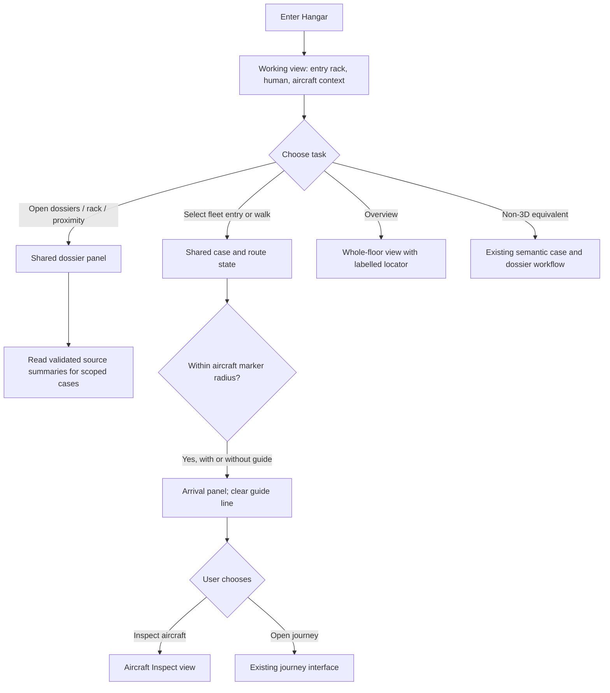

> **aircraft-hangar-redesign** | Status: Draft | Version: 0.1.0 | Last Updated: 2026-11-06

## Executive Summary

This draft defines a bounded presentation and interaction amendment to the approved
[Aircraft Hangar 3D Presentation Layer v0.4.1](aircraft-hangar-3d.md). It addresses the
reproduced close-up opening camera, remote and undiscoverable rack, route-dependent arrival,
primitive aircraft/avatar geometry, and disconnected camera and navigation state.

The change is limited to five precedence areas listed under Product Context: camera and
default-follow behavior; entry-side rack placement and layout validation; authored fictional
aircraft and human geometry; dossier, navigation, and arrival composition; and display-label
precedence. It does not supersede the entire approved PRD. All existing server authority,
case/object IDs, non-3D task equivalence, resource rights, CSP, size budgets, performance
targets, browser baseline, and release gates remain in force unless explicitly amended here.

The selected direction retains Three.js/React Three Fiber and project-authored,
untextured geometry. It introduces no engine replacement, textures, GLB assets, new package,
external model, or manufacturer-fidelity promise. The intended users are presenters and
reviewers navigating the existing synthetic cases, including keyboard and assistive-
technology users. This is a draft for human review; no implementation, approval, validation
review, or release sign-off is claimed.

---

## Research Readiness

Research status: `Required` (completed)

Rationale: Existing production composition and rendered behavior were inspected, and the
research report records the reproduced failures, alternatives, constraints, and limits.
Requirements below use that evidence. The report's synthetic API probe is not evidence of
deployed authentication, live source content, production-host behavior, or release
performance.

Research artifact:
[docs/research/2026-11-06/3d-interface-redesign-research.md](../research/2026-11-06/3d-interface-redesign-research.md).

Planning blockers: None for the bounded requirements choices in this draft. Human review
and approval merge remain required before implementation or story planning.

### Research Finding Dispositions

| Gap ID | Evidence IDs | Affected targets | Disposition | Rationale | Primary research artifact |
|---|---|---|---|---|---|
| F1 | C1, C2, C3, C8, C9, C10 | DD-001, FR-001–FR-003, NFR-001 | Incorporated | Research reproduced the close-up default-follow view and distant Overview; separate task views and actual rendered-camera ownership replace the conflicting default. | `docs/research/2026-11-06/3d-interface-redesign-research.md` |
| F2 | C1, C3, C4, C5, C6, C8, C12 | DD-002, FR-004–FR-006 | Revised | The rack exists and is reachable; the amendment moves it to the entry side, labels it, validates one layout source, and joins its controls to the shared panel. Overview-ray evidence does not establish aircraft occlusion as the cause. | `docs/research/2026-11-06/3d-interface-redesign-research.md` |
| F3 | C1, C5, C8 | DD-004, FR-008, AC-010 | Incorporated | Guided arrival works, while unguided proximity produced no arrival state. Arrival is therefore independent of an active guide route. | `docs/research/2026-11-06/3d-interface-redesign-research.md` |
| F4 | C7, C8, C10, C13 | DD-003, FR-007, AC-011, RC-001 | Incorporated | Current geometry is deliberately primitive. Authored, untextured fictional shapes address the geometry gap without expanding asset rights, CSP, or byte-budget scope. Human visual review remains necessary. | `docs/research/2026-11-06/3d-interface-redesign-research.md` |
| F5 | C1, C2, C5, C9 | DD-001, FR-001, FR-003, FR-005, NFR-001 | Incorporated | Separate controllers and canvas stubs passed while the production camera did not respond. Acceptance therefore exercises production composition and verifies the actual rendered camera, in addition to reducer/controller tests. | `docs/research/2026-11-06/3d-interface-redesign-research.md` |
| F6 | C1, C4, C6, C10, C14 | DD-004, FR-004–FR-006, FR-008 | Incorporated | The source-summary endpoint and validator already exist. The design reuses them, never fabricates coverage, and keeps case authorization distinct from summary-read failure. | `docs/research/2026-11-06/3d-interface-redesign-research.md` |
| Governance and retained boundaries | C11, C13 | CON-001–CON-004, Sign-Off | Incorporated | The broad amendment requires a human approval merge before implementation. Existing byte budgets and CSP constraints remain unchanged; they are not reported as newly measured. | `docs/research/2026-11-06/3d-interface-redesign-research.md` |

---

## Product Context

The approved 3D presentation layer remains the product boundary and server data remains
authoritative. The findings demonstrate that the opening scene composition and separated
interaction paths obscure useful existing capabilities; they do not justify a new product,
game engine, workflow, or backend contract. The production-facing browser probe used
synthetic API responses and a 1440 × 1100 viewport. Four inspected screenshots
(`hangar-initial.png`, `hangar-overview.png`, `hangar-dossiers.png`, and
`hangar-arrival.png`) are colocated with the research report. No automated pixel or contrast
measurement was used. The numeric framing bounds below are proposed acceptance targets,
not observed results or claims that the current implementation meets them.
Research ran 40 selected existing tests across seven files; those passing results do not
establish that production camera or scene wiring works.

**Amendment precedence.** The following decisions supersede only the corresponding
presentation defaults in `aircraft-hangar-3d.md` v0.4.1; all other provisions remain:

| Approved v0.4.1 provision | Amendment precedence |
|---|---|
| DD-022 and the Follow camera section: follow is on at Data Room entry, with the fixed radius-6 pose. | DD-001 and FR-001: enter in a composed Working view. Follow is an explicit optional mode, and its pose is part of the same camera state used by rendering and controls. |
| DD-017 and Scene rendering: rear-wall rack, start point, and interaction zone at their existing coordinates. | DD-002 and FR-004: use the entry-side rack/start/interaction layout below, with one validated manifest consumed by rendering, walking, and route logic. |
| DD-021, DD-029, FR-022: capsule-like human and primitive normalized aircraft geometry. | DD-003 and FR-007: use authored articulated fictional geometry with the specified silhouette and human visual acceptance. Retain the no-texture/no-GLB boundary. |
| FR-018–FR-020: rack menu, guide-line workflow, and non-3D list as separate entry paths. | DD-004 and FR-004–FR-006: visible Open dossiers, rack click, proximity, and non-3D navigation converge on one dossier/state model. |
| FR-019: arrival is tied to completion of a selected guided route. | DD-004 and FR-008: arrival is triggered by proximity with or without a route; guide lines clear on arrival. |
| Existing case name/category labels and illustrative fictional geometry. | DD-005 and FR-007: render the server-projected case display name and category verbatim. A manufacturer/model string in that data is a label only and never a promise that the geometry depicts that real aircraft. Geometry never invents or rewrites identifiers or labels. |

**Scope.** In scope: default camera composition and controls; layout and rack discovery;
dossier/source-summary composition; shared camera, walk, route, selection, and arrival
state; fictional visual construction; and automated plus human-facing acceptance. Out of
scope: backend or workflow changes, new endpoints or commands, new authentication or
authorization, flight simulation, real-world manufacturer fidelity, externally sourced
assets, new telemetry, and changes to the existing non-3D capabilities.

Requirement IDs in this document are stable and local to `aircraft-hangar-redesign`.
References to the approved product document are qualified as `HGv0.4.1`.

---

## Users and Personas

| Persona | Primary job | Pain point addressed | Success outcome |
|---|---|---|---|
| Presenter / demo operator | Show the hangar, locate dossiers, and enter a selected case. | Initial framing and disconnected controls hide the workflow. | Opens the shared dossier panel or reaches an aircraft without a forced route. |
| Technical, finance, or legal reviewer | Inspect only the case details and evidence available to their authenticated role. | Presentation must not obscure or expand server authority. | Uses the same server-backed case detail in 3D or non-3D mode. |
| Executive observer | Compare the three synthetic cases and their displayed labels. | Overview scale and primitive geometry weaken context. | Sees a composed opening and a legible all-case fleet strip. |
| Keyboard or assistive-technology user | Complete the same selection, dossier, and navigation tasks without pointer-only interaction. | Camera and walk controls must not consume semantic input. | Uses labelled controls and the equivalent non-3D interface. |

---

## Design Decisions

| ID | Decision |
|---|---|
| DD-001 | The initial camera mode is Working, not Follow or Overview. Working frames the entry-side rack, human, and nearest aircraft context. Follow remains an explicit optional mode. A single production camera state is authoritative for the rendered camera, presets, pointer input, keyboard input, and follow updates. |
| DD-002 | Preserve the existing 90 × 50 floor, aircraft positions, identifiers, and footprints. Move the rack and start area to the entry side using the layout contract below. The rack is 2 × 2 floor units and 2.2 units high, footprint x `[-1,1]`, z `[20,22]`, with its front face at z `20` facing `-z`. The interaction circle has radius `1.5`, center `(0,18.5)`; avatar start is `(-4,18.5)`. The single scene manifest is the source for rendering, walk collision, interaction, and route reachability. |
| DD-003 | Keep Three.js/React Three Fiber and project-authored, untextured fictional geometry. Aircraft have swept/tapered wings, tapered fuselage and nose/tail, cockpit/window forms, nacelles, gear, and separated coherent materials. The fictional human has distinct head, neck, torso, pelvis, paired arms/hands/legs/boots, face/hair silhouette, workwear, and a correctly fitted hard hat at consistent scale. No textures, GLB files, new packages, manufacturer marks, or photorealism are introduced. |
| DD-004 | One production interaction state owns camera mode, avatar position, guide destination, selected case/object, dossier visibility, and arrival latch. Rack click, proximity, Open dossiers, route, arrival, and non-3D controls use the same state and handlers. Reload resets transient scene state to the entry start and Working view; server state is unchanged and refreshed through existing interfaces. |
| DD-005 | Use exact server-projected case IDs, display names, categories, and detail. Render the name/category verbatim; geometry is fictional and cannot imply manufacturer fidelity. Never infer identity, status, owner, next action, capability, or evidence from geometry, role, or source labels. |
| DD-006 | The scene and dossier remain a presentation layer. The authenticated server retains role and case-scope authority; the redesign adds no command, endpoint, client authorization grant, telemetry, or source payload display. |

### Camera transitions

Working is the reload default. Selecting a mode replaces the previous fit. Working,
Overview, and Inspect disable following; Walk follows the avatar with the current bounded
user orbit offsets. The Follow control is an alias for entering Walk; turning it off
returns to Working. It is not a second camera authority and never restores the former
fixed radius-6 pose. Pointer drag and wheel adjust
the active fit and remain effective during following. Selecting a fleet entry selects
that case without teleporting the avatar or opening its journey; Inspect frames that
selected aircraft. Opening or dismissing dossiers changes no camera mode.

Working's aircraft context means the nearest aircraft's entrance-side marker and
server-projected label, with its silhouette visible beyond them, not the full aircraft
bounds. Full-aircraft framing belongs to Inspect. Labels and the fleet strip are semantic
overlays, not geometry scaled to match the human.

### Entry-side layout contract

The coordinates in DD-002 replace only the rack, interaction-zone, and avatar-start
coordinates in HGv0.4.1. The floor remains x `[-45,45]`, z `[-25,25]`, with its existing
walkable polygon. Existing aircraft footprints and markers remain unchanged. The layout
validator must confirm that the rack and start point are inside the floor, the rack and
interaction geometry do not intersect aircraft footprints, the avatar start is walkable,
and all three existing aircraft markers are reachable from the start and interaction zone
on the existing route grid. A failure blocks the layout; rendering, walking, and routing
must not use independent coordinate copies.

The rack has five vertically stacked, labelled source units in this order: technical,
maintenance, finance, records, contracts. A visible Data Room label identifies the rack.

---

## Product Goals

**GOAL-001: Make the existing hangar workflow discoverable and usable.**
Priority: MUST. By the first approved release of this amendment, every automated
acceptance criterion for camera composition, rack/dossier access, navigation, and arrival
passes, and the named human visual review accepts the opening, Overview, Walk, aircraft
Inspect, and human close-up views. No product usage baseline is asserted.

**SMART status:** deferred pending implementation evidence and human review.

---

## Functional Requirements

| ID | Requirement | Actor / trigger | Dependencies | Acceptance criteria | Product goals |
|---|---|---|---|---|---|
| FR-001 | On entry, present a Working camera view that frames the entry-side rack, a readable human, and nearest-aircraft context together. Provide a fleet strip with all three in-scope cases without requiring travel. Overview fits the entire floor; Walk frames the human; aircraft Inspect frames the selected aircraft. | User enters or selects a camera mode. | HGv0.4.1:FR-002, FR-004, FR-021, FR-022. | AC-001–AC-003 | GOAL-001 |
| FR-002 | Fit each camera mode to actual scene bounds and viewport aspect ratio; keep Overview’s whole-floor framing distinct from Working, Walk, and aircraft Inspect. Bound zoom and retain valid camera state on invalid input. | Scene entry, viewport change, mode selection, or zoom. | FR-001. | AC-001–AC-004 | GOAL-001 |
| FR-003 | Make pointer drag and wheel zoom affect the camera actually rendered, including Follow mode. Provide visible keyboard controls; camera and walk handlers operate only in their labelled focused regions and do not capture buttons, inputs, or Tab. Reduced-motion mode applies camera changes immediately. | User or viewport input. | FR-001, HGv0.4.1:FR-009, FR-010. | AC-004–AC-005 | GOAL-001 |
| FR-004 | Present the five-source rack at the entry-side location with visible Data Room label and an always-visible semantic Open dossiers control. Rack click, proximity, and Open dossiers open the same dossier panel. All scene and non-3D controls use the same walk, route, selection, and panel state. | Scene loads or user opens dossier access. | DD-002, DD-004, HGv0.4.1:FR-016–FR-020. | AC-006–AC-008 | GOAL-001 |
| FR-005 | Read source summaries only for cases in the current authenticated scoped case list through `GET /api/v1/cases/{caseId}/sources` and the existing `sourceSummary.ts` contract validator. Display only validated server fields; show the exact text `source summary unavailable` on a failed or unsupported summary. A visible scoped case remains selectable when its summary fails; source failure does not grant case access. | User opens dossiers or selects a case. | HGv0.4.1:FR-002, FR-003, FR-018; server source-summary contract. | AC-007–AC-009 | GOAL-001 |
| FR-006 | Preserve the five existing summary roles—`technical-reviewer`, `finance-reviewer`, `legal-reviewer`, `presenter`, and `executive`—and render only role-specific detail returned by the server. Scene and non-3D selection add no authorization or workflow command. | Authenticated role views a case. | HGv0.4.1:FR-003, FR-008, FR-014, FR-018. | AC-009 | GOAL-001 |
| FR-007 | Render aircraft as recognizable fictional swept/tapered silhouettes with nose, tail, cockpit, nacelles, gear, and material separation. Render a consistently scaled articulated fictional human with separate human body parts, face/hair silhouette, workwear, and fitted hard hat. Preserve server display names and categories verbatim without asserting that geometry is a real manufacturer/model. | Scene loads or aircraft is inspected. | DD-003, DD-005, HGv0.4.1:FR-022. | AC-011–AC-012 | GOAL-001 |
| FR-008 | On entering within radius `1.5` of any aircraft marker, show an arrival panel whether or not a guide route is active. Clear any guide line on arrival. Show server case identity, owner, next action, and mapped evidence, or explicit empty states; offer Inspect aircraft and Open journey. Opening journey requires explicit user action. | Avatar enters aircraft marker radius. | FR-004–FR-006, HGv0.4.1:FR-003, FR-019. | AC-010 | GOAL-001 |
| FR-009 | Latch a dismissed arrival panel until the avatar leaves and re-enters that aircraft’s marker radius. Replacing a guide destination clears the prior guide and closes its arrival panel; arrival at the new destination is eligible once. Reload resets transient avatar, route, selection, camera, panel, and dismissal state to the entry defaults without changing server state. | User dismisses arrival, changes destination, or reloads. | DD-004, FR-008. | AC-010 | GOAL-001 |

**Role/action matrix.** The role names below are the existing summary roles, not a new
authorization policy. The client does not infer a role-to-source mapping or broaden
available detail; it renders only the role-specific summary returned by the server.
Unknown roles are denied by the existing server checks (`403 forbidden`), absent sessions
receive `401 unauthenticated`, and out-of-scope cases receive the existing bare `404`.
Denied requests must reach no source adapter. The browser does not display cases omitted
from the scoped case list or infer access from a selectable mesh.

| Existing role | Summary detail | Scene and dossier actions |
|---|---|---|
| `technical-reviewer` | Only role-specific detail returned by the server. | Select a listed case and open its read-only dossier; existing server-authorized case controls only. |
| `finance-reviewer` | Only role-specific detail returned by the server. | Select a listed case and open its read-only dossier; existing server-authorized case controls only. |
| `legal-reviewer` | Only role-specific detail returned by the server. | Select a listed case and open its read-only dossier; existing server-authorized case controls only. |
| `presenter` | Only role-specific detail returned by the server. | Select a listed case and open its read-only dossier; existing server-authorized case controls only. |
| `executive` | Only role-specific detail returned by the server. | Select a listed case and open its read-only dossier; existing server-authorized case controls only. |

---

## Non-Functional Requirements

### Performance and Capacity

**NFR-001: Performance and capacity.** Preserve HGv0.4.1 size and timing targets as
release checks: at most 1,572,864 gzip JavaScript bytes attributable to Hangar entry,
at most 15,728,640 total scene-asset bytes, Hangar selectable within 8 seconds, and
selection P95 no greater than 500 ms on the existing demo baseline. These are targets,
not measured results. Verification: AC-013 and release check RC-003.

### Reliability and Resilience

Existing Hangar failure and non-3D fallback behavior remains unchanged. This amendment
adds no reliability target.

### Security

**NFR-002: Security.** All case/source reads and workflow operations continue to use
existing server authentication and role/scope checks. The browser renders only cases
returned by the authenticated scoped case list and does not create local authorization
grants. Source-summary responses retain the existing endpoint outcomes: `401`
unauthenticated, `403` forbidden, `404` bare not-found, `400 unsupported_contract_version`,
`503` service error, `504 source_read_timeout`, and `422 source_payload_limit`. No new API
error is introduced. Verification: AC-007–AC-009 and existing endpoint tests.

### Privacy

**NFR-003: Privacy.** Show only validated source summary fields; never expose source
records, infer missing coverage, or transmit avatar, camera, route, selection, or client
telemetry. Use synthetic visual assets and labels. Verification: AC-007–AC-009 and
existing privacy/transport checks.

### Scalability and Elasticity

No change from HGv0.4.1; the supported case set remains the existing three cases.

### Maintainability and Operability

**NFR-004: Maintainability.** One production manifest and one interaction/camera state
must drive rendering, camera input, walking, routing, case selection, rack, and arrival.
Automated acceptance must exercise production application composition and startup
wiring; testing only copied reducers, isolated controllers, or a test-local stub scene
does not satisfy the requirement. Verification: AC-005–AC-010, AC-014.

### Observability

No new telemetry or telemetry vocabulary is introduced. Existing observability behavior
remains unchanged.

### Usability and Accessibility

**NFR-005: Usability and accessibility.** The 3D scene retains semantic, visible,
keyboard-operable controls and the equivalent non-3D workflow. Text contrast remains at
least 4.5:1 through the existing token-pair contract and review; no automated browser
pixel or contrast measurement is required or claimed. Human review checks the actual
painted labels and controls. Verification: AC-005–AC-009, AC-013–AC-014, RC-001–RC-002.

### Compatibility and Interoperability

Existing browser/device support and the existing typed server contracts remain unchanged.
The three viewport profiles named in AC-001 are framing acceptance inputs, not a change
to the supported-browser baseline.

### Portability

No change from HGv0.4.1: the Hangar remains in the existing client and uses same-origin
resources.

---

## Constraints

| ID | Constraint | Category | Imposing source, authority, affected boundary, and impact |
|---|---|---|---|
| CON-001 | Preserve server authority for case state, identifiers, status, owner, next action, capability, evidence mapping, roles, and authorization. Preserve the existing non-3D equivalence. | Technical | HGv0.4.1 and ARR/CP/SS contracts; bounds presentation and integration; no local grants or new workflow. |
| CON-002 | Retain Three.js/React Three Fiber and project-authored, untextured fictional geometry. No engine replacement, textures, GLB files, new packages, manufacturer marks, or photorealism. | Technical / rights | HGv0.4.1 DD-002, DD-015, DD-029 and C7/C10/C13; preserves current asset-rights and CSP boundary. |
| CON-003 | Preserve existing resource rights, CSP, JavaScript/asset budgets, 8-second startup target, 500 ms P95 selection target, browser/device baseline, and release-check process. | Operational / technical | HGv0.4.1 and C13; these remain acceptance targets, not claims of achieved performance. |
| CON-004 | Add no backend endpoint, workflow command, client authorization, source-record display, or client telemetry. Keep source-summary read and error behavior within the existing contract. | Technical / privacy | Existing server contracts and C14; the amendment is presentation-only. |

---

## Process Models

---

## Acceptance Criteria

Automated criteria exercise production wiring and fail when behavior is removed. The
named human visual review is not replaced by mesh-name, pixel, or contrast automation.
The existing tests identified by research that must be updated or replaced are
`frontend/tests/HangarPlayMode.test.tsx`,
`frontend/tests/hangarAppHarness.ts`,
`frontend/tests/HangarCameraController.test.ts`,
`frontend/tests/HangarFollowCamera.test.ts`,
`frontend/tests/HangarSceneBuilder.test.ts`,
`frontend/tests/HangarRackMenu.test.tsx`, and
`frontend/tests/HangarSelectionEvidence.test.tsx`. Their prior passing results do not
establish that production camera or scene wiring works.

| ID | Given / When / Then acceptance intent | Covers | Verification | Status |
|---|---|---|---|---|
| AC-001 | Given viewport profiles 1280 × 720, 1440 × 1100, and 390 × 844, when Working opens, then the projected bounds of rack, human, and nearest-aircraft entrance marker fit within 5% inset on every edge; their combined bounds occupy 60–92% of stage width and 45–85% of stage height; the human occupies 6–16% of stage height; the rack label, nearest-aircraft label, and all three fleet entries are visible. Measurements use the actual stage after responsive controls, not the outer window; the whole aircraft need not fit in Working. | FR-001, FR-002 | Automated camera-fit/layout assertions using actual bounds; no pixel measurement. | Not Started |
| AC-002 | Given any of the three named viewport profiles, when Overview is selected, then all four walkable-floor corners remain within a 5% inset, and a labelled locator remains legible; Overview does not stretch the human or aircraft. | FR-001, FR-002 | Automated camera-fit/layout assertions. | Not Started |
| AC-003 | Given Walk or aircraft Inspect mode at any named viewport, when its fit is computed, then the human occupies 8–22% of stage height in Walk and the inspected aircraft’s largest projected bound occupies 35–75% of the stage in Inspect, with at least 5% inset and no clipping. User zoom remains within 0.8–1.4 times the mode’s fitted distance. | FR-001, FR-002 | Automated aspect-aware fit and zoom-bound assertions. | Not Started |
| AC-004 | Given the production Hangar composition in Working or Follow mode, when pointer drag, wheel, or the visible keyboard controls are used, then the actual rendered camera changes within the existing orbit-angle clamps; focused controls alone receive camera/walk keys, Tab and form controls retain normal behavior, and reduced motion applies changes immediately. | FR-002, FR-003 | Production camera integration test plus existing camera-controller tests; manual pointer check in RC-001. | Not Started |
| AC-005 | Given the production application and scene manifest, when the application starts and mode, walk, selection, route, or viewport state changes, then the rendered camera and scene controls reflect the same state; no disconnected legacy route or test-local state drives visible controls. | FR-003, FR-004, NFR-004 | Production startup/composition integration test, including real camera object wiring; not satisfied by canvas-prop stubs alone. | Not Started |
| AC-006 | Given the entry layout, when layout validation runs, then the rack is at the DD-002 coordinates with five ordered vertical units; rack, interaction zone, and avatar start pass floor/footprint checks; all existing aircraft markers remain reachable from the start and interaction zone; and render, collision, and route calculations use that same manifest. | FR-004 | Automated scene-manifest and route-reachability tests. | Not Started |
| AC-007 | Given an authenticated scoped case list, when the user clicks the rack, enters its interaction zone, activates Open dossiers, or uses the non-3D dossier control, then each path opens the same dossier state and displays only the five validated source summaries from the existing endpoint. On summary failure or unsupported contract, the exact text `source summary unavailable` appears, with no fabricated coverage; a currently listed case remains selectable. | FR-004–FR-006 | Production composition/API-contract integration test using the real validator and endpoint contract fixtures. | Not Started |
| AC-008 | Given a source-summary response with any existing outcome—401, 403, 404, 400, 503, 504, or 422—when the dossier is rendered, then it uses the existing unavailable state and existing session behavior, never invents coverage or exposes source records, and never grants case authorization. Cases absent from the authenticated scoped list are not rendered. | FR-005, FR-006 | Frontend contract tests and existing `SourceSummaryEndpointTests`; no new status/error contract. | Not Started |
| AC-009 | Given each of the five existing summary roles, when its scoped case list and source summary are rendered, then only server-returned role-specific detail is shown; the client adds no role mapping, action, or permission. Selection remains read-only. | FR-005, FR-006 | Existing server role/scope tests plus production frontend integration tests. | Not Started |
| AC-010 | Given the avatar is guided or unguided, when it enters within 1.5 units of an aircraft marker, then the arrival panel opens once, the guide line clears, server case identity/owner/next action/mapped evidence are shown with explicit empty states, and Inspect aircraft and Open journey are offered. Opening the journey requires explicit user activation. Dismissal stays latched until exit/re-entry; changing destination clears the old guide/panel; reload restores entry defaults without a server mutation. | FR-008, FR-009 | Production walk/arrival integration tests for guided and unguided paths, latch, route replacement, and reload. | Not Started |
| AC-011 | Given the scene builder and production view, when aircraft are rendered, then each has a tapered nose/fuselage, swept/tapered wing and tail surfaces, cockpit/window form, nacelles, landing gear, and visually separated coherent materials; geometry remains fictional and untextured and uses server-projected IDs/names without inference. | FR-007 | Scene-structure tests plus human review RC-001; structure alone does not establish visual quality. | Not Started |
| AC-012 | Given the human avatar in the production scene, when opening, Walk, aircraft Inspect, and human close-up views are reviewed, then distinct head/neck/torso/pelvis, paired arms/hands/legs/boots, face/hair silhouette, workwear, fitted hard hat, consistent physical scale, and coherent human proportions are visible. | FR-007 | Named human visual release check RC-001; mesh names alone do not pass. | Not Started |
| AC-013 | Given the production build and demo baseline, when the retained release checks run, then JavaScript and asset totals remain within CON-003, Hangar becomes selectable within 8 seconds, and selection P95 is at most 500 ms; actual environment and results are recorded. | NFR-001 | Existing budget validation and measured release check RC-003; no result is asserted by this draft. | Not Started |
| AC-014 | Given the opening and semantic controls, when the named visual/accessibility review runs, then labels and controls are visible and legible, text uses token pairs with at least 4.5:1 contrast, reduced motion is immediate, and keyboard/non-3D workflows remain usable. No automated browser pixel/contrast result is used. | NFR-005 | Human visual and keyboard review RC-001–RC-002. | Not Started |

### Release checks (manual)

| ID | Check | Covers |
|---|---|---|
| RC-001 | In a real browser, review Working, Overview, Walk, aircraft Inspect, human close-up, rack, and dossier views at the named viewports. Confirm legible labels and the intended composition; do not use automated pixel measurement as proof. | FR-001, FR-004, FR-007, NFR-005 |
| RC-002 | Complete the keyboard-only and non-3D dossier/navigation flow, verify focus behavior and reduced-motion behavior, and review text token pairs against the 4.5:1 contrast contract. Record human review; no automated contrast claim. | FR-003–FR-006, NFR-005 |
| RC-003 | On the existing demo baseline, record browser/device versions, Hangar startup time, P95 selection time, gzip JavaScript bytes, and total scene-asset bytes. Compare against NFR-001; this draft contains no measured release result. | NFR-001, CON-003 |

---

## Traceability Matrix

### FR-to-AC Coverage

| FR | Acceptance criteria |
|---|---|
| FR-001 | AC-001–AC-003 |
| FR-002 | AC-001–AC-004 |
| FR-003 | AC-004–AC-005 |
| FR-004 | AC-005–AC-007 |
| FR-005 | AC-007–AC-009 |
| FR-006 | AC-007–AC-009 |
| FR-007 | AC-011–AC-012 |
| FR-008 | AC-010 |
| FR-009 | AC-010 |

Coverage: 9/9 FRs have one or more AC links (100%; threshold 80%).

### FR-to-GOAL Alignment

| FR | Product goals |
|---|---|
| FR-001–FR-009 | GOAL-001 |

Coverage: 9/9 FRs have one or more GOAL links (100%; target 100%).

No feasibility handoff is in scope; there are no feasibility candidate disposition rows.

---

## MVP and Release Framing

The first release of this amendment includes all FR-001–FR-009, their automated
acceptance criteria, and the named human visual/accessibility checks. No feature is
deferred from this bounded scope. Existing HGv0.4.1 journeys, source contracts, fallback,
non-3D behavior, security boundary, rights/CSP rules, and release checks remain in force.
Implementation and story planning are outside this draft and require an approval merge.

---

## Success Metrics

| Goal | Indicator | Baseline | Target | Measurement window | Evidence |
|---|---|---|---|---|---|
| GOAL-001 | Requirements acceptance and named visual review | C1–C10 reproduce presentation and interaction gaps; release results are not available. | 14/14 acceptance criteria pass; all five named human visual views and keyboard/non-3D checks are recorded as accepted before release. | Each later release candidate. | Test results and human review record; no telemetry or usage baseline is introduced. |

---

## Risks and Assumptions

### Key Assumptions

| ID | Assumption | Evidence status | Impact if false | Mitigation | Source |
|---|---|---|---|---|---|
| AS-001 | The proposed entry-side coordinates leave all retained aircraft footprints and markers valid. | Derived from existing footprint/marker data; validator pending implementation. | Rack, start, or route could overlap or be unreachable. | Enforce DD-002 layout validation and AC-006 before acceptance. | C3, C10 |
| AS-002 | Authored untextured geometry can meet the named visual acceptance without GLB or textures. | Stack and current geometry confirmed; visual result untested. | Art direction may need another approved amendment. | Human review across RC-001 views; retain current asset and CSP limits. | C7–C10, C13 |
| AS-003 | Existing server summary response and validator provide the fields required by the dossier. | Endpoint/validator presence verified; synthetic browser edge did not verify live authenticated content. | Panel may need to show explicit empty/unavailable states. | Use existing contract tests and production integration check; do not invent data. | C8, C14 |
| AS-004 | Existing browser/device baseline can support the three named framing profiles. | Not release-tested. | A supported viewport may require layout adjustment. | Run fit assertions and record browser/device during RC-001 and RC-003. | C8, C13 |

### Risk Register

| Risk | Probability | Impact | Mitigation |
|---|---|---|---|
| More detailed shapes still fail to read as human or aircraft. | Medium | High | Require actual rendered-view human review; do not accept geometry names as visual evidence. |
| A separate camera or legacy interaction path remains wired into the visible page. | Medium | High | Production startup/composition acceptance; verify the rendered camera, not only helper reducers. |
| Source failure is mistaken for case denial or causes inferred coverage. | Medium | High | Keep scoped case-list authority distinct; show the exact unavailable text and no inferred summary. |
| New framing fails at narrow or short viewports. | Medium | Medium | Test all three named viewport profiles against numeric bounds and retain the non-3D equivalent. |
| Human approval is bypassed before implementation. | Low | High | Repository gate: no implementation or story planning before the draft is approved by merge. |

---

## Glossary

| Term | Definition |
|---|---|
| Working view | Default composed view showing the entry rack, human, and nearest-aircraft context. |
| Overview | Camera mode that fits the full walkable floor and retains a labelled locator. |
| Walk | Camera mode framed on the presenter avatar during scene navigation. |
| Inspect | Camera mode framed on a selected aircraft. |
| Scoped case list | Cases returned to the authenticated user by the existing server-authorized case-list interface. |
| Source summary | Validated read-only, five-source summary returned by the existing source-summary endpoint. |
| Arrival latch | Per-marker dismissal state that clears only after the avatar leaves that marker's radius. |

---

## Sign-Off

### Approval Checklist

* Product Sponsor: Pending human review.
* Product Owner: Pending human review.
* Technical Lead: Pending human review.
* Quality Lead: Pending human review.
* Legal/Compliance: Existing rights/CSP boundary retained; no new asset source proposed.

Approval date: Not approved.

### Waivers

None requested.

### Handoff Readiness

Not ready for implementation or story planning. This draft must be reviewed and approved
through the required human approval merge. Validate and Finalize have not been run, and no
quality-review report, approval decision, sign-off, or handoff is asserted.

---

## Disclaimer

> [!CAUTION]
> **Disclaimer:** This agent is an assistive tool only. It does not provide product management approval, technical feasibility validation, or business sign-off and does not replace product managers, engineering leads, business stakeholders, or other qualified human reviewers. The output consists of suggested requirements, acceptance criteria, and product specifications to support a user's own product planning and decision-making. All Product Requirements Documents, functional requirements, non-functional requirements, and constraint definitions generated by this tool must be independently reviewed and validated by appropriate product and engineering reviewers before adoption. Outputs from this tool do not constitute product approval, requirements sign-off, or engineering commitment.

---

## Document Metadata

* Template Version: 1.0.0.
* Canonical Template: `docs/templates/prd-template.md` (section structure aligned with
  `requirements-author/templates/prd/prd-full.md`).
* License: CC-BY 4.0 (Microsoft HVE-Core).
* Attribution: Microsoft HVE-Core Team.
