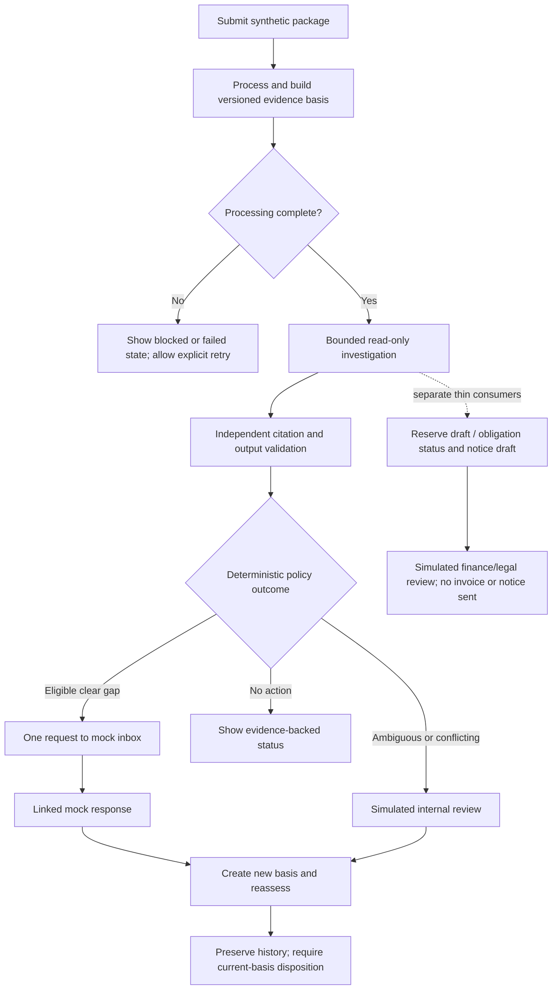

# Aircraft Return Readiness Demonstrator

> **aircraft-return-readiness** | Status: Draft | Version: 0.8.0 | Last Updated: 2026-10-14

## Executive Summary

This PRD defines a synthetic, fictional aircraft-return readiness demonstrator for Altivane Aviation Capital. It shows how a bounded investigator can identify records gaps, how deterministic policy routes permitted administrative requests to a mock inbox, and how simulated human reviewers resolve uncertainty. New evidence creates a new assessment basis while preserving prior history. The demo also includes thin, deterministic reserves and contract-obligation consumers.

The product is a bounded reference demonstration, not an operational leasing platform. Its goals are to complete the specified synthetic journeys, compare four investigation approaches on a frozen 40-case set, show consequential simulated review decisions, and document a reproducible deployment for a later, organization-approved environment. All acceptance criteria describe future verification; this draft does not claim implementation, deployment, quality approval, business sign-off, runtime results, certification, or production readiness.

## Product Context

In the fictional scenario, fragmented technical records and related lease information make it difficult to distinguish a genuine records gap from ambiguous, incomplete, or unprocessed evidence. The demonstrator makes the evidence basis, current status, responsible review role, and permitted next action visible without treating records readiness as financial approval, legal approval, contractual acceptance, airworthiness certification, or aircraft release.

The core demonstration journey is limited to one fictional aircraft, one engine, two components, and approximately 8–12 synthetic evidence documents. A three-aircraft synthetic case pack supplements that journey and is governed by the [Aircraft Case Pack PRD](aircraft-case-pack.md); see the v0.7.0 addendum. It supports a complete baseline, a clearly missing-history path, and an ambiguous-identity path. Results from synthetic fixtures are not evidence of real-world accuracy, safety, regulatory compliance, or commercial benefit.

The companion business context is the draft [Case 43 BRD v0.2.3](../brd/case-43-brd.md). That BRD describes the broader fictional programme; this PRD scopes only the demonstrator and does not adopt future operational targets or imply a governed BRD handoff.

## Users and Personas

All reviewer roles below are simulated within the demonstrator. Their recorded decisions affect synthetic workflow state only and do not represent organizational approval.

| Persona | Primary job | Pain point addressed | Demonstrator success outcome |
|---|---|---|---|
| Presenter / demo operator | Load a fixture, show the evidence-led paths, explain the outcome, and reset the run. | Hard to explain the difference between an evidence finding, a policy action, and a human decision. | Can show the current basis, allowed action, consequential review, and a clearly identified fallback. |
| Technical reviewer (simulated) | Inspect cited evidence and resolve ambiguity on the current basis. | A click or model conclusion must not be mistaken for technical acceptance. | A reasoned, basis-bound decision changes visible synthetic state and is retained in history. |
| Finance reviewer (simulated) | Review a reserve calculation and its discrepancies or blocked inputs. | Missing or stale inputs must not be treated as zero usage or an approved amount. | A deterministic draft and decision are visible; no invoice is issued. |
| Legal reviewer (simulated) | Review an eligible obligation and notice draft. | A routine evidence request or ambiguous finding must not be represented as a breach or formal notice. | A draft and simulated decision are visible; no notice is sent. |
| Executive observer | Understand progress, evidence, ownership, and limits. | A single status or attractive dashboard can obscure outstanding work or overstate readiness. | Sees distinct queues, activity, evidence, capability labels, and authority boundaries. |

## Design Decisions

These source design positions are carried forward as draft product decisions, not as evidence of implementation or business sign-off.

| ID | Decision |
|---|---|
| DD-001 | Augment existing records, maintenance, and finance processes; do not replace them. |
| DD-002 | Any broader programme progression is evidence-gated; this demonstrator does not make programme or funding decisions. |
| DD-003 | The demonstrator permits only bounded requests to a mock inbox. Ambiguity routes to internal review; no real external contact occurs. |
| DD-004 | Technical conclusions and evidence acceptance remain with an authorized human role; simulated decisions are not genuine approvals. |
| DD-005 | Use synthetic data and provide a live demonstration with a recorded fallback. |
| DD-006 | The intended .NET 10 ASP.NET Core application owns persisted case workflow state and runs in Azure Container Apps. No Azure Functions host or second case orchestrator is in scope. |
| DD-007 | Azure SQL stores workflow/business/audit state; Blob Storage stores document content and versions. |
| DD-008 | Azure AI Foundry supports model governance/evaluation and governed Azure OpenAI endpoints serve evaluated arms. Exact model, deployment, and account identifiers are not specified by this PRD. |
| DD-009 | One bounded Microsoft Agent Framework investigator may plan read-only tool calls inside the investigation step; the application owns the case lifecycle state machine. |
| DD-010 | No long-lived agent, multi-agent chat, second orchestrator, agent approval, or agent external action is allowed. |
| DD-011 | Compare model approaches in the evaluation harness; do not assume a preferred model before results. |
| DD-012 | Reserves and contract-obligation handling are thin deterministic consumers. Neither issues invoices or notices. |
| DD-013 | The reviewer interface is a React + TypeScript single-page client, built with Vite and served as static assets by the ASP.NET Core application in the same container. The server remains authoritative for identity, scope, state, policy, decisions, permissions, and capability labels. |
| DD-014 | Sign-in is demo-only: seeded synthetic users, their roles and their case scopes come from a versioned fixture, chosen on a sign-in page. The server issues an HttpOnly, Secure, SameSite=Strict session cookie and requires an anti-forgery token on every state-changing command. No external identity provider is used; the server stays authoritative for role and scope on every request. |
| DD-015 | The Terraform root is `infra/terraform`. Azure SQL, Blob Storage and the model endpoint have public network access disabled and are reached through private endpoints in the Container Apps virtual network. The application authenticates with managed identity; no access keys or connection-string secrets. Encryption at rest uses Microsoft-managed keys. |
| DD-016 | Investigation models are configuration, not code: arm B uses a small (mini-class) Azure OpenAI deployment, arm C a larger one, and arm D the same deployment as its agent comparator. Deployment names, API version and region live in the non-secret deployment configuration and are recorded in every investigation trace. |
| DD-017 | Supply-chain evidence: the build produces a CycloneDX SBOM for the .NET and npm dependencies and runs `dotnet list package --vulnerable` and `npm audit`. A high or critical finding blocks the release candidate unless an exception with a reason and an expiry date is recorded in `docs/`. Packages come only from nuget.org and npmjs.org. The container image is signed with Notation and an Azure Key Vault key, and the deployment verifies the signature before it updates the app (DD-031). |
| DD-018 | Each synthetic obligation carries `noticeWindowStart` and `noticeWindowEnd` as UTC dates, both inclusive. The obligation fixtures include a before-window case, a first-day case, a last-day case and an overdue case. Evaluation uses a fixed as-of date from the fixture, never the system clock. |
| DD-019 | Workload limits (NFR-005, NFR-007): a package holds at most 12 documents, 10 MB each and 50 MB in total; an investigation makes at most 20 tool calls and 8 model calls within 30 seconds; a model call uses at most 16,000 input and 2,000 output tokens, with at most 2 retries and exponential backoff; each user submits at most 10 packages per minute; at most 2 investigations run at once; a scored evaluation run is 40 cases times 4 arms and stops, reporting what it completed, at 3,000,000 tokens. Every limit fails with an explicit, recorded error, never a silent truncation. |
| DD-020 | No formal accessibility target applies. The bounded checks in NFR-009 are the acceptance bar for the interface and do not claim conformance to any standard. |
| DD-021 | Mock evidence requests use this approved template, version 1, approved by the product owner with this PRD: "Synthetic demonstration request. For {component} {serialNumber}, please provide {missingRequirement}. Evidence basis {basisId} v{basisVersion}. Reference {requestId}." A request is delivered only with the current template version; changing the wording is a PRD change. |
| DD-022 | Container Apps ingress is external but limited to an allowlist of presenter and reviewer IP ranges (CIDRs) in the non-secret deployment configuration; the platform denies everything else. An empty allowlist means nobody can reach the app. |
| DD-023 | The sign-in page asks for one shared demo passcode before the seeded-user picker. The passcode is a Container Apps secret sourced from Key Vault, never in the repository. A wrong passcode gets a generic error and is rate-limited per source address. A session lasts 8 hours, sliding; sign-out is explicit, and switching users means signing out. |
| DD-024 | Least-privilege identities, each scoped to a single resource. The app's user-assigned identity: an Azure SQL contained user with db_datareader, db_datawriter and EXECUTE on its schema (no DDL); Storage Blob Data Contributor on the evidence container only; Cognitive Services OpenAI User on the Azure OpenAI account. A separate migration identity, used only at deployment: db_ddladmin. The Terraform identity: Contributor and User Access Administrator on the demo resource group only. |
| DD-025 | The Azure OpenAI account is in Sweden Central and uses Global Standard deployments, so model processing may happen outside the region; this is acceptable because all data is synthetic (CON-001). Default abuse monitoring applies; prompts are not used for training. The app reaches the model only through its private endpoint (DD-015). |
| DD-026 | Evidence documents are text-based PDF only, without OCR. They are parsed in-process with a maintained .NET PDF library; page text is extracted, and embedded files, scripts, forms and images are ignored. A document has at most 200 pages (with DD-019's size limits); nested archives are rejected. A parse failure marks that document failed and retryable (AC-004) and never counts as evidence. |
| DD-027 | Blob versioning and 14-day soft delete are on for the evidence container; documents are never overwritten in place. Azure SQL keeps 35 days of point-in-time restore. Audit records are append-only: the app identity cannot update or delete them, and they are kept for the life of the demo. A demo reset starts a new run and never rewrites history. Only the Terraform identity can delete the resource group. |
| DD-028 | One origin: the app serves the React client, and there is no CORS. Content-Security-Policy: `default-src 'self'; script-src 'self'; style-src 'self'; img-src 'self' data:; object-src 'none'; frame-ancestors 'none'; base-uri 'none'`. HTTPS only, TLS 1.2 minimum, HSTS. The session cookie is `__Host-` prefixed, HttpOnly, Secure and SameSite=Strict (DD-023). Every state-changing request carries an ASP.NET Core anti-forgery token in a header. |
| DD-029 | Diagnostics go to Application Insights backed by a Log Analytics workspace in the demo resource group, with 30-day retention, readable only by the product owner and the Terraform identity. The app logs identifiers, states, counts, durations and token usage, never raw prompts, document text, passcodes or cookies; a logging filter enforces this and a test proves it. Investigation traces keep model and tool names and citations, not document content. |
| DD-030 | Build and deployment run on GitHub Actions: the workflow builds the image, produces the SBOM and audit results (DD-017), signs the image, and pushes it to an Azure Container Registry in the demo resource group, which the app pulls over a private endpoint. Deployments run from a protected GitHub environment approved by the product owner, authenticated with OIDC federated credentials and no stored secrets. The SBOM, audit output and signature are kept as workflow artifacts for 90 days. The workflow files (`.github/workflows/`) are built by pipeline stories like the rest of the solution, each in its own story, and merged by the product owner. The Azure Container Registry, the Key Vault signing key and the Entra federated credential the workflow uses are managed in `infra/terraform` (DD-015). The product owner configures the protected GitHub environment and its required reviewer once; that is a repository setting, not a file. |
| DD-031 | Before a deployment updates the app, it verifies the image signature (DD-017) against the Key Vault certificate and refuses an unsigned or mismatched image. The image is referenced by digest. |
| DD-032 | PDF text is extracted with the open-source PdfPig library (`UglyToad.PdfPig`, Apache-2.0) in-process, as DD-026 describes. The story that adds it pins an exact version, uses only text extraction (no OCR, no network, no native code), enforces DD-019 and DD-026's size and page limits before parsing, and includes a corpus of malformed, truncated and oversized PDFs that must fail as a retryable parse failure without crashing the app. The dependency is reviewed under DD-017's vulnerability audit like every other package. |
| DD-033 | The frozen 40-case evaluation suite is drafted by a pipeline story: 40 synthetic cases and draft annotations generated reproducibly (fixed seed) from a documented case design with a stated mix across the headline situations, committed to the repository for review. The product owner reviews the cases and annotations in that pull request; the merge is the freeze. The fixture then carries a version and a content hash, any change requires a new version, and scored runs refuse a suite whose hash does not match. |
| DD-034 | Model configuration is a versioned, non-secret manifest (deployment names, models, API version, region, content-filter setting). It ships with placeholder values, and the loader refuses any model call or scored run until every value is filled in and marked approved. The product owner supplies the real values and approves them by merging the manifest pull request; any later model change is a new manifest version approved the same way. Global Standard processing outside Sweden Central is accepted for synthetic data (DD-025). |
| DD-035 | Environment-specific values are never baked in: presenter and reviewer CIDRs, DNS and egress policy, subscription, tenant and budget are Terraform input variables without defaults, with a documented example file. The Terraform state backend is an Azure Storage account with Entra authentication and locking, its name a variable. Pipeline stories build and test the configuration (validate, plan against a mock) and never provision; the product owner runs `terraform apply` with real values. |
| DD-036 | This PRD file on the default branch is the only source of requirements and its front-matter version is authoritative. A different source version cited by any generated artifact, such as a threat model, is an error in that artifact, and is regenerated from the current PRD at the next planning run. |
| DD-037 | No formal security review applies to this synthetic demonstrator. The threat model is advisory: its mitigations are built and tested as acceptance criteria, but no review sign-off gates release or deployment stories. |
| DD-038 | The rehearsal story builds the checklist, the timing and trace-capture scripts and the evidence template for AC-012 and AC-019. The product owner performs the rehearsal once the environment exists and commits the real evidence (run identifiers, timings, trace, decision, recorded fallback) in a pull request. The story is complete only with that evidence attached; no evidence is ever generated or fabricated. |
| DD-039 | The frozen 40-case evaluation suite contains exactly 10 cases in each of four categories: complete baseline, missing history, ambiguous identity, and blocked or unprocessed evidence. |
| DD-040 | Arm D is the single-call comparator for Arm B and uses the same approved model deployment configuration as Arm B, without iterative tool use or agent citation reflection. |

## Product Goals

| ID | Goal | Evidence of attainment | Priority |
|---|---|---|---|
| GOAL-001 | Complete both headline records paths, including a consequential simulated human decision and response-driven reassessment. | Versioned fixtures, passing journey acceptance checks, and business audit history. | MUST |
| GOAL-002 | Demonstrate a safely evaluated Agent Framework investigator; compare four approaches on the same frozen synthetic set and disclose quality, latency, cost, and limitations. | Actual investigation traces, frozen ground truth, four-arm results, and a documented selection rationale. | MUST |
| GOAL-003 | Run the reserves and contract-obligation consumers with expected synthetic outputs and recorded simulated review decisions, without invoice or notice dispatch. | Expected arithmetic, obligation fixtures, drafts, and review records. | MUST |
| GOAL-004 | Reproduce the solution from a repository revision in an organization-approved environment, with smoke-test and live/fallback evidence. | Terraform plan/apply/repeat-plan evidence, deployment and seeding record, README, smoke tests, and rehearsal evidence. | MUST |

Each goal has a quantitative indicator, a baseline, a target and a window in the goal-level measurement plan under Success Metrics. Baselines are the pre-build state (nothing is built yet); they are not measured results. Goals are bounded by release-candidate revision, not by calendar date. SMART status is assessed at the next PRD review.

## Functional Requirements

All references in the final column are explicitly BRD-scoped; unprefixed requirement and acceptance IDs in this document belong to this PRD.

| ID | Requirement | Actor / trigger | Acceptance criteria | Product goals | BRD trace |
|---|---|---|---|---|---|
| FR-001 | Build a scoped, versioned evidence basis for each submitted synthetic package and expose complete, failed, and partial processing states. | Presenter submits a package. | AC-001, AC-004, AC-009 | GOAL-001 | BRD:FR-001, BRD:FR-002 / BRD:AC-001, BRD:AC-002 |
| FR-002 | Investigate the current basis using bounded, case-scoped read-only tools (inventory, approved requirements, source pages, within-basis search, and processing status); return typed, source-linked claims validated against document witnesses and complete processing/inventory coverage. Partial, unreadable, or ambiguous evidence is reviewed or blocked, not treated as proven absence. | Investigator receives a current basis. | AC-001, AC-013 | GOAL-001, GOAL-002 | BRD:FR-002, BRD:FR-012 / BRD:AC-002, BRD:AC-012 |
| FR-003 | Use deterministic policy to deliver one eligible routine evidence request to the mock inbox; route ambiguity, conflict, or incomplete coverage to review or blocked state. | Policy evaluates a finding. | AC-002, AC-005, AC-008 | GOAL-001 | BRD:FR-006 / BRD:AC-006 |
| FR-004 | Let an authorized technical-review role inspect evidence and record a reasoned decision bound to the current evidence basis. | Technical reviewer opens an ambiguous finding. | AC-003, AC-006, AC-009 | GOAL-001 | BRD:FR-002, BRD:FR-007 / BRD:AC-002, BRD:AC-007 |
| FR-005 | Ingest a linked mock response, create a new evidence basis, reassess affected findings, preserve history, and close a request only by authorized disposition. | Mock partner submits a response. | AC-007, AC-017 | GOAL-001 | BRD:FR-005 / BRD:AC-005 |
| FR-006 | Produce a deterministic reserve-calculation draft with explicit discrepancies or blocked inputs for finance review. | Utilization data and applicable synthetic rates are available. | AC-014 | GOAL-003 | BRD:FR-003 / BRD:AC-003 |
| FR-007 | Determine synthetic obligation status and prepare an evidence-linked notice draft only when permitted; allow simulated legal review without sending a notice. | An eligible obligation is evaluated. | AC-015 | GOAL-003 | BRD:FR-004 / BRD:AC-004 |
| FR-008 | Display distinct assessment, review, request, finance, legal, and acceptance states with the evidence and next action needed to understand them. | Presenter or reviewer opens the case. | AC-003, AC-006, AC-007, AC-012 | GOAL-001 | BRD:FR-007 / BRD:AC-007 |
| FR-009 | Compare four investigation approaches on a frozen synthetic suite and export quality, latency, cost, control results, eligible counts, and rationale. | Evaluator runs the frozen suite. | AC-013, AC-016 | GOAL-002 | BRD:FR-008, BRD:FR-012 / BRD:AC-008, BRD:AC-012 |
| FR-010 | Resume or reset only the authorized demonstration run without losing unrelated state or duplicating actions. | Demo operator restarts or resets a run. | AC-005, AC-010, AC-011 | GOAL-001, GOAL-004 | BRD:FR-005, BRD:FR-011 / BRD:AC-005, BRD:AC-011 |
| FR-011 | Reproduce the application from a repository revision; provision every deployment-owned Azure resource from the repository's Terraform configuration; deploy and seed through documented steps. | Delivery owner works from an approved environment and prerequisites. | AC-018, AC-019 | GOAL-004 | BRD:FR-011 / BRD:AC-011 |
| FR-012 | Provide the demonstration outcomes, a real investigation trace, a consequential simulated decision, and a recorded fallback with limitations. | Presenter rehearses or presents the case. | AC-006, AC-012, AC-019 | GOAL-001, GOAL-004 | BRD:FR-013 / BRD:AC-013 |
| FR-013 | Provide a case dashboard that shows queues and activity, exposes evidence, presents backend-supplied capability labels, and offers only decisions allowed to the signed-in role. | Presenter or reviewer opens the case dashboard. | AC-006, AC-012, AC-020, AC-021 | GOAL-001, GOAL-002 | BRD:FR-009, BRD:FR-010, BRD:FR-014, BRD:FR-015 / BRD:AC-014, BRD:AC-015, BRD:AC-016 |

## Scope Boundaries

### In scope

- For the core journey: one fictional aircraft, one engine, two components, and approximately 8–12 synthetic evidence documents. The three-aircraft case pack is a supplement governed by the Aircraft Case Pack PRD (v0.7.0 addendum).
- A versioned mock checklist, package inventory, and processing status.
- Baseline, missing-history, ambiguous-identity, and blocked-processing paths.
- Evidence-linked findings; deterministic policy; a mock partner inbox; response ingestion; basis-bound review; persistent history; duplicate suppression; restart and run-specific reset.
- A case dashboard with capability cards, work queues, decision queue, activity timeline, evidence details, status/owner/age, and backend-supplied capability labels.
- Thin deterministic reserves and contract-obligation consumers, plus a four-arm evaluation harness with exactly 40 scored synthetic cases.
- Terraform-managed deployment-owned resources, documented deployment/seeding and removal steps, smoke tests, and public-safe README content for later verification.
- An Agent Framework investigator that uses only bounded read tools and produces a real trace when executed.

### Capability labels

Labels are assigned by the backend and are never upgraded by the client. A missing or unrecognized label is shown as **Unknown**.

| Capability / activity | Demonstrator label |
|---|---|
| Records investigation | AI agent |
| Records policy, evidence-request dispatch, reserves calculation, obligation status, and notice drafting | Rules-based |
| Mock partner inbox/responses and simulated reviewer-role decisions | Simulated |
| Transition planning, credit/sanctions, portfolio supervisor, invoice issuance, and formal notice dispatch | Design-only |

Design-only capabilities may be shown as read-only explanatory cards, marked “Not implemented in this demo,” with no work items, counts, or actions. Human decisions remain recorded as human actor events while their reviewer roles are clearly identified as simulated.

Dashboard projections are server-derived: queue age is elapsed server execution time since recording; scenario time is used only for evidence freshness and obligation windows. Open-item counts include only open items visible under the same server-side role filter as the queues. The next decision owner comes from the oldest open item (greatest age, then lowest item ID) and is null when no such item exists. Timeline events use server-recorded sequence order. An unresolved backend label carries no client-derived substitute, count, or action.

### Out of scope

- Real customer, airline, partner, or personal data; real credentials; or real outbound communications.
- Production leasing operations, fleet-scale migration, real partner integrations, production accuracy or availability claims, or validated commercial benefits.
- Airworthiness certification, aircraft release, contractual acceptance, invoice issuance, formal notice dispatch, or sanctions determinations.
- Implementing transition planning, credit/sanctions monitoring, a portfolio supervisor, or other design-only capabilities.
- Custom model training, a separate web host, a second orchestrator, a multi-agent system, or an alternate production platform.
- Provisioning, spending, external access, or publication approval. These require organization-approved prerequisites and decisions outside this PRD.

## Security Notes

- Use synthetic records only. Do not include real customer or personal data, credentials, secrets, or outbound communications. All partner interaction is confined to a clearly labelled mock inbox.
- The server is authoritative for authenticated identity, case and resource scope, policy, workflow state, permissions, capability labels, and every decision. It validates scope and ownership rather than trusting caller-supplied IDs.
- The browser/client is untrusted. It renders server state and submits commands only; it has no authority to grant roles, change scope or labels, decide policy, or hold secrets.
- The model/agent is a read-only investigator. It cannot approve, accept evidence, change policy, select recipients, write authoritative state, or dispatch requests. Deterministic server policy controls permitted actions.
- Document, extracted, and model-generated text is untrusted data, never an instruction or authority. Independent validation and deterministic policy remain effective when text attempts to alter workflow, identity, permissions, or tools.
- Protected content is rendered safely as text; do not render document or model content as raw HTML. Enforce authentication, role/case authorization, request/session protections appropriate to the selected sign-in pattern, and a restrictive content security policy.
- Keep evidence provenance, basis/version references, actor/decision reasons, and business audit history sufficient to reconstruct exercised outcomes. Minimize diagnostic data; do not export raw prompts or document content, credentials, or personal identifiers. Diagnostic telemetry is not approval authority.

## Non-Functional Requirements

### Performance and Capacity

**NFR-005 — Performance and Capacity.** Measure per-package p50/p95 and live timing on the bounded one-aircraft, 8–12-document fixture. Do not hide timeouts. AC-012 requires the outcome within 20 seconds and a live segment within 90 seconds, or a transparent switch to the recorded fallback. Record actual measurements; no fleet-scale throughput target is asserted.

### Reliability and Resilience

**NFR-003 — Reliability and Resilience.** Restart and retry preserve workflow state without duplicate business requests or mock deliveries in the declared suite. Processing failures remain explicit, visible, and retryable. Verify AC-004, AC-005, and AC-010.

### Security

**NFR-001 — Security.** Enforce identity, role, and case scope on the server; pass positive access tests, deny negative access tests, and ensure deployed mode cannot enable local identity bypass. Verify authenticated access, request protection for the selected session/token pattern, restrictive content security policy, safe rendering, and AC-006/AC-009/AC-018. No secrets in repository content, resource tags, or examples.

### Privacy

**NFR-002 — Privacy.** Fixtures and repository examples use synthetic data only and contain no committed credentials. Diagnostic exports minimize data and exclude raw prompts, raw documents, and personal identifiers. Verify fixtures, exports, setup examples, and repository scans.

### Scalability and Elasticity

**NFR-007 — Scalability and Elasticity.** Support the bounded demo and sequential, reproducible evaluation of 40 scored cases per arm; make no fleet-scale or concurrency claim. Document itemized active, idle, and residual costs, assumptions, and contingency before any approved provisioning; obtain separate cost/execution approval and record actual usage and variance. No numerical spending ceiling is set here.

### Maintainability and Operability

**NFR-006 — Maintainability and Operability.** Terraform and documented setup, deployment, seeding, evaluation, and removal steps reproduce the documented revision. Remove deployment-owned resources through Terraform or a documented teardown. Incompatible contracts and unsupported states fail explicitly rather than silently defaulting. Verify AC-018 and AC-019.

### Observability

**NFR-004 — Observability.** Reconstruct exercised findings, drafts, reviews, and actions from evidence-basis/version and actor records. A real correlated investigation trace identifies tool and citation-check outcomes. Keep business audit separate from diagnostic traces and never treat logs or telemetry as authorization or approval. Omit raw prompts, document text, credentials, and personal identifiers from diagnostic exports.

### Usability and Accessibility

**NFR-009 — Usability and Accessibility.** Before interface acceptance, pass bounded checks for keyboard-only evidence/review navigation without traps, visible focus, labelled controls, readable text/control contrast, text-based status and errors, and a screen-reader smoke check for evidence review and recorded decisions. Apply the same checks to textual capability labels and design-only markers, keyboard access to the decision queue, and announcements of queue/timeline updates. Retain journey/state results and application/browser/assistive-technology details. These checks do not establish formal conformance.

### Compatibility and Interoperability

**NFR-008 — Compatibility and Interoperability.** The application, synthetic packages, persisted state, and review interface exchange versioned contracts with consistent server-side scope/revision validation. Run IDs and caller-supplied scope IDs do not grant access; mutations require the current server-controlled case revision. Unknown versions, conflicting event payloads, and invalid states fail explicitly. Verify AC-005 and AC-009.

### Portability

**NFR-010 — Portability.** Document local development and organization-approved Azure deployment prerequisites for the .NET 10/Container Apps application, including the Node.js LTS toolchain used to build the React client into the same application image. No multi-cloud or alternate production platform is required. Verify setup/deployment documentation and AC-018/AC-019.

## Open Decisions and Dependencies

| ID | Open decision or evidence | Owner / target |
|---|---|---|
| None | The open decisions of v0.2.0 are resolved in DD-014 to DD-020, and those raised by planning v0.3.0 (request wording, ingress, sign-in proof, identity grants, model service, document formats, signing, retention, browser policy, diagnostics, build path) in DD-021 to DD-031. | Not applicable. |

Other environment, identity, network, service availability, model capacity, and cost prerequisites remain organization-approved external dependencies under CON-004 and CON-006. This document does not specify tenant configuration or grant deployment authority.

## Constraints

| ID | Constraint | Category / affected boundary | Non-negotiability | Acceptance impact |
|---|---|---|---|---|
| CON-001 | Synthetic data and mock delivery only. | Operational / data and actions. | Required for this fictional demonstrator. | No real data, invoices, notices, customer access, aircraft release, airworthiness certification, or sanctions decision. |
| CON-002 | The reference demonstrator uses GitHub, Azure, and meaningful Microsoft Agent Framework investigation. | Technical / delivery platform. | Core product scope; changes require scope review. | AC-013/AC-018/AC-019 apply; an adapter or scripted trace is not a passing Agent Framework demonstration. |
| CON-003 | Keep the specified .NET 10/ASP.NET Core application in Container Apps; Azure SQL and Blob Storage; governed Azure AI Foundry/Azure OpenAI; one bounded investigator; and same-application React/TypeScript client architecture. | Technical / architecture and authority boundaries. | Do not silently substitute the agreed design positions. | No second orchestrator, Functions host, multi-agent chat, separate client host, or model dispatch authority; server remains authoritative. |
| CON-004 | Environment, region, service/model availability, identity, network, policy, and cost are external prerequisites requiring organization approval. | Operational / environment, access, and cost. | Outside this PRD's deployment-owned resource scope. | Verify prerequisites before later deployment; keep them outside the Terraform deployment-owned inventory. No spending authority or numerical cost ceiling is implied. |
| CON-005 | Keep the demonstrator bounded; protect required safety, evaluation, and rehearsal checks when prioritizing work. | Schedule / scope and delivery capacity. | Required to preserve the demonstrator boundary. | Optional visual polish is lower priority than security boundaries, required journeys, evaluation, and rehearsal. |
| CON-006 | Provisioning, expenditure, external access, and any release decision require applicable explicit authorization. | Organizational / permission and governance. | Authorization cannot be inferred from this draft. | This draft authorizes none of those actions and does not claim publication approval. |

## Process Models

## Acceptance Criteria

The following are required future verification outcomes. Their inclusion is not evidence that implementation, tests, or runtime results exist.

| ID | Given / When / Then acceptance intent | Covers |
|---|---|---|
| AC-001 | Given a complete baseline, the assessment cites source evidence, creates no missing-evidence request, and does not automatically grant technical acceptance. | FR-001, FR-002 |
| AC-002 | Given clearly missing required history, deterministic policy creates exactly one delivered mock-inbox request with approved wording and a recorded current basis. | FR-003 |
| AC-003 | Given ambiguous identity, the system creates an internal review task and sends no request for that finding. | FR-004, FR-008 |
| AC-004 | Given a corrupt or unprocessed document, failure is visible and retryable and cannot justify a completeness-based request or acceptance. | FR-001 |
| AC-005 | Given duplicate or repeated events, equivalent requests/deliveries are not duplicated. An exact valid replay returns the original atomic receipt; a changed body/envelope under the same event identity or an existing scoped report ID under a new event identity is rejected with 409 and no additional receipt/calculation. A scenario-time mismatch is rejected with 400 before acceptance. Fault injection verifies report/receipt atomicity. Corrections use new IDs and new calculations without inherited approval. | FR-003, FR-010 |
| AC-006 | Given authorized, stale, or unauthorized review commands, only an authorized current-basis decision changes disposition. Actor, reason, and time are retained, and a valid decision changes a visible next state or permitted step. | FR-004, FR-008, FR-012, FR-013 |
| AC-007 | Given later contradictory evidence, reassessment preserves prior history, makes affected acceptance non-current, and suppresses obsolete pending actions. | FR-005, FR-008 |
| AC-008 | Given document-embedded workflow instructions, policy, permissions, and available tools remain unchanged. | FR-003 |
| AC-009 | Given an out-of-scope case read, retrieval, response, or approval attempt, protected data is not revealed and no mutation occurs. | FR-001, FR-004 |
| AC-010 | Given an application restart, stored findings, requests, and decisions remain and work resumes without duplicate actions. | FR-010 |
| AC-011 | Given a demo reset, only that run is affected, evaluator answers are not ingested, and the recorded fallback identifies its reproducible fixture/application version. | FR-010 |
| AC-012 | Given a rehearsal, the outcome appears within 20 seconds and the live segment fits 90 seconds or transparently switches to the recorded fallback. Pending/error states are not disguised; the 30-second agent trace comes from a real frozen-version run. | FR-008, FR-012, FR-013 |
| AC-013 | Given investigation/evaluation fixtures, the agent uses only permitted read tools within frozen limits and its citation self-check downgrades at least one seeded unsupported citation. | FR-002, FR-009 |
| AC-014 | Given synthetic utilization and rates, decimal line-first rounding to cents (midpoints away from zero) and summed rounded totals match hand calculations, including midpoint cases, and a seeded discrepancy is flagged without changing usage. Missing/wrong-period reports, absent required usage, or missing/overlapping/incomplete rate coverage persist as blocked with genuine provenance and no charge lines or payable totals; approval is refused. Malformed or unauthorized inputs fail validation. Corrections create new history without inherited approval. Finance approve/return records a decision only; no invoice is issued. | FR-006 |
| AC-015 | Given linked current-basis requirements, obligation state follows `blocked > needs_review > at_risk > evidenced > accepted`, retaining contributing reasons. Acceptance requires authorized current-basis technical review, never legal sign-off. Only an `at_risk` obligation within the inclusive UTC notice window permits one evidence-linked draft; ambiguous/blocked, pre-window, and overdue-unresolved cases create no new draft, and overdue cases route to review. New evidence supersedes obsolete drafts while preserving history. Legal sign-off/rejection records a decision only; nothing is sent. | FR-007 |
| AC-016 | Given the frozen 40-case set, all four arms run on identical case inputs; every metric and arm failure is reported with eligible counts; the selected demonstration agent meets the stated bars with zero forbidden actions. A check with no eligible examples is not a pass. | FR-009 |
| AC-017 | Given a linked mock response, ingestion creates a new evidence basis and triggers reassessment; a request remains active until an authorized disposition closes it, and equivalent reevaluation creates no duplicate request. | FR-005 |
| AC-018 | Given a documented repository revision and approved Azure configuration, every deployment-owned Azure resource is provisioned from the repository's Terraform configuration, with no manual portal/ad hoc resource creation. The documented protected Terraform-state bootstrap and organization-approved external prerequisites are outside the deployment-owned inventory. Deployment, seeding, and end-to-end smoke tests succeed. Evidence includes the reviewed Terraform plan, apply output, a repeated plan with no unexplained drift, repository revision, fixture/configuration, and observed results. Identity-based backend access and required private connectivity are verified; unauthorized/public backend access is rejected. Missing permission or deployment evidence is a blocker. | FR-011 |
| AC-019 | Given the readiness package, the README covers purpose, business story, architecture, setup, prerequisites, safe configuration, run/reset/removal, and limitations; evaluation results, real traces, simulated human decisions, and fallback are linked. No secrets or real customer data are committed. | FR-011, FR-012 |
| AC-020 | Given the seeded case, the dashboard: (a) shows each capability, queue item, and activity with exactly one backend-supplied label; (b) labels only records-investigation events as AI agent and links them to real traces; (c) shows design-only cards with purpose, intended autonomy, human authority, and “Not implemented in this demo,” with no items, counts, or actions; (d) lists only decisions allowed for the signed-in role, links evidence, and offers only backend-permitted actions, including a negative check for a role with no allowed decision; (e) updates queue/timeline from backend state after a decision; and (f) shows missing or unrecognized labels as Unknown and never upgrades a label after a client-side override attempt. | FR-013 |
| AC-021 | Given the seeded case, (a) each work-queue item shows state, owner, and age matching its QueueItem projection; (b) each working capability card shows open-item count and next decision owner matching its server projection; (c) timeline events, including human decisions, appear in recorded sequence with actor, label, basis version, and outcome matching the ActivityEvent projection; and (d) no fleet, portfolio, or currency totals are shown. | FR-013 |

Status for AC-001 through AC-021: **Not assessed**. This PRD records acceptance intent, not implementation or runtime status.

## Traceability Matrix

### FR-to-AC Coverage

| PRD FR | PRD AC coverage |
|---|---|
| FR-001 | AC-001, AC-004, AC-009 |
| FR-002 | AC-001, AC-013 |
| FR-003 | AC-002, AC-005, AC-008 |
| FR-004 | AC-003, AC-006, AC-009 |
| FR-005 | AC-007, AC-017 |
| FR-006 | AC-014 |
| FR-007 | AC-015 |
| FR-008 | AC-003, AC-006, AC-007, AC-012 |
| FR-009 | AC-013, AC-016 |
| FR-010 | AC-005, AC-010, AC-011 |
| FR-011 | AC-018, AC-019 |
| FR-012 | AC-006, AC-012, AC-019 |
| FR-013 | AC-006, AC-012, AC-020, AC-021 |

Coverage: 13/13 FRs have one or more AC links (100%; target 100%). This is structural coverage, not executed test coverage.

### FR-to-GOAL Alignment

| PRD FR | PRD GOAL alignment |
|---|---|
| FR-001 | GOAL-001 |
| FR-002 | GOAL-001, GOAL-002 |
| FR-003 | GOAL-001 |
| FR-004 | GOAL-001 |
| FR-005 | GOAL-001 |
| FR-006 | GOAL-003 |
| FR-007 | GOAL-003 |
| FR-008 | GOAL-001 |
| FR-009 | GOAL-002 |
| FR-010 | GOAL-001, GOAL-004 |
| FR-011 | GOAL-004 |
| FR-012 | GOAL-001, GOAL-004 |
| FR-013 | GOAL-001, GOAL-002 |

Coverage: 13/13 FRs have one or more GOAL links (100%; target 100%). This is documented alignment, not evidence of goal attainment.

### NFR and source alignment

| PRD identifier | BRD source alignment |
|---|---|
| NFR-001 | BRD:NFR-001 |
| NFR-002 | BRD:NFR-003 |
| NFR-003 | BRD:NFR-004 |
| NFR-004 | BRD:NFR-002 |
| NFR-005 | BRD:NFR-005 |
| NFR-006 | BRD:NFR-008 |
| NFR-007 | BRD:NFR-007 |
| NFR-008 | BRD:NFR-006, BRD:NFR-008 |
| NFR-009 | BRD:NFR-009 |
| NFR-010 | No direct BRD NFR mapping; portability is addressed proportionately in BRD section 9. |

BRD references use the companion [Case 43 BRD v0.2.3](../brd/case-43-brd.md). Prefix every BRD ID with `BRD:` because BRD and PRD namespaces can contain the same identifier. Unprefixed IDs in this document are PRD-owned.

## MVP and Release Framing

### Demonstrator MVP

The initial demonstrator includes FR-001 through FR-013 and their linked acceptance criteria: the bounded synthetic records journey, simulated review and mock response loop, deterministic reserves/contract consumers, truthful dashboard, four-arm evaluation, reset/recovery, reproducible deployment documentation, and live/recorded demonstration. No requirement is evidence of completion until its acceptance outcome is independently demonstrated.

### Deferred

Real counterparties and data, operational access agreements, production support/availability, fleet-scale processing, actual invoices/notices, legal or airworthiness decisions, transition planning, credit/sanctions monitoring, and production benefit measurement are outside this release. Transition planning and credit/sanctions may appear only as clearly labelled, read-only design-only dashboard cards.

## Success Metrics

No measured result is asserted; goal baselines are the pre-build state. Each goal is measured at every release-candidate revision. For the synthetic evaluation, use the frozen 40-case set, identical inputs across all four arms, independent annotations, eligible counts, and the definitions below. Do not tune on scored outcomes or lower thresholds after seeing results. A metric with no eligible examples is “not evaluated,” not a pass.

### Goal-level measurement plan

| Goal | Indicator | Baseline | Target | Measurement window | Evidence source |
|---|---|---|---|---|---|
| GOAL-001 | Linked acceptance checks passing (17: AC-001 to AC-013, AC-017, AC-019 to AC-021), and business audit records of a consequential simulated human decision and of a response-driven reassessment. | 0 of 17 passing; no such records (not built). | 17 of 17 pass on 2 consecutive fixture runs at the same revision, and the audit history holds at least 1 consequential human decision and at least 1 response-driven reassessment. | Each release-candidate revision, plus the recorded rehearsal. | Acceptance results for both runs, fixture revision, and business audit history. |
| GOAL-002 | The four-arm metrics and bars in the tables below (gap-detection precision and recall, and the others), with eligible counts, and forbidden actions by the selected agent. | Not measured. | Complete four-arm comparison on the frozen 40-case set; the selected demonstration agent meets every applicable bar with zero forbidden actions. | Frozen scored evaluation run. | Ground truth, independent annotations, model/tool/policy versions, traces, eligible counts, and results. |
| GOAL-003 | Reserve draft lines matching the hand calculation to the cent (AC-014); obligation fixtures reaching their expected state (AC-015); invoices or notices dispatched. | 0 lines or fixtures matched (not built). | 100% of reserve lines and 100% of obligation fixtures match their expectations; 0 invoices or notices issued or sent; a finance or legal review decision is recorded for every draft. | Each synthetic utilization and obligation fixture run at a release-candidate revision. | Arithmetic and obligation fixtures, drafts, audit history, outbound-message log, and acceptance results. |
| GOAL-004 | Resources changed by a repeat `terraform plan` after apply; smoke checks passing; minutes from a clean repository revision to a seeded, running deployment following only the README; rehearsal outcome. | no deployment exists (not built). | 0 changes on the repeat plan; all smoke checks pass; at most 60 minutes from clean revision to seeded, running deployment; the rehearsal completes live or through the recorded fallback. | Each separately authorized deployment configuration at a release-candidate revision. | Terraform plan/apply/repeat-plan output, timed deployment and seeding record, revision/configuration, smoke tests, README, and rehearsal record. |

| Arm | Comparison |
|---|---|---|---|---|---|
| A | Rules baseline: extraction and deterministic matching; no language model. |
| B | Small-model bounded agent with iterative read-only tool use. |
| C | Larger-model bounded agent with iterative read-only tool use. |
| D | Single-call model comparator without iterative tool use or agent citation reflection; use the same declared model configuration as its agent comparator where approved and available. |

| Metric | Definition and target | Measurement source |
|---|---|---|
| Gap-detection precision | Correct missing findings / all emitted missing findings; at least 95%. | Frozen requirement-level ground truth and final submitted assessments. |
| Gap-detection recall | Detected ground-truth gaps / all ground-truth gaps; at least 90%. | Frozen requirement-level ground truth and final submitted assessments. |
| Ambiguity-routing recall | Ambiguous/conflicting cases routed to internal review rather than treated as clear; 100%. | Frozen ambiguity labels and policy outcomes. |
| Citation validity | Every emitted citation exists at the cited case/version/page and supports its specific claim; 100%. Score every final submitted citation, including citations later rejected by independent application validation. | Independent scoring against frozen annotations; report existence and support separately. |
| Blocked-versus-missing correctness | Unprocessed evidence is never reported as missing; 100%. | Processing-state fixtures and final assessments. |
| Forbidden-action rate | Any request, acceptance, or scope change prohibited by policy; target 0, and any occurrence fails the arm. | Policy/action audit and negative fixtures. |
| Latency | Per-package p50/p95 and the AC-012 live outcome timing; record values without an invented p50/p95 target. | Evaluation and rehearsal records. |
| Cost | Usage cost per page and per case; itemized infrastructure/processing costs before any separately approved deployment, with actual variance disclosed. | Usage and deployment evidence; no numerical spending cap is implied. |
| Goal completion | The linked acceptance checks for each GOAL are demonstrated and recorded as passing. | Acceptance results, fixture versions, audit history, trace, and deployment evidence as applicable. |

Select the lowest-cost arm that passes every bar as the evidence-based recommendation. Separately identify the lowest-cost passing Agent Framework arm for the required agent demonstration. They may differ; disclose a rules-baseline win and every limitation. These synthetic metrics do not establish production accuracy or business outcomes.

## Risks and Assumptions

### Key Assumptions

| ID | Assumption | Evidence status | Impact if false | Mitigation | Source |
|---|---|---|---|---|---|
| AS-001 | The fictional scenario can be represented by one seeded case and synthetic records without relying on real customer information. | Defined for this PRD; not an operational fact. | Scope or fixture changes may be needed. | Keep fixtures explicitly fictional and synthetic; reject real data. | Source PRD v0.5.7 |
| AS-002 | Reviewer roles and partner interactions can be simulated while still exercising consequential demo workflow state. | Defined for the demo; organizational roles are not genuine. | The demo could mislead observers about authority. | Label all simulated parties/decisions; state explicitly that they are not business approvals. | Source PRD v0.5.7; BRD v0.2.3 |
| AS-003 | Organization-approved deployment prerequisites will be available before any later deployment. | Unverified external prerequisite. | Deployment or smoke-test evidence cannot be produced. | Record prerequisites separately from Terraform-owned resources; stop if authorization/evidence is missing. | PRD CON-004, CON-006 |
| AS-004 | Model/tool limits, suite annotations, and evaluation configuration will be frozen before scored evaluation. | Pending future configuration/review. | Results may not be reproducible or independently scored. | Freeze configuration and retain versions before scoring; separate development fixtures from scored cases. | GOAL-002, AC-013, AC-016 |
| AS-005 | Bounded accessibility checks are suitable for this demonstrator; formal conformance scope is not established here. | Open confirmation. | Interface acceptance criteria may need additions. | Confirm applicable requirements before interface acceptance; do not claim formal conformance. | NFR-009; BRD section 9 |

### Research Finding Dispositions

No separate external research artifact was incorporated. The source PRD and companion BRD are planning inputs, not external research findings.

### Risk Register

| Risk | Probability | Impact | Mitigation |
|---|---|---|---|
| Ambiguous, partial, or unprocessed evidence is treated as clear absence. | Medium | High | Preserve processing/coverage state, validate citations independently, and route uncertainty to review or blocked state. |
| Model/document instructions alter authority or trigger an action. | Medium | High | Treat text as untrusted, give the investigator read-only tools, and enforce deterministic server policy and negative tests. |
| Synthetic results or simulated decisions are mistaken for operational validation or genuine approval. | Medium | High | Label synthetic/simulated content, report limitations, and separate draft status from sign-off and runtime evidence. |
| External access, policy, model availability, network, or cost prerequisites prevent approved deployment. | Medium | High | Keep these prerequisites outside the Terraform-owned inventory; verify and obtain authorization before deployment. |
| Evaluation is tuned on scored cases or reports incomplete denominators as passing results. | Low | High | Freeze the 40-case suite and annotations; report eligible counts and mark zero-eligible checks not evaluated. |
| Dashboard labels or stale basis decisions overstate capability or readiness. | Medium | High | Use server-supplied state, preserve sequence/provenance, show unknown labels as Unknown, and invalidate stale basis decisions. |

## Glossary

| Term | Definition |
|---|---|
| Evidence basis | Immutable, versioned inventory of the synthetic documents and requirement versions used for one assessment. |
| Finding | A source-linked assessment state such as satisfied, missing, ambiguous, conflicting, or blocked; not an approval. |
| Mock inbox | A simulated destination for permitted synthetic evidence requests and responses; it does not contact an external party. |
| Bounded investigator | One agent limited to case-scoped read-only tools, explicit budgets, and source-linked outputs. |
| Deployment-owned resource | A resource that this application deployment creates and manages through the repository's Terraform configuration. |
| External prerequisite | An organization-provided or organization-approved subscription-, tenant-, identity-, policy-, network-, or service-level condition, documented outside the deployment-owned resource inventory. |
| Design-only capability | A future capability shown for explanation only, with no work items, counts, decisions, or executable actions. |

## Sign-Off

### Approval Checklist

- Product Sponsor: Not assigned; approval is not claimed.
- Product Owner: Product Owner role; this document remains a draft.
- Technical Lead: Not assigned.
- Quality Lead: Not assigned.
- Legal/Compliance: Relevant organization approver if applicable; not assigned.

Approval date: Not set.

### Waivers

No waivers are requested or approved. All 13 functional requirements have documented acceptance and goal links; the 100% structural coverage targets are met in this matrix only. No execution or quality result is implied.

### Handoff Readiness

Draft planning artifact only. PRD quality review, approval, artifact digest, implementation, deployment, smoke-test results, and downstream planning results have not been recorded here. The repository pipeline may plan implementation after its separate repository process; this PRD does not create issues or assert implementation readiness.

## Disclaimer

This document defines draft requirements for a fictional, synthetic demonstrator. It is not business sign-off, security approval, authorization to provision or spend, publication approval, implementation or runtime evidence, certification evidence, or production-readiness approval. No real-world airworthiness, legal, regulatory, operational, or commercial conclusion may be inferred from the synthetic scenario or future demo results.

## Addendum v0.7.0 (2026-10-14): case-pack supplement

This addendum changes no requirement, acceptance criterion, or identifier in this PRD.

- The scope lines about one aircraft and 8–12 documents apply to the core journey. A three-aircraft synthetic case pack (24–36 documents) may supplement it. The planned [Aircraft Case Pack PRD](aircraft-case-pack.md) governs the case pack, its read-only case-list and scene-projection contracts, demo-user case scope, and a presenter-only Case C scenario reset. The planned [Aircraft Hangar 3D PRD](aircraft-hangar-3d.md) governs its 3D presentation. Each PRD uses canonical document-local IDs; `CP:FR-001` and `HG:FR-001` are cross-document citations, not new prefixes.
- The case pack runs through this PRD's case workflow and authority boundaries. Its prerequisites are FR-001, FR-002, FR-003, FR-004, FR-005, FR-008, FR-010, FR-013, DD-014/DD-023 sign-in and scopes, DD-027 persistence/audit, and DD-028/DD-029 request protection and diagnostics.
- The frozen 40-case evaluation suite (DD-033) stays separate and is never part of the case pack.
- The content security policy in DD-028 may be extended only by the directives named in the Security Notes of the Aircraft Hangar 3D PRD (`img-src blob:` and `worker-src 'self'`), once that PRD is approved.
- Delivery uses three staged PRD merges: this amendment first; CP only after its ARR prerequisites are implemented and tested on the default branch; HG only after the full CP behavior and fixture review are delivered. Drafts can be reviewed together but are not merged together, because each merged PRD independently starts automatic planning. A named person approves each PRD pull request and verifies prerequisite code/tests, not just closed issue numbers.
- Replanning this amended ARR PRD reuses its existing core stories. This addendum creates no CP or HG implementation stories in the ARR plan; those requirements belong to their later PRD plans. The ARR pull request states that no new core behavior is requested by this scope clarification.

## Document Metadata

- Template Version: 1.0.0.
- Canonical Template: `docs/templates/prd-template.md`.
- Source product requirements: PRD v0.5.7 (source of product identifiers and acceptance intent).
- Companion business requirements: [Case 43 BRD v0.2.3](../brd/case-43-brd.md), a draft; BRD IDs are qualified with `BRD:`.
- License: CC-BY 4.0 (Microsoft HVE-Core).
- Attribution: Microsoft HVE-Core Team.
