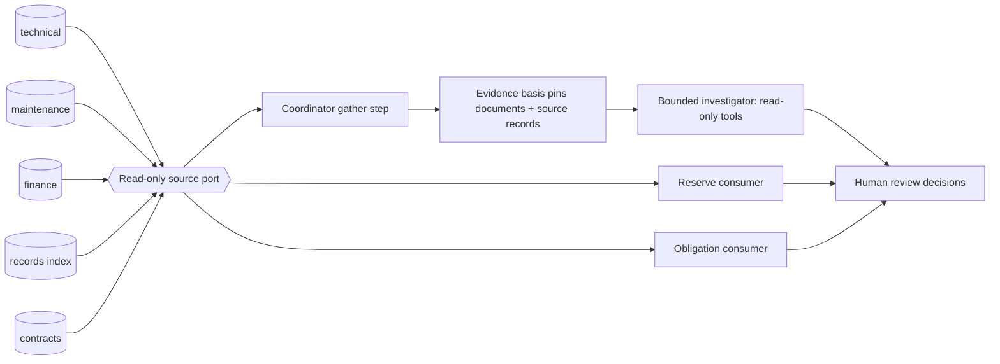

# Synthetic Source-System Stubs and Read-Only Source Port

> **aircraft-source-systems** | Status: Draft | Version: 0.10.0 | Last Updated: 2026-11-02

## Executive Summary

This PRD defines five synthetic source-system stubs and one read-only server port through which the Aircraft Return Readiness Demonstrator reads them. The stubs stand in for the places where an aircraft-return case gets its facts in real life: **technical** (airworthiness data), **maintenance** (work packages), **finance** (lease and billing), **records** (the document store) and **contracts** (obligations). The companion [Aircraft Return Readiness PRD](aircraft-return-readiness.md) (ARR) and [Aircraft Case Pack PRD](aircraft-case-pack.md) (CP) have no such layer. ARR builds an evidence basis from a submitted package, and its reserves (ARR:FR-006) and obligations (ARR:FR-007) read plain fixtures.

The stubs let the demonstration show the intended shape of the product: a coordinator (the application-owned case state machine, ARR:DD-009) gathers facts from several systems, a bounded investigator reads them through case-scoped read-only tools, and humans decide. The port is the seam where a real system adapter would later replace a stub. Every datum read through it carries provenance (system, record, version, as-of date), and the stubs can simulate an unavailable, stale or conflicting source so the presenter can show how the workflow reacts.

Version 0.9.1 closes the planner's open points: the telemetry approval is a recorded human merge gate (DD-025), role-by-source and anti-forgery negative tests are explicit (AC-038, AC-039), and several criteria now state the invariants they prove. Version 0.4.0 withdraws the notice-validity checklist, which is outside the capstone areas. Version 0.3.0 added Cape Town interest evidence records, per-regime sanctions flags, an IFRS 16 flag topic and a personal-data marker, so each regulatory area in the capstone brief has a defined route to its owner. Version 0.2.0 added the controls an auditor or specialist panel will ask about: an exportable decision dossier, regime and responsibility tags on requirements, separate finance record kinds for rent, reserves and deposits, and specialist-review flags that can never read as clearance. They show that the controls work; they do not show regulatory compliance.

This PRD adds no workflow state, role, agent or external action. ARR stays authoritative for case workflow, authority boundaries and the evidence basis. Acceptance criteria describe future verification and are not evidence of delivery.

Version 0.10.0 adds the [arrival source-interaction addendum](#arrival-source-interaction-addendum) for one fresh, opted-in case; all other cases retain their existing behavior.

## Research Readiness

Research status: `Not required`

Rationale: Verified repository source, authorization, persistence and UI contracts, together with the user's resolved decisions, cover this addendum; it introduces no unfamiliar API or external assumption.

Research artifact: Not applicable.

Planning blockers: None.

### Research Finding Dispositions

No external Research was required or performed. Human review, approval and merge remain a separate future gate.

## Product Context

In the fictional scenario for Altivane Aviation Capital, the facts for one aircraft return live in separate systems owned by different teams. A records gap in the document store may be explained by an open work package in maintenance; a reserve discrepancy needs utilization from technical data and rates from the lease; an obligation window comes from the contract. Today the demonstrator receives all of this as one submitted package and one fixture file, so it cannot show where a fact came from, what happens when a source disagrees with the documents, or what a source outage does to a case.

The stubs are not an integration product. They are deterministic, in-process, synthetic, and read-only. They do not model the real data model, API or behavior of any maintenance, ERP, records or lease-management product, and no stub status establishes readiness, airworthiness, financial approval, legal approval, contractual acceptance, or aircraft release.

## Users and Personas

| Persona | Primary job | Pain point addressed | Success outcome |
|---|---|---|---|
| Presenter / demo operator | Show that a case is assembled from several systems, and show a source problem. | Cannot explain where a fact came from, or show an outage without breaking the demo. | Opens a case, sees each source and its provenance, and switches a source to unavailable, stale or conflicting for that case run, with an audit record. |
| Technical reviewer (simulated) | Judge whether an airworthiness or maintenance fact supports a records finding. | A document and a system may disagree; the reviewer cannot tell which is newer. | Sees both side by side with provenance, and decides on the current basis. |
| Finance reviewer (simulated) | Review a reserve draft. | Cannot trace a utilization figure or rate to its source. | Each draft line cites a finance or technical source record. |
| Legal reviewer (simulated) | Review an obligation and notice draft. | Cannot trace an obligation to the contract clause record. | The draft cites the contracts record and its version. |
| Bounded investigator (agent) | Plan read-only lookups inside the investigation step. | Must not reach outside the case or write anywhere. | Calls case-scoped read-only source tools and receives typed, provenance-bearing results. |
| Frontend implementer (consumer) | Build a source panel. | Needs a stable contract, not per-system shapes. | Receives one versioned envelope for all five sources. |

All systems, records, actors and decisions are synthetic or simulated.

## Design Decisions

| ID | Decision |
|---|---|
| DD-001 | The source stubs are server-side, in-process classes in the existing ASP.NET Core application, seeded from versioned fixtures. They are not separate services, containers or Azure resources, and add no Terraform. |
| DD-002 | Exactly five sources: `technical`, `maintenance`, `finance`, `records`, `contracts`. A source is one `ISourceSystem` implementation. The port exposes read operations only; no type in the port can write, update or delete. |
| DD-003 | The `records` source is the index over the case's evidence documents (the document store). Document content and versions remain owned by ARR (Blob Storage and the evidence basis, ARR:DD-007, ARR:DD-027). The records stub lists document metadata and returns the same `documentId` and `documentVersion` values ARR uses. It does not hold a second copy of content. |
| DD-004 | Every record returned by the port is a `SourceRecord` with `sourceId`, `recordId`, `recordVersion` (integer), `asOf` (UTC date), `caseId`, `kind`, `payload` (typed per kind, defined in the contract documentation) and `synthetic: true`. Provenance is not optional and is never inferred by the client. |
| DD-005 | The coordinator snapshots the source records it uses into the evidence basis. A basis therefore pins `(sourceId, recordId, recordVersion)` alongside document versions, so an assessment can be reproduced and a later source change creates a new basis through the ARR reassessment path (ARR:FR-005). The stubs hold a current version of each record; a fixture change that alters a record bumps `recordVersion`. |
| DD-006 | Source calls are case-scoped on the server. The caller supplies a case identifier; the server checks identity, role and case scope (ARR:DD-014) before any stub is touched. An out-of-scope or unknown case returns the same response as a nonexistent one. A record whose `caseId` differs from the requested case is never returned. |
| DD-007 | Source health is a per-case, per-run simulated mode of each source: `available` (default), `unavailable`, `stale` or `conflicting`. A presenter can set a mode for a source in a case run with an audited command (FR-007). `unavailable` returns a typed `source_unavailable` result, never an empty list. `stale` returns records with an `asOf` older than the scenario date and a `stale: true` flag. `conflicting` returns the fixture's alternate record version for that source. Modes never delete or edit fixture data. |
| DD-008 | A source problem is a finding input, not a decision. An unavailable or stale source blocks or downgrades the dependent finding with a stated reason (ARR blocked-versus-missing rule); it never counts as "missing evidence", never triggers a mock request on its own, and never changes an obligation or reserve silently. Disagreement between a document and a source record routes to internal review (ARR:FR-003). |
| DD-009 | The investigator gains read-only tools `list_source_records` and `get_source_record` in addition to its ARR tools (ARR:FR-002). They accept only `caseId`-bound arguments supplied by the server, count against the investigator's existing call and token budgets, and return `SourceRecord`s or a typed error. No source tool exists for any write. |
| DD-010 | Reserves (ARR:FR-006) read utilization from `technical` and rates and lease terms from `finance`. Obligations (ARR:FR-007) read clauses and notice windows from `contracts` (ARR:DD-018 still governs window semantics). Both consumers stay deterministic and keep their existing outputs; only their input source changes, and each output line cites the `SourceRecord` it used. |
| DD-011 | Source fixtures live under `backend/AirlineDemo.Api/Fixtures/sources/`, one file per source, with a manifest carrying `schemaVersion`, `sourceFixtureVersion`, the fixed `scenarioDate` (ARR:DD-018) and a SHA-256 content hash, loaded by the same refuse-on-mismatch rule as the case pack (CP:FR-001). The fixtures cover the ARR core case and the three CP cases. |
| DD-012 | The read contract is versioned in the path (`/api/v1/...`) and body (`contractVersion`), like CP:DD-005. One envelope serves all five sources so the client does not learn per-system shapes. |
| DD-013 | The port is the only way application code reads source data. The ARR evidence pipeline, reserve consumer, obligation consumer and investigator tools all depend on the port interface, so replacing a stub with an adapter changes one registration, not the callers. No real adapter is built in this PRD. |
| DD-014 | The stubs are not a new orchestrator or agent. The application-owned state machine remains the only workflow owner (ARR:DD-009, ARR:DD-010). A coordinator "gather" step may read sources before the investigation step, within the existing case lifecycle states; it adds no state token. |
| DD-015 | IDs are local to this PRD. Cross-references use `ARR:`, `CP:` and `HG:` prefixes. |
| DD-016 | A decision dossier is a deterministic, read-only export for one recorded human decision (ARR:FR-004, ARR:FR-007 review). It lists the exact document versions, `(sourceId, recordId, recordVersion)` pins, requirement version and applicability tags, deterministic rule or policy version, the investigator trace identifier where one ran, the authenticated actor and role, time, reason, and the audit event identifiers. It is assembled from existing records; it creates no new authority and no approval. Its SHA-256 hash lets a reader confirm it was not edited after export. |
| DD-017 | Every requirement an assessment uses carries `regime` (`EASA`, `FAA-91`, `FAA-121` or `Other`) and `responsibleParty` (`lessee-operator`, `lessor`, `camo` or `unassigned`), read from `technical` records of kind `applicability`. A requirement without either tag is `needs_review`, never satisfied. Regimes are never cross-applied: a requirement for one regime does not satisfy another. The tags describe fixture scenarios, not legal conclusions. |
| DD-019 | `finance` has separate record kinds `rent`, `maintenance_reserve`, `security_deposit` and `reserve_reimbursement`. The reserve consumer reads only `maintenance_reserve` and `reserve_reimbursement`. Its draft separates billed, collected, underbilled, overdue and reimbursable lines, and states that it makes no profit, revenue or cash-recognition claim. |
| DD-020 | `contracts` carries a record kind `specialist_flag` with a `topic` (`sanctions`, `cape_town`, `ifrs16`, `gdpr` or `other`) and a `result` that may only be `specialist_review_required` or `not_assessed`. A `sanctions` flag also carries a required `regime` of `EU`, `US` or `UK`; one flag covers one regime, and a flag for one regime says nothing about another. No value reads as cleared, compliant, recoverable, classified or recognized; fixture validation rejects any other value. A flag routes the related finding to internal review (ARR:FR-003). |
| DD-021 | `contracts` carries a record kind `cape_town_interest` with `internationalInterestRef`, `registrationRef`, `idera` (`present`, `absent` or `not_recorded`) and `stateDeclarationNoted` (boolean). It is evidence for counsel. It has no field for priority, remedy, outcome or recoverability, and fixture validation rejects a record that carries one. A finding that relies on it still needs a `cape_town` specialist flag. |
| DD-022 | Every `records` entry carries `containsPersonalData` (boolean) and fixtures are rejected without it. Source summaries, dossiers and diagnostics carry identifiers, versions and hashes only, never a field flagged as personal data. Retention, erasure and data-subject request handling are design-only and described in `docs/compliance-request-handling.md`; no request-handling feature is built. |
| DD-023 | Source authorization is role- and case-scoped: technical-reviewer may read technical, maintenance, and records sources; finance-reviewer may read technical and finance sources; legal-reviewer may read contracts and records sources; presenter and executive may read the source summary only; a decision dossier is readable only by a case-scoped reviewer whose role matches the recorded decision. Unknown roles are denied. Source-mode changes remain presenter-only. |
| DD-024 | Direct source-record reads are limited to 20 requests per authenticated session and case per minute, with at most 2 in-flight reads per case, no pagination, and at most 100 records in one response. A limit breach returns 429 with error.code source_read_limit; a source response exceeding 100 records returns 422 with error.code source_record_limit and no partial records; a read exceeding the 1-second request deadline returns 504 with error.code source_read_timeout. |
| DD-025 | After Telemetry Foundations approves the proposed additions and the approval is recorded in `docs/telemetry/source-system-proposed-additions.md`, source-specific structured logs may use source.id, case.id, event.outcome, and duration; these fields are never metric dimensions, and raw record identifiers and payloads remain excluded. The approval is a human merge gate: it exists only when a pull request that adds `docs/telemetry/source-system-proposed-additions.md` (naming the four attributes, their allowed values, and the approving person) has been merged to the default branch by a person. Until then these attributes stay suppressed and the diagnostic allowlist excludes them; no automated process creates or edits that file. |
| DD-026 | DD-026: A source coverage flag is true only when the source mode is available and at least one in-scope record from that source is present; otherwise it is false. |
| DD-027 | DD-027: For Cases A, B, and C, the signed source fixtures are the canonical identifier set; any Aircraft Case Pack artifact for those scenarios uses the same case, document, and component identifiers. |
| DD-028 | DD-028: For repeated exports of the same recorded decision, serialized bytes are identical after removing the `exportedAt` field; `contentHash` covers every other field except `contentHash` itself. This rule follows AC-024 and DD-016. |

## Product Goals

| ID | Goal | Evidence of attainment | Priority |
|---|---|---|---|
| GOAL-001 | Show a case assembled from five synthetic sources with provenance on every datum, read through one read-only, scope-checked port, used by the investigator, the reserve consumer and the obligation consumer. | Port contract tests, scope negative tests, consumer tests citing source records, and an end-to-end case test pass. | MUST |
| GOAL-002 | Let a presenter demonstrate a source outage, stale source or document-versus-source conflict and see the workflow react safely and traceably. | Source-mode command tests including negative cases pass; each accepted mode change has an audit record; the dependent finding is blocked, downgraded or routed to review as specified. | MUST |
| GOAL-003 | Make each human decision reproducible and each applicability and finance distinction explicit, so a reviewer can see what the demonstrator does and does not establish. | Dossier, applicability, finance-kind, specialist-flag, Cape Town evidence and personal-data tests pass. | MUST |

Measured at each release-candidate revision. Baseline: no source stubs, no port, no source tools and no source-mode command, dossier, applicability tag or specialist flag exist (not built). Target: all SRC acceptance criteria marked Automated pass, and the manual items in the release checklist are recorded.

## Functional Requirements

Unqualified IDs belong to this PRD. Companion IDs are cited as `ARR:` or `CP:` plus the identifier.

| ID | Requirement | Actor / trigger | Companion dependencies | Acceptance criteria | Product goals |
|---|---|---|---|---|---|
| FR-001 | Define the read-only source port and the `SourceRecord` envelope (DD-002, DD-004, DD-012), with `list` and `get` operations per case and source, a typed `source_unavailable` result, and versioned errors. | Application code or an authenticated client reads a source. | ARR:DD-014, ARR:NFR-008. | AC-001, AC-002, AC-003 | GOAL-001 |
| FR-002 | Implement the five stubs deterministically from versioned fixtures with manifest, hash, fixed scenario date and refuse-on-mismatch loading, covering the ARR core case and Cases A, B and C. | Application seeds fixtures. | CP:FR-001, CP:FR-002, ARR:DD-018. | AC-004, AC-005 | GOAL-001 |
| FR-003 | Enforce server-side identity, role and case scope on every source read; never return a record for a different case. | Authenticated user or investigator tool reads a source. | ARR:DD-014, ARR:NFR-001, CP:FR-008. | AC-006, AC-007, AC-038 | GOAL-001 |
| FR-004 | Pin the source records a basis used into the evidence basis, and reassess through the ARR path when a pinned record's version changes. | Coordinator gathers sources; a source record changes version. | ARR:FR-001, ARR:FR-005. | AC-008, AC-009 | GOAL-001 |
| FR-005 | Give the investigator the read-only tools `list_source_records` and `get_source_record` within its existing budgets and citation validation; a source claim cites a `SourceRecord` witness. | Investigation step runs. | ARR:FR-002, ARR:AC-013. | AC-010, AC-011 | GOAL-001 |
| FR-006 | Feed the reserve consumer from `technical` and `finance` records and the obligation consumer from `contracts` records, citing the source record on each output line, without changing their rules or states. | Reserve or obligation evaluated. | ARR:FR-006, ARR:FR-007, ARR:AC-014, ARR:AC-015. | AC-012, AC-013 | GOAL-001 |
| FR-007 | Let a presenter in scope set a source's simulated mode (`available`, `unavailable`, `stale`, `conflicting`) for one case run through an authenticated, anti-forgery-protected, idempotent command that writes one audit record. | Presenter issues the command. | ARR:DD-028, ARR:DD-027, CP:FR-009. | AC-014, AC-015, AC-016, AC-039 | GOAL-002 |
| FR-008 | Apply source modes to findings as DD-008 states: unavailable or stale blocks or downgrades with a stated reason, document-versus-source disagreement routes to internal review, and none of them creates a mock request or an acceptance. | A finding depends on a non-`available` source. | ARR:FR-003, ARR:FR-004. | AC-017, AC-018 | GOAL-002 |
| FR-009 | Serve a read-only, versioned source summary for a case: per source its mode, the records in use with provenance, and a coverage flag; no payload text beyond the typed fields. | Authenticated user opens the case. | ARR:FR-008, ARR:FR-013. | AC-019 | GOAL-001 |
| FR-010 | Emit source-read, mode-change and load outcomes through the existing server diagnostics filter, without record payloads or authentication secrets. | A read, mode change or load completes or fails. | ARR:DD-029, ARR:NFR-002, ARR:NFR-004. | AC-020 | GOAL-001 |
| FR-011 | Export a deterministic, hashed, read-only decision dossier for one recorded decision, with the contents in DD-016, limited to the caller's role and case scope. | Authorized user requests the dossier. | ARR:DD-027, ARR:FR-004, ARR:FR-008. | AC-024, AC-025 | GOAL-003 |
| FR-012 | Tag each requirement used by an assessment with `regime` and `responsibleParty` from `technical` applicability records; treat an untagged requirement as `needs_review` and never cross-apply regimes. | Assessment evaluates a requirement. | ARR:FR-002, ARR:FR-004. | AC-026, AC-027 | GOAL-003 |
| FR-014 | Keep rent, maintenance reserve, security deposit and reserve reimbursement as separate `finance` record kinds, and keep the reserve draft's lines separate and free of profit or cash claims. | Reserve draft built. | ARR:FR-006, ARR:AC-014. | AC-030 | GOAL-003 |
| FR-015 | Carry `specialist_flag` records (topics and per-regime sanctions rule in DD-020) and `cape_town_interest` evidence records (DD-021) in `contracts`; flags route the related finding to internal review and can never state clearance. | Finding depends on a flagged topic. | ARR:FR-003. | AC-031, AC-032, AC-033, AC-034, AC-035 | GOAL-003 |
| FR-016 | Mark each `records` entry with `containsPersonalData` and keep personal-data fields out of summaries, dossiers and diagnostics (DD-022). | Records are loaded or exported. | ARR:NFR-002, ARR:DD-029. | AC-036, AC-037 | GOAL-003 |

## Scope Boundaries

### In scope

- The port, `SourceRecord` envelope, five deterministic stubs and their versioned fixtures.
- Case-scoped read tools for the investigator and source inputs for the reserve and obligation consumers.
- Pinning source records in the evidence basis.
- A presenter command for simulated source modes and its audit record.
- A read-only per-case source summary.
- A hashed decision dossier, requirement regime and responsibility tags, separate finance record kinds, and specialist-review flags.

### Capability labels

Following ARR's label table: the source stubs and their reads are `Simulated`; the reserve and obligation consumers stay `Rules-based`; the investigator's source tool calls are `AI agent` only as part of the investigation step. A source mode change is a `Simulated` presenter command.

### Out of scope

- Any real system adapter, real data model, authentication to a real system, or network call.
- Writing, updating or deleting any source record from the application or the agent.
- New workflow states, roles, agents or a second orchestrator (ARR:DD-010).
- Per-domain agents or agent-to-agent messaging.
- Streaming, change feeds or polling of sources; sources are read on demand and pinned in the basis.
- Airworthiness determination, invoice issuance, formal notices, or aircraft release.
- Any determination or claim of regulatory compliance or applicability (EASA Part-M, FAA 91.417/121.380, Cape Town Convention, IFRS 16, GDPR, EU/US/UK sanctions). Regime tags and flags label fixture scenarios only. Applicability is recorded in a separate compliance claims register, not in this PRD.
- Any real sanctions screening, Cape Town registry search, lease classification, impairment calculation or data-subject request handling, or legal conclusion.
- Changes to the frozen 40-case evaluation suite (ARR:DD-033). Any evaluation use of source records is a separate PRD decision.
- Rendering or client behavior beyond the contract (the dashboard and HG consume the summary), except for the opted-in arrival case in the addendum.

### Synthetic source content

Each source holds a small, fixed set of records per case. Registrations, serials and amounts are fictional.

| Source | Record kinds (illustrative; exact payloads in contract documentation) | What it enables in the demo |
|---|---|---|
| `technical` | Airworthiness directive status, component time/cycle snapshot, utilization (hours, cycles), requirement applicability (`regime`, `responsibleParty`) | Reserve inputs; a status that supports or contradicts a document |
| `maintenance` | Work package header, task cards with status (open, closed, deferred), component install/removal events | A records gap explained by an open or deferred work package |
| `finance` | Lease terms (rates per hour/cycle, reserve basis), billing period, and separate `rent`, `maintenance_reserve`, `security_deposit` and `reserve_reimbursement` records | Reserve rates; a seeded discrepancy |
| `records` | Document index: `documentId`, `documentVersion`, type, component, date, processing state, `containsPersonalData` | The list of what the document store holds |
| `contracts` | Obligation clause, `noticeWindowStart`, `noticeWindowEnd`, linked requirement, `specialist_flag` (topics: sanctions with EU/US/UK regime, Cape Town, IFRS 16, GDPR), `cape_town_interest` | Obligation status and notice draft inputs |

Each case fixture seeds at least one situation per column-worth of behavior: Case A has a maintenance record that explains the missing-history finding after the mock response; Case B has a technical record that disagrees with a document on engine identity (routes to internal review); Case C has a complete baseline in all five sources and a `records` entry for the blocked document.

### Read contract

Authenticated `GET /api/v1/cases/{caseId}/sources` returns the source summary (FR-009). Authenticated `GET /api/v1/cases/{caseId}/sources/{sourceId}/records` returns the records of one source for the case. Authenticated `GET /api/v1/cases/{caseId}/decisions/{decisionId}/dossier` returns the decision dossier (FR-011); the actual decision route and identifier are taken from the ARR default branch and recorded in the contract documentation. `POST /api/v1/cases/{caseId}/sources/{sourceId}/mode` is the only new mutation in the original scope (FR-007); the addendum specifies additional case commands only for the opted-in arrival case. Unsupported versions return 400 `unsupported_contract_version`; unauthenticated reads return 401 with no case data; every envelope carries integer `contractVersion: 1`.

| Type / field | Type and meaning |
|---|---|
| SourceSummary envelope | `contractVersion: integer`, `fixtureVersion: string`, `caseId: string`, `caseRevision: integer`, `sources: SourceStatus[]`. |
| SourceStatus | `sourceId: technical / maintenance / finance / records / contracts`, `mode: available / unavailable / stale / conflicting`, `capabilityLabel: Simulated`, and `coverage: boolean`. Only a role entitled to that source also receives `recordCount: integer`, `pinnedInBasis: boolean` and `recordsInUse: {sourceId, recordId, recordVersion}[]`. |
| Records envelope | `contractVersion: integer`, `caseId: string`, `sourceId: string`, `records: SourceRecord[]`. An unavailable source returns 503 with `error.code = source_unavailable` and no `records`. |
| SourceRecord | `sourceId`, `recordId`, `recordVersion: integer`, `asOf: YYYY-MM-DD UTC date`, `caseId`, `kind`, `stale: boolean`, `payload: object` (typed per kind), `synthetic: true`. |
| Decision dossier | `contractVersion`, `caseId`, `decisionId`, `exportedAt`, `basis: {basisId, basisVersion, documents[], sourcePins[], requirements[{id, version, regime, responsibleParty}]}`, `policyVersion`, `traceId: string or null`, `decision: {actorId, role, time, reason, outcome}`, `auditEventIds[]`, `contentHash`, `synthetic: true`, `limitations: string[]`. The hash covers every field except `exportedAt` and itself, so the same inputs give the same hash. |
| Specialist flag payload | `topic: sanctions / cape_town / ifrs16 / gdpr / other`, `regime: EU / US / UK` (required for sanctions, absent otherwise), `result: specialist_review_required / not_assessed`, `relatedRequirementId`. |
| Cape Town interest payload | `internationalInterestRef`, `registrationRef`, `idera: present / absent / not_recorded`, `stateDeclarationNoted: boolean`. |
| Mode request | `commandId: nonempty string`, `expectedRevision: nonnegative integer`, `mode`. Actor, time and reason are never accepted from the body. |
| Mode receipt | `contractVersion: 1`, `commandId`, `caseId`, `sourceId`, `priorMode`, `newMode`, `priorRevision`, `newRevision`, `auditEventId`. Reason code `presenter_set_source_mode`. |
| Error envelope | Source summary and record reads use `contractVersion: 1`, `error: {code}`. Mode-command and dossier errors use `contractVersion: 1`, `error: {code, message}`. Authorization and conflict errors contain no case data or receipt. |

Mode command validation order follows CP: authentication, role, case scope, anti-forgery, supported source and mode, then replay lookup. An identical stored command for the same actor and case returns its original receipt; reuse with a different actor or payload returns 409 `command_id_conflict`; a new command at a stale revision returns 409 `stale_revision`. Setting the mode a source already has returns 422 `mode_unchanged`. Mode changes apply to the current run only and never rewrite history (ARR:DD-027); a case run reset (ARR:FR-010) restores `available` for every source.



## Security Notes

- Trust boundary: the browser is untrusted (ARR Security Notes). Source reads and the mode command validate identity, role, case scope and revision on the server. Client-supplied case, source or record identifiers never grant access; an out-of-scope or unknown identifier returns the same response as a nonexistent one.
- Data handled: synthetic fixtures only. No credentials, personal data or real records. The manifest hash detects accidental drift and gives no authenticity guarantee beyond the repository's review gate.
- Read-only by construction: the port interface has no write method, the investigator has no write tool, and a test fails if any `ISourceSystem` member can mutate state.
- Untrusted text: record payload strings (for example a task-card description) are untrusted data. They are passed to the investigator as quoted data, may not change authority, and are covered by the ARR prompt-injection negative fixtures (ARR risk register). One fixture record carries seeded instruction-like text.
- The mode command requires the session cookie, anti-forgery token (ARR:DD-028), presenter role and case scope before replay lookup. Each accepted change writes one append-only audit record (ARR:DD-027); replays and rejections write none.
- Diagnostics exclude payload text, cookies and tokens (ARR:DD-029). No client telemetry endpoint is added.
- The dossier contains identifiers, versions, hashes and reasons only. It excludes document text, raw prompts and model output, authentication material and personal data, and carries `synthetic: true` and a `limitations` list stating that it is not a certification, approval or legal conclusion.
- Simulated source health is labelled in every response as `Simulated`; a client cannot present it as a real system outage.

## Non-Functional Requirements

### Performance and Capacity

**NFR-001.** In an in-process ASP.NET integration host with temporary stores and the four-case fixture, each source read and the summary respond in 1 second or less at the 95th percentile over 100 sequential measured requests, and the summary payload stays at or below 65,536 bytes or returns 422 `source_payload_limit` without partial data.

### Reliability and Resilience

**NFR-002.** Source fixture loading is atomic: a validation or publication failure leaves previously stored source data, pins and audit records unchanged. Loading the same version and hash again is a no-op; a stored version with different content is refused.

### Security

**NFR-003.** The scope, read-only, anti-forgery and replay rules in the Security Notes hold on every endpoint and tool, verified by negative tests (AC-006, AC-007, AC-010, AC-015, AC-016, AC-038, AC-039).

### Privacy

**NFR-004.** Fixtures, diagnostics and examples contain synthetic data only; a scan of fixtures and exports finds no personal identifiers or secrets.

### Maintainability and Operability

**NFR-005.** Replacing one stub with another `ISourceSystem` implementation changes one dependency-injection registration and no caller (AC-021). Contract documentation lists every record kind and payload field.

### Observability

**NFR-006.** Reads, mode changes and loads are visible in diagnostics without payloads; the attributes for source, case, outcome and duration are added once the DD-025 approval record is merged (AC-020).

### Compatibility and Interoperability

**NFR-007.** Contracts are versioned (DD-012); unsupported versions fail explicitly. Cross-source identifiers (`documentId`, `componentId`, `caseId`) match the ARR and CP identifiers exactly.

**NFR-008.** The dossier for a case with up to 50 pinned items is produced in 2 seconds or less at the 95th percentile, and repeated exports of the same decision have identical bytes after removing `exportedAt` (AC-024, DD-028).

### Scalability

Out of scope. The demonstrator is a fixed, in-process, four-case fixture set; NFR-001 and NFR-008 bound the only load it serves.

### Usability and Accessibility

Not applicable to the original scope; display of the summary is a dashboard or HG requirement. The opted-in arrival interface is specified in the addendum.

## Constraints

| ID | Constraint | Type | Rationale | Impact |
|---|---|---|---|---|
| CON-001 | Handle synthetic data only (ARR:CON-001); run the five source stubs in-process (DD-001). | Operational and architectural | ARR imposes the synthetic-data boundary; the requested scenario excludes separately deployed source systems. | No real data or external source service. An exception to ARR's data boundary requires its owner-approved PRD change; a stub-deployment change requires a user-approved change to this PRD. |
| CON-002 | Add no ARR lifecycle state or role for arrival, and no new agent or orchestrator. | Architectural | DD-014 and the confirmed arrival scope retain the existing workflow and roles; ARR:DD-010 forbids a second orchestrator and long-lived agents. | A change to this scope requires a user-approved PRD amendment; any conflict with ARR also requires an ARR amendment. |
| CON-003 | This PRD adds no Azure resource, Terraform, package dependency, or change under `.github/` or `.ai-sdlc/`. | Delivery | DD-001 selects the existing application; the requested fixture rehearsal has no external runtime dependency. `AGENTS.md` permits justified backend and frontend package additions and governs protected paths; the no-package choice is specific to this PRD. | Changing this delivery scope requires PRD owner review and the applicable repository write and merge policy. |

## Process Models

Original case flow with sources: submit package → coordinator gathers source records through the port → basis pins documents and source records → investigator runs read-only tools (documents and sources) → deterministic policy → review, mock request, reserve draft or obligation draft → human decision. The recorded human decision can be exported as a dossier (FR-011). A non-`available` source adds a blocked, downgraded or review branch (FR-008) and never an automatic request. The opted-in arrival case instead gathers and completes its source handoff before package intake as specified in the addendum.

## Acceptance Criteria

Verification values: **Automated** means a vitest, xUnit or CI check that fails when the behavior is missing. **Manual** means a human check recorded in the release checklist and not story acceptance.

| ID | Criterion (Given / When / Then) | FRs | Verification |
|---|---|---|---|
| AC-001 | Given the port interface, when reflected, then it exposes only read operations, and a test fails if a member named or typed as a write is added. | FR-001 | Automated |
| AC-002 | Given a valid in-scope request, when a source is read, then every record carries `sourceId`, `recordId`, `recordVersion`, `asOf`, `caseId`, `kind` and `synthetic: true`; a record missing any is rejected by fixture validation. | FR-001 | Automated |
| AC-003 | Given an unsupported `/api/v{n}/` version, then the response is 400 `unsupported_contract_version` with no case data; given an unauthenticated read, then 401 with no case data; given a source in `unavailable` mode, when its records are read directly, then the response is 503 with `error.code = source_unavailable` and neither a `records` property nor any record data. | FR-001 | Automated |
| AC-004 | Given the fixtures, when loaded, then the ARR core case and Cases A, B and C each have records in all five sources, and the manifest hash, `schemaVersion` and counts validate; the `caseId`, `documentId` and `componentId` values equal the canonical ARR and CP values (NFR-007, DD-027), compared against the ARR fixtures and the CP pack on the default branch. | FR-002 | Automated |
| AC-005 | Given a changed fixture byte, a wrong `schemaVersion` or a wrong count, when loaded, then loading is refused with a reason and no partial data is published; given previously stored source data, pins and audit records, an injected validation or publication failure leaves all three byte-for-byte unchanged (NFR-002); loading the same version and hash again is a no-op, and a stored version with different content is refused. | FR-002 | Automated |
| AC-006 | Given a user whose scope excludes a case, when any source endpoint is read, then the response equals that of a nonexistent case and no record is returned and no source stub is called (a counting fake on the port records zero calls). | FR-003 | Automated |
| AC-007 | Given a record whose `caseId` differs from the requested case (seeded in a test fixture), when read, then it is never returned, and the attempt is a diagnostics event without payload. | FR-003 | Automated |
| AC-038 | Given each documented role and source (technical-reviewer: technical, maintenance, records; finance-reviewer: technical, finance; legal-reviewer: contracts, records; presenter and executive: summary only), when every role reads every source, then allowed reads return records and an in-scope denied role-source pair or in-scope unknown role returns 403 `forbidden`; a missing or out-of-scope case returns bodyless 404. Denied reads call no source stub and disclose no record; a table-driven test enumerates all role-by-source cases (DD-023). | FR-003 | Automated |
| AC-008 | Given a gathered case, when the basis is built, then it pins each used `(sourceId, recordId, recordVersion)`; a basis built from the same inputs is identical, and a basis without pins is rejected. | FR-004 | Automated |
| AC-009 | Given a pinned record whose fixture version is bumped, when the case is reassessed, then a new basis is created, the former basis is retained, and the history shows both; an unchanged record creates no new basis. | FR-004 | Automated |
| AC-010 | Given the investigator, when it lists tools, then `list_source_records` and `get_source_record` are present and no source write tool exists; a call with a different case identifier than the server-bound one is refused. | FR-005 | Automated |
| AC-011 | Given an investigation citing a source record, when the citation self-check runs, then a citation to a record or version not in the basis is downgraded, and source calls count against the call budget. | FR-005 | Automated |
| AC-012 | Given finance and technical records, when the reserve draft is built, then each line cites its `SourceRecord` and totals equal the existing ARR:AC-014 hand calculation; a removed `finance` rate yields a blocked input, not a zero. | FR-006 | Automated |
| AC-013 | Given a contracts record, when obligation status is evaluated, then the state and notice-window behavior match ARR:AC-015 and ARR:DD-018, the draft cites the record, and no notice is sent. | FR-006 | Automated |
| AC-014 | Given a presenter in scope, when the mode command is issued with a valid token and revision, then the source mode changes for the current run, one audit record is written, and the receipt matches the contract. | FR-007 | Automated |
| AC-015 | Given a technical, finance, legal or executive role, or a presenter outside case scope, when the command is issued, then the response is 403 or 404 respectively, state is unchanged and no audit record is written. | FR-007 | Automated |
| AC-016 | Given an exact replay, then the original receipt returns with no new audit record; given a reused identifier with a different payload, 409 `command_id_conflict`; given a stale revision, 409 `stale_revision`; given the current mode, 422 `mode_unchanged`; and a run reset restores every source to `available`. | FR-007 | Automated |
| AC-039 | Given a mode command with a missing or invalid anti-forgery token (and otherwise valid session, role, scope and revision), when issued, then the response is the contract's anti-forgery error, the source mode is unchanged and zero audit records are written; the check runs after authentication, role and case scope and before replay lookup. | FR-007 | Automated |
| AC-017 | Given a source set to `unavailable` or `stale`, when the dependent finding is assessed, then it is blocked or downgraded with a stated reason, no mock request is created, and no acceptance is recorded; given `available`, the same finding follows its normal path. | FR-008 | Automated |
| AC-018 | Given a document and a source record that disagree (Case B engine identity), when assessed, then the finding routes to internal review with zero external requests and both items cited. | FR-008 | Automated |
| AC-019 | Given the summary read by each in-scope documented role, then all five sources show their mode, `Simulated` label and DD-026 coverage. A reviewer receives `recordCount`, `pinnedInBasis` and `recordsInUse` only for sources that role may read; a presenter or executive receives none of those fields. No payload text appears, the summary is consistent with `caseRevision`, an over-limit payload returns 422 `source_payload_limit`, and an unknown role returns 403 `forbidden`. | FR-009 | Automated |
| AC-020 | Given a read, a mode change or a failed load, when diagnostics are inspected, then each outcome appears in diagnostics and contains no payload text, cookie or token; `source.id`, `case.id`, `event.outcome` and `duration` appear only once the DD-025 approval record is on the default branch, and before that no diagnostic event carries them. | FR-010 | Automated |
| AC-021 | Given a test double implementing `ISourceSystem`, when registered in place of one stub, then all callers work unchanged and no caller references a stub type. | FR-001, FR-006 | Automated |
| AC-022 | Given the seeded instruction-like text in a task-card record, when the investigator reads it, then no tool call outside policy occurs and the finding is unaffected. | FR-005 | Automated |
| AC-033 | Given a `sanctions` flag with no `regime` or a regime outside `EU`, `US`, `UK`, or a non-sanctions flag carrying a `regime`, when fixtures load, then loading is refused; given an `EU` flag only, the `US` and `UK` regimes of the same finding show `not_assessed`, not cleared. | FR-015 | Automated |
| AC-034 | Given an `ifrs16` flag, when the related finding is assessed, then it routes to internal review and no screen, draft or export states a lease classification, impairment or accounting recognition. | FR-015 | Automated |
| AC-035 | Given a `cape_town_interest` record, when read, then it is returned as evidence with no outcome; a fixture adding a priority, remedy or recoverability field is refused; and a finding relying on it without a `cape_town` flag fails fixture validation. | FR-015 | Automated |
| AC-036 | Given a `records` entry without `containsPersonalData`, when fixtures load, then loading is refused; given an entry marked true, then it is listed with identifiers only. | FR-016 | Automated |
| AC-037 | Given a seeded synthetic name and licence number in a marked document, when the summary, a dossier and diagnostics are inspected, then none contains them. | FR-016 | Automated |
| AC-023 | Given a rehearsal, when the presenter walks one case through an outage and a conflict, then the product owner confirms the audience can see which source, which record version and what the workflow did. | FR-007, FR-008, FR-009 | Manual |
| AC-024 | Given a recorded decision, when the dossier is exported twice, then both exports contain the DD-016 contents, have identical `contentHash` and bytes apart from `exportedAt`, and a missing audit event, pin or requirement version makes the export fail with 422 `dossier_incomplete` rather than a partial dossier. | FR-011 | Automated |
| AC-025 | Given a role or case scope that excludes the decision, when the dossier is requested, then the response equals that of a nonexistent decision; given an in-scope response, no document text, prompt, model output, cookie or token appears. | FR-011 | Automated |
| AC-026 | Given a requirement lacking `regime` or `responsibleParty`, when assessed, then it is `needs_review` and not satisfied, and the reason names the missing tag. | FR-012 | Automated |
| AC-027 | Given an EASA-tagged and an FAA-91-tagged requirement for the same component, when evidence satisfies only one, then only that requirement is satisfied and the other stays unsatisfied. | FR-012 | Automated |
| AC-030 | Given `rent`, `security_deposit`, `maintenance_reserve` and `reserve_reimbursement` records, when the reserve draft is built, then rent and deposit records change no line or total, lines are separated as DD-019 states, the draft carries no profit or cash claim, and a fixture that stores a deposit as a `maintenance_reserve` is rejected. | FR-014 | Automated |
| AC-031 | Given a `specialist_flag` with a result other than `specialist_review_required` or `not_assessed` (for example `cleared`), when fixtures load, then loading is refused with a reason and no partial data is published. | FR-015 | Automated |
| AC-032 | Given a finding with a `specialist_review_required` flag, when assessed, then it routes to internal review with zero external requests and no acceptance, and the display text never states clearance, compliance or recoverability. | FR-015 | Automated |

## Traceability Matrix

### FR-to-AC Coverage

| FR | ACs |
|---|---|
| FR-001 | AC-001, AC-002, AC-003, AC-021 |
| FR-002 | AC-004, AC-005 |
| FR-003 | AC-006, AC-007, AC-038 |
| FR-004 | AC-008, AC-009 |
| FR-005 | AC-010, AC-011, AC-022 |
| FR-006 | AC-012, AC-013, AC-021 |
| FR-007 | AC-014, AC-015, AC-016, AC-039, AC-023 |
| FR-008 | AC-017, AC-018, AC-023 |
| FR-009 | AC-019, AC-023 |
| FR-010 | AC-020 |
| FR-011 | AC-024, AC-025 |
| FR-012 | AC-026, AC-027 |
| FR-014 | AC-030 |
| FR-015 | AC-031, AC-032, AC-033, AC-034, AC-035 |
| FR-016 | AC-036, AC-037 |
| FR-017 | AC-040, AC-041 |
| FR-018 | AC-042, AC-053, AC-055, AC-057, AC-059 |
| FR-019 | AC-043, AC-044, AC-045, AC-046, AC-053, AC-059 |
| FR-020 | AC-047, AC-048, AC-059 |
| FR-021 | AC-049, AC-050, AC-051, AC-058, AC-060 |
| FR-022 | AC-049, AC-050, AC-051 |
| FR-023 | AC-054 |
| FR-024 | AC-056, AC-061 |
| FR-025 | AC-041, AC-043, AC-044 |
| FR-026 | AC-052, AC-057, AC-058 |
| FR-027 | AC-049, AC-050, AC-051, AC-063 |
| FR-028 | AC-049, AC-051 |
| FR-029 | AC-048, AC-059 |
| FR-030 | AC-062 |

Coverage: 29 of 29 FRs have at least one criterion (100%).

### FR-to-GOAL Alignment

| FR | Goal |
|---|---|
| FR-001 to FR-006, FR-009, FR-010 | GOAL-001 |
| FR-007, FR-008 | GOAL-002 |
| FR-011, FR-012, FR-014 to FR-016 | GOAL-003 |
| FR-017 to FR-030 | GOAL-001 |

## MVP and Release Framing

The release contains FR-001 through FR-016, except the withdrawn FR-013. **Do not merge this PRD while its ARR prerequisites are undelivered.** Before approval, the product owner verifies default-branch code and passing behavior tests for ARR:FR-001, ARR:FR-002, ARR:FR-005, ARR:FR-006, ARR:FR-007, ARR:FR-008, ARR:FR-010 and ARR:DD-014, and CP:FR-001, CP:FR-002 and CP:FR-009. If CP is not yet delivered, stories for the Cases A to C fixtures wait for it and the ARR core case fixtures can proceed alone.

The arrival addendum adds FR-017 through FR-030 to the opted-in release; its human merge and subsequent pipeline planning gate precede production work.

Suggested story order (each story changes under 500 lines, names its test file, and leaves the tests failing on `main`):

1. Port interface, `SourceRecord` envelope and read-only reflection test (FR-001).
2. Fixture manifest loader with refuse-on-mismatch and atomic publish (FR-002).
3. `technical` and `finance` stubs and fixtures for the core case (FR-002).
4. `maintenance`, `records` and `contracts` stubs and fixtures for the core case (FR-002).
5. Scope-checked read endpoints and error envelopes (FR-001, FR-003).
6. Basis pinning and reassessment on version change (FR-004).
7. Reserve consumer reads `technical`/`finance` (FR-006); obligation consumer reads `contracts` (FR-006).
8. Investigator source tools and citation check (FR-005).
9. Source-mode command, audit record and run-reset restore (FR-007).
10. Source-mode effects on findings (FR-008).
11. Case A to C source fixtures (FR-002; after CP).
12. Source summary endpoint (FR-009) and diagnostics (FR-010); the source, case, outcome and duration attributes wait for the DD-025 approval merge.
13. Finance record kinds and reserve-draft line separation (FR-014).
14. Requirement applicability tags and `needs_review` rule (FR-012).
15. Specialist flags (including per-regime sanctions and `ifrs16`) and `cape_town_interest` records, with fixture validation (FR-015).
16. Personal-data marker and exclusion from summaries, dossiers and diagnostics (FR-016).
17. Decision dossier export (FR-011); needs stories 5, 6 and 9 and the ARR decision records.

Fixture data lives under `backend/AirlineDemo.Api/Fixtures/sources/`; code under `backend/AirlineDemo.Api/SourceSystems/`; behavior tests under `backend/AirlineDemo.Api.Tests/`; contract documentation under `docs/`.

### Release checklist (manual verification)

- Product owner confirms AC-023 after a rehearsal.
- Product owner reviews the source fixtures for synthetic-only content and fictional identifiers.
- Product owner confirms a sample dossier is readable by someone outside the team and states its limitations.
- Product owner confirms that no slide or screen wording claims compliance, clearance or validity (see FR-015).
- Product owner records AC-055 keyboard, announcements, denied/disabled controls and 4.5:1 text-contrast review in both themes.
- Product owner checks the AC-061 local rehearsal guide and records the result.
- Product owner checks the source-basis contract clarification in AC-063 after the feature is implemented.

## Success Metrics

| Goal | Indicator | Baseline | Target | Evidence |
|---|---|---|---|---|
| GOAL-001 | Automated criteria passing (AC-001 to AC-013, AC-019 to AC-022 and AC-038: 18); records without provenance; cross-case records returned | 0 of 18; not built | 18 of 18; 0; 0 | Test results at each release-candidate revision |
| GOAL-002 | Mode-command criteria (AC-014 to AC-018 and AC-039: 6) passing; audit record per accepted mode change; automatic requests or acceptances caused by a source problem | 0 of 6; none; not built | 6 of 6; 1 per accepted change and none per replay or rejection; 0 | Test results and audit history |
| GOAL-003 | Dossier, applicability, finance and specialist-flag criteria passing (AC-024 to AC-037 except the withdrawn AC-028 and AC-029: 12); screens or exports stating compliance, clearance, validity or profit | 0 of 12; not built | 12 of 12; 0 | Test results and manual wording check |
| GOAL-001 | Fixture-only arrival handoff: source sets pinned, unauthorized source-port calls, external calls and model calls | Arrival scenario not built | 5 of 5 sets; 0 unauthorized source-port, external or model calls | Production-host fixture rehearsal and counting fakes at each release candidate |

## Risks and Assumptions

### Key Assumptions

| ID | Assumption | Basis | If wrong |
|---|---|---|---|
| AS-001 | Five stubs with a few records per case are enough to show the multi-system story. | Defined for this PRD. | Add record kinds in a later addendum; the port is unchanged. |
| AS-002 | Pinning source records in the basis fits ARR's basis model without a new workflow state. | The existing [source-basis contract](../source-systems-contract.md#source-pins-in-a-case-basis) and case store implement versioned pins and expected-revision commits; arrival adds no ARR lifecycle state. | A change that violates ARR's basis or lifecycle model requires an ARR amendment before implementation. |
| AS-003 | The investigator's existing budgets absorb two more read tools. | Budgets are frozen configuration (ARR:AS-004). | Re-freeze budgets before scored evaluation. |
| AS-004 | The ARR decision records hold enough (actor, reason, basis, trace) to assemble a dossier without a new store. | ARR:DD-027 audit and basis records. | A small ARR amendment would be needed before story 17. |

### Risk Register

| Risk | Likelihood | Impact | Mitigation |
|---|---|---|---|
| Stubs are mistaken for real integrations or real system behavior. | Medium | High | Label `Simulated` in every response and on the dashboard; the Product Context states the limit; no product names in fixtures. |
| A source outage is mistaken for missing evidence and triggers a request. | Medium | High | DD-008 and AC-017 require blocked or downgraded handling with zero requests. |
| Source text carries instructions to the agent. | Medium | High | Treat as data; seeded fixture and AC-022. |
| Source change after assessment silently alters results. | Low | High | Pins in the basis and reassessment through ARR (AC-008, AC-009). |
| Regime tags or flags are read as legal advice or proof of compliance. | Medium | High | Out-of-scope list, `limitations` in every dossier, DD-020 forbids clearance values, manual wording check, separate claims register. |
| Scope creep into real adapters or per-domain agents. | Medium | Medium | Out-of-scope list; DD-013 keeps the seam without building adapters. |

## Glossary

| Term | Definition |
|---|---|
| Source system (stub) | A synthetic, deterministic, in-process stand-in for a system that owns one domain's facts. |
| Source port | The read-only interface through which application code and agent tools read sources. |
| SourceRecord | A typed, versioned record with provenance returned by the port. |
| Source mode | A simulated per-case, per-run health state of a source: available, unavailable, stale or conflicting. |
| Coordinator | The application-owned case state machine that gathers inputs, runs the investigator and routes to humans (ARR:DD-009). |
| Decision dossier | A hashed, read-only export of the basis, rules and authenticated approval behind one recorded human decision. |
| Specialist flag | A contracts record marking a topic (sanctions, Cape Town, GDPR) for specialist review; it never states clearance. |
| Pin | A reference to an exact source record version held in an evidence basis. |

## Arrival Source-Interaction Addendum

**Scope and precedence.** This addendum applies only to the fresh, enrolled `case-001` owned by `presenter`. For that case it supersedes the original scope's UI exclusion, mode-only mutation statement, package-before-gather flow and usability exclusion. It does not alter legacy scenarios or introduce an ARR lifecycle state: `not_started`, `collecting` and `ready` are source-journey metadata. SRC DD-023, DD-024 and DD-026 remain canonical; this addendum does not widen their entitlements, limits or coverage.

**Existing contract evidence.** The [source contract](../source-systems-contract.md) specifies the role matrix, summary, signed fixtures and `source-record-pins-v1`; the [read endpoint](../../backend/AirlineDemo.Api/SourceSystems/SourceReadEndpoints.cs), [admission store](../../backend/AirlineDemo.Api/SourceSystems/SourceReadAdmissionStore.cs), [source basis](../../backend/AirlineDemo.Api/Evidence/EvidenceIntake.cs) and [case store](../../backend/AirlineDemo.Api/Persistence/CaseStateStore.cs) define the current governed read, serialization and expected-revision operations.

### Arrival decisions

| ID | Decision |
|---|---|
| DD-029 | `Demo:ArrivalJourney` defaults to `false`. When `true`, enroll only presenter-owned `case-001` using expected revision `0`, committing its `arrival.enrolled` marker at resulting revision `1`; do not auto-gather or pre-pin it, including when normal demo seeding is enabled. A positive-revision case without the marker is legacy and is never retroactively enrolled. |
| DD-030 | The presenter starts and completes arrival; authenticated reviewer sessions retrieve only DD-023-entitled sources. The five-panel UI uses the existing summary and a separate, human-triggered governed read for details. Status and summary are not proof of retrieval or completion. |
| DD-031 | Successful retrieval atomically appends its exact source pins and one read audit through the case store's expected-revision commit. Completion checks all five valid retrieved sets, their exact pins and current modes in the same revision it commits, then freezes a basis version and digest. |
| DD-032 | Direct list/get and arrival retrieval share read classification and DD-024 admission; the shared reader never commits. A direct caller owns one audit-only commit; a successful pinning retrieval owns one combined audit-and-basis commit, and a non-pinning read owns one audit-only commit. Arrival audit projection is role-filtered and never exposes raw basis content. |

### Arrival requirements

The plan-qualified identifiers in the second column are distinct from this PRD's local SRC identifiers; a plan requirement can map to more than one independently verifiable SRC requirement.

| SRC ID | Arrival plan ID | Requirement and outcome | Goal | Criteria |
|---|---|---|---|---|
| FR-017 | plan:FR-001 | A fresh opted-in case starts unpinned on the pool board as `Arrived` and remains in arrival until persisted completion; defaults and existing cases are unchanged. | GOAL-001 | AC-040, AC-041 |
| FR-018 | plan:FR-002 | The arrival UI displays exactly five ordered source panels with mode, `Simulated` label and server-derived coverage from the existing summary. | GOAL-001 | AC-042, AC-053, AC-055, AC-057, AC-059 |
| FR-019 | plan:FR-003 | Human-triggered authenticated retrieval and detail reads obey DD-023 case/role scope and DD-024 shared limits, with distinct outcomes and no client-supplied authority. | GOAL-001 | AC-043, AC-044, AC-045, AC-046, AC-053, AC-059 |
| FR-020 | plan:FR-004 | Each new scoped arrival retrieval or direct source read records server actor, role, time, source and outcome, with permitted successful record references and no payload in activity. | GOAL-001 | AC-047, AC-048, AC-059 |
| FR-021 | plan:FR-005 | Presenter completion requires all five available, nonempty retrieved source sets to be pinned. | GOAL-001 | AC-049, AC-050, AC-051, AC-058, AC-060 |
| FR-022 | plan:FR-006 | Each source pin preserves the immutable record identity, version, complete content and digest. | GOAL-001 | AC-049, AC-050, AC-051 |
| FR-023 | plan:FR-007 | Maintenance task-card text is literal untrusted data and cannot become markup, instructions or actions. | GOAL-001 | AC-054 |
| FR-024 | plan:FR-008 | A signed-fixture-only rehearsal ends at enabled intake/AI handoff with zero external or model calls; actual investigation is optional and requires its existing configured model. | GOAL-001 | AC-056, AC-061 |
| FR-025 | plan:FR-002 | An in-scope presenter starts the enrolled case's arrival journey through an authenticated command. | GOAL-001 | AC-041, AC-043, AC-044 |
| FR-026 | plan:FR-005 | The server rejects package submission before intake side effects until arrival completion, naming missing sources when applicable. | GOAL-001 | AC-052, AC-057, AC-058 |
| FR-027 | plan:FR-006 | A successful nonempty retrieval commits its source pins and audit atomically at the expected revision, preserving earlier basis versions and other source pins. | GOAL-001 | AC-049, AC-050, AC-051, AC-063 |
| FR-028 | plan:FR-006 | An exact successful arrival-command replay returns its original receipt without another source read, pin or audit event. | GOAL-001 | AC-049, AC-051 |
| FR-029 | plan:FR-006 | The enrolled case projection hides source record identities and versions outside the caller's DD-023 entitlements. | GOAL-001 | AC-048, AC-059 |
| FR-030 | plan:FR-004 | After an unsuccessful source read, the UI refreshes case and arrival metadata before enabling another source read or case-changing command. | GOAL-001 | AC-062 |

| SRC ID / category | Arrival plan ID | Requirement | Criteria |
|---|---|---|---|
| NFR-009 / Performance and capacity | plan:NFR-001 | Preserve DD-024's shared rolling admission, concurrency, record-count and deadline bounds in the precise scope below. | AC-045, AC-046 |
| NFR-010 / Reliability and resilience | plan:NFR-002 | Preserve earlier basis bytes and digests, atomic expected-revision commits, exact replay and failure isolation across file and SQL-compatible stores. | AC-044, AC-049, AC-050, AC-051 |
| NFR-011 / Security and compatibility | plan:NFR-003 | Preserve existing source summary, record and signed-fixture contracts and legacy case behavior; protect role-scoped activity and the server-side intake gate. | AC-040, AC-043, AC-047, AC-048, AC-052, AC-056, AC-058 |
| NFR-012 / Usability and accessibility | plan:NFR-004 | Provide native keyboard-operable controls, accessible source headings and status/alert announcements in both existing themes; preserve 4.5:1 text contrast using established tokens and manual review. | AC-042, AC-053, AC-054, AC-055, AC-059 |

### Role and disclosure matrix

All rows assume an authenticated session unless stated otherwise. Base activity fields are source, role, server time and outcome; reviewer activity also includes the server-derived actor. Record references are `(sourceId, recordId, recordVersion)` only.

| Role / scope | Summary and arrival status | Start / complete | Retrieve or view source records | Arrival source activity |
|---|---|---|---|---|
| `technical-reviewer`, in scope | All five summaries and status | 403 `forbidden` | `technical`, `maintenance`, `records` | Base fields and actor; references only for those three sources |
| `finance-reviewer`, in scope | All five summaries and status | 403 `forbidden` | `technical`, `finance` | Base fields and actor; references only for those two sources |
| `legal-reviewer`, in scope | All five summaries and status | 403 `forbidden` | `records`, `contracts` | Base fields and actor; references only for those two sources |
| `presenter`, in scope | All five summaries and status | Allowed with anti-forgery token | None; 403 `forbidden` | Base fields only; no actor or record references |
| `executive`, in scope | All five summaries and status | 403 `forbidden` | None; 403 `forbidden` | Base fields only; no actor or record references |
| Unknown role, in scope | 403 `forbidden` | 403 `forbidden` | 403 `forbidden` | 403 `forbidden` |
| Documented role, missing or out-of-scope case | Bodyless 404 | Bodyless 404 | Bodyless 404; no source call | No case activity disclosed or appended |
| Unknown role, missing or out-of-scope case | Summary: 403 `forbidden`; arrival status: bodyless 404 | Bodyless 404 | Bodyless 404; no source call | No case activity disclosed or appended |

An in-scope role denied a particular source receives 403 `forbidden`, matching AC-038 and the existing read endpoint. Summary detail fields `recordCount`, `pinnedInBasis` and `recordsInUse` appear only for sources that the role can read; presenter and executive receive mode, label and coverage only, as in AC-019. DD-026 coverage is true only for `available` mode with at least one in-scope record, not because a source was retrieved or pinned.

The existing source contract's exact success envelopes govern summary and record reads; existing APIs and legacy behavior do not change.

The existing [compliance-evidence presenter exception](../source-systems-contract.md#case-evidence-projection) is unchanged and is not extended to arrival activity, source records or case-basis projections.

### Arrival API, admission and failure contract

For enrolled cases, `GET /api/v1/cases/{caseId}/arrival` returns status; `POST` to `/arrival/start`, `/arrival/sources/{sourceId}/retrieve` or `/arrival/complete` is case-scoped and anti-forgery protected. The POST paths extend the same `/api/v1/cases/{caseId}` prefix. The existing case projection gains `arrival` only for enrolled cases; legacy responses have no such field.

Each command body contains exactly `commandId` (nonblank string, at most 64 characters) and `expectedRevision` (nonnegative signed 64-bit integer). No command accepts actor, role, extra fields or query parameters. Status also accepts no query parameters. Success is HTTP 200 with exactly the applicable fields:

```text
Status:    {contractVersion: 1, caseId, caseRevision, state, missingSources, canComplete}
Command:   {contractVersion: 1, commandId, caseId, state, priorRevision, newRevision, auditEventId}
Retrieval: {contractVersion: 1, commandId, caseId, sourceId, outcome, priorRevision, newRevision, auditEventId, recordRefs}
recordRefs entry: {sourceId, recordId, recordVersion}
```

Status `state` is `not_started`, `collecting` or `ready`; command state is `collecting` or `ready`. `missingSources` is an array in `technical`, `maintenance`, `finance`, `records`, `contracts` order, computed from one case snapshot's valid retrievals, exact pins and current modes; `canComplete` is true only while collecting with none missing. After persisted completion, state stays `ready` and `missingSources` stays `[]`. Coverage is absent from status. Retrieval `outcome` is `pinned`, `empty`, `stale` or `conflicting`; its receipt contains metadata only. `recordRefs` contains successful in-scope returned identities and is `[]` for an empty result.

`caseId`, `commandId`, `sourceId` and `auditEventId` are strings; revisions are nonnegative signed 64-bit integers; `recordVersion` is a positive integer; `canComplete` is boolean; and `recordRefs` is an array of the shown triples.

Arrival errors contain exactly `{contractVersion: 1, error: {code}}`, except `arrival_sources_missing`, whose `error` also contains `missingSources`; bodyless 404 is the case-scope exception. Errors contain no records, payload, receipt or hidden identities. The existing code-only error envelope for direct source list/get, and the mode and dossier responses, are unchanged.

| Input or state | Exact result |
|---|---|
| No session; scoped unknown or unauthorized role; missing anti-forgery token on an otherwise valid command | 401 `unauthenticated`; 403 `forbidden`; 403 `anti_forgery_failed`, respectively; no source call |
| Missing, out-of-scope or non-enrolled case on an arrival route | Bodyless 404; no source call or case activity |
| Unsupported route version; missing, extra, malformed or oversized command field; any query parameter | 400 `unsupported_contract_version` or 400 `invalid_request`, respectively; no source call |
| An otherwise authorized scoped reviewer's arrival retrieval source is `Technical` or `other` | 422 `unknown_source`; no source call |
| Retrieve or complete before start; new start while collecting; new start or retrieve after completion | 409 `arrival_not_started`; 409 `arrival_started`; 409 `arrival_completed`, respectively; no source call |
| New command at a stale revision; command ID reused with changed command, source, actor, role or revision after normal authorization and anti-forgery checks | 409 `stale_revision`; 409 `command_id_conflict`, respectively; no new pins or completion |
| Exact authorized successful-command replay | 200 and the original stored receipt; no new source read, pin, revision or audit |
| Complete with `technical` and `finance` missing; complete with all five valid sets pinned | 409 `arrival_sources_missing` with `missingSources: ["technical", "finance"]`; 200 ready receipt, respectively |
| New, unused complete command ID after completion | 200 and the original completion receipt; no mutation |
| Available nonempty / available empty / stale / conflicting retrieval | 200 with `pinned` / `empty` / `stale` / `conflicting`, respectively; only `pinned` adds pins |
| Unavailable / 101 records / deadline exceeded / exhausted rate or in-flight budget | 503 `source_unavailable` / 422 `source_record_limit` / 504 `source_read_timeout` / 429 `source_read_limit`; no partial records or pins |
| Direct get for a nonexistent record / a source returns a record from another case | 404 `record_not_found` / 502 `source_case_mismatch`; no record or identity disclosed |
| Invalid source envelope or pin, bad digest, or changed content under an already-pinned source ID, record ID and version | 503 `source_read_failed`; one failed-read audit without record identities, no partial records or pins |
| Durable read-audit write fails | 503 `audit_write_failed`; no records or receipt, no partial pin or success event, and no retry of the source call |
| Enrolled package submission before completion, with missing sources / with none missing | 409 `arrival_sources_missing` with the ordered list / 409 `arrival_not_completed`, respectively; no intake side effects |

DD-024 counts admitted direct list/get and arrival retrieval calls together across sources: at most 20 per authenticated session and case in a rolling 60-second window, with timestamps exactly 60 seconds old expired; at most 2 in-flight per case across sessions. Admitted reads count even if empty or failed; unauthorized, invalid, replayed and admission-rejected requests do not consume a read. Each read has a 1-second deadline, at most 100 records and no pagination. A 21st rolling-window request, third in-flight read or 101st record is refused as above.

### Atomicity, audit and handoff

- Pin every validated record from an `available`, nonempty, non-stale, non-conflicting retrieval using the existing canonical source-record serialization and `source-record-pins-v1`: exact source ID, record ID, version, complete server-owned content and lowercase SHA-256 content digest. Apply the existing source-basis validator to every arrival basis regardless of audit action before commit. Merge other source pins; preserve every earlier basis version, content and digest byte-for-byte. Empty, unavailable, stale, conflicting, rejected, oversized or timed-out reads never satisfy arrival.
- The server checks authorization and stored command receipt before a source read. An exact replay returns the original receipt even after completion; a changed fingerprint conflicts after normal authorization. A successful new retrieval performs one port call and one expected-revision commit containing both its validated new basis and one audit event. For this enrolled journey only, a new command appends one basis even when its retrieved set is identical; this explicitly overrides the no-new-basis rule in AC-009 and the source contract for that case, while exact command replay remains a no-op and legacy gathering is unchanged.
- A source or case change between read and commit returns 409 `stale_revision`: the losing attempt adds no pins or completion and never overwrites an intervening winner. It appends one audit-only `stale_revision` event against refreshed state, without retrying the source read or pin; if that audit fails, return 503 `audit_write_failed`. Earlier basis versions and all independently committed pins and events remain unchanged.
- Direct list/get and each new arrival retrieval in an enrolled case record one scoped read attempt, including denied, empty, unavailable, stale, conflicting, rate-limited and timed-out outcomes. The server derives actor, role, time and outcome; successful returned records contribute identities and versions only. Denied, empty and failed outcomes contain no record identities; no source payload or task-card text is stored in the audit detail. Exact receipt replays, missing sessions and missing or out-of-scope cases create no case activity.
- Case HTTP projections for enrolled cases omit raw basis `content` from every basis version for every role. Source activity uses an explicit field allowlist, never raw audit detail; references are projected only for the current role's DD-023-entitled sources, and presenter and executive receive only the four base fields. For persisted assessment witnesses of the form `source:<sourceId>:<recordId>:v<recordVersion>`, omit entries for sources the role cannot read; apply the same entitlement to other structured source-reference fields. Internal records are not rewritten.
- Presenter completion atomically checks the five retrievals, exact pins and current `available` modes against the expected revision and records `arrival.completed` referencing the complete immutable basis version and digest. Later source-mode changes cannot rewrite the completion snapshot; ARR still applies its existing live-mode policy to later assessments.
- For enrolled cases, the existing `POST /api/cases/{caseId}/packages` checks persisted completion before parsing, package or basis writes, investigation admission or model resolution. After completion, intake carries the frozen source-pin snapshot into its next source basis without altering earlier basis history. Legacy package behavior is unchanged.
- Source pins and arrival audit do not count as document intake or investigation. Intake is complete only on the existing `package-received` journey event; investigation is complete only on recorded investigation or agent events. After completion and before package submission, arrival is done, intake is current and investigation is upcoming.
- The UI displays `Not permitted` without read actions or details for denied sources, distinguishes the contract outcomes, serializes retrieval actions, disables duplicate actions while pending and never auto-retries. The role-filtered activity trail displays only projected fields; case and fleet refresh after successful writes and authenticated persona switches without closing the open arrival case.
- An unsuccessful source read can still commit an audit and advance the revision. Before enabling another source read or case-changing command, the UI refreshes case and arrival metadata without repeating the source read. If refresh fails, show `Status unavailable`, disable those actions and allow an explicit metadata-only retry or persona switch.
- Once the feature is implemented, update the source-basis section of [docs/source-systems-contract.md](../source-systems-contract.md) to describe the enrolled arrival exception alongside legacy gather deduplication and exact replay. If `docs/` is outside the implementer's write scope, a person makes that documentation change. Fixture envelopes, manifests and signatures remain unchanged.

### Arrival acceptance criteria

All criteria are future verification requirements, not claims that the feature is delivered. Automated criteria use the production host or real UI path with fakes only at named edges.

| ID | Given / When / Then | FRs | Verification |
|---|---|---|---|
| AC-040 | Given the opt-in and a presenter-owned revision-0 `case-001`, when startup enrolls it, then one `arrival.enrolled` marker advances revision 0 to 1 and a counting source port and basis store show zero pre-gather calls and zero pins; with opt-in false, seeding matches the baseline, and an unenrolled positive-revision case remains byte-for-byte unchanged. | FR-017 | Automated |
| AC-041 | Given an enrolled case, when a presenter opens and starts it, then the pool shows `Arrived`, the case opens on arrival, status changes from `not_started` to `collecting` with one start event, and it remains in arrival until persisted completion. | FR-017, FR-025 | Automated |
| AC-042 | Given an enrolled started case, when its summary is displayed, then exactly five panels appear in canonical order with the server's mode, `Simulated` and coverage, including `coverage: false` for an available empty source; no client infers coverage from mode or pins. | FR-018 | Automated |
| AC-043 | Given every matrix role and each of the five sources, when status, start, complete, retrieval and direct list/get are exercised, then the exact matrix responses and fields apply; denied or out-of-scope requests make zero port calls, and no browser role value grants access. | FR-019, FR-025 | Automated |
| AC-044 | Given valid sessions and otherwise valid commands, when the listed malformed fields, source IDs, query parameters, anti-forgery and lifecycle cases are submitted, then the exact table statuses, codes, body shapes and zero-call conditions apply; an invalid envelope, invalid pin or changed content for an already-pinned identity and version returns 503 `source_read_failed`, one identity-free failed audit and no partial records or pins. | FR-019, FR-025 | Automated |
| AC-045 | Given a fake clock and shared admission store, when direct reads and retrievals are mixed, then 20 admitted calls succeed within one session/case window, the 21st returns 429, the oldest expires at 60 seconds, and a third simultaneous read for the case returns 429 across sessions; 100 records pass, 101 return 422, and a read reaching the 1-second deadline returns 504 without partial records. | FR-019 | Automated |
| AC-046 | Given an available nonempty, available empty, unavailable, stale, conflicting, limited or timed-out source, when an entitled reviewer retrieves it, then the exact outcome or error in the contract table is returned, only the available nonempty set is pinned, and an empty set is never called unavailable. | FR-019 | Automated |
| AC-047 | Given new scoped direct list/get and retrieval attempts, when each succeeds, is denied, is empty or fails, then exactly one server-attributed audit event records source, actor, role, time and outcome, with identities only for successfully returned records and no payload; exact replays and missing sessions or cases add none. An injected audit write failure returns 503 `audit_write_failed`, returns no records, retries no source call and adds no partial pins or success event. | FR-020 | Automated |
| AC-048 | Given source activity, source-bearing assessment witnesses and every historical basis version, when each role reads the enrolled case projection, then its fields and references match the matrix, no basis `content` appears in the raw response, and no role can recover an unauthorized source identity or version from activity, basis or assessment references; the existing compliance-evidence exception is unchanged. | FR-020, FR-029 | Automated |
| AC-049 | Given a successful available nonempty retrieval and prior pins from another source, when committed through both file and SQL-compatible store contracts, then one port call, one validated basis append and one audit event occur together, including for a new command with identical content; exact replay appends none. Every returned record's exact identity, version, serialized content and digest is pinned, other pins remain, and all prior basis bytes and digests are unchanged. | FR-021, FR-022, FR-027, FR-028 | Automated |
| AC-050 | Given an intervening case or source change between retrieval and commit in each store contract, when the stale commit is attempted, then it returns 409 `stale_revision`, adds no losing pins or completion, preserves the winner and every earlier basis byte and digest, and adds only one failed-attempt audit; if that audit write also fails, it returns 503 `audit_write_failed` without an additional event. | FR-021, FR-022, FR-027 | Automated |
| AC-051 | Given all five valid sets and available current modes, when the presenter completes at the expected revision in each store contract, then one completion freezes the exact basis version and digest; exact replay returns the original receipt with zero new calls or writes, reusing an ID with a changed fingerprint returns 409 `command_id_conflict`, and a new unused completion ID returns the original receipt without mutation. Later mode changes do not rewrite the snapshot. | FR-021, FR-022, FR-027, FR-028 | Automated |
| AC-052 | Given an enrolled case lacking completion, when the real package route is called, then it returns the specified missing-sources or not-completed error and counting parser, package store, basis store, investigation admission and model fakes all report zero calls; after completion, intake preserves frozen pins and prior basis history, while a legacy case follows its original path. | FR-026 | Automated |
| AC-053 | Given a source panel and authenticated persona switch, when the UI mounts or the session or case changes, then it performs no automatic record list/get or retrieval, clears prior data and in-flight work, ignores late old-session results, and offers `View records` only for entitled sources as a separate user-triggered audited read. | FR-018, FR-019 | Automated |
| AC-054 | Given a maintenance task card containing instruction-shaped or HTML-shaped text, when displayed, then it is labelled `Untrusted source data` and rendered as literal text with no markup, link, command, tool action, approval or automatic request. | FR-023 | Automated |
| AC-055 | Given the arrival interface in each existing theme, when a person navigates by keyboard and inspects the source headings and status/alert announcements, then controls are operable, denied and disabled actions are clear, and text meets 4.5:1 contrast using established tokens. | FR-018 | Manual |
| AC-056 | Given a fresh temporary case store, committed signed fixtures and real source ports, when authenticated presenter, technical, finance and legal sessions complete the five-source journey through the production host, then intake/AI handoff is enabled with 5 of 5 sets pinned and counting model and network edges report zero calls; no package is submitted and no AI result is claimed. | FR-024 | Automated |
| AC-057 | Given a source status or summary failure, when the enrolled case is displayed, then it is shown as unavailable rather than ready, and browsing a later step does not enable intake or forward progression. | FR-018, FR-026 | Automated |
| AC-058 | Given one enrolled case snapshot, when status and completion are requested with technical and finance missing, then status reports exactly those sources in canonical order, `canComplete: false` and no coverage field, and completion returns the same ordered list; after all five sets are valid, only presenter completion changes state to `ready`. | FR-021, FR-026 | Automated |
| AC-059 | Given each reviewer and presenter, when the real UI switches authenticated personas and reads or filters source activity, then the open case remains open, case and fleet refresh after the switch or a successful write, denied panels say `Not permitted`, outcomes remain distinct, hidden references never appear, and only one retrieval is pending with no automatic retry. | FR-018, FR-019, FR-020, FR-029 | Automated |
| AC-060 | Given a completed arrival with source pins but no package or investigation events, when the real journey model and UI load, then arrival is done, intake is current and investigation is upcoming; source pins and read audit alone never complete either later step. | FR-021 | Automated |
| AC-061 | Given the real App and HTTP-edge responses, when presenter, technical, finance and legal personas walk the five sources, then the UI reaches enabled handoff without claiming an AI run. The local rehearsal guide `docs/demo/arriving-plane-source-journey.md` states the opt-in, fresh-store setup, presenter → technical → finance → legal → presenter order, one unavailable-source recovery, expected activity and pins, and the stop before package submission. | FR-024 | Automated and manual |
| AC-062 | Given the UI at case revision 7 and one retrieval returning 503 `source_unavailable` after its audit commits revision 8, when the UI handles the failure, then case and arrival metadata refresh to revision 8 before another source read or mutation is enabled, with no second retrieval request. If refresh fails, the UI shows `Status unavailable`, disables those actions and offers an explicit metadata-only retry. | FR-030 | Automated |
| AC-063 | Given the implemented feature, when an authorized writer updates `docs/source-systems-contract.md`, then its source-basis section states that identical legacy gathers are no-ops, a new successful nonempty enrolled arrival retrieval appends one basis even for identical content, and an exact command replay appends none. Fixture envelopes, manifests and signatures are unchanged. | FR-027 | Manual |

### Delivery and risk boundary

No separate source systems, real data, new infrastructure, package dependencies, agents, or changes to signed fixture contracts, manifests or signatures are in scope. The requested fixture rehearsal has no external runtime dependency; this PRD's no-package choice is narrower than the repository's package-addition allowance. In-process stubs follow DD-001, synthetic-only data follow ARR:CON-001, and the no-new-role or lifecycle-state boundary is a confirmed feature constraint and follows DD-014. If committed fixture verification fails, stop and refer it to the release owner. A fixture-only rehearsal stops before package submission; an actual model-backed investigation is a separate optional continuation.

The human merge is the PRD approval gate: **@wesback is the named reviewer, approver and merger, and that review, approval and merge are pending**. Only after that merge does the repository pipeline perform its quality, security and functional planning and create implementation stories; no production implementation is authorized by this draft.

## Sign-Off

### Approval Checklist

* Product Owner: Not approved.
* Engineering Reviewer: Not approved.
* Security and Privacy Reviewer: Not assigned; synthetic data only, advisory.
* Legal/Compliance: Not assigned; synthetic data only.
* Arrival addendum reviewer and merger: @wesback — review, approval and merge pending.

Approval date: Not approved.

### Waivers

None requested.

### Handoff Readiness

Draft only. No implementation story is approved until a named person approves this PRD pull request and the prerequisite delivery gate in MVP and Release Framing is satisfied. A merged PRD is planned into stories by the pipeline (threat model, then stories); say in the pull request whether it needs ARR amendment AS-002 first. The telemetry approval record (DD-025) is a separate pull request a person merges; the stories that add the four attributes depend on it.

## Disclaimer

This document defines draft requirements for a fictional, synthetic demonstrator. It is not business sign-off, security approval, authorization to provision or spend, implementation or runtime evidence, certification evidence, or production-readiness approval. No real-world airworthiness, financial, legal or contractual decision follows from it.

## Document Metadata

* Withdrawn in v0.4.0 and not reused: DD-018, FR-013, AC-028, AC-029.
* Template Version: 1.0.0.
* Canonical Template: `docs/templates/prd-template.md`.
* Companion PRDs: [Aircraft Return Readiness](aircraft-return-readiness.md) (ARR, v0.9.2); [Aircraft Case Pack](aircraft-case-pack.md) (CP, v0.3.1); [Aircraft Hangar 3D](aircraft-hangar-3d.md) (HG, v0.4.1).
* License: CC-BY 4.0 (Microsoft HVE-Core).
* Attribution: Microsoft HVE-Core Team.
