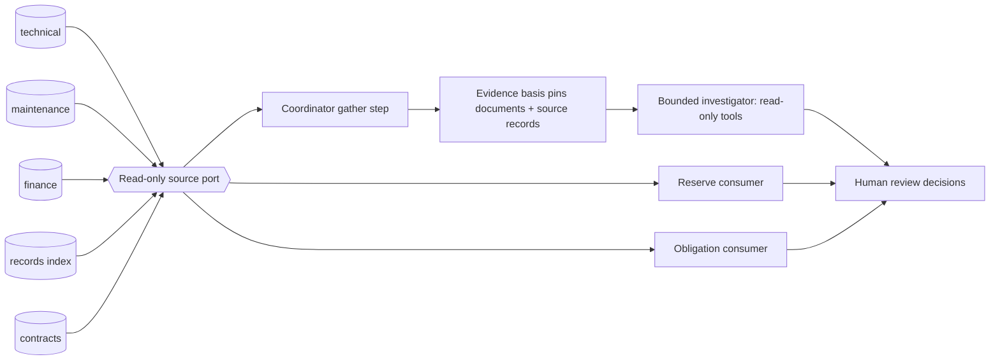

# Synthetic Source-System Stubs and Read-Only Source Port

> **aircraft-source-systems** | Status: Draft | Version: 0.1.0 | Last Updated: 2026-10-16

## Executive Summary

This PRD defines five synthetic source-system stubs and one read-only server port through which the Aircraft Return Readiness Demonstrator reads them. The stubs stand in for the places where an aircraft-return case gets its facts in real life: **technical** (airworthiness data), **maintenance** (work packages), **finance** (lease and billing), **records** (the document store) and **contracts** (obligations). The companion [Aircraft Return Readiness PRD](aircraft-return-readiness.md) (ARR) and [Aircraft Case Pack PRD](aircraft-case-pack.md) (CP) have no such layer. ARR builds an evidence basis from a submitted package, and its reserves (ARR:FR-006) and obligations (ARR:FR-007) read plain fixtures.

The stubs let the demonstration show the intended shape of the product: a coordinator (the application-owned case state machine, ARR:DD-009) gathers facts from several systems, a bounded investigator reads them through case-scoped read-only tools, and humans decide. The port is the seam where a real system adapter would later replace a stub. Every datum read through it carries provenance (system, record, version, as-of date), and the stubs can simulate an unavailable, stale or conflicting source so the presenter can show how the workflow reacts.

This PRD adds no workflow state, role, agent or external action. ARR stays authoritative for case workflow, authority boundaries and the evidence basis. Acceptance criteria describe future verification and are not evidence of delivery.

## Product Context

In the fictional scenario for Altivane Aviation Capital, the facts for one aircraft return live in separate systems owned by different teams. A records gap in the document store may be explained by an open work package in maintenance; a reserve discrepancy needs utilization from technical data and rates from the lease; an obligation window comes from the contract. Today the demonstrator receives all of this as one submitted package and one fixture file, so it cannot show where a fact came from, what happens when a source disagrees with the documents, or what a source outage does to a case.

The stubs are not an integration product. They are deterministic, in-process, synthetic, and read-only. They do not model the real data model, API or behavior of any maintenance, ERP, records or lease-management product, and no stub status establishes readiness, airworthiness, financial approval, legal approval, contractual acceptance, or aircraft release.

## Users and Personas

| Persona | Primary job | Pain point addressed | Success outcome |
|---|---|---|---|
| Presenter / demo operator | Show that a case is assembled from several systems, and show a source problem. | Cannot explain where a fact came from, or show an outage without breaking the demo. | Opens a case, sees each source and its provenance, and switches a source to unavailable, stale or conflicting for that case run, with an audit record. |
| Technical reviewer (simulated) | Judge whether an airworthiness or maintenance fact supports a records finding. | A document and a system may disagree; the reviewer cannot tell which is newer. | Sees both side by side with provenance, and decides on the current basis. |
| Finance reviewer (simulated) | Review a reserve draft. | Cannot trace a utilization figure or rate to its source. | Each draft line cites a finance or technical source record. |
| Legal reviewer (simulated) | Review an obligation and notice draft. | Cannot trace an obligation to the contract clause record. | The draft cites the contracts record and its version. |
| Bounded investigator (agent) | Plan read-only lookups inside the investigation step. | Must not reach outside the case or write anywhere. | Calls case-scoped read-only source tools and receives typed, provenance-bearing results. |
| Frontend implementer (consumer) | Build a source panel. | Needs a stable contract, not per-system shapes. | Receives one versioned envelope for all five sources. |

All systems, records, actors and decisions are synthetic or simulated.

## Design Decisions

| ID | Decision |
|---|---|
| DD-001 | The source stubs are server-side, in-process classes in the existing ASP.NET Core application, seeded from versioned fixtures. They are not separate services, containers or Azure resources, and add no Terraform. |
| DD-002 | Exactly five sources: `technical`, `maintenance`, `finance`, `records`, `contracts`. A source is one `ISourceSystem` implementation. The port exposes read operations only; no type in the port can write, update or delete. |
| DD-003 | The `records` source is the index over the case's evidence documents (the document store). Document content and versions remain owned by ARR (Blob Storage and the evidence basis, ARR:DD-007, ARR:DD-027). The records stub lists document metadata and returns the same `documentId` and `documentVersion` values ARR uses. It does not hold a second copy of content. |
| DD-004 | Every record returned by the port is a `SourceRecord` with `sourceId`, `recordId`, `recordVersion` (integer), `asOf` (UTC date), `caseId`, `kind`, `payload` (typed per kind, defined in the contract documentation) and `synthetic: true`. Provenance is not optional and is never inferred by the client. |
| DD-005 | The coordinator snapshots the source records it uses into the evidence basis. A basis therefore pins `(sourceId, recordId, recordVersion)` alongside document versions, so an assessment can be reproduced and a later source change creates a new basis through the ARR reassessment path (ARR:FR-005). The stubs hold a current version of each record; a fixture change that alters a record bumps `recordVersion`. |
| DD-006 | Source calls are case-scoped on the server. The caller supplies a case identifier; the server checks identity, role and case scope (ARR:DD-014) before any stub is touched. An out-of-scope or unknown case returns the same response as a nonexistent one. A record whose `caseId` differs from the requested case is never returned. |
| DD-007 | Source health is a per-case, per-run simulated mode of each source: `available` (default), `unavailable`, `stale` or `conflicting`. A presenter can set a mode for a source in a case run with an audited command (FR-007). `unavailable` returns a typed `source_unavailable` result, never an empty list. `stale` returns records with an `asOf` older than the scenario date and a `stale: true` flag. `conflicting` returns the fixture's alternate record version for that source. Modes never delete or edit fixture data. |
| DD-008 | A source problem is a finding input, not a decision. An unavailable or stale source blocks or downgrades the dependent finding with a stated reason (ARR blocked-versus-missing rule); it never counts as "missing evidence", never triggers a mock request on its own, and never changes an obligation or reserve silently. Disagreement between a document and a source record routes to internal review (ARR:FR-003). |
| DD-009 | The investigator gains read-only tools `list_source_records` and `get_source_record` in addition to its ARR tools (ARR:FR-002). They accept only `caseId`-bound arguments supplied by the server, count against the investigator's existing call and token budgets, and return `SourceRecord`s or a typed error. No source tool exists for any write. |
| DD-010 | Reserves (ARR:FR-006) read utilization from `technical` and rates and lease terms from `finance`. Obligations (ARR:FR-007) read clauses and notice windows from `contracts` (ARR:DD-018 still governs window semantics). Both consumers stay deterministic and keep their existing outputs; only their input source changes, and each output line cites the `SourceRecord` it used. |
| DD-011 | Source fixtures live under `backend/AirlineDemo.Api/Fixtures/sources/`, one file per source, with a manifest carrying `schemaVersion`, `sourceFixtureVersion`, the fixed `scenarioDate` (ARR:DD-018) and a SHA-256 content hash, loaded by the same refuse-on-mismatch rule as the case pack (CP:FR-001). The fixtures cover the ARR core case and the three CP cases. |
| DD-012 | The read contract is versioned in the path (`/api/v1/...`) and body (`contractVersion`), like CP:DD-005. One envelope serves all five sources so the client does not learn per-system shapes. |
| DD-013 | The port is the only way application code reads source data. The ARR evidence pipeline, reserve consumer, obligation consumer and investigator tools all depend on the port interface, so replacing a stub with an adapter changes one registration, not the callers. No real adapter is built in this PRD. |
| DD-014 | The stubs are not a new orchestrator or agent. The application-owned state machine remains the only workflow owner (ARR:DD-009, ARR:DD-010). A coordinator "gather" step may read sources before the investigation step, within the existing case lifecycle states; it adds no state token. |
| DD-015 | IDs are local to this PRD. Cross-references use `ARR:`, `CP:` and `HG:` prefixes. |

## Product Goals

| ID | Goal | Evidence of attainment | Priority |
|---|---|---|---|
| GOAL-001 | Show a case assembled from five synthetic sources with provenance on every datum, read through one read-only, scope-checked port, used by the investigator, the reserve consumer and the obligation consumer. | Port contract tests, scope negative tests, consumer tests citing source records, and an end-to-end case test pass. | MUST |
| GOAL-002 | Let a presenter demonstrate a source outage, stale source or document-versus-source conflict and see the workflow react safely and traceably. | Source-mode command tests including negative cases pass; each accepted mode change has an audit record; the dependent finding is blocked, downgraded or routed to review as specified. | MUST |

Measured at each release-candidate revision. Baseline: no source stubs, no port, no source tools and no source-mode command exist (not built). Target: all SRC acceptance criteria marked Automated pass, and the manual items in the release checklist are recorded.

## Functional Requirements

Unqualified IDs belong to this PRD. Companion IDs are cited as `ARR:` or `CP:` plus the identifier.

| ID | Requirement | Actor / trigger | Companion dependencies | Acceptance criteria | Product goals |
|---|---|---|---|---|---|
| FR-001 | Define the read-only source port and the `SourceRecord` envelope (DD-002, DD-004, DD-012), with `list` and `get` operations per case and source, a typed `source_unavailable` result, and versioned errors. | Application code or an authenticated client reads a source. | ARR:DD-014, ARR:NFR-008. | AC-001, AC-002, AC-003 | GOAL-001 |
| FR-002 | Implement the five stubs deterministically from versioned fixtures with manifest, hash, fixed scenario date and refuse-on-mismatch loading, covering the ARR core case and Cases A, B and C. | Application seeds fixtures. | CP:FR-001, CP:FR-002, ARR:DD-018. | AC-004, AC-005 | GOAL-001 |
| FR-003 | Enforce server-side identity, role and case scope on every source read; never return a record for a different case. | Authenticated user or investigator tool reads a source. | ARR:DD-014, ARR:NFR-001, CP:FR-008. | AC-006, AC-007 | GOAL-001 |
| FR-004 | Pin the source records a basis used into the evidence basis, and reassess through the ARR path when a pinned record's version changes. | Coordinator gathers sources; a source record changes version. | ARR:FR-001, ARR:FR-005. | AC-008, AC-009 | GOAL-001 |
| FR-005 | Give the investigator the read-only tools `list_source_records` and `get_source_record` within its existing budgets and citation validation; a source claim cites a `SourceRecord` witness. | Investigation step runs. | ARR:FR-002, ARR:AC-013. | AC-010, AC-011 | GOAL-001 |
| FR-006 | Feed the reserve consumer from `technical` and `finance` records and the obligation consumer from `contracts` records, citing the source record on each output line, without changing their rules or states. | Reserve or obligation evaluated. | ARR:FR-006, ARR:FR-007, ARR:AC-014, ARR:AC-015. | AC-012, AC-013 | GOAL-001 |
| FR-007 | Let a presenter in scope set a source's simulated mode (`available`, `unavailable`, `stale`, `conflicting`) for one case run through an authenticated, anti-forgery-protected, idempotent command that writes one audit record. | Presenter issues the command. | ARR:DD-028, ARR:DD-027, CP:FR-009. | AC-014, AC-015, AC-016 | GOAL-002 |
| FR-008 | Apply source modes to findings as DD-008 states: unavailable or stale blocks or downgrades with a stated reason, document-versus-source disagreement routes to internal review, and none of them creates a mock request or an acceptance. | A finding depends on a non-`available` source. | ARR:FR-003, ARR:FR-004. | AC-017, AC-018 | GOAL-002 |
| FR-009 | Serve a read-only, versioned source summary for a case: per source its mode, the records in use with provenance, and a coverage flag; no payload text beyond the typed fields. | Authenticated user opens the case. | ARR:FR-008, ARR:FR-013. | AC-019 | GOAL-001 |
| FR-010 | Emit source-read, mode-change and load outcomes through the existing server diagnostics filter, without record payloads or authentication secrets. | A read, mode change or load completes or fails. | ARR:DD-029, ARR:NFR-002, ARR:NFR-004. | AC-020 | GOAL-001 |

## Scope Boundaries

### In scope

- The port, `SourceRecord` envelope, five deterministic stubs and their versioned fixtures.
- Case-scoped read tools for the investigator and source inputs for the reserve and obligation consumers.
- Pinning source records in the evidence basis.
- A presenter command for simulated source modes and its audit record.
- A read-only per-case source summary.

### Capability labels

Following ARR's label table: the source stubs and their reads are `Simulated`; the reserve and obligation consumers stay `Rules-based`; the investigator's source tool calls are `AI agent` only as part of the investigation step. A source mode change is a `Simulated` presenter command.

### Out of scope

- Any real system adapter, real data model, authentication to a real system, or network call.
- Writing, updating or deleting any source record from the application or the agent.
- New workflow states, roles, agents or a second orchestrator (ARR:DD-010).
- Per-domain agents or agent-to-agent messaging.
- Streaming, change feeds or polling of sources; sources are read on demand and pinned in the basis.
- Airworthiness determination, invoice issuance, formal notices, or aircraft release.
- Changes to the frozen 40-case evaluation suite (ARR:DD-033). Any evaluation use of source records is a separate PRD decision.
- Rendering or client behavior beyond the contract (the dashboard and HG consume the summary).

### Synthetic source content

Each source holds a small, fixed set of records per case. Registrations, serials and amounts are fictional.

| Source | Record kinds (illustrative; exact payloads in contract documentation) | What it enables in the demo |
|---|---|---|
| `technical` | Airworthiness directive status, component time/cycle snapshot, utilization (hours, cycles) | Reserve inputs; a status that supports or contradicts a document |
| `maintenance` | Work package header, task cards with status (open, closed, deferred), component install/removal events | A records gap explained by an open or deferred work package |
| `finance` | Lease terms (rates per hour/cycle, reserve basis), billing period, prior reserve postings | Reserve rates; a seeded discrepancy |
| `records` | Document index: `documentId`, `documentVersion`, type, component, date, processing state | The list of what the document store holds |
| `contracts` | Obligation clause, `noticeWindowStart`, `noticeWindowEnd`, linked requirement | Obligation status and notice draft inputs |

Each case fixture seeds at least one situation per column-worth of behavior: Case A has a maintenance record that explains the missing-history finding after the mock response; Case B has a technical record that disagrees with a document on engine identity (routes to internal review); Case C has a complete baseline in all five sources and a `records` entry for the blocked document.

### Read contract

Authenticated `GET /api/v1/cases/{caseId}/sources` returns the source summary (FR-009). Authenticated `GET /api/v1/cases/{caseId}/sources/{sourceId}/records` returns the records of one source for the case. `POST /api/v1/cases/{caseId}/sources/{sourceId}/mode` is the only new mutation (FR-007). Unsupported versions return 400 `unsupported_contract_version`; unauthenticated reads return 401 with no case data; every envelope carries integer `contractVersion: 1`.

| Type / field | Type and meaning |
|---|---|
| SourceSummary envelope | `contractVersion: integer`, `fixtureVersion: string`, `caseId: string`, `caseRevision: integer`, `sources: SourceStatus[]`. |
| SourceStatus | `sourceId: technical / maintenance / finance / records / contracts`, `mode: available / unavailable / stale / conflicting`, `recordCount: integer`, `pinnedInBasis: boolean`, `capabilityLabel: CapabilityLabel`. |
| Records envelope | `contractVersion: integer`, `caseId: string`, `sourceId: string`, `mode: string`, `records: SourceRecord[]`. An unavailable source returns 503 with `error.code = source_unavailable` and no `records`. |
| SourceRecord | `sourceId`, `recordId`, `recordVersion: integer`, `asOf: YYYY-MM-DD UTC date`, `caseId`, `kind`, `stale: boolean`, `payload: object` (typed per kind), `synthetic: true`. |
| Mode request | `commandId: nonempty string`, `expectedRevision: nonnegative integer`, `mode`. Actor, time and reason are never accepted from the body. |
| Mode receipt | `contractVersion: 1`, `commandId`, `caseId`, `sourceId`, `priorMode`, `newMode`, `priorRevision`, `newRevision`, `auditEventId`. Reason code `presenter_set_source_mode`. |
| Error envelope | `contractVersion: 1`, `error: {code, message}`. No case data or receipt in an authorization or conflict error. |

Mode command validation order follows CP: authentication, role, case scope, anti-forgery, supported source and mode, then replay lookup. An identical stored command for the same actor and case returns its original receipt; reuse with a different actor or payload returns 409 `command_id_conflict`; a new command at a stale revision returns 409 `stale_revision`. Setting the mode a source already has returns 422 `mode_unchanged`. Mode changes apply to the current run only and never rewrite history (ARR:DD-027); a case run reset (ARR:FR-010) restores `available` for every source.

## Security Notes

- Trust boundary: the browser is untrusted (ARR Security Notes). Source reads and the mode command validate identity, role, case scope and revision on the server. Client-supplied case, source or record identifiers never grant access; an out-of-scope or unknown identifier returns the same response as a nonexistent one.
- Data handled: synthetic fixtures only. No credentials, personal data or real records. The manifest hash detects accidental drift and gives no authenticity guarantee beyond the repository's review gate.
- Read-only by construction: the port interface has no write method, the investigator has no write tool, and a test fails if any `ISourceSystem` member can mutate state.
- Untrusted text: record payload strings (for example a task-card description) are untrusted data. They are passed to the investigator as quoted data, may not change authority, and are covered by the ARR prompt-injection negative fixtures (ARR risk register). One fixture record carries seeded instruction-like text.
- The mode command requires the session cookie, anti-forgery token (ARR:DD-028), presenter role and case scope before replay lookup. Each accepted change writes one append-only audit record (ARR:DD-027); replays and rejections write none.
- Diagnostics exclude payload text, cookies and tokens (ARR:DD-029). No client telemetry endpoint is added.
- Simulated source health is labelled in every response as `Simulated`; a client cannot present it as a real system outage.

## Non-Functional Requirements

### Performance and Capacity

**NFR-001.** In an in-process ASP.NET integration host with temporary stores and the four-case fixture, each source read and the summary respond in 1 second or less at the 95th percentile over 100 sequential measured requests, and the summary payload stays at or below 65,536 bytes or returns 422 `source_payload_limit` without partial data.

### Reliability and Resilience

**NFR-002.** Source fixture loading is atomic: a validation or publication failure leaves previously stored source data, pins and audit records unchanged. Loading the same version and hash again is a no-op; a stored version with different content is refused.

### Security

**NFR-003.** The scope, read-only, anti-forgery and replay rules in the Security Notes hold on every endpoint and tool, verified by negative tests (AC-006, AC-007, AC-010, AC-015, AC-016).

### Privacy

**NFR-004.** Fixtures, diagnostics and examples contain synthetic data only; a scan of fixtures and exports finds no personal identifiers or secrets.

### Maintainability and Operability

**NFR-005.** Replacing one stub with another `ISourceSystem` implementation changes one dependency-injection registration and no caller (AC-021). Contract documentation lists every record kind and payload field.

### Observability

**NFR-006.** Reads, mode changes and loads are visible in diagnostics with source, case, outcome and duration, and without payloads (AC-020).

### Compatibility and Interoperability

**NFR-007.** Contracts are versioned (DD-012); unsupported versions fail explicitly. Cross-source identifiers (`documentId`, `componentId`, `caseId`) match the ARR and CP identifiers exactly.

### Usability and Accessibility

Not applicable to this PRD; there is no interface requirement. Display of the summary is a dashboard or HG requirement.

## Constraints

| ID | Constraint | Type | Rationale | Impact |
|---|---|---|---|---|
| CON-001 | Synthetic data and in-process stubs only (ARR:CON-001). | Operational | Fictional demonstrator. | No real system, network call or data. |
| CON-002 | No new workflow state, role, agent or orchestrator (ARR:DD-010). | Architectural | Keeps one workflow owner. | Source gathering fits inside existing lifecycle states. |
| CON-003 | No new Azure resource, package or `.github/` change is required. | Delivery | Keeps stories inside the implementer's write scope. | Terraform and CI are untouched. |

## Process Models

Case flow with sources: submit package → coordinator gathers source records through the port → basis pins documents and source records → investigator runs read-only tools (documents and sources) → deterministic policy → review, mock request, reserve draft or obligation draft → human decision. A non-`available` source adds a blocked, downgraded or review branch (FR-008) and never an automatic request.

## Acceptance Criteria

Verification values: **Automated** means a vitest, xUnit or CI check that fails when the behavior is missing. **Manual** means a human check recorded in the release checklist and not story acceptance.

| ID | Criterion (Given / When / Then) | FRs | Verification |
|---|---|---|---|
| AC-001 | Given the port interface, when reflected, then it exposes only read operations, and a test fails if a member named or typed as a write is added. | FR-001 | Automated |
| AC-002 | Given a valid in-scope request, when a source is read, then every record carries `sourceId`, `recordId`, `recordVersion`, `asOf`, `caseId`, `kind` and `synthetic: true`; a record missing any is rejected by fixture validation. | FR-001 | Automated |
| AC-003 | Given an unsupported `/api/v{n}/` version, then the response is 400 `unsupported_contract_version` with no case data; given an unauthenticated read, then 401 with no case data. | FR-001 | Automated |
| AC-004 | Given the fixtures, when loaded, then the ARR core case and Cases A, B and C each have records in all five sources, and the manifest hash, `schemaVersion` and counts validate. | FR-002 | Automated |
| AC-005 | Given a changed fixture byte, a wrong `schemaVersion` or a wrong count, when loaded, then loading is refused with a reason and no partial data is published; given a pre-existing pack and unrelated case data, an injected failure leaves them unchanged. | FR-002 | Automated |
| AC-006 | Given a user whose scope excludes a case, when any source endpoint is read, then the response equals that of a nonexistent case and no record is returned. | FR-003 | Automated |
| AC-007 | Given a record whose `caseId` differs from the requested case (seeded in a test fixture), when read, then it is never returned, and the attempt is a diagnostics event without payload. | FR-003 | Automated |
| AC-008 | Given a gathered case, when the basis is built, then it pins each used `(sourceId, recordId, recordVersion)`; a basis built from the same inputs is identical, and a basis without pins is rejected. | FR-004 | Automated |
| AC-009 | Given a pinned record whose fixture version is bumped, when the case is reassessed, then a new basis is created, the former basis is retained, and the history shows both; an unchanged record creates no new basis. | FR-004 | Automated |
| AC-010 | Given the investigator, when it lists tools, then `list_source_records` and `get_source_record` are present and no source write tool exists; a call with a different case identifier than the server-bound one is refused. | FR-005 | Automated |
| AC-011 | Given an investigation citing a source record, when the citation self-check runs, then a citation to a record or version not in the basis is downgraded, and source calls count against the call budget. | FR-005 | Automated |
| AC-012 | Given finance and technical records, when the reserve draft is built, then each line cites its `SourceRecord` and totals equal the existing ARR:AC-014 hand calculation; a removed `finance` rate yields a blocked input, not a zero. | FR-006 | Automated |
| AC-013 | Given a contracts record, when obligation status is evaluated, then the state and notice-window behavior match ARR:AC-015 and DD-018, the draft cites the record, and no notice is sent. | FR-006 | Automated |
| AC-014 | Given a presenter in scope, when the mode command is issued with a valid token and revision, then the source mode changes for the current run, one audit record is written, and the receipt matches the contract. | FR-007 | Automated |
| AC-015 | Given a technical, finance, legal or executive role, or a presenter outside case scope, when the command is issued, then the response is 403 or 404 respectively, state is unchanged and no audit record is written. | FR-007 | Automated |
| AC-016 | Given an exact replay, then the original receipt returns with no new audit record; given a reused identifier with a different payload, 409 `command_id_conflict`; given a stale revision, 409 `stale_revision`; given the current mode, 422 `mode_unchanged`; and a run reset restores every source to `available`. | FR-007 | Automated |
| AC-017 | Given a source set to `unavailable` or `stale`, when the dependent finding is assessed, then it is blocked or downgraded with a stated reason, no mock request is created, and no acceptance is recorded; given `available`, the same finding follows its normal path. | FR-008 | Automated |
| AC-018 | Given a document and a source record that disagree (Case B engine identity), when assessed, then the finding routes to internal review with zero external requests and both items cited. | FR-008 | Automated |
| AC-019 | Given an in-scope user, when the summary is read, then it lists five sources with mode, record counts and pin flags, contains no payload text, and is consistent with `caseRevision`; an over-limit payload returns 422 `source_payload_limit`. | FR-009 | Automated |
| AC-020 | Given a read, a mode change or a failed load, when diagnostics are inspected, then each outcome appears with source, case, outcome and duration and contains no payload text, cookie or token. | FR-010 | Automated |
| AC-021 | Given a test double implementing `ISourceSystem`, when registered in place of one stub, then all callers work unchanged and no caller references a stub type. | FR-001, FR-006 | Automated |
| AC-022 | Given the seeded instruction-like text in a task-card record, when the investigator reads it, then no tool call outside policy occurs and the finding is unaffected. | FR-005 | Automated |
| AC-023 | Given a rehearsal, when the presenter walks one case through an outage and a conflict, then the product owner confirms the audience can see which source, which record version and what the workflow did. | FR-007, FR-008, FR-009 | Manual |

## Traceability Matrix

### FR-to-AC Coverage

| FR | ACs |
|---|---|
| FR-001 | AC-001, AC-002, AC-003, AC-021 |
| FR-002 | AC-004, AC-005 |
| FR-003 | AC-006, AC-007 |
| FR-004 | AC-008, AC-009 |
| FR-005 | AC-010, AC-011, AC-022 |
| FR-006 | AC-012, AC-013, AC-021 |
| FR-007 | AC-014, AC-015, AC-016, AC-023 |
| FR-008 | AC-017, AC-018, AC-023 |
| FR-009 | AC-019, AC-023 |
| FR-010 | AC-020 |

Coverage: 10 of 10 FRs have at least one criterion (100%).

### FR-to-GOAL Alignment

| FR | Goal |
|---|---|
| FR-001 to FR-006, FR-009, FR-010 | GOAL-001 |
| FR-007, FR-008 | GOAL-002 |

## MVP and Release Framing

The release contains FR-001 through FR-010. **Do not merge this PRD while its ARR prerequisites are undelivered.** Before approval, the product owner verifies default-branch code and passing behavior tests for ARR:FR-001, ARR:FR-002, ARR:FR-005, ARR:FR-006, ARR:FR-007, ARR:FR-008, ARR:FR-010 and ARR:DD-014, and CP:FR-001, CP:FR-002 and CP:FR-009. If CP is not yet delivered, stories for the Cases A to C fixtures wait for it and the ARR core case fixtures can proceed alone.

Suggested story order (each story changes under 500 lines, names its test file, and leaves the tests failing on `main`):

1. Port interface, `SourceRecord` envelope and read-only reflection test (FR-001).
2. Fixture manifest loader with refuse-on-mismatch and atomic publish (FR-002).
3. `technical` and `finance` stubs and fixtures for the core case (FR-002).
4. `maintenance`, `records` and `contracts` stubs and fixtures for the core case (FR-002).
5. Scope-checked read endpoints and error envelopes (FR-001, FR-003).
6. Basis pinning and reassessment on version change (FR-004).
7. Reserve consumer reads `technical`/`finance` (FR-006); obligation consumer reads `contracts` (FR-006).
8. Investigator source tools and citation check (FR-005).
9. Source-mode command, audit record and run-reset restore (FR-007).
10. Source-mode effects on findings (FR-008).
11. Case A to C source fixtures (FR-002; after CP).
12. Source summary endpoint (FR-009) and diagnostics (FR-010).

Fixture data lives under `backend/AirlineDemo.Api/Fixtures/sources/`; code under `backend/AirlineDemo.Api/SourceSystems/`; behavior tests under `backend/AirlineDemo.Api.Tests/`; contract documentation under `docs/`.

### Release checklist (manual verification)

- Product owner confirms AC-023 after a rehearsal.
- Product owner reviews the source fixtures for synthetic-only content and fictional identifiers.

## Success Metrics

| Goal | Indicator | Baseline | Target | Evidence |
|---|---|---|---|---|
| GOAL-001 | Automated criteria passing (AC-001 to AC-013, AC-019 to AC-022: 18); records without provenance; cross-case records returned | 0 of 18; not built | 18 of 18; 0; 0 | Test results at each release-candidate revision |
| GOAL-002 | Mode-command criteria (AC-014 to AC-018) passing; audit record per accepted mode change; automatic requests or acceptances caused by a source problem | 0 of 5; none; not built | 5 of 5; 1 per accepted change and none per replay or rejection; 0 | Test results and audit history |

## Risks and Assumptions

### Key Assumptions

| ID | Assumption | Basis | If wrong |
|---|---|---|---|
| AS-001 | Five stubs with a few records per case are enough to show the multi-system story. | Defined for this PRD. | Add record kinds in a later addendum; the port is unchanged. |
| AS-002 | Pinning source records in the basis fits ARR's basis model without a new workflow state. | ARR basis is a versioned inventory (ARR glossary). | A small ARR amendment would be needed before story 6. |
| AS-003 | The investigator's existing budgets absorb two more read tools. | Budgets are frozen configuration (ARR:AS-004). | Re-freeze budgets before scored evaluation. |

### Risk Register

| Risk | Likelihood | Impact | Mitigation |
|---|---|---|---|
| Stubs are mistaken for real integrations or real system behavior. | Medium | High | Label `Simulated` in every response and on the dashboard; the Product Context states the limit; no product names in fixtures. |
| A source outage is mistaken for missing evidence and triggers a request. | Medium | High | DD-008 and AC-017 require blocked or downgraded handling with zero requests. |
| Source text carries instructions to the agent. | Medium | High | Treat as data; seeded fixture and AC-022. |
| Source change after assessment silently alters results. | Low | High | Pins in the basis and reassessment through ARR (AC-008, AC-009). |
| Scope creep into real adapters or per-domain agents. | Medium | Medium | Out-of-scope list; DD-013 keeps the seam without building adapters. |

## Glossary

| Term | Definition |
|---|---|
| Source system (stub) | A synthetic, deterministic, in-process stand-in for a system that owns one domain's facts. |
| Source port | The read-only interface through which application code and agent tools read sources. |
| SourceRecord | A typed, versioned record with provenance returned by the port. |
| Source mode | A simulated per-case, per-run health state of a source: available, unavailable, stale or conflicting. |
| Coordinator | The application-owned case state machine that gathers inputs, runs the investigator and routes to humans (ARR:DD-009). |
| Pin | A reference to an exact source record version held in an evidence basis. |

## Sign-Off

### Approval Checklist

* Product Owner: Not approved.
* Engineering Reviewer: Not approved.
* Security and Privacy Reviewer: Not assigned; synthetic data only, advisory.
* Legal/Compliance: Not assigned; synthetic data only.

Approval date: Not approved.

### Waivers

None requested.

### Handoff Readiness

Draft only. No implementation story is approved until a named person approves this PRD pull request and the prerequisite delivery gate in MVP and Release Framing is satisfied. A merged PRD is planned into stories by the pipeline (threat model, then stories); say in the pull request whether it needs ARR amendment AS-002 first.

## Disclaimer

This document defines draft requirements for a fictional, synthetic demonstrator. It is not business sign-off, security approval, authorization to provision or spend, implementation or runtime evidence, certification evidence, or production-readiness approval. No real-world airworthiness, financial, legal or contractual decision follows from it.

## Document Metadata

* Template Version: 1.0.0.
* Canonical Template: `docs/templates/prd-template.md`.
* Companion PRDs: [Aircraft Return Readiness](aircraft-return-readiness.md) (ARR, v0.7.0); [Aircraft Case Pack](aircraft-case-pack.md) (CP); [Aircraft Hangar 3D](aircraft-hangar-3d.md) (HG).
* License: CC-BY 4.0 (Microsoft HVE-Core).
* Attribution: Microsoft HVE-Core Team.
