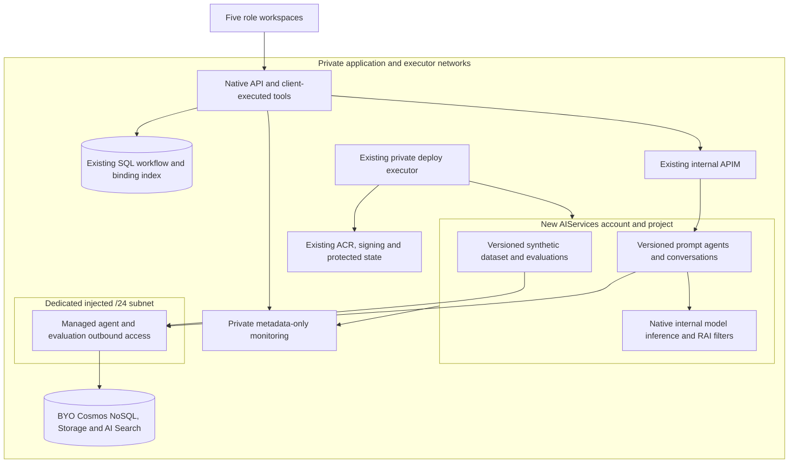

# Foundry Managed Agents

> **foundry-managed-agents** | Status: Draft | Version: 0.1.0 | Last Updated: 2026-11-03

## Executive Summary

Deliver a fully running private airline demonstrator on real Microsoft Foundry, including code, Terraform, deployment orchestration, safety, evaluations, observability and an executable operator manual. Both the case copilot and live investigator become ordinary saved, versioned managed prompt agents. The user's selected scope includes managed orchestration and conversation state, not just model lifecycle features.

The native API remains the authority for SQL aircraft workflow, role/source authorization, stage changes and immutable human release approval. Foundry chooses declared function steps and stores conversation/response state; it receives no business authority. Existing enterprise workspaces, five personas and three `cp-case-*` packs remain substantive working experiences.

By first migration release acceptance, the private executor must demonstrate real agent creation/versioning, invocation, function continuation, authorized reconnect after fresh sign-in and process restart, evaluation, safety and metadata-only telemetry. Unit tests or successful resource provisioning cannot replace those proofs. Tenant and subscription are the only required Azure command arguments; protected approvals, rights and retained secrets remain explicit prerequisites.

This is a complete **draft for human PR approval**, not an implementation authorization or an approved release. Human merge approves the proposed persistence, gateway and scope amendments below. Validate and Finalize are not entered or claimed; this authoring creates no stories, issues, code, infrastructure mutations or workflow changes.

## Research Readiness

Research status: `Required`

Rationale: Managed runtime, private network injection, state isolation, gateway placement and evaluation depend on external service contracts. The supplied research completed two Wider/Deeper/Contrarian cycles and resolves the smaller-runtime alternative against the user's selected scope.

Research artifact: [Foundry migration research](../research/2026-11-03/foundry-migration-research.md).

Planning blockers: None.

Scope and behavior are resolved as concrete requirements, not future architecture selections. PRD approval, tenant policy, exact cost/capacity/quota confirmation and private live compatibility are mandatory release gates. Failure blocks release without expanding region, public access, tool authority or SKUs.

### Research Finding Dispositions

Evidence IDs below belong to the [primary research artifact](../research/2026-11-03/foundry-migration-research.md#evidence-log), not this PRD. Research facts support decisions; proposed product choices acquire authority only through human PRD merge. D10/D11 are recorded user choices; D12 is the research architecture consequence proposed here.

| Gap ID | Evidence IDs | Affected targets | Disposition | Rationale | Primary research artifact |
| --- | --- | --- | --- | --- | --- |
| F11 | W14, W18, W19, C15 | FR-001, FR-003, DD-002 | Incorporated | AzureRM 4.81.0 supports AIServices/project/injection; select a new account rather than assume retrofit. | [Research F11](../research/2026-11-03/foundry-migration-research.md#f11-real-foundry-infrastructure-is-supported-by-the-pinned-provider) |
| F12 | W16, W20, W22, W23 | FR-001, FR-021 | Incorporated | Injection is creation-time; capability-host readiness and private evaluation need executable proof. | [Research F12](../research/2026-11-03/foundry-migration-research.md#f12-private-evaluations-change-the-account-creation-decision) |
| F13 | W15, W17, W24, W25, C16 | FR-015, FR-016, FR-017 | Revised | Preserve exact deterministic evaluation; user D11 additionally requires managed production orchestration. | [Research F13](../research/2026-11-03/foundry-migration-research.md#f13-meaningful-evaluations-do-not-require-replacing-application-orchestration) |
| F14 | C15, C17, C18, W15, W16 | FR-014, FR-018 | Incorporated | Retain screening/redaction and add explicit model filters; neither proves injection immunity. | [Research F14](../research/2026-11-03/foundry-migration-research.md#f14-safety-and-telemetry-already-exist-and-must-not-regress) |
| F15 | W20, W21, W22, W23, W26, C16 | FR-001, FR-016, CON-002 | Incorporated | Sweden Central only; relevance/groundedness supported, regional red-team/protected-material features excluded. | [Research F15](../research/2026-11-03/foundry-migration-research.md#f15-regional-and-network-limitations-constrain-showcase-features) |
| F16 | W27, W28, W29, W30, W32 | FR-003, FR-005, DD-005 | Incorporated | Ordinary saved/versioned agents for both workloads; exclude ephemeral Responses-only and hosted local loops. | [Research F16](../research/2026-11-03/foundry-migration-research.md#f16-managed-prompt-agents-satisfy-selected-orchestration-and-state-scope) |
| F17 | W28, W31, W33 | FR-001, FR-004, CON-005 | Incorporated | Standard BYO stores; verify new-runtime provisioning and exact cost, not a fictional fixed 3000 RU/s requirement. | [Research F17](../research/2026-11-03/foundry-migration-research.md#f17-private-managed-state-needs-the-standard-topology) |
| F18 | W29, W34, W35, W36, C15 | FR-002, FR-010, DD-004 | Incorporated | Private API-to-project proxy selected; internal inference is not APIM-mediated. Reject unproved BYOM chaining. | [Research F18](../research/2026-11-03/foundry-migration-research.md#f18-gateway-placement-and-managed-model-mediation-are-different-contracts) |
| F19 | W30, C19, C20, C21 | FR-006, FR-011, FR-013 | Incorporated | Foundry selects functions; API executes real live-session tool pipeline and preserves separate investigator gate. | [Research F19](../research/2026-11-03/foundry-migration-research.md#f19-function-execution-can-remain-behind-api-policy) |
| F20 | W29, W33, C19, C20, C21, C22 | FR-007, FR-008, FR-009, FR-020 | Incorporated | Durable ownership, atomic admission, scoped content/retention and fresh authorization precede history access. | [Research F20](../research/2026-11-03/foundry-migration-research.md#f20-persisted-history-changes-the-content-and-authorization-boundary) |

## Product Context

The demonstrator already has private deployment, bounded local orchestration, synthetic source ports, deterministic evaluation, Prompt Shields and export redaction. A project with decorative badges would not satisfy the requested managed-agent demonstration. Migration must preserve existing business decisions while exposing genuine lifecycle evidence.

Current-version source authorities are:

Companion identifiers use `COP:` for copilot 0.2.0 and `SRC:` for source systems 0.11.0; unqualified identifiers belong to this PRD.

| Source | Current version / observed contract | Authority retained |
| --- | --- | --- |
| [Role-aware case copilot](role-aware-case-copilot.md) | 0.2.0; COP:DD-004, COP:DD-006, COP:DD-007, COP:DD-012, COP:DD-017 and Addendum A | Five tools, closed observations, source matrix, exact-session five-minute proposal, audit and trusted confirmation. Scoped amendments below. |
| [Aircraft return readiness](aircraft-return-readiness.md) | 0.9.2 | Native state machine, investigator claims, human decisions, immutable basis and four-arm semantics. |
| [Aircraft source systems](aircraft-source-systems.md) | 0.11.0; SRC:DD-023, SRC:DD-024 | Role/source entitlements, shared read admission and no source-fixture signing; manifest/hash checks retained. |
| [Role workspaces](role-workspaces.md) | 0.2.0 | Working technical findings, finance worksheet, legal register, executive portfolio and presenter control centre. |
| [Gateway Terraform](../../infra/terraform/main.tf) | `model`, `gateway_chat_completions`, `content_safety` | Private internal APIM, caller identity/role, seven correlation headers and separate screening route. |
| [CopilotQuestions](../../backend/AirlineDemo.Api/Copilot/CopilotQuestions.cs), [input contract](../../backend/AirlineDemo.Api/Copilot/CopilotInputContract.cs) | Current repository source; C19/C20 | Question/tool/token/deadline limits, structural inputs, duplicate detection and output/citation checks. |
| [CopilotMcp](../../backend/AirlineDemo.Api/Copilot/CopilotMcp.cs), [proposal endpoints](../../backend/AirlineDemo.Api/Copilot/CopilotProposalEndpoints.cs) | Current source | Real dispatch, UI-only note/confirmation, atomic `CommitCopilotRelease` and exact receipt replay. |
| [BoundedInvestigator](../../backend/AirlineDemo.Api/Investigation/BoundedInvestigator.cs), [manifest/registry](../../backend/AirlineDemo.Api/Investigation/ApprovedModelManifest.cs), [limits](../../backend/AirlineDemo.Api/Investigation/InvestigationLimits.cs) | Current source; C21 | Registered synthetic hashes, role-bound source tools, verbatim witnesses and separate live-arm gate. |
| [Four-arm runner](../../backend/AirlineDemo.Api/Evaluation/FourArmEvaluationRunner.cs), [diagnostics](../../backend/AirlineDemo.Api/Diagnostics/DiagnosticsSetup.cs) | Current source; C16/C17 | Frozen scoring contracts and redaction before exporters, not cloud success evidence. |
| [DemoSessionStore](../../backend/AirlineDemo.Api/Auth/DemoSessionStore.cs) | Current source; C22 | Memory-only sessions, eight-hour sliding expiry; restart invalidates sessions. |
| [Private deploy script](../../scripts/deploy-private.py), [deployment manual](../deployment.md) | Current source | Derived configuration, private executor, protected signing/release, saved-plan confirmation and resume. |

**Scoped precedence on human merge:** this PRD supersedes only incompatible COP:DD-004 infrastructure/provider restrictions, COP:DD-006 no-persisted-conversation/one-question runtime, COP:DD-007's exclusion of this new provider/content approval, and associated COP:CON-002/COP:CON-006/COP:NFR-014/cloud-egress or no-persistence statements. ARR's per-internal-inference APIM/call accounting is replaced only for managed internal inference. Raw source exclusion, source entitlements, structural validation, immutable release and audit remain binding. COP:DD-012/COP:DD-017 manual handoff applies to that earlier feature/addendum, not a global override: [AGENTS.md](../../AGENTS.md) governs this new feature's post-merge quality/security/functional planning. No companion file is edited by this authoring.

## Users and Personas

| Persona / canonical role | Job, pain and success outcome |
| --- | --- |
| Technical / `technical-reviewer` | Resolve findings with technical, maintenance and records evidence; retain the finding workspace rather than a cosmetic role switch. |
| Finance / `finance-reviewer` | Decide reserve drafts from entitled technical/finance inputs; technical-source access never grants technical-point visibility. |
| Legal / `legal-reviewer` | Work obligations with contracts/records evidence; records access never grants unrelated point visibility. |
| Presenter / `presenter` | Show controls, switch personas and confirm simulated release; read bounded AI assurance evidence without acquiring reviewer decisions or source prose. |
| Executive / `executive` | Read coarse portfolio progress without source records, point details, release or Foundry project data. |
| Unknown / anonymous | No authorized feature access; denial precedes business, source and Foundry data access. |

### Roles-by-action and field contract

Every allow requires live server-owned case scope; never accept role, owner or service conversation ID from the agent/browser. `summary` means exactly `contractVersion, caseId, aircraftId, caseRevision, status, ownerRole, nextActionId, capabilityLabel, released, releaseBlockers, simulated, synthetic`; next action remains role-owned. Source summary uses existing closed `sourceId, mode, capabilityLabel, coverage, recordCount, pinnedInBasis, recordsInUse`, omitting unauthorized record references.

| Role | List/summary + own conversation | Open-point fields | UI-only source details | Propose / confirm / release | AI assurance |
| --- | --- | --- | --- | --- | --- |
| technical-reviewer | Allow scoped summaries | `contractVersion, caseId, caseRevision, domain=technical, points[{pointId,domain,pointType,state,ownerRole,sourceRefs}]` | technical, maintenance, records only | Deny / deny / deny | Deny |
| finance-reviewer | Allow scoped summaries | Same fields, `domain=finance` only | technical, finance only | Deny / deny / deny | Deny |
| legal-reviewer | Allow scoped summaries | Same fields, `domain=legal` only | contracts, records only | Deny / deny / deny | Deny |
| presenter | Allow scoped summaries | `contractVersion, caseId, caseRevision, status` only; no `points` | Deny; summary only | Allow proposal / explicit trusted UI / exact approved retry | Allow read-only bounded fields below |
| executive | Allow scoped summaries | Same coarse status fields as presenter | Deny; summary only | Deny / deny / deny | Deny |
| unknown role | Deny | Deny | Deny | Deny / deny / deny | Deny |
| anonymous | Deny | Deny | Deny | Deny / deny / deny | Deny |

Allowed UI record content remains the current source response; no migration broadens its field projection. Managed copilot receives only structural `caseId, sourceId, outcome, refs[{sourceId,recordId,recordVersion}]` for list/record observations, never those record bodies. Investigator evidence follows its separate registry contract. Denied actions return 401 `unauthenticated`, 403 `forbidden`, or 404 `case_not_found` for missing/out-of-scope cases; they cause zero case-payload/source/Foundry calls. Ownership checks can read only the local binding index after coarse authentication/role/scope authorization.

## Design Decisions

All rows are proposed product decisions for human review, except the already selected managed scope in DD-001. No row records approval.

| ID | Decision and basis |
| --- | --- |
| DD-001 | User D10/D11 selects real Foundry plus managed orchestration/state for both workloads. The smaller lifecycle-only option is excluded. |
| DD-002 | New private AIServices account/project with injection at creation; use pinned AzureRM 4.81.0 project/network schema (F11/F12), not in-place outbound retrofit. |
| DD-003 | Standard BYO Cosmos NoSQL, Storage and AI Search; dedicated `/24` delegated to `Microsoft.App/environments`. New-runtime capacity/configuration must be verified and priced, never inferred from conflicting Classic RU/s examples. |
| DD-004 | API-to-project traffic uses explicitly allowlisted private APIM operations, app identity/JWT role/correlation and gateway MI. Native agent inference is internal Foundry work, not per-call APIM traffic; BYOM chaining is excluded. |
| DD-005 | Ordinary immutable named/versioned prompt agents, pinned model/config digest; no ephemeral direct-model substitute, hosted copy of the old loop, Copilot harness, managed memory, voice, file search, public MCP or service-side business tools. |
| DD-006 | Durable SQL binding/index metadata only; exact user+role+selected case+entitlement fingerprint+revision+agent/version+manifest/config digest. Browser gets an opaque local handle. No durable authentication or duplicate business transcript. |
| DD-007 | Absolute conversation lifetime eight hours from local creation reservation, at most 20 admitted user turns. New sign-in can resume the same authorized binding; proposal approval never resumes across sessions. |
| DD-008 | SQL compare-and-swap turn admission with fencing, not a process lock. Abandoned/ambiguous histories retire; timeout never reclaims the same history for a new writer. |
| DD-009 | Per turn: 20 tool attempts, eight response submissions including retries, 30 seconds; each response requests 2000 output tokens, estimated full input ceiling 16000. These do not bound invisible internal inference. |
| DD-010 | Human merge approves newly persisted submitted questions/closed observations for copilot and exact registry-approved evidence for investigator, not raw source egress or trace-content capture. |
| DD-011 | One versioned 12-row synthetic Foundry dataset/run per exact release input identity; relevance and groundedness normalized to 1–5, each row at least 3. Safety/Prompt Shields evidence is separate; no unsupported regional evaluator. |
| DD-012 | Existing record screening remains fail-visible `clear/detected/unavailable`; deployment filters block medium/high severity Hate, Sexual, Violence and SelfHarm for input and output using the verified service schema. Screening is not authorization or injection immunity. |
| DD-013 | Metadata-only app and service trace exports; no prompt/output harvesting. Missing usage stays unknown, and missing evidence never produces passing assurance. |
| DD-014 | Scoped companion supersession follows Product Context. Existing source/tool/approval controls remain; this new feature follows current repository post-merge planning policy. |
| DD-015 | Expiry immediately denies use; bounded cleanup removes service items according to verified deletion semantics. Retention and deletion lag remain visible, not an instant physical-erasure promise. |
| DD-016 | No provisioning until exact plan, policy, quota and cost confirmation; no cutover until real private proofs and personal signed-release approval. No automatic costly SKU, regional, public-network or direct-model fallback. |

## Product Goals

All goals are MUST; wesback owns product acceptance at the first migration release, with no fabricated calendar commitment.

| ID | Goal | Target / measurement window |
| --- | --- | --- |
| GOAL-001 | Reproduce an isolated Foundry deployment without replacing the existing application. | AC-001–AC-005 and AC-026 satisfied at first migration release; two identical setup runs create no duplicate matching assets. |
| GOAL-002 | Run managed copilot/investigator while preserving business authority and scoped durable conversations. | AC-006–AC-017, AC-024, AC-027 and AC-028 satisfied at first release; zero unauthorized reads, duplicate releases or stale output returns in race tests. |
| GOAL-003 | Present measured safety, evaluation and observability rather than simulated success. | AC-018–AC-023 satisfied at first release; 12/12 pinned rows meet both quality thresholds, with separate real safety/export evidence. |
| GOAL-004 | Supply a resumable operating procedure and release evidence. | AC-005, AC-024–AC-026 and AC-029 satisfied at first release; an authorized operator completes the manual using tenant/subscription arguments and listed prerequisites. |

**SMART Evaluation** (formal Validate→Finalize assessment not performed):

- [x] **S**pecific: One private managed-agent migration.
- [x] **M**easurable: Named acceptance sets and zero-effect assertions.
- [ ] **A**chievable: Live service, quota and integration proofs pending.
- [x] **R**elevant: Selected full airline demo without authority transfer.
- [x] **T**ime-bound: First migration release acceptance.

**Status**: deferred.

## Functional Requirements

All FRs are MUST. Contract tables below are normative; names of production seams identify verification boundaries, not new business authority.

| ID | Requirement / expected outcome | Actor / trigger | Product goals | Acceptance criteria |
| --- | --- | --- | --- | --- |
| FR-001 | Provision a new private injected AIServices account/project, Standard BYO stores, private monitoring, capability hosts, dedicated delegated subnet with NSG, private endpoints/DNS links and Entra-only access; retain existing SQL/APIM/ACR/executor/signing/state. | Deploy operator / reviewed setup | GOAL-001 | AC-001 |
| FR-002 | Route app agent/conversation/Responses traffic only through private APIM with explicit operation/resource allowlists, existing app identity/JWT role/correlation boundary and APIM MI-to-project; refuse direct endpoint fallback. | Runtime / project operation | GOAL-001, GOAL-002 | AC-002, AC-003 |
| FR-003 | Create/version both managed prompt agents from the private executor under deploy identity; generate a nonsecret manifest with exact project, agent names/versions, definition hashes, model deployment/version, API/SDK versions, tool schemas, filter policy and configuration digest. Detect exact matches; refuse drift rather than follow `latest`. | Deploy identity / configure or resume | GOAL-001 | AC-004 |
| FR-004 | Derive names, IDs, manifests, subnet selection and configuration from tenant/subscription plus retained environment identity; show exact additional cost/capacity/quota/policy and plan confirmation before provisioning. Resume without repeating successful matching work or exposing secrets. | Operator / deploy or resume | GOAL-001, GOAL-004 | AC-005 |
| FR-005 | Use saved managed agents for both production workloads, with Foundry choosing function steps and maintaining state; app dispatches tools and verifies results instead of running the former local orchestration loop as the agent. | User / admitted task | GOAL-002 | AC-006 |
| FR-006 | Declare exactly five copilot functions and execute through the real current-session MCP pipeline; preserve investigator's separate fixed read functions, synthetic registry and claim verification. | Managed function selection / dispatch | GOAL-002 | AC-007, AC-008 |
| FR-007 | Persist scoped ownership/index metadata for service conversation IDs and support authorized reconnect after re-login/restart; authorize before history fetch and expose only a random local handle. | Signed-in owner / resume | GOAL-002 | AC-009, AC-010 |
| FR-008 | Admit at most one writer per conversation across app instances through the named SQL atomic admission contract, fencing every completion and retiring abandoned histories. | Runtime / turn admission | GOAL-002 | AC-011, AC-012 |
| FR-009 | Revalidate live session, entitlements, case revision, agent/version and configuration at admission, every dispatch and after every await before accepting output; retire incompatible histories. | Runtime / continuation or state change | GOAL-002 | AC-012, AC-013 |
| FR-010 | Enforce exact request/history/response/tool/deadline bounds and fail closed on unknown input accounting or unsafe provider state; distinguish host submissions from invisible service inference. | Runtime / each admitted turn | GOAL-002 | AC-014 |
| FR-011 | Persist only the workload-specific approved supplied content and validated response shapes; exclude raw copilot sources, release notes, secrets and arbitrary investigator prose/uploads. | Runtime / content admission | GOAL-002, GOAL-003 | AC-015 |
| FR-012 | Verify copilot output schema/current authorized citation tuples and investigator exact claim/witness/source contracts before any user-visible result or workflow consumption. | Runtime / answer returned | GOAL-002 | AC-016 |
| FR-013 | Keep proposal creation, explicit UI decision and exact approved release retry in the API, preserving five-minute exact-session binding, normalized human note, immutable receipt and atomic business/audit commit. | Presenter / simulated release | GOAL-002 | AC-017 |
| FR-014 | Configure explicit model content filters and retain private gateway Prompt Shields; show exact clear/detected/unavailable screening and separate provider filtered/refusal states without task completion. | Reviewer / source read or managed response | GOAL-003 | AC-018 |
| FR-015 | Publish a real versioned synthetic dataset of app-produced production-agent outputs under the exact 12-row matrix, pinned input/model/agent/config/fixture identities and operator-owned private evaluation execution. | Deploy operator / acceptance evaluation | GOAL-003 | AC-019 |
| FR-016 | Record bounded real evaluation statuses, per-row relevance/groundedness with verified scale normalization and fail-closed missing/version/metric handling; expose no fabricated passing state. | Evaluation adapter / run completion | GOAL-003 | AC-020 |
| FR-017 | Retain frozen deterministic four-arm evaluation and exact domain tests; any production/live selection executes the migrated agent, not a local fake or prerecorded answer. | Operator / comparative or live run | GOAL-003 | AC-021 |
| FR-018 | Emit allowlisted metadata-only correlated telemetry at observable seams, with content capture disabled for app and Foundry/platform exports and unknown usage represented honestly. | Runtime / operation evidence | GOAL-003 | AC-022 |
| FR-019 | Provide a presenter-only read-only AI assurance workspace with real bounded evaluation, agent/model/filter identities, safety/telemetry status and approved Azure links. | Presenter / assurance view | GOAL-003 | AC-023 |
| FR-020 | Deny expired/retired histories immediately and perform bounded, resumable service-item and local-metadata cleanup without claiming cascade or instant physical erasure. | Runtime clock / cleanup operator | GOAL-002, GOAL-004 | AC-024 |
| FR-021 | Deliver complete manual, scripts and committed architecture documentation covering setup, resume, exact failures, private proofs, prerequisites, costs and cleanup. | Operator / first release verification | GOAL-004 | AC-025 |
| FR-022 | Cut over only after verified replacement and signed release; retire old standalone resources only through a separately confirmed deletion plan protecting retained state/signing. | Operator / cutover or retirement | GOAL-001, GOAL-004 | AC-026 |
| FR-023 | Preserve five working enterprise role workspaces and all three seeded packs; role switch/case change retires incompatible conversation context without exposing prior persona content. | Demo user / navigation or switch | GOAL-002 | AC-027 |
| FR-024 | Return the exact public statuses/error codes and accessible UI states below, with no sensitive provider details; wire new contracts through the production host. | Client / success, rejection or unavailable state | GOAL-002, GOAL-004 | AC-028 |

### Gateway and tool contracts

APIM's runtime allowlist covers only create/read/delete owned conversations, enumerate their items, create/read responses and submit function outputs through the pinned API's Responses operation. It restricts the configured project and exact manifest agent/version/model identities. Agent creation/versioning, arbitrary project administration, file uploads, arbitrary URL proxying and runtime evaluation submission are denied. Exact REST paths/API versions are recorded from the pinned SDK contract and live-verified before release; a catch-all pass-through does not satisfy FR-002.

The new Foundry, Cosmos, Search and Storage resources disable public data-plane access and local/key authentication; Storage also disables anonymous blob access. Use managed identities with scoped RBAC, TLS 1.2 or later, encrypted stores and explicit backup/retention settings in the reviewed plan. The delegated agent subnet has an NSG with service-required identity/platform/private-dependency rules verified against W28; no unrestricted public-service exception is introduced. Unresolved policy applicability, diagnostic-content settings, resource capacity or unsupported Entra-only connections block provisioning rather than silently enable keys or public access.

Preserve `Gateway.Invoke`, approved app object identity/audience and these seven validated per-submission headers: `x-gateway-arm`, `x-gateway-run`, `x-gateway-package`, `x-gateway-case`, `x-gateway-model-configuration`, `x-gateway-suite-version`, `x-gateway-call-identity`. They cover app-to-gateway calls only. Native internal inference uses approved account deployments/RAI policy; no claim of seven-header forwarding, eight internal model calls or per-internal-call cost tracking is permitted. The app identity has no direct project invocation/admin grant; gateway identity has minimum project invocation/state access, deploy identity owns definitions, evaluation identity owns datasets/runs, and agent identity has only required BYO store access.

New gateway-operation denials use the same minimal error envelope: 403 `gateway_operation_forbidden` for an unlisted operation, 403 `gateway_target_forbidden` for another project and 403 `gateway_agent_forbidden` for another agent/version/model configuration; no backend request follows. Existing JWT/correlation rejection semantics remain. Each correlation value must match the existing `^[A-Za-z0-9][A-Za-z0-9._-]{0,127}$` rule. The app maps upstream gateway admission failure to 503 `model_unavailable`, never a direct retry/fallback.

| Copilot function | Accepted argument keys / business boundary |
| --- | --- |
| `list_my_cases` | Empty object; session-scoped summaries only. Without a selected case, create a fresh nonresumable listing conversation; selecting a case retires it. |
| `get_case_summary` | `caseId`; must equal server-validated selected case. |
| `get_open_points` | `caseId`; same selected case and role-domain projection. |
| `read_source` | `caseId, operation`, plus `sourceId` for list/record and `recordId` for record; `summary/list/record` exact shapes and existing source admission. |
| `advance_stage` | `caseId, expectedRevision`, optional `proposalId`; no note, approval flag, recipient, role or stage argument. Proposal/receipt remains UI-only. |

Every dispatch calls `CopilotMcp.InvokeToolAsync` with the newly resolved live session. Duplicate JSON argument names, extra properties, wrong types, malformed/replayed call IDs and unknown functions retain deterministic refusal and invocation-ledger accounting. Unknown functions execute zero tools. A release proposal ends that model turn; model-generated approval or release note is never accepted. The exact human-approved release retry is also terminal: return the native receipt through the trusted API response without submitting it to Foundry or requesting another model response. No provider failure after a committed release can suppress its receipt or claim that nothing changed. Investigator declarations remain `get_case_inventory, get_approved_requirements, get_source_page, search_within_basis, get_processing_status` plus configured role-bound `list_source_records, get_source_record`, never the copilot's release tool.

### Durable binding and atomic operations

SQL holds only local handle, remote conversation/item references needed for cleanup, immutable ownership tuple, definition/config/history digests, lifecycle state, UTC timestamps, admitted-turn count, expected row revision and active-turn fence. It stores no duplicate raw transcript as business state. The browser handle is 32 cryptographically random bytes encoded as 43 unpadded base64url characters; only exact `^[A-Za-z0-9_-]{43}$` is accepted. Remote service IDs are never accepted as handles or returned to the browser.

The immutable tuple is canonical demo user ID, exact role, selected case (or the explicit listing sentinel), fingerprint of sorted case scopes plus role/source entitlements, case revision, agent name/version and approved model-manifest/configuration digest. Investigator additionally binds evidence-version and registered evidence hashes. The SQL unique indexes cover local handle and non-null remote conversation identity. A role/case/revision/configuration change retires the old binding instead of rewriting its tuple. Listing uses sentinel revision zero, skips nonexistent case-row comparison, authorizes each listed case at read/output and is retired at the end of its single turn; it cannot become a resumable cross-case history.

| Named new store operation | Atomic invariant and failure behavior |
| --- | --- |
| `ReserveManagedConversation` | Insert immutable tuple and unique local handle before a single remote create attempt. Complete only by expected revision; create timeout/unknown remote outcome retires reservation, never blindly recreates it. |
| `AdmitManagedTurn` | One SQL expected-revision update checks active state, immutable tuple, current SQL case revision, lifetime, count below 20 and no active fence, then increments count and stores unique fence/deadline. Competing writer cannot both pass. No cloud call occurs inside this transaction. |
| `CompleteManagedTurn` | Compare exact fence, tuple, row/case revision and deadline before accepting validated response metadata; stale/late completion cannot clear a newer fence or return output. A lost comparison retires that binding. |
| `RetireManagedConversation` | Monotonic compare-and-swap state change invalidates fence and all future reuse; never changes ownership or business revision. At deadline an active turn is retired, not leased to another writer on the same history. |
| `ClaimManagedCleanupBatch` | Atomic batch claim of eligible tombstones; duplicate cleanup workers cannot both own a batch item. Deletion confirmations update only the expected claim revision; failure retains references for bounded retry. |

These are required new testable store contracts, not claims that current code already supplies them. Fresh session authorization immediately precedes and follows SQL admission and follows every await; there is no distributed SQL/Foundry/session transaction. A successful cloud write plus lost local completion is an ambiguous outcome: retire, suppress output, require a fresh conversation. A late function request never executes a business commit. Re-login restores only authorized conversation access; memory-only `DemoSessionStore` still invalidates all sessions at restart. Existing proposal caller/session fingerprints remain separate and exact. Native confirmation/release routes return their exact original receipts outside managed history; a successful release retires old revision-bound conversation context without suppressing or rewriting the native receipt.

### Limits, counting and failure contract

All time comparisons use UTC authority and injected time in deterministic tests; equality with expiry/deadline is expired. Non-admitted auth/schema/busy failures do not consume conversation turns. Once admitted, a turn counts even if denied by a tool, cancelled, filtered or failed; no refunds. Listing conversations are single-turn and never resumable. Case-bound conversations can resume after fresh sign-in only under the exact ownership/authorization contract.

| Boundary / scope | Exact accounting and window | At boundary / over boundary |
| --- | --- | --- |
| Lifetime / one conversation | Absolute eight hours from SQL reservation, never sliding | Age below 8h allowed; age at 8h: 410 `conversation_expired`, retire. |
| User turns / conversation | At most 20 admitted turns over that absolute lifetime | Turn 20 allowed; attempted 21: 410 `conversation_turn_limit`, retire. |
| Tool attempts / admitted turn | At most 20 selections including malformed, denied, unknown and duplicate attempts; no dispatch of attempt 21 | 20 allowed; 21: 429 `copilot_tool_limit`. |
| Response submissions / admitted turn | At most eight create/continue Responses submissions, including retries; count before sending; conversation creation separate, at most one attempt per reservation | Eight allowed; ninth: 429 `copilot_model_limit`. Name retained for compatibility, not internal inference count. |
| Deadline / admitted turn | 30 seconds from atomic admission, including waits, retry backoff and tool execution; no late result accepted | Elapsed below 30s allowed; at 30s: 504 `copilot_timeout`, retire. |
| Input / every response submission | `ceil(total UTF-16 units / 4)` across fixed instructions, authorized full service history, submitted question/task, agent configuration, tools/schemas, argument JSON, tool outputs and identifiers; no silent truncation | 16000 allowed; 16001: 422 `copilot_input_token_limit`; incomplete/unknown history: 502 `conversation_history_invalid`, retire. |
| Output / each managed response | Service maximum-output setting 2000 tokens plus usage/finish-reason check when exposed | 2000 allowed without truncation; usage 2001 or length finish: 422 `copilot_output_token_limit`, retire. Unknown usage is unknown, not zero. |
| Question / copilot user turn | Existing 1–2000 Unicode scalar values, non-whitespace, no unpaired surrogate | 2000 allowed; 2001/empty/invalid: 400 `invalid_question`, no submission. |
| Final answer / copilot | Existing nonempty answer at most 8000 UTF-16 units and at most 100 exact citation tuples per answer | 8000/100 allowed; 8001: 502 `model_response_invalid`; 101: 502 `citation_invalid`. |
| Source reads / session+case | Existing shared rolling 60s: 20 admitted reads, timestamps at exactly 60s expire; at most two in-flight per case across sessions; failed/empty admitted reads count, invalid/unauthorized/replayed/admission-denied do not | Read 21 or third concurrent: 429 `source_read_limit`; 101 records: 422 `source_record_limit`; elapsed at 1s: 504 `source_read_timeout`, no partial records. |
| Safe reads / individual provider read | At most two retries after initial attempt, 500ms then 1000ms, within turn deadline; only documented read-only operations | Third retry refused: 429 `copilot_retry_limit`; exhausted dependency: 503 `model_unavailable`. No automatic create/submission retry. |

Both migrated workloads obey these host bounds. Preserve the investigator's typed `InvestigationBreach` mapping and existing assessment route behavior; managed transport failures use the new public envelope below. Four-arm frozen comparator limits remain its separate contract, not silently widened. Runtime must set and verify the service output ceiling and disabled automatic context truncation. Full authorized history is inspected through the permitted item-read seam, together with manifest-known instructions/configuration/tools, before accounting; unavailable history or unsupported required settings fail closed. Internal service-only tokens/work are not observable pre-call and are not subject to a fictional pre-call check. Estimated input bounds the observable application payload, not invisible service inference. Exposed actual over-limit input also returns 422 `copilot_input_token_limit`; unavailable usage is reported as unknown and blocks usage-based acceptance, not falsely reported as zero.

New errors return `{"contractVersion":1,"error":{"code":"<code>"}}` only, with no question, note, provider exception, remote ID, project endpoint, other owner/case, configuration secret or transcript. Existing unchanged route envelopes/codes remain unchanged. The new assurance route uses this envelope too. Correlation is server-generated metadata, never error detail.

Admission precedence is live authentication, same-origin/media/version/schema guards, role/case scope, local-handle ownership, expiry/retired state, immutable tuple, then active fence. Another owner's expired handle remains 404 `conversation_not_found`. Loss of selected-case scope remains 404 `case_not_found`; a changed entitlement fingerprint that still permits the selected case gives 409 `conversation_context_mismatch`. An already admitted binding is retired on either change without fetching history.

| Condition | HTTP / exact error code | UI state / effect |
| --- | --- | --- |
| No live session / unrecognized or disallowed role | 401 `unauthenticated` / 403 `forbidden` | Sign in / permission denied; zero provider/source calls. |
| Missing/out-of-scope case | 404 `case_not_found` | Case unavailable; no case/source payload. |
| Malformed handle / unknown or another owner's well-formed handle | 400 `invalid_conversation_handle` / 404 `conversation_not_found` | No history lookup in Foundry. |
| Active writer | 409 `conversation_busy` | Turn in progress; no second submission, no automatic retry. |
| Expired / turn cap | 410 `conversation_expired` / 410 `conversation_turn_limit` | Start new conversation; old history logically unavailable. |
| Own binding tuple/revision/entitlement/version mismatch | 409 `conversation_context_mismatch` | Retire; show start-new action, never prior content. |
| Unapproved managed input contract / invalid manifest | 503 `copilot_input_not_approved` / 503 `model_manifest_refused` | Feature unavailable; no cloud request. |
| Missing configuration or unsupported required service setting | 503 `managed_agent_unconfigured` | Feature unconfigured; no fallback. |
| Definitive service conversation missing or otherwise locally retired / unsafe item/history shape | 410 `conversation_unavailable` / 502 `conversation_history_invalid` | Retire; start new; no raw response. |
| Ambiguous create/submission, cancellation after submission, lost completion | 502 `managed_operation_ambiguous` | Retire; do not retry/return late output. Client disconnect records this outcome without sending a body. |
| Provider filtered / refusal | 422 `managed_content_filtered` / 422 `managed_refusal` | “Response filtered” / “Agent declined”; no completion badge, proposal or business change. |
| Unsafe/unsupported provider response | 502 `managed_response_invalid` | Retire; no business or user-visible generated result. |
| Local binding/cleanup store unavailable / audit unavailable | 503 `conversation_store_unavailable` / 503 `audit_unavailable` | Fail closed before untracked work; no fabricated result. |
| Definitive upstream failure / turn timeout | 503 `model_unavailable` / 504 `copilot_timeout` | Unavailable / timed out; retire if any write outcome is uncertain. |
| Invalid request / unsupported contract version / CSRF failure | 400 `invalid_request` / 400 `unsupported_contract_version` / 403 `anti_forgery_failed` | Correct request / unsupported version / refresh sign-in; zero provider calls. Existing MCP protocol remains `unsupported_protocol_version`. |
| Unapproved origin / host / non-JSON POST | 403 `origin_forbidden` / 403 `host_forbidden` / 415 `unsupported_media_type` | Existing same-origin guard; zero provider calls, no request echo. |

Tool-local unknown/invalid selections retain 400 `unknown_tool`/`invalid_request`; no selected case gives 409 `case_selection_required`, mismatched case 403 `selected_case_mismatch`, invalid structural observation 502 `copilot_context_invalid`. Invalid final JSON/citation remains 502 `model_response_invalid`/`citation_invalid`. These failed observations consume tool-attempt count; lost audit aborts the turn.

### Persistent-content and evaluation contracts

Copilot application-supplied content is fixed instructions, the explicitly submitted untrusted user question and closed `CopilotInputContract.Observe` observations only. Raw source prose stays in the UI-only record pane, including Prompt Shields-screened prose. Notes and confirmation payloads never enter agent messages. Investigator accepts only exact SHA-256 items in the committed `SyntheticContentRegistry`, approved evidence version/region, trusted fixed task/instructions and closed tool outputs under its existing gate. Arbitrary documents, uploads and user prose are rejected before creating history. Delimiter checks, role-bound source checks, verbatim claim/witness verification and marked-personal-data rejection remain authoritative.

Foundry may persist its generated response items as part of managed state. Before reuse, the API validates those items against the pinned agent's function/answer schemas and authorized references; generated text is never an instruction or an entitlement. Unknown item types, unverifiable/edited history or invalid generated content retires the conversation. The API does not claim it can prevent the service from initially storing a generated refusal or invalid response; it prevents reuse/disclosure and queues cleanup. It does not keep a second raw transcript in SQL, logs or production evaluation capture.

New final copilot answers retain the current-turn citation rule: every tuple must have been returned by authorized `read_source` in that admitted turn, not merely mentioned in old history. Reconnect display validates original turn receipts against current case revision/source entitlements and exact versions before returning citations. A provider refusal/filter flag is checked before any functions in that response are dispatched.

The 12-row synthetic dataset is separately human-approved in a fixture PR; outputs are captured only by the explicit private evaluation harness using the same production agent/dispatch/verification path and isolated synthetic case state, never live prompt harvesting. No evaluation run approves proposals or writes production aircraft state.

| Rows | Workload / role | Exact case coverage and task |
| --- | --- | --- |
| 1–3 | Copilot / technical-reviewer | `cp-case-a`, `cp-case-b`, `cp-case-c`: own open points and entitled evidence references. |
| 4–6 | Copilot / finance-reviewer | Same three cases: own open points and entitled evidence references. |
| 7–9 | Copilot / legal-reviewer | Same three cases: own open points and entitled evidence references. |
| 10 | Copilot / presenter | `cp-case-a`: coarse readiness/status, no source body or release execution. |
| 11 | Copilot / executive | `cp-case-b`: coarse status, no source body or release execution. |
| 12 | Investigator / technical-reviewer | `cp-case-c`: fixed synthetic investigation and exact verified witnesses. |

Dataset identity includes exact 12 row IDs/input hashes, fixture hashes, role/case, production output hashes, both agent/version identities, model deployment/version, manifest/config digest, evaluator IDs/versions/configuration and approved scale adapter. Each requested run performs at most 12 production tasks and requires exactly 24 row-metric results, through one evaluation-run submission with no automatic rerun; these are not counts of internal judge inference. Create/version/run reconciliation uses this exact input/output identity and a recorded run ID; identical completed assets are reused, ambiguous submission stops for reconciliation rather than creates another run.

Relevance and groundedness must each score at least 3/5 on every valid row; no mean can hide a failed row. Accept documented native 1–5 scales unchanged, or documented 0–1 scales through `1 + 4*x`; record source scale, raw score and normalized value, without rounding into a pass. Unsupported/unknown scales, nonnumeric/NaN/out-of-range scores, missing rows/metrics or mismatched identities cannot pass. These are app adapter rules, not invented Foundry result properties. Pin the actual evaluator schema and Sweden Central availability in release evidence. Prompt Shields/content-filter safety evidence is separate; hosted red teaming and protected-material evaluators are not required.

Evaluation states are `unconfigured` (required setup absent), `not-run` (configured exact identity, no run), `running` (accepted run ID, not terminal), `passed` (12 complete matching rows, both thresholds and deterministic checks satisfied), `failed` (valid terminal evidence below threshold or deterministic/schema/identity failure), `unavailable` (dependency/required metric or service result unavailable). Preserve last run evidence with its own identity/time; it cannot represent a newly configured version as passed.

## Non-Functional Requirements

### Performance and Capacity

- **NFR-001**: Enforce every runtime limit/window/boundary in FR-010 before the controlled operation; verified with injected clocks, complete histories and counting provider/tool fakes. Goals: GOAL-002; AC-014.
- **NFR-002**: Direct and copilot source reads share canonical SRC:DD-024 admission, including cross-session in-flight count and no partial over-cap output. Goals: GOAL-002; AC-008.

### Reliability and Resilience

- **NFR-003**: Retry only proven read-only provider reads within the defined schedule; unknown writes poison history. Faults between cloud success and SQL completion yield no late result or business action. Goals: GOAL-002; AC-012, AC-014.
- **NFR-004**: Missing service/private gateway/filter/evaluation evidence fails visibly, with zero automatic direct-model, public-access, SKU or regional fallback. Goals: GOAL-001, GOAL-003; AC-002, AC-020, AC-026.
- **NFR-015**: Deterministic role/tool/citation/no-write checks remain authoritative; model-judge quality cannot overrule any one failure. Goals: GOAL-003; AC-020, AC-021.

### Security

- **NFR-005**: Check the complete role/field matrix and immutable ownership tuple before service history or source access and after awaited work; deny with no unauthorized data-port calls. Goals: GOAL-002; AC-007, AC-009, AC-013, AC-027.
- **NFR-006**: A managed response cannot approve, alter or duplicate human release; one atomic native commit preserves proposal, receipt, business audit and invocation detail invariants. Goals: GOAL-002; AC-017.

### Privacy

- **NFR-007**: Persist only approved workload content in managed state, metadata in SQL, and allowlisted metadata in exports; apply the retention contract with immediate logical denial and no physical-erasure SLA claim. Goals: GOAL-002, GOAL-003; AC-015, AC-022, AC-024.

### Scalability and Elasticity

- **NFR-008**: Two independent API instances contending for one SQL binding admit exactly one writer; instance loss never makes the old fence/history reusable. No sticky-session or process-lock correctness dependency. Goals: GOAL-002; AC-011, AC-012.

### Maintainability and Operability

- **NFR-009**: Two consecutive setup invocations against identical reviewed configuration reuse matching agent/dataset/run identities; drift and missing prerequisites stop nonzero with actionable stage/code, no secret echo. Goals: GOAL-001, GOAL-004; AC-004, AC-005, AC-025.
- **NFR-014**: Unit tests remain cloud/browser/Docker/publish-free; mocked Terraform tests are plan-only. Full existing suites and separate private live evidence remain release requirements, not omitted tests. Goals: GOAL-004; AC-029.

### Observability

- **NFR-010**: Export only approved metadata; correlate app/gateway/tool spans with `trace_id`/`span_id`, agent/version and pseudonymous response reference, duration, attempt counts and service usage when available. Preserve required `service.name`, `service.version`, `deployment.environment`, `telemetry.sdk.name`, `telemetry.sdk.language`, `telemetry.sdk.version` resource attributes. Goals: GOAL-003; AC-022, AC-023.

Use telemetry-foundations/OpenTelemetry semantic conventions rather than inventing attribute names; new vocabulary requires its proposed-additions review before emission. Hash canonical user/response/conversation identifiers with the existing keyed pseudonymization approach; never use raw IDs as metric labels. Counts/durations use bounded dimensions and seconds for latency histograms. Do not emit `Authorization`, `Cookie`, `Set-Cookie`, session/CSRF tokens, release notes, questions, prompts, tool bodies, source text, model output or exception message/stack text. Allowlisting applies to nested attributes, scopes and events, not keyword guessing.

Raw input/output capture must be disabled in application SDK instrumentation **and** Foundry/service/platform trace exports; local redaction cannot sanitize upstream capture. The approved synthetic dataset is a separate access-controlled evaluation artifact, not general telemetry. A missing export, token measurement or service span remains unavailable/unknown. An emitted operation failure is ERROR severity; no dashboard can synthesize a healthy dependency from configuration alone.

### Usability and Accessibility

- **NFR-011**: Keyboard-operable conversation/start-new controls and assurance states have semantic labels/live status announcements; errors preserve typed questions only in the current UI session and never expose remote history on denial. Existing role workspace accessibility remains. Goals: GOAL-002, GOAL-003; AC-023, AC-027, AC-028.

### Compatibility and Interoperability

- **NFR-012**: Pin published SDK/package/API versions in deployment evidence and manifest, verify real private create/version/invoke/function/continue behavior, and retain MCP wire version `2025-11-25` for existing same-origin clients. No unsupported SDK schema is assumed. Goals: GOAL-001, GOAL-002; AC-003, AC-006.

### Portability

- **NFR-013**: The supported operator environment remains approved macOS/Linux tooling and the existing private Azure executor; required Azure arguments are tenant/subscription, with a retained prefix for existing environments and no mandatory portal resource-ID copying. Goals: GOAL-001, GOAL-004; AC-005, AC-025.

## Constraints

All constraints are non-negotiable within this scope; changing one requires a new human-reviewed requirement amendment.

| ID | Constraint / imposing source | Category / affected boundary / impact | Goal / acceptance |
| --- | --- | --- | --- |
| CON-001 | Human PRD merge precedes implementation. This authoring produces an integrated draft, not approval; subsequent quality review and planning follow the repository gate. Source: AGENTS PRD gate. | Organizational / delivery; the user's working-solution goal remains outstanding until verified release. | GOAL-004 / AC-029 |
| CON-002 | Sweden Central only; no public data-plane bypass, trusted-service exception, policy ignore tags or cross-region evaluator. Source: user and F12/F15/F17. | Technical / network and residency; a failed regional preflight stops release. | GOAL-001 / AC-001, AC-002 |
| CON-003 | Native API/SQL own workflow, source/role policy, stage changes, exact human release and immutable audit. Source: ARR/SRC/Copilot and user. | Technical / business authority; managed state cannot become authorization. | GOAL-002 / AC-007, AC-017 |
| CON-004 | Newly persisted content requires human PRD merge and dataset fixture approval; no production prompt harvesting or raw service trace capture. Source: user, COP:DD-007 as scoped here. | Organizational / privacy; absent approval disables managed input. | GOAL-002, GOAL-003 / AC-015, AC-019, AC-022 |
| CON-005 | Exact new-runtime store configuration, current prices/capacity/quota/policy and plan require fail-closed human confirmation before extra provisioning; no automatic costly fallback. Source: user, research W31 discrepancy. | Financial / provisioning; missing/changed cost evidence invalidates confirmation. | GOAL-001, GOAL-004 / AC-001, AC-005 |
| CON-006 | No public MCP/cookie bridge/service-account elevation, hosted legacy loop, harness/memory/voice or model-side business writes. Source: selected user scope/F16–F20. | Technical / tools; only app executes authorized functions. | GOAL-002 / AC-006, AC-007 |
| CON-007 | Preserve application components and protected backend/state/signing material; no full-app destruction as migration shortcut or key purge. Source: user and deployment manual. | Operational / retirement; exact deletion plan after successful cutover only. | GOAL-001, GOAL-004 / AC-026 |
| CON-008 | No hidden mandatory `.github` changes in application requirements; necessary workflow changes are separate human-merged work after the gate. Source: AGENTS and user. | Organizational / pipeline; no skips, approval impersonation or weakening signing protections. | GOAL-004 / AC-025, AC-029 |

## Process Models

### Foundry Managed Agents Architecture

Proposed target, not a claim of deployed resources. Existing components are explicitly reused; new managed stores/project are the scoped additions supported by research.

### Legend

Arrows are data/dependency paths, not authority grants; grouped boundaries represent private connectivity/ownership, with private endpoints and DNS for app/executor access. Tool selections return to the API; no agent-to-business-write path exists.

### Key Relationships

APIM mediates app-to-project calls, **not** `agents → inference`. The executor deploys definitions/datasets under separate identities. SQL contains authoritative business state plus scoped binding metadata, while Foundry stores managed conversation items. Model-selected calls are reauthorized and executed inside the API.

## Acceptance Criteria

Every criterion is **Not Started**. Test names are focused production-path candidates for downstream implementation, not a story plan or claims of existing tests. `ProductionHost` means the same application startup/DI/routes as production with fake provider/clock only at external seams. Race tests use the real store contract with a SQL integration variant outside unit tests. Each negative changes one valid input/state.

| ID | Given / When / Then, including negative contract | Covers |
| --- | --- | --- |
| AC-001 | Given retained application infrastructure and reviewed inputs, when plan-only mocked-provider tests render the new target, then AIServices/project, creation-time injection, delegated `/24` with NSG, BYO stores, private monitoring/endpoints/DNS and scoped Entra identities appear without replacing retained components. Negative table: public access or key/local authentication enabled on Foundry/Cosmos/Search/Storage, anonymous blobs enabled, missing agent-subnet NSG, non-Sweden region or missing verified new-runtime capacity/policy/price/quota evidence stops preflight before apply with `foundry_preflight_refused` and zero provisioning calls. Real private readiness proof is additional release evidence. Candidate: `FoundryTopology_PreservesExistingPrivateResources`. | FR-001, NFR-004, CON-002, CON-005 |
| AC-002 | Given the valid manifest/application identity, when requests cross the production gateway-client seam, then all seven exact correlation headers and pinned agent/project values are sent only to private APIM. Negative table: missing role → gateway 401; missing correlation → gateway 400; unlisted operation → 403 `gateway_operation_forbidden`; other project → 403 `gateway_target_forbidden`; agent/version/model mismatch → 403 `gateway_agent_forbidden`; app direct-project grant → failed deployment verification. App returns 503 `model_unavailable`, with no direct request after gateway failure. Candidate: `ProductionHost_ManagedGateway_AllowlistAndNoFallback`; mocked policy plan plus live gateway negatives required. | FR-002, NFR-004, CON-002 |
| AC-003 | Given the pinned SDK/API and new private project, when executor verification performs create/read/delete conversation, response/function continuation and item read, then exact allowed operations work through APIM MI. Negative: definition mutation/evaluation submission through runtime APIM is 403 `gateway_operation_forbidden` and no backend call; unsupported required service setting makes runtime 503 `managed_agent_unconfigured`. Record actual private API evidence, not a unit-test success flag. Candidate: `ProductionHost_ManagedClient_ProductionWiring`. | FR-002, NFR-012 |
| AC-004 | Given immutable matching definitions and manifest, when setup runs twice through the script's testable orchestration seam, then the second run reuses exact agent versions and creates zero extras. Negative: same identity with changed definition digest exits nonzero `agent_definition_mismatch`, no overwrite/latest resolution; app identity cannot create/version agents. Candidate: `ManagedAgentSetup_ExactVersionReconciliation`. | FR-003, NFR-009 |
| AC-005 | Given tenant/subscription and documented retained prerequisites, when setup/resume runs with recorded command fakes, then names/IDs/config derive reproducibly and the exact confirmed plan/cost/capacity is used. Negative: altered plan hash, SKU, subscription, missing PAT/protected reviewer or quota failure exits nonzero `deployment_prerequisite_failed`, no next-stage mutation; secrets are absent from captured stdout/arguments/manifests. Candidate: `PrivateDeployment_FoundryResumeAndCostConfirmation`. | FR-004, NFR-009, NFR-013 |
| AC-006 | Given each production workload, when the real host/task service runs with a scripted managed transport, then it names an exact saved agent/version, creates/resumes managed state and submits sanitized function results; a counting legacy client records zero production calls. Negative: missing agent/version or an ephemeral/hosted substitute gives 503 `managed_agent_unconfigured`. Repeat with real private service at release. Candidate: `ProductionHost_BothWorkloads_UseManagedAgents`. | FR-005, NFR-012, CON-006 |
| AC-007 | Given each role and a single valid selected case, when every function/source action in the matrix runs through real host dispatch, then only its named fields/tools are accessible and `CopilotMcp.InvokeToolAsync` records current-session admission. Negative: duplicate key/extra approval key → 400 `invalid_request`; unknown function → 400 `unknown_tool`; other selected case → 403 `selected_case_mismatch`; disallowed role/source → 403 `forbidden`; anonymous → 401. Counting source/provider fakes remain zero for denied access. Candidate: `ProductionHost_ManagedFunctions_RoleAndShapeMatrix`. | FR-006, NFR-005, CON-003 |
| AC-008 | Given shared source admission and injected clock, when direct/MCP reads total 20 in 60s with two in flight, then the boundaries succeed; read 21/third concurrent returns 429 `source_read_limit`, 101 records returns 422 `source_record_limit`, at 1s returns 504 `source_read_timeout` without partial output. At exactly 60s the oldest admission expires. Investigator refuses nonregistered evidence and unauthorized sources before managed submission. Candidate: `ProductionHost_ManagedTools_SharedSourceAndRegistryGates`. | FR-006, NFR-002 |
| AC-009 | Given a stored owner/role/case/entitlement/revision/agent/config tuple and valid local handle, when the same freshly authenticated owner resumes, then metadata authorizes before history read. Negative: change only owner → 404 `conversation_not_found`; revoke selected-case scope → 404 `case_not_found`; change only recognized role, still-permitted entitlement fingerprint, revision, agent version or digest → 409 `conversation_context_mismatch`, retire; count zero Foundry calls. Candidate: `ProductionHost_Conversation_ImmutableTupleBeforeHistory`. | FR-007, NFR-005 |
| AC-010 | Given a completed conversation and no active turn, when the process/session store restarts, then old cookie returns 401; after fresh sign-in the same authorized user can resume within absolute lifetime. Negative: another user or expired conversation cannot resume; old release approval cannot be reused under the fresh session. Candidate: `ProductionHost_Conversation_ReloginAfterRestart`; SQL-backed restart additionally live-verified. | FR-007 |
| AC-011 | Given two instances sharing one binding and same expected revision, when a barrier releases two real store admissions concurrently, then exactly one fence/turn increment succeeds and loser gets 409 `conversation_busy`, with one provider submission. Negative: duplicate local/remote binding insert is rejected; injected admission-commit failure leaves tuple, binding revision, turn count, fence and aircraft revision unchanged. Candidate: `ManagedConversationStore_TwoInstancesSingleWriter`, plus real SQL integration. | FR-008, NFR-008 |
| AC-012 | Given admitted fence A, when fake provider pauses after accepting a submission and the clock reaches 30s, SQL completion fails or process dies, then the binding retires and no result/business action appears. Releasing A after a new conversation starts cannot clear/complete that new binding. Negative: create accepted then timeout causes zero automatic second creates; unknown submission causes zero retries. Candidate: `ProductionHost_Conversation_AmbiguousWritePoisonsHistory`. | FR-008, FR-009, NFR-003, NFR-008 |
| AC-013 | Given a valid admitted task, when a barrier changes state between await and dispatch/output, then lost session gives 401 `unauthenticated`, unknown role 403 `forbidden`, revoked selected-case scope 404 `case_not_found`, or otherwise changed tuple 409 `conversation_context_mismatch`; the binding retires and old output/source body is suppressed. Negative: provider-selected owner/case does not restore access. Candidate: `ProductionHost_Conversation_ReauthorizeAfterEveryAwait`. | FR-009, NFR-005 |
| AC-014 | Given fresh binding and fake time/provider, when each limit table row is exercised at its boundary and one over, then exact status/code/count applies and over-bound operations are not sent. Include 19/20/21 turns; just-before/at 8h; 20/21 attempts; eight/nine submissions; just-before/at 30s; 16000/16001 estimated inputs including stored history/schema; 2000/2001 output tokens; 2000/2001 question scalars; 8000/8001 answer units; 100/101 citations; retries at 500/1000ms and third refusal. Unknown history retires; unknown usage remains null/unknown. Candidate: `ProductionHost_ManagedLimits_ExactBoundaryTable`. | FR-010, NFR-001, NFR-003 |
| AC-015 | Given sentinel raw source prose, note, cookie/token and unregistered investigator text, when real production payload builders submit/create/continue and resume managed history, then no forbidden sentinel reaches transport/SQL transcript/export; permitted question and closed fields do. Negative: extra nested property, injected delimiter, altered hash or unknown history item refuses with 502 `copilot_context_invalid`/`conversation_history_invalid` or existing investigator gate failure before further submission. Candidate: `ProductionHost_ManagedPayload_WorkloadSpecificPersistence`. | FR-011, NFR-007, CON-004 |
| AC-016 | Given valid final JSON and exact freshly reauthorized references returned by tools, when answers pass existing validators, then authorized output is shown. Negative: forged URL/record/version, stale citation, duplicate/extra JSON property or fabricated/paraphrased investigator witness gives exact `citation_invalid`, `model_response_invalid` or existing investigator output rejection; no claims enter workflow. Candidate: `ProductionHost_ManagedOutput_CurrentCitationAndClaimContracts`. | FR-012 |
| AC-017 | Given a presenter proposal at time T, when the trusted UI approves and exact retry occurs before T+5m in the same live session, then native `CommitCopilotRelease` consumes once and stores original receipt/business audit/invocation details atomically. Return that native receipt with zero subsequent model submissions or receipt-content egress. Negative: at T+5m → 410 `confirmation_expired`; other session → 404 `confirmation_not_found`; changed note/tuple or model approval cannot release. Inject failure between release and detail append: business revision, release, approval consumption, receipt and audit all roll back; parallel retry returns original bytes once. A binding-completion failure after native success cannot roll back the committed release or conceal its retrievable receipt. Candidate: existing `CopilotProposalTests` production-host atomic/replay/race suite adapted to managed transport. | FR-013, NFR-006, CON-003 |
| AC-018 | Given gateway screening and pinned model filter policy, when clear/detected/unavailable records and provider filtered/refusal responses occur, then screening remains fail-visible and provider states give 422 `managed_content_filtered`/`managed_refusal` with no task/proposal/business completion. Include `cp-case-a` maintenance task card `mx-cp-a-task-card-001` version 1 as the canonical injection showcase, preserving its actual verdict/cache identity. Negative: unconfigured screening shows unavailable, not clear; filter identity/threshold mismatch blocks release. Candidate: `ProductionHost_ManagedSafety_FailVisibleNotAuthorization`; real Prompt Shields/filter evidence additionally required. | FR-014 |
| AC-019 | Given the approved 12-row matrix and isolated synthetic fixtures, when the private harness runs production services and publishes a dataset version, then rows contain actual validated outputs with exact pinned identities/hashes and no production-state changes. Negative: changed hash, extra row, arbitrary uploaded input or runtime public run-submission endpoint is refused; second identical completed run reuses recorded assets. Candidate: `FoundryEvaluation_ProductionOutputsAndExactDatasetIdentity`. | FR-015, CON-004 |
| AC-020 | Given actual evaluator schema/scale adapter, when both metrics for every matching row normalize to at least 3, then state may be passed only after deterministic checks. Negative table: native 2.99/5 → failed; 0.5 on documented 0–1 → 3/5; unknown scale/NaN/out-of-range/version mismatch → failed; missing required metric/result → unavailable; configured without run → not-run; absent setup → unconfigured; accepted pending ID → running. No missing row can pass. Candidate: `FoundryEvaluation_StatusScaleAndCompletenessContract`. | FR-016, NFR-004, NFR-015 |
| AC-021 | Given frozen A/B/C/D inputs and scoring, when comparative evaluation runs, then A remains rules, B small bounded, C larger bounded and D B's single-call configuration; exact deterministic scorer/no-write assertions remain. Production/live selection invokes the same migrated agent adapter, not local-orchestration replay; failure is recorded, never a manufactured outcome. Candidate: extend `FourArmEvaluationRunnerTests.Production_command_resolves_and_dispatches_registered_arm_executors` and `Evaluation_answers_are_not_ingested_into_case_state`. | FR-017, NFR-015 |
| AC-022 | Given nested forbidden sentinels in messages/events/scopes/exceptions, when real diagnostics exporters run with collecting fakes, then only approved metadata emerges with trace/span correlation and unknown usage remains unknown. Negative: service-side content capture enabled or exporter unavailable blocks telemetry acceptance, even if app redaction passes. Candidate: `DiagnosticsTests.ManagedTelemetry_MetadataOnlyAtExporterBoundary`; release evidence inspects real Foundry/platform settings/exports. | FR-018, NFR-007, NFR-010, CON-004 |
| AC-023 | Given bounded exact-version evidence, when presenter calls assurance through production host and keyboard-opens the workspace, then only named summary fields and approved Azure links appear. Negative: technical, finance, legal, executive and unknown roles get 403 and anonymous gets 401, with zero evidence-store/project reads; a mismatched version never displays passed; unapproved origin produces no link. Candidate: `ProductionHost_Assurance_PresenterOnlyBoundedEvidence` and frontend `AiAssurance_StatusAndKeyboardContract`. | FR-019, NFR-010, NFR-011 |
| AC-024 | Given expired/retired rows and a fake service with noncascading deletion, when cleanup is claimed, then immediate logical denial precedes bounded item/response/conversation deletion and confirmation. Negative: failures retain tombstones/references; 101st row or fourth retry is not claimed in the same run/window; no assertion equates HTTP delete with instant physical erasure. Candidate: `ManagedConversationCleanup_BoundedNonCascadeAndRetention`. | FR-020, NFR-007 |
| AC-025 | Given the manual and reviewed revision, when an authorized operator follows setup/resume/verify/cleanup, then exact prerequisites, plan/cost records, private proofs and signed-release evidence are recorded. Negative: absent personal approval exits nonzero with no impersonation, success marker or weakened protection. Candidate: extend `scripts/tests/test_private_deployment.py` using command fakes; actual private walkthrough evidence required separately. | FR-021, NFR-009, NFR-013, CON-008 |
| AC-026 | Given successful replacement proofs and approved signed image, when cutover then separately confirmed old-model retirement runs, then exact deletion plan excludes existing SQL/APIM/ACR/state/executor/signing and retained secrets. Negative: no cutover proof, changed plan, purge operation or full-app destroy request stops nonzero `foundry_retirement_refused`; no fallback enables public/direct inference. Candidate: `PrivateDeployment_FoundryCutoverProtectsRetainedResources`. | FR-022, NFR-004, CON-007 |
| AC-027 | Given every persona and `cp-case-a/b/c`, when workspaces/actions run, then findings/finance/legal decisions, executive portfolio and presenter control remain real server-backed behavior with the exact field matrix. Negative: persona/case switch hides prior conversation immediately and cannot fetch/replay it under the new tuple. Candidate: `ProductionHost_ManagedMigration_RoleWorkspaceRegression` plus current workspace frontend tests. | FR-023, NFR-005, NFR-011 |
| AC-028 | Given each positive/error table row, when the same production startup routes handle it, then exact HTTP/code/envelope/UI state applies and errors expose no sentinels/remote IDs. Positive creation/continuation returns local handle only; unsupported contract version is 400 `unsupported_contract_version`. Negative schema/CSRF/auth tests change one field and assert zero provider calls. Candidate: `ProductionHost_ManagedConversationAndAssurance_ContractTable`. | FR-024, NFR-011 |
| AC-029 | Given this draft's gate and eventual implementation, when review checks delivery evidence, then no pre-merge implementation or hidden workflow prerequisite is authorized, existing full suites remain required, unit tests use no cloud/browser/Docker/publish and mocked Terraform tests are plan-only. Negative: unit-only evidence cannot satisfy private release proofs; missing full-suite results blocks acceptance. Verified by repository evidence and human PR review, not claimed executed here. | NFR-014, CON-001, CON-008 |

### Endpoint and assurance contract

Extend existing `POST /api/v1/copilot/questions` with optional `conversationHandle` and `contractVersion:1`; omitted version remains existing v1 compatibility. `question`, optional `selectedCaseId` and trusted UI `releaseNote` retain their meaning. Response adds local `conversationHandle` and lifecycle state to current answer/citation/UI-only record fields. New `GET /api/v1/copilot/conversations/{handle}` returns only reauthorized validated answer/citation history, turn count and expiry for reconnect, with no raw sources, approval state, release note, prompts or remote IDs. Return at most 20 admitted user-turn summaries, never service pagination to the browser. History reads return 409 `conversation_busy` while an active turn exists; only validated completed turns can be returned. Recheck tuple/revision after the history await before disclosure.

New `GET /api/v1/workspace/ai-assurance` is justified by presenter evidence needs; it returns one exact configured release summary, at most one latest exact-identity run and its 12 row statuses/two numeric scores, agent/model/filter/dataset identities, safety/telemetry status, observation time and approved links. It triggers no model/evaluation and exposes no questions, output bodies or project browsing. Links are server-built HTTPS only, exact origins `https://ai.azure.com` and `https://portal.azure.com`, no userinfo, off-origin redirects or user-provided URL. At most one project link, one evaluation link and one trace link. Absent evidence returns the documented unavailable state, never passing.

New routes use the same production host authentication/authorization/CSRF conventions and DI startup; no test-only host registration is sufficient. Unsupported API path versions retain 404. Deployment/cleanup commands exit nonzero with named codes; they are not public HTTP mutation endpoints.

| Concrete request/state; other fields valid | Exact result at production host |
| --- | --- |
| Signed-in technical reviewer, `question="What are the open points?"`, `selectedCaseId="cp-case-a"`, no handle | 200 after valid provider result; newly generated local handle, technical fields only. |
| Same owner/tuple, valid handle, second question | 200 after one atomic admission; same handle, turn count incremented once. |
| Same request with `contractVersion=2` | 400 `unsupported_contract_version`; zero provider calls. |
| Same request with `conversationHandle="remote-service-id"` | 400 `invalid_conversation_handle`; zero history calls. |
| Valid handle while another turn is active | 409 `conversation_busy`; zero new submissions/history disclosure. |
| Assurance GET as `executive` / anonymous | 403 `forbidden` / 401 `unauthenticated`; zero evidence-store/project reads. |

### Cleanup and retention contract

Expiry/retirement immediately blocks any fetch, including asynchronous cleanup lag. A cleanup invocation claims at most 100 bindings, performs at most 1000 service delete requests and runs at most ten minutes; it stops at the first reached cap and checkpoints remaining item references. One binding receives at most three cleanup attempts in a rolling 24-hour window, timestamps exactly 24h old expired. Cleanup runs hourly on the existing private executor, with operator resume after downtime; exceeding a batch cap defers remaining work, not an HTTP failure or unbounded loop.

List/delete response items and responses before deleting conversations when required by the pinned service's verified semantics; conversation deletion alone is not assumed to cascade. Definitive service absence can confirm deletion; ambiguous results retain the tombstone. Retain tombstone/binding metadata for seven days after confirmed service deletion, then purge in the same bounded batch mechanism. Keep no new raw local history. Metadata-only diagnostic/evaluation summary retention is 30 days; approved synthetic dataset versions stay while referenced by the deployed release and are retired through explicit operator cleanup. Existing immutable business audit and protected state/signing retention are unchanged. Service backups/physical purge follow documented platform retention, recorded in the manual; no instant erasure promise.

## Traceability Matrix

### Feasibility Candidate Disposition

Not applicable: no feasibility handoff supplied.

### FR-to-AC Coverage

| FR | AC links | Coverage |
| --- | --- | --- |
| FR-001 | AC-001 | 1 |
| FR-002 | AC-002, AC-003 | 2 |
| FR-003 | AC-004 | 1 |
| FR-004 | AC-005 | 1 |
| FR-005 | AC-006 | 1 |
| FR-006 | AC-007, AC-008 | 2 |
| FR-007 | AC-009, AC-010 | 2 |
| FR-008 | AC-011, AC-012 | 2 |
| FR-009 | AC-012, AC-013 | 2 |
| FR-010 | AC-014 | 1 |
| FR-011 | AC-015 | 1 |
| FR-012 | AC-016 | 1 |
| FR-013 | AC-017 | 1 |
| FR-014 | AC-018 | 1 |
| FR-015 | AC-019 | 1 |
| FR-016 | AC-020 | 1 |
| FR-017 | AC-021 | 1 |
| FR-018 | AC-022 | 1 |
| FR-019 | AC-023 | 1 |
| FR-020 | AC-024 | 1 |
| FR-021 | AC-025 | 1 |
| FR-022 | AC-026 | 1 |
| FR-023 | AC-027 | 1 |
| FR-024 | AC-028 | 1 |

Authored coverage: `(24 / 24) * 100 = 100.0%`; threshold 80.0%. This measures links, not executed tests or a quality verdict.

### FR-to-GOAL Alignment

| FR | Product goals |
| --- | --- |
| FR-001 | GOAL-001 |
| FR-002 | GOAL-001, GOAL-002 |
| FR-003 | GOAL-001 |
| FR-004 | GOAL-001, GOAL-004 |
| FR-005 | GOAL-002 |
| FR-006 | GOAL-002 |
| FR-007 | GOAL-002 |
| FR-008 | GOAL-002 |
| FR-009 | GOAL-002 |
| FR-010 | GOAL-002 |
| FR-011 | GOAL-002, GOAL-003 |
| FR-012 | GOAL-002 |
| FR-013 | GOAL-002 |
| FR-014 | GOAL-003 |
| FR-015 | GOAL-003 |
| FR-016 | GOAL-003 |
| FR-017 | GOAL-003 |
| FR-018 | GOAL-003 |
| FR-019 | GOAL-003 |
| FR-020 | GOAL-002, GOAL-004 |
| FR-021 | GOAL-004 |
| FR-022 | GOAL-001, GOAL-004 |
| FR-023 | GOAL-002 |
| FR-024 | GOAL-002, GOAL-004 |

Authored coverage: `(24 / 24) * 100 = 100.0%`; target 100.0%. Every NFR/CON names goals and ACs in its definition. No gap waiver is requested.

## MVP and Release Framing

First release includes FR-001–FR-024 and GOAL-001–GOAL-004 in full. Managed state, meaningful safety/evaluation/telemetry, five working roles, all three packs and complete deployment/manual are not deferred. Implementation follows human merge and the repository's post-merge quality, security and functional-planning gates; this PRD is not a work-item plan.

Out of scope: real airline/customer data, real aircraft/financial/legal clearance, OAuth/session persistence redesign, external/public MCP, arbitrary documents, managed memory/voice/harness, hosted legacy orchestration, cross-region evaluators, BYOM gateway chaining and automatic platform fallbacks. Four-arm research comparators remain explicit evaluation modes, not runtime fallback.

Release gates, in order of authority: human PRD/content-contract merge; human-approved synthetic dataset fixture; current policy/quota/exact new-runtime cost/capacity and plan confirmation; full regression/mocked Terraform results; real private integration/evaluation/safety/export evidence; protected personal signed-release approval and verified running image. Old models retire only after cutover and separately approved exact deletion plan.

Manual/script verification must record private create/version/invoke/function-output/continue, no-direct-fallback negatives, entitlement change races, fresh sign-in after restart resume, exact dataset/evaluator scores, Prompt Shields/filter states and actual safe trace exports. Evidence includes revision/image digest, exact manifest identities, plan hash, operator confirmation, timestamps, failures/resume outcome and resource retention list; never secrets or live prompts. Update the manual and future architecture document with the chosen contract and the non-mediated internal inference arrow.

Tests to adapt, not delete: `CopilotQuestionTests` provider/message/limits/citation/hostile-model cases; `CopilotMcpTests`, `CopilotProposalTests` exact-session/atomic/replay tests; `InvestigationLimitsTests` model-call wording/accounting at the response seam while retaining typed breaches; `FourArmEvaluationRunnerTests` wiring/no-ingest/unknown usage; `DiagnosticsTests`, `CopilotScreeningTests`; `scripts/tests/test_private_deployment.py`; relevant mocked `.tftest.hcl`. Many-request tests use fresh bindings/sessions and fake clocks to stay below shared limits unless testing them. New migrations update migration-chain enumeration tests. Run full .NET/frontend/script suites and mocked Terraform plan tests during implementation; cloud/browser/build checks remain separate evidence, not unit-test prerequisites.

## Success Metrics

These are acceptance measurements, not invented telemetry instrument names. Baseline is current repository behavior, not an unmeasured cloud performance claim.

| Goal | Metric / baseline | Target / window / evidence owner |
| --- | --- | --- |
| GOAL-001 | Repeat setup identity stability; baseline standalone OpenAI/local agents | Two identical invocations, zero duplicate matching versions/datasets/runs and no retained-resource replacement at first release; operator saved plans/manifests. |
| GOAL-002 | Unauthorized or stale history/source/output and duplicate business writes; baseline existing deterministic guards | Zero in AC-007–AC-017/AC-027 race/negative evidence at first release; engineering test results plus private SQL/restart proof. |
| GOAL-003 | Exact-version evaluated coverage; baseline deterministic four-arm only | 12/12 rows, both normalized metrics at least 3/5, separate safety and metadata-only export proof at first release; private evaluation operator. |
| GOAL-004 | Manual completion and retained-resource safety; baseline existing private deploy manual | One complete authorized private walkthrough with repeat/resume and failed-gate negatives at first release; operator/reviewer. No overall success if a required live proof is missing. |

## Risks and Assumptions

### Key Assumptions

| ID | Assumption | Evidence status | Impact if false | Mitigation | Source |
| --- | --- | --- | --- | --- | --- |
| AS-001 | Documented Sweden private managed agents/evaluation are available to the target subscription. | Partially supported; no live proof | Deployment unavailable | Preflight blocks, no region/SKU bypass. | F12/F15/F17, W20–W23/W28/W32 |
| AS-002 | Pinned provider schemas support the new topology; SDK/service compatibility still needs proof. | Evidenced schema; untested live | Cannot invoke required operations | Pin published versions and fail-closed private contract verification. | F11/F16, W18/W19/W29/W30 |
| AS-003 | Project-operation proxy preserves required private app boundary. | Partially supported | Cutover blocked | Exact-operation allowlist/live proof; no reliance on contradictory BYOM route. | F18, W34–W36 |
| AS-004 | Existing sessions are not durable and cannot prove identity after restart. | Evidenced | Unsafe resume if treated as durable | Fresh authentication then exact SQL ownership match. | C22, DemoSessionStore |

No unresolved product/architecture scope question is delegated to implementation. These assumptions are evidence gates with specified failure behavior, not permission to change scope.

### Risk Register

| Risk | Probability / impact | Mitigation / release evidence |
| --- | --- | --- |
| New-runtime Cosmos guidance mixes capacity generations. | High / high | Verify exact supported provisioning parameters, current cost/quota and plan; reject guessed 3000 RU/s or costly automatic fallback. |
| Cloud accepts a write but API loses outcome. | Medium / high | Fence, retire ambiguous binding, reconcile cleanup; no non-idempotent retry or late business dispatch. |
| Service/platform tracing captures content despite app redaction. | Medium / high | Disable service-side content capture and inspect actual export configuration/evidence before release. |
| Project-level state access is mistaken for reviewer ACL. | High / high | API owner/role/case/revision binding before history, gateway-only app path and race tests. |
| Preview SDK/evaluator schema or regional rollout changes. | Medium / high | Published exact pins, scale adapter and real private proofs; missing/unknown evidence cannot pass. |
| Judge variability or duplicated evaluation costs. | Medium / medium | Fixed 12 rows, exact identity/run reconciliation, no automatic rerun and per-row thresholds. |
| Deployment resume damages state/signing or bypasses approval. | Low / high | Existing private executor, exact saved plans, retained-resource exclusions and protected human release gate. |
| Cleanup outage increases managed retention lag. | Medium / medium | Immediate logical denial, hourly bounded cleanup, visible backlog and documented platform retention. |

## Glossary

| Term | Meaning |
| --- | --- |
| Managed prompt agent | Saved/versioned Foundry orchestration definition using declared client-executed functions. |
| Conversation binding | SQL metadata associating an opaque local handle with an immutable authorized identity/configuration tuple and managed history. |
| Fence | Unique admitted-turn token checked atomically before accepting completion; not authority to execute a business write. |
| Retired / poisoned | History denied for all reuse after expiry, mismatch or ambiguity, queued for cleanup. |
| Structural observation | Closed allowlisted tool projection without raw source prose. |
| Internal inference | Foundry's native model work, outside the per-call APIM telemetry/budget boundary. |
| Private live proof | Actual deployed service/executor evidence, distinct from unit tests and ARM success. |
| Simulated release | Native human-approved synthetic workflow event; not aircraft airworthiness or external delivery. |

## Sign-Off

### Approval Checklist

- [ ] Product Sponsor — wesback: product opportunity and selected migration scope; no approval recorded.
- [ ] Product Owner — wesback: requirements, limits and persistent-content/gateway contract; human PRD merge pending.
- [ ] Technical Lead — repository engineering reviewer: private topology/runtime feasibility and live release evidence.
- [ ] Quality Lead — repository quality reviewer: post-merge pipeline quality and later test/evidence coverage; no nested reviewer invoked here.
- [ ] Legal/Compliance — appropriate security/privacy reviewers: data handling and applicable policy; no legal or compliance certification claimed.

Approval date: Not approved.

**Merge: person (wesback approves this PRD's persistent-content contract, scoped companion amendments and private managed-agent gateway boundary).** The merge is not a substitute for Azure policy, cost/quota confirmation or personal protected release approval.

### Waivers

None.

### Handoff Readiness

Complete integrated **Draft**, ready for human PR review, not approved for implementation before merge. Planning blockers: None; zero unresolved scope questions. Authored inventory: **4 GOAL, 24 FR, 15 NFR, 8 CON, 29 AC, 16 DD**. FR-to-AC and FR-to-GOAL authored coverage: **100.0%** each. Ten research finding dispositions cover F11–F20.

Validate/Finalize: **not entered; not passed**. Quality report: not requested in this bounded authoring; post-merge pipeline owns formal review. All acceptance execution/live proof and all approver decisions remain pending. No backlog handoff, issue/story planning, repository tracking files or infrastructure mutations are produced. Artifact hash can be recorded by the human review/merge process; no Finalize handoff is emitted.

## Disclaimer

> [!CAUTION]
> **Disclaimer:** This agent is an assistive tool only. It does not provide product management approval, technical feasibility validation, or business sign-off and does not replace product managers, engineering leads, business stakeholders, or other qualified human reviewers. The output consists of suggested requirements, acceptance criteria, and product specifications to support a user's own product planning and decision-making. All Product Requirements Documents, functional requirements, non-functional requirements, and constraint definitions generated by this tool must be independently reviewed and validated by appropriate product and engineering reviewers before adoption. Outputs from this tool do not constitute product approval, requirements sign-off, or engineering commitment.

All aircraft, users and evidence are synthetic. Findings, safety signals and model scores are not airworthiness, financial/legal approval, authorization proof or universal prompt-injection immunity.

## Document Metadata

- Template Version: 1.0.0.
- Canonical Template: `requirements-author/templates/prd/prd-full.md`.
- License: CC-BY 4.0 (Microsoft HVE-Core).
- Attribution: Microsoft HVE-Core Team.
- Repository Template: [docs/templates/prd-template.md](../templates/prd-template.md), all frontmatter fields and headings retained.
- Authoring: HVE prd-builder / requirements-author Assess, Discover, Create, Build and Integrate; no Validate/Finalize.
- Research: supplied two-cycle artifact, F11–F20, C15–C22, W14–W36 and D10–D12.
