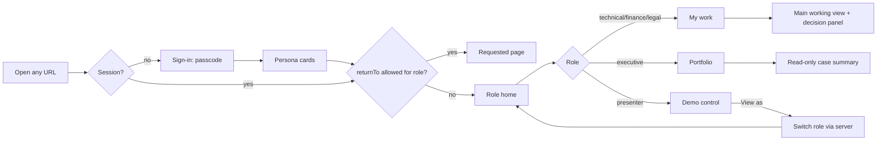

# Altivane Asset Transitions: Role Workspaces

> **role-workspaces** | Status: draft | Version: 0.2.0 | Last Updated: 2026-10-26

## Executive Summary

Today the demonstrator is a single unstyled page. A user signs in, picks a persona, and sees one hard-coded case. To try another role, they must sign out and sign in again. It does not look or behave like software anyone would use every day.

This PRD replaces that page with an enterprise application shell branded for the fictional lessor **Altivane Aviation Capital**. The product name shown is "Asset Transitions". The look follows Fluent 2 (Microsoft 365 / Dynamics 365). Each simulated reviewer lands in a workspace that mirrors their daily job:

- The technical reviewer works a findings queue.
- The finance reviewer works reserve worksheets.
- The legal reviewer works an obligations register.
- The executive gets a read-only portfolio overview.
- The presenter gets a demo control centre.

All roles share one navigation model, a role switcher, light and dark themes, and consistent tables, status badges and empty, loading and error states.

The server stays authoritative. The shell renders server projections and submits the commands that already exist. Two new read-only endpoints feed the role homes: a cross-case worklist and an executive portfolio. No authority, label or decision rule moves to the browser.

The release horizon is the next demo cycle. The primary success metric is that a first-time viewer can reach each role's main working view from sign-in in at most two clicks (GOAL-001).

---

## Research Readiness

Research status: `Required`

Rationale: The UI uses Fluent UI React v9 (`@fluentui/react-components`). It inserts `<style>` elements at runtime, which the current CSP `style-src 'self'` blocks. Whether a per-response nonce is enough depends on third-party package behaviour, so it was researched.

Facts read in this repository:

- The CSP is one constant on every response (`backend/AirlineDemo.Api/Security/TransportSecurity.cs`), and `index.html` is served as a static file (`backend/AirlineDemo.Api/StaticClient.cs`).
- The per-case read APIs exist: dashboard, technical reviews, reserve, obligations, requests, history and readiness.
- The dashboard queue projection is role-filtered (`CapabilityProjection.Build` keeps open items whose owner is the session role).
- The demo users and their case scopes are in `demo-users-v1.json`.

The brand colours were sampled from the user-supplied brand slide. Their contrast ratios were computed and are recorded in DD-003.

Research artifact: `docs/research/2026-10-26/role-workspaces-fluent-csp-research.md`.

Planning blockers: None

### Research Finding Dispositions

| Finding | Evidence | Disposition |
|---|---|---|
| Griffel's `createDOMRenderer` passes `styleElementAttributes` (including `nonce`) to every `<style>` it creates | Research E-1, E-2 | Adopted: DD-010, FR-016 |
| The `FluentProvider` theme `<style>` tag uses the same renderer attributes | Research E-3 | Adopted: DD-010, AC-022 |
| `@fluentui/react-components` 9.74.11 supports React 19 and is MIT licensed | Research E-4 | Adopted: DD-002, NFR-006 |
| `index.html` is a static file today | Research E-5 | Adopted: FR-016 serves it per response; AC-020 |
| Three tests pin the CSP literally | Research E-7 | Adopted: AC-020 names the one assertion that changes; the constant stays for non-document responses |

---

## Product Context

The demonstrator presents aircraft return readiness. Fragmented records and lease information are triaged into evidence-backed findings. Simulated technical, finance and legal reviewers then act on them, and an executive follows progress. The functional flows exist and are tested, as defined in `aircraft-return-readiness`, `aircraft-case-pack`, `aircraft-source-systems` and `aircraft-hangar-3d`.

Audiences judge the product by how it feels. Professionals evaluating it expect what they use at work: a branded application frame, a left navigation, a "my work" queue, dense sortable tables, a record view with a decision panel, and fast switching between personas during a demo. The current page undermines the message on the brand slide, "Making Transitions Predictable — From Aircraft Records to Asset Confidence".

---

## Users and Personas

All reviewer roles are simulated. Decisions affect synthetic workflow state only (unchanged from `aircraft-return-readiness`).

| Persona (fixture user / role) | Daily job in the workspace | Home page | Main working view |
|---|---|---|---|
| Technical reviewer (`reviewer` / `technical-reviewer`) | Work through open findings and evidence requests across aircraft. | My work: the findings queue | Finding workspace: evidence on the left, finding and decision panel on the right |
| Finance reviewer (`fin-1` / `finance-reviewer`) | Check reserve calculations, chase blocked or stale inputs, decide on drafts. | My work: the reserves worklist | Reserve worksheet with inputs, discrepancies, draft amount and decision panel |
| Legal reviewer (`legal-1` / `legal-reviewer`) | Review eligible obligations and notice drafts. | My work: the obligations register | Obligation record with clause references, notice draft (text) and decision panel |
| Executive observer (`exec-1` / `executive`) | Know where each aircraft transition stands and who owns the next decision. | Portfolio | Read-only case summary with activity timeline |
| Presenter (`presenter` / `presenter`) | Run the demo: reset cases, switch persona, follow the guided path. | Demo control centre | Any case view, plus the hangar |

---

## Design Decisions

| ID | Decision |
|---|---|
| DD-001 | Branding: the shell is branded "Altivane Aviation Capital", product name "Asset Transitions". It uses the logo and colours from the user-supplied brand slide. Altivane is a fictional company; no real customer branding is used. |
| DD-002 | Fluent 2 is implemented with Fluent UI React v9: `@fluentui/react-components` 9.74.11 and `@fluentui/react-icons` 2.0.344, both MIT, added to `frontend/package.json` with the lockfile. Components (Toolbar, Nav, DataGrid, Dialog, Menu, Toast, Badge, Field) come from the library; project CSS is limited to layout. The brand is applied as a Fluent theme (DD-003). |
| DD-003 | Brand colours, applied as overrides of `createLightTheme` and `createDarkTheme` in `frontend/src/theme/altivaneTheme.ts`, with contrast ratios computed on the stated surface (WCAG 2.2 relative luminance). Light theme: `--brand-navy #19223F` (text on `#F7F7F8`, 14.62:1); `--brand-green #639A5E` (non-text UI and large text only, 3.11:1); `--brand-green-text #3D7339` (green text, 5.29:1 on `#F7F7F8`); `--text-secondary #565C71` (6.2:1); `--surface-page #F7F7F8`; `--surface-card #FFFFFF`; `--accent-rule #71B06C`. Top bar: navy background `#19223F` with white text (15.65:1). Dark theme: `--surface-page #1B1F2B`, text `#E6E8EE` (13.42:1), green `#8CC487` (8.11:1). |
| DD-004 | Type, spacing, radii, elevation and focus indicators are Fluent's own theme tokens (`tokens.*` from `@fluentui/react-components`), unchanged. The font stack is Fluent's default (`"Segoe UI Variable", "Segoe UI", ...`); no web font is downloaded. |
| DD-005 | Role switching uses the server endpoint from #634 (`POST /api/auth/switch-user`). The browser never impersonates a role; the server issues the new session. |
| DD-006 | Client routing uses the History API (the server already serves the SPA for non-file paths). Client route guards are a usability aid only; every API call is still authorised by the server. |
| DD-007 | Role homes read two new server projections (FR-011, FR-012). Counts, ages, owners and labels are never computed in the browser. |
| DD-008 | Supersedes open stories #635 (header role switcher) and #636 (Fluent-style stylesheet). They are closed; their intent is in FR-003 and FR-002. #631, #632, #633 and #634 stay open and are prerequisites. |
| DD-009 | The existing 3D hangar is kept as the "Hangar" module inside the shell for all roles. Its behaviour is unchanged and governed by `aircraft-hangar-3d`. |
| DD-010 | The CSP for HTML document responses adds a per-response nonce to `style-src` (FR-016). This supersedes, for document responses only, the `style-src 'self'` of DD-028 in `aircraft-return-readiness`; every other response keeps that policy unchanged. `'unsafe-inline'` is not used: injected markup still cannot add styles. |

---

## Product Goals

GOAL-001: A first-time viewer reaches every role's main working view from sign-in in at most two clicks, in the next demo release.
Priority: MUST. KPI: click count measured on the release walkthrough (AC-018).

GOAL-002: The UI reads as one consistent enterprise product. Every page uses the shell, the token sheet and shared components, and both themes meet WCAG 2.2 AA contrast, in the next demo release.
Priority: MUST. KPI: token contract tests pass; release review checklist has no open item.

GOAL-003: A presenter can show all five personas in one session without re-entering the passcode or signing out, in the next demo release.
Priority: MUST. KPI: AC-004 passes; persona switch completes in at most 2 clicks.

---

## Functional Requirements

| ID | Requirement | Actor | Trigger | Expected outcome | AC | Goal |
|---|---|---|---|---|---|---|
| FR-001 | Application shell: a 48 px navy top bar shows the Altivane logo, the product name "Asset Transitions", case search (FR-010) and the user menu. A left navigation is 240 px wide and collapses to 48 px; its collapsed state is remembered. Breadcrumbs sit above the page content. | Any signed-in user | Any route | All authenticated pages render inside the shell | AC-001, AC-002 | GOAL-002 |
| FR-002 | Theme: `altivaneTheme.ts` exports `altivaneLightTheme` and `altivaneDarkTheme` (DD-003, DD-004), applied by one `FluentProvider` at the app root. The user menu offers Light, Dark and System. The choice is stored in `localStorage` key `altivane.theme` (values `light`, `dark` or `system`; any other value is treated as `system`). | Any user | Theme menu | `data-theme` on `<html>` matches the choice | AC-003 | GOAL-002 |
| FR-003 | Role switcher: the user menu shows the display name and role, and lists "Switch role" with every other fixture persona. Choosing one calls the #634 endpoint. On success the app navigates to that role's home. | Any signed-in user | User menu | New role active without the passcode | AC-004 | GOAL-003 |
| FR-004 | Sign-in: a branded split page. The left panel shows the brand tagline. The right panel has step 1 (passcode) and step 2 (persona cards with display name, role and a one-line job description from the Personas table). The last chosen user id is preselected from `localStorage` key `altivane.lastUserId`; only the id is stored, never the passcode. | Unauthenticated user | Opening any route | Signed in and taken to the target route (FR-005) | AC-005 | GOAL-001 |
| FR-005 | Routing and deep links: routes `/work`, `/portfolio`, `/demo`, `/cases`, `/cases/:caseId/:tab`, `/hangar`. An unauthenticated visit is sent to sign-in with `returnTo`, and after sign-in the user returns there if the route belongs to their role. Otherwise they land on their role home. `returnTo` is accepted only as a same-origin path (contract table in AC-006). | Any user | Navigation | Correct page or role home | AC-006, AC-007 | GOAL-001 |
| FR-006 | Role navigation: the left navigation shows exactly the items in the role navigation table (section "Role navigation"). Opening a route not in the role's set shows "This page is not part of your workspace" with a link to the role home. | Any signed-in user | Navigation | Only role-relevant items | AC-007 | GOAL-001 |
| FR-007 | Technical workspace: My work is a table of the worklist items (FR-011) with columns Item, Aircraft case, Capability, Age, Status (badge with the backend label), filterable by case and capability and sortable by age. A row opens the finding workspace at `/cases/:caseId/findings`. That page is a split view: the evidence list and request status on the left, the finding and the decision panel on the right. The decision panel offers only `allowedDecisions` from the case dashboard. Previous and Next buttons move through the worklist order. | Technical reviewer | Home or row click | Reasoned decision recorded through the existing technical-review command | AC-008, AC-009 | GOAL-001 |
| FR-008 | Finance workspace: My work lists reserve worklist items. The reserve worksheet (`/cases/:caseId/reserve`) shows the reserve inputs table (input, value, source, freshness, status), highlights blocked or stale inputs, shows the draft amount and the decision panel, and carries the permanent banner "Draft only — no invoice is issued." | Finance reviewer | Home or row click | Decision recorded through the existing reserve decision command | AC-010 | GOAL-001 |
| FR-009 | Legal workspace: My work lists obligation worklist items. The obligation record (`/cases/:caseId/obligations`) shows the obligation table, the selected obligation's clause references, and the notice draft rendered as text (never HTML), with the decision panel and the banner "Simulated — no notice is sent." | Legal reviewer | Home or row click | Decision recorded through the existing legal decision command | AC-011 | GOAL-001 |
| FR-010 | Case search: the top-bar search filters the cases in the session scope by case id prefix (case-insensitive). Enter, or choosing a result, opens `/cases/:caseId/overview`. It never queries cases outside the session scope. | Any signed-in user | Typing in search | Matching scoped cases listed | AC-012 | GOAL-001 |
| FR-011 | Worklist API: `GET /api/v1/workspace/worklist` returns the open items owned by the session role across every case in the session scope (contract in section "API contracts"). | Shell, for technical, finance, legal and presenter roles | Loading My work | Server-derived cross-case queue | AC-013, AC-014 | GOAL-001 |
| FR-012 | Portfolio API: `GET /api/v1/workspace/portfolio` returns one row per case in the session scope with open-item counts per owner role, the next decision owner, the oldest open-item age and the latest activity (contract in section "API contracts"). | Shell, for executive and presenter roles | Loading Portfolio | Server-derived portfolio | AC-015, AC-016 | GOAL-001 |
| FR-013 | Executive portfolio page (`/portfolio`): KPI tiles (cases in scope, cases with open items, total open items, oldest open-item age) and a portfolio table (case, open items per role, next decision owner, oldest age, latest activity). Rows open a read-only case summary. No decision controls are rendered anywhere for the executive. | Executive, presenter | Home | Read-only overview | AC-016, AC-017 | GOAL-001 |
| FR-014 | Demo control centre (`/demo`): lists the presenter's cases with the existing reset actions, a "View as" button per persona (uses FR-003), and a guided-path checklist of links into each role's main working view. | Presenter | Home | Demo run from one page | AC-004, AC-018 | GOAL-003 |
| FR-015 | Shared states: every data region has a loading skeleton, an empty state with a one-line explanation, and an error banner. A 401 response returns the user to sign-in with `returnTo`. A 403 shows "You do not have permission for this action." A 404 on a case shows "Case not found or not in your scope." A 503 shows "Service temporarily unavailable" with a Retry button. After a decision, a toast ("Decision recorded") is announced through `role="status"`. | Any user | API responses | Consistent feedback | AC-019 | GOAL-002 |
| AC-020 | Through the application test host with a test `wwwroot` whose `index.html` contains the FR-016 meta tag: `GET /`, `GET /index.html` and `GET /work` each return the FR-016 CSP with a nonce of exactly 24 Base64 characters, a body whose `csp-nonce` meta equals that nonce, and `Cache-Control: no-store`; two requests to `/` return different nonces. Negative: `GET /api/health` and a static asset return exactly `TransportSecurity.ContentSecurityPolicy` with no `nonce-`. `StaticClientTests.AssertSecurityHeaders` is updated in this story to expect the FR-016 form for document responses; `TransportSecurityTests.Csp_matches_dd_028` and `Csp_matches_hangar_baseline` stay unchanged and pass. | FR-016, NFR-003 |
| AC-021 | Client nonce contract (unit test over the function that reads the meta): meta `content="q83vEjRWeJq83vEjRWeJqw=="` → renderer attributes `{ nonce: "q83vEjRWeJq83vEjRWeJqw==" }`; `content="__CSP_NONCE__"` → `{}`; `content=""` → `{}`; no meta → `{}`. Other inputs are out of scope. Negative: the `__CSP_NONCE__` case never yields a `nonce` attribute. | FR-016 |
| AC-022 | A unit test renders the signed-in shell through the app root with nonce `test-nonce`; every `<style>` element in the document has `nonce="test-nonce"` and at least one exists. Negative: the same check over a render with a renderer without a nonce reports the unmarked `<style>` elements and fails. | FR-016, NFR-003 |
| FR-016 | Nonce CSP for documents: for `/`, `/index.html` and the client-route fallback, the server generates a nonce of 16 bytes from a cryptographic random generator, Base64 encoded, new for every response. It sends `Content-Security-Policy: default-src 'self'; script-src 'self'; style-src 'self' 'nonce-<nonce>'; img-src 'self' data: blob:; worker-src 'self'; object-src 'none'; frame-ancestors 'none'; base-uri 'none'` and `Cache-Control: no-store`, and replaces the token `__CSP_NONCE__` in `<meta name="csp-nonce" content="__CSP_NONCE__">` of `index.html` with the same nonce. All other responses keep `TransportSecurity.ContentSecurityPolicy` exactly. The client reads the meta value and creates the Griffel renderer with `createDOMRenderer(document, { styleElementAttributes: { nonce } })` inside a `RendererProvider`; a missing meta, an empty value or the literal `__CSP_NONCE__` (Vite dev server) gives a renderer without a nonce. | Browser loading the app | Any document request | Fluent styles apply; other inline styles stay blocked | AC-020, AC-021, AC-022 | GOAL-002 |

### Role navigation

| Navigation item (route) | technical-reviewer | finance-reviewer | legal-reviewer | executive | presenter |
|---|---|---|---|---|---|
| My work (`/work`) | yes | yes | yes | no | yes |
| Portfolio (`/portfolio`) | no | no | no | yes (home) | yes |
| Demo control (`/demo`) | no | no | no | no | yes (home) |
| Cases (`/cases`) | yes | yes | yes | yes | yes |
| Hangar (`/hangar`) | yes | yes | yes | yes | yes |

Role home: technical, finance and legal go to `/work`, executive to `/portfolio`, presenter to `/demo`.
Case tabs (`/cases/:caseId/:tab`):

| Tab | technical-reviewer | finance-reviewer | legal-reviewer | executive | presenter |
|---|---|---|---|---|---|
| `overview` | yes | yes | yes | yes | yes |
| `findings` | yes | no | no | read-only | yes |
| `reserve` | no | yes | no | read-only | yes |
| `obligations` | no | no | yes | read-only | yes |
| `history` | yes | yes | yes | yes | yes |

"read-only" means the tab renders the server data the role can already read, with no decision panel. If the server answers 403 for that role, the tab shows the FR-015 permission message instead.

### API contracts

Both endpoints are `GET`, read-only, and require a valid session cookie. They never return a case outside `session.User.CaseScopes`. A scoped case for which the store has no state is listed in `unavailableCaseIds` and contributes nothing else.

| Request | Response |
|---|---|
| No session cookie, or an expired session | `401`, the existing unauthenticated body |
| Worklist with role `executive` | `403` `{"error":"Role not permitted."}`; no case store read |
| Portfolio with role `technical-reviewer`, `finance-reviewer` or `legal-reviewer` | `403` `{"error":"Role not permitted."}`; no case store read |
| `GET /api/v2/workspace/worklist` (unsupported version) | `404` |
| Worklist, permitted role | `200` `{"contractVersion":1,"items":[{"caseId","itemId","capabilityId","state","owner","ageSeconds","label"}],"unavailableCaseIds":[...],"truncated":bool}` |
| Portfolio, permitted role | `200` `{"contractVersion":1,"cases":[{"caseId","openItemsByRole":{"technical-reviewer":n,"finance-reviewer":n,"legal-reviewer":n,"presenter":n},"nextDecisionOwner":string|null,"oldestOpenAgeSeconds":n|null,"latestActivity":{"sequence","actor","label","outcome"}|null}],"unavailableCaseIds":[...]}` |

The worklist items are exactly the `Queue` entries `CapabilityProjection.Build(caseId, role, state, now)` produces for each scoped case. They are ordered by `ageSeconds` descending, then `caseId` ascending, then `itemId` ascending. At most 200 items are returned; when more exist, `truncated` is `true`. `nextDecisionOwner` is the owner of `CapabilityProjection.NextDecisionItem` over all open items of the case, or `null` when there are none. Portfolio rows follow the order of the scopes in the fixture. The portfolio returns counts and owner roles only; it never returns item ids, evidence, drafts or decision text.

---

## Non-Functional Requirements

### Performance and Capacity

NFR-001: Each workspace API answers within 500 ms at the 95th percentile for a session with 5 scoped cases and up to 200 open items per case, in an in-memory store test. The shell's first meaningful paint after sign-in is within 2 s on the deployed Consumption replica. Verified by review on the release walkthrough.

### Reliability and Resilience

NFR-002: A failing data region shows its FR-015 error state without blanking the shell or other regions.

### Security

NFR-003: The server enforces session, role and scope on both new endpoints (AC-013 to AC-016). The browser holds no authority: navigation guards, hidden buttons and themes are usability features only. Document responses use the nonce CSP of FR-016 and every other response keeps the existing CSP. Every runtime `<style>` element carries the response nonce (AC-022); `'unsafe-inline'` is never used and no `style` attribute is written into HTML markup. Protected text (notice drafts, findings, labels) is rendered as text. `returnTo` is validated as in AC-006. The anti-forgery header is sent on every state-changing command, as today.

### Privacy

NFR-004: Only synthetic fixture data is shown. `localStorage` holds only `altivane.theme`, `altivane.lastUserId` and `altivane.navCollapsed`; never a passcode, session id or anti-forgery token.

### Scalability and Elasticity

NFR-005: No change; single Consumption replica as deployed.

### Maintainability and Operability

NFR-006: Colours, spacing, radii, shadows and fonts are referenced only through Fluent `tokens.*`. Colour literals appear only in `altivaneTheme.ts`; a unit test fails when another file under `frontend/src` (`.ts`, `.tsx`, `.css`) contains a colour literal (`#` followed by 3, 4, 6 or 8 hex digits, `rgb(`, `hsl(`). The only new runtime npm dependencies are the two packages in DD-002, at the pinned versions.

### Observability

NFR-007: No new telemetry. The new endpoints use the existing request logging; they log no item content.

### Usability and Accessibility

NFR-008: WCAG 2.2 AA. Every interactive element is reachable and operable by keyboard, with Fluent's visible focus indicator (at least 3:1). Tables use `<th scope>` and `aria-sort`. The navigation is a `<nav aria-label="Primary">`. Toasts use `role="status"`. Text contrast is at least 4.5:1 and non-text contrast at least 3:1 in both themes, proven by the theme contract test (AC-003), not by browser pixel sampling. `prefers-reduced-motion` disables transitions (Fluent motion honours it).

### Compatibility and Interoperability

NFR-009: Current Edge, Chrome, Safari and Firefox on desktop at 1280 px width and above. At 768–1279 px the navigation starts collapsed. A mobile layout is out of scope.

### Portability

NFR-010: No change to hosting.

---

## Constraints

| ID | Constraint | Source | Boundary | Non-negotiable because | Category | Impact |
|---|---|---|---|---|---|---|
| CON-001 | `script-src` stays `'self'` and `'unsafe-inline'` is forbidden in every directive; only document responses get a style nonce (DD-010) | `TransportSecurity.cs`, DD-028 of `aircraft-return-readiness`, product owner decision of 2026-10-26 | Technology | Keeps the reviewed injection protection | Technical | Fluent's runtime styles are allowed only through the nonce |
| CON-002 | Server-derived labels, counts and allowed decisions; the client never substitutes them | `aircraft-return-readiness` Scope Boundaries | Design | Existing AC-020 | Technical | Workspaces render projections only |
| CON-003 | Synthetic data only; Altivane is fictional | `aircraft-return-readiness` Security Notes | Scope | Privacy baseline | Organizational | Brand assets are demo-only |

---

## Process Models

---

## Acceptance Criteria

| ID | Criterion | Covers |
|---|---|---|
| AC-001 | Given a signed-in session, when any authenticated route renders, then the top bar contains the logo image with alt "Altivane Aviation Capital", the text "Asset Transitions", the search box and the user menu. A `<nav aria-label="Primary">` and a breadcrumb `<nav aria-label="Breadcrumb">` are present. Negative: on the sign-in page, no Primary nav is rendered. | FR-001 |
| AC-002 | Given the navigation is collapsed, when the page reloads, then it is still collapsed (`altivane.navCollapsed` = `true`). Negative: a stored value other than `true` or `false` renders the navigation expanded. | FR-001 |
| AC-003 | A unit test imports `altivaneLightTheme` and `altivaneDarkTheme`, checks every DD-003 colour override, and computes contrast for `colorNeutralForeground1`, `colorNeutralForeground2` and `colorBrandForeground1` on `colorNeutralBackground1` (≥ 4.5:1) and `colorBrandBackground` on `colorNeutralBackground1` (≥ 3:1) in both themes. A theme choice sets `data-theme` and persists. Negative: a stored theme `purple` is treated as `system`; a file other than `altivaneTheme.ts` containing a colour literal fails the NFR-006 test. | FR-002, NFR-006, NFR-008 |
| AC-004 | Given the presenter is signed in, when they choose "Switch role → Finance reviewer" (user menu) or "View as" on the demo page, then `POST /api/auth/switch-user` is called with the anti-forgery header and the app shows `/work` for the finance reviewer, without the passcode page. Negative: when the endpoint answers 403, the role is unchanged and the FR-015 permission message is shown. | FR-003, FR-014 |
| AC-005 | Given no session, the sign-in page shows the passcode step and then one card per fixture persona, with display name, role and job line. The card matching `altivane.lastUserId` is preselected. Negative: after sign-in, `localStorage` contains no key whose value equals the passcode. | FR-004, NFR-004 |
| AC-006 | `returnTo` contract (unit test over the validation function and one sign-in flow): `/cases/cp-case-a/findings` → accepted; `/work?x=1` → accepted; `//evil.example/x` → rejected (role home); `https:` + `//evil.example` → rejected; `/\evil.example` → rejected; `javascript:alert(1)` → rejected; empty → role home. Other inputs are out of scope. | FR-005, NFR-003 |
| AC-007 | Given the finance reviewer, the Primary nav lists exactly My work, Cases and Hangar. Visiting `/portfolio` shows "This page is not part of your workspace" with a link to `/work`. Negative: the executive's nav contains no My work item, and `/work` shows the same message. | FR-005, FR-006 |
| AC-008 | Given a worklist with items across two cases, the technical My work table lists them in server order with the backend label as the badge text, and filtering by case shows only that case's rows. Negative: an item whose `label` is missing or unrecognised shows the badge "Unknown". | FR-007, CON-002 |
| AC-009 | Given the finding workspace, the decision panel lists exactly the dashboard's `allowedDecisions`. Submitting posts to `/api/cases/:caseId/technical-reviews` with `X-CSRF-Token`, then the toast "Decision recorded" appears and the queue is re-read from the server. Negative: when `allowedDecisions` is empty, no decision form is rendered. | FR-007, FR-015 |
| AC-010 | Given the reserve worksheet, blocked and stale inputs carry the badges "Blocked" and "Stale" exactly as the server reports them, and the banner "Draft only — no invoice is issued." is always present. Negative: a missing input value renders "Not available", never `0`. | FR-008 |
| AC-011 | Given an obligation whose notice draft contains `<b>x</b>`, the draft is shown as the literal text `<b>x</b>`, and the banner "Simulated — no notice is sent." is present. Negative: no `<b>` element is created from draft text. | FR-009, NFR-003 |
| AC-012 | Given scopes `["cp-case-a","cp-case-b"]`, typing `CP-CASE-B` lists only `cp-case-b`, and Enter opens `/cases/cp-case-b/overview`. Negative: typing `case-001` lists nothing and makes no request to `/api/cases/case-001`. | FR-010 |
| AC-013 | Worklist through the application test host, with two seeded scoped cases and one case outside the scope: the response contains only open items owned by the session role from the two scoped cases, in the contract order, and `contractVersion` is `1`. Negative: an item of the out-of-scope case, and an open item owned by another role, are absent. | FR-011, NFR-003 |
| AC-014 | Worklist limits and errors: with 201 eligible items, 200 are returned and `truncated` is `true`; with exactly 200, `truncated` is `false`. A scoped case with no state appears only in `unavailableCaseIds`. Negative: the executive gets `403` `{"error":"Role not permitted."}`; no session gets `401`; `/api/v2/workspace/worklist` gets `404`. | FR-011 |
| AC-015 | Portfolio through the application test host, for the executive with three scoped cases: one row per case in fixture order with the correct per-role counts, `nextDecisionOwner` equal to the owner of the oldest open item (ties broken by lowest item id), and `null` owner and age for a case without open items. Negative: a technical reviewer gets `403`; the response JSON contains no `itemId` property. | FR-012, NFR-003 |
| AC-016 | Given a portfolio response, the executive page shows four KPI tiles whose values equal: the row count; the rows with any open item; the sum of all counts; the maximum `oldestOpenAgeSeconds`, formatted as days and hours. Negative: with zero rows, the tiles show `0`, `0`, `0` and "—", and the empty state reads "No cases in your scope." | FR-012, FR-013 |
| AC-017 | Given the executive opens any case tab, no element with role `button` labelled as a decision, and no decision `<form>`, is rendered. Negative: the same tab for the technical reviewer renders the decision panel. | FR-013 |
| AC-018 | Walkthrough on the deployed app: for each of the five personas, the main working view is reached from the sign-in persona card in at most two clicks. Verified by review. Negative: if any persona needs three or more clicks, the release checklist item stays open. | FR-014, GOAL-001 |
| AC-019 | For a data region whose request answers 401, 403, 404 or 503, the region shows exactly the FR-015 text, a 401 navigates to sign-in with the current path as `returnTo`, and a 503 offers Retry, which repeats the request once per click. Negative: a 403 in one region leaves other regions rendered. | FR-015, NFR-002 |

---

## Traceability Matrix

### Feasibility Candidate Disposition

No feasibility handoff was consumed.

### FR-to-AC Coverage

| FR | AC |
|---|---|
| FR-001 | AC-001, AC-002 |
| FR-002 | AC-003 |
| FR-003 | AC-004 |
| FR-004 | AC-005 |
| FR-005 | AC-006, AC-007 |
| FR-006 | AC-007 |
| FR-007 | AC-008, AC-009 |
| FR-008 | AC-010 |
| FR-009 | AC-011 |
| FR-010 | AC-012 |
| FR-011 | AC-013, AC-014 |
| FR-012 | AC-015, AC-016 |
| FR-013 | AC-016, AC-017 |
| FR-014 | AC-004, AC-018 |
| FR-015 | AC-009, AC-019 |
| FR-016 | AC-020, AC-021, AC-022 |

Coverage: 16 / 16 = 100%.

### FR-to-GOAL Alignment

| FR | Goal |
|---|---|
| FR-001, FR-002, FR-015, FR-016 | GOAL-002 |
| FR-003, FR-014 | GOAL-003 |
| FR-004 to FR-013 | GOAL-001 |

Coverage: 16 / 16 = 100%.

---

## MVP and Release Framing

Everything above is in the first release. Prerequisites already filed: #631 and #632 (case seeding), #633 (scoped case loading), #634 (switch-user endpoint).

The suggested delivery order lets independent slices build in parallel; the planner decides the final stories:

1. The nonce CSP and Fluent packages with the theme (FR-016, FR-002), the worklist API (FR-011) and the portfolio API (FR-012), all independent.
2. The shell, routing and navigation (FR-001, FR-005, FR-006, FR-015), then sign-in (FR-004) and the role switcher (FR-003).
3. The role workspaces (FR-007, FR-008, FR-009, FR-013, FR-014) and search (FR-010), in parallel.

Logo asset: a person commits the brand logo as `frontend/public/brand/altivane-logo.svg` (Merge: person, a brand asset). Until then the shell shows a text wordmark "ALTIVANE" in navy with the alt text from AC-001.

Out of scope:
- A mobile layout.
- Aircraft registration and type metadata on cases (cases are labelled by case id).
- Notifications.
- Real identity providers.
- Any change to decision rules, labels or the hangar behaviour, and any CSP change beyond FR-016.

---

## Success Metrics

| Metric | Baseline | Target | Source | Goal |
|---|---|---|---|---|
| Clicks from persona card to main working view | 2 or more, plus a sign-out to change persona | ≤ 2 for every persona | AC-018 walkthrough | GOAL-001 |
| Pages outside the shell or with colour literals | All pages | 0 | AC-001, AC-003 tests | GOAL-002 |
| Persona switches needing the passcode | 1 per switch | 0 | AC-004 | GOAL-003 |

---

## Risks and Assumptions

### Key Assumptions

| ID | Assumption | Evidence status | Impact if false | Mitigation | Source |
|---|---|---|---|---|---|
| AS-001 | #634 delivers `POST /api/auth/switch-user` returning the new session and anti-forgery token | Untested (open story) | FR-003 is blocked | Stories for FR-003 depend on #634 | Issue #634 |
| AS-002 | Seeded cases (#631, #632) give every role at least one open item | Partially supported | Empty homes during the demo | Empty states (FR-015); presenter reset | Issues #631, #632 |

### Risk Register

| Risk | Probability | Impact | Mitigation |
|---|---|---|---|
| Rebuilding the UI breaks existing frontend tests that assert old markup | High | Medium | Each story lists the existing tests it updates (repo rule); behaviour assertions are kept |
| Stories exceed the size limit | Medium | Medium | Split per workspace; API contract tests as separate tests-only stories where needed |
| A cached `index.html` reuses a nonce | Low | Medium | `Cache-Control: no-store` on document responses (AC-020) |
| Fluent adds bundle size to first load | Medium | Low | Import components individually; NFR-001 first-paint budget checked on the walkthrough |

---

## Glossary

| Term | Definition |
|---|---|
| Role home | The page a role lands on after sign-in or role switch |
| Worklist | Open items owned by the session role across its scoped cases (FR-011) |
| Main working view | The page where a role does its primary task (decision panel or portfolio) |

---

## Sign-Off

### Approval Checklist

- Product Owner: approves by merging this PRD.

Approval date: on merge.

### Waivers

None.

### Handoff Readiness

Research status `Required`, artifact committed; planning blockers `None`; 16 FR, 10 NFR, 3 CON, 22 AC; FR-to-AC 100%, FR-to-GOAL 100%.

---

## Disclaimer

All companies, aircraft, cases and people are fictional. Simulated decisions are not technical, financial or legal approvals.

---

## Document Metadata

- Template Version: 1.0.0.
- Canonical Template: `requirements-author/templates/prd/prd-full.md`.
- License: CC-BY 4.0 (Microsoft HVE-Core).
- Attribution: Microsoft HVE-Core Team.
